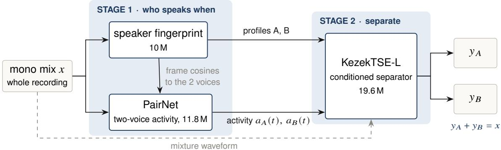
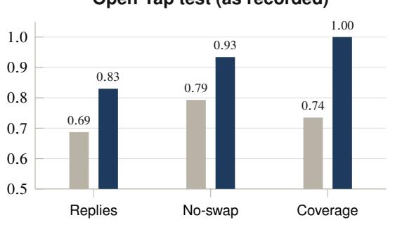
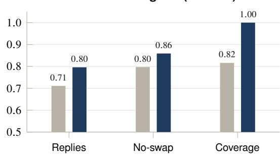

# KEZEK: Splitting Mono Two-Person Conversations into Per-Speaker Tracks for Full-Duplex Dialogue Data

Bagzhan Karl

Alizhan Karl

bagzhankarl@manifestro.io

alizhankarl@manifestro.io

Manifestro

Code · Weights · Demo

## Abstract

Full-duplex spoken dialogue models learn turn-taking, overlaps and backchannels from conversations recorded with one channel per speaker, but most available conversational audio is a single mono mix. We present Kezek, a model that turns a mono recording of exactly two people into one track per person with the original length and timing; overlaps and short replies (“yeah”, “mm-hm”) stay on the track of the person who said them. Kezek decides who speaks when and who is who once for the whole recording (stage 1: a two-voice activity model guided by a speaker fingerprint trained to be insensitive to phase), and a conditioned time-domain separator only carries out that decision (stage 2), with outputs that always sum to the input. Standard separation metrics miss the failures that matter for dialogue data, so we report short-reply retention, leakage onto the other person’s solo, channel swaps and coverage. Against the open pipeline pyannote → DialogueSidon on the same recordings, Kezek keeps more short replies (0.83 vs. 0.69 on Open Yap test; 0.80 vs. 0.71 over the other’s speech on unseen telephone speech from CallHome English), mostly because it returns the whole recording while the external pipeline drops part of it (on the audio both return, reply retention is about the same: 0.859 vs. 0.865 on Open Yap); it also leaks less, swaps channels less often, and runs 4–5 times faster (about 230 hours of audio per GPU-hour). We also report negative results and an ideal-mask ceiling that locate the remaining gap: quiet replies under a louder voice. Code and weights are released under permissive licences.

## 1 Introduction

Full-duplex spoken dialogue models listen and speak at the same time [3, 14]. To learn when to interrupt, when to back of and when to say “mm-hm” without taking the turn, they are trained on conversations where each participant has a separate channel. Such recordings are scarce. Most conversational audio (podcasts, interviews, call recordings) exists only as a single mono mix.

Turning a mono mix into per-speaker tracks is usually done with a cascade: a diarization system decides who speaks when, and a separation or restoration model produces the tracks [12]. For dialogue data, three failure modes of such cascades matter more than average separation quality:

1. A channel swap puts a stretch of one person’s speech on the other person’s track, and the dialogue model learns the wrong turn-taking.

2. Short replies get lost. Backchannels are short, quiet and often overlap the other speaker; they are exactly what a full-duplex model needs to learn, and exactly what diarization tends to drop.

3. Leakage, the other person’s voice audible on a track, teaches the model to treat its own channel as containing both speakers.

A data-preparation tool must also return the whole recording with the original timing, and it must be fast enough to process tens of thousands of hours.

## Contributions

• A two-stage design in which who is who is decided once for the whole recording and a conditioned separator only executes that decision, with an exact mixture-consistency constraint (Section 4).

• An evaluation protocol for dialogue-data separation: short-reply retention over speech and in pauses, leakage, per-recording channel swaps and coverage, applicable both with reference tracks and with utterance-level annotation only (Section 3).

• Two practical findings: energy-based activity labels of close-talk recordings mark the other speaker’s crosstalk as speech, and fixing this with word-gated labels removes most channel swaps; and a raw-audio speaker fingerprint becomes competitive on conversational speech only once it is trained to ignore phase (Section 5).

• A comparison with the open pipeline pyannote → DialogueSidon on Open Yap test and on unseen telephone speech, plus negative results and an ideal-mask ceiling that locate the remaining gap (Sections 6–7).

## 2 Related work

Speaker diarization. End-to-end neural diarization with a powerset output [16] underlies pyannote, the most widely used open diarization toolkit. Target-speaker voice activity detection (TS-VAD) [11] conditions activity estimation on speaker profiles and handles overlap well. Both decide activity in local windows and link windows by clustering speaker embeddings such as ECAPA-TDNN [4]. A linking error is a channel swap.

Speech separation and target-speaker extraction. Time-domain masking networks such as Conv-TasNet [10] and time–frequency models such as TF-GridNet [20] separate overlapping speech with high fidelity on synthetic mixtures. Target-speaker extraction [21] conditions the separator on an enrollment of the target voice, often through FiLM [15]. Our separator is a Conv-TasNet-style model conditioned on activity hints and on profiles of both speakers.

Data for full-duplex dialogue models. dGSLM [14] and Moshi [3] are trained on two-channel conversations. DuplexChat [12] builds such data from podcasts with a cascade of pyannote diarization and the generative restoration model DialogueSidon [13]; channel swaps and short replies are not measured there. We use that cascade as our external baseline.

## 3 Measuring dialogue-data separation

Task. Input: a mono recording at 16 kHz of a conversation between exactly two people, of any length, with no enrollment sample. Output: two tracks ��, �� of the same length and timing, each containing one person, and a manifest with per-window confidence. Overlaps must be split, and every short reply must be on the track of the person who produced it.

Metrics. Track order is fixed once per recording (the better of the two permutations over the whole recording), as a downstream user would get it.

• Short replies are utterances shorter than 1 s. A reply is kept if its energy on the speaker’s own track is within −6 dB of the reference. We report replies over the other person’s speech and in pauses separately; those over speech are the hard case (about two thirds of all replies in Open Yap).

• Leakage is the energy on a track during the other person’s solo, relative to that person’s energy (lower is better).

• The no-swap rate is the share of recordings with no window (10 s) assigned to the wrong person.

  
Figure 1. The Kezek pipeline. Stage 1 decides activity and identity once for the whole recording; stage 2 separates under that decision in 8 s chunks and its outputs always sum to the input.

• Coverage is the share of the input duration returned; anything a system drops counts as lost.

• Overlap SI-SDRi [8] is measured on frames where both speak, for systems whose output is sample-aligned with the input; for generative outputs it is not comparable.

• Speed is hours of audio processed per GPU-hour.

All energy-based metrics fit one gain per output track on that person’s solo frames, the same rule for every system, so that generative systems that change the level are not penalised. The energy criterion for replies is lenient on its own: the unprocessed mixture copied to both tracks keeps 0.99 of replies (Section B), because it keeps everything. Reply retention is therefore meaningful only read together with leakage, and every table here reports both.

Present and audible replies. The analysis of quiet replies (Section 7) uses a stricter criterion. A reply counts as kept only if it is present: the projection of the track onto the reply’s reference has a coeficient of at least 0.5 (−6 dB); and audible: the projected reply energy is at least the energy of the rest of the track over the reply interval (0 dB). Under this criterion the reference tracks score 1.00, silence 0, and the unprocessed mixture 0.40 on replies over the other’s speech.

Without reference tracks. For corpora with only utterance-level annotation (CallHome), a reply over speech counts as kept when its track stands at least 6 dB above the level that leaks onto the same track during the other’s solo within ±5 s. Two sanity systems bound the scale: gated (the mixture switched by the annotation) scores 1.00, and mix (the mixture on both tracks) scores 0.17 on replies over speech and 0 dB leakage.

## 4 Method

## 4.1 Overview

Earlier single-model designs that received a short window and had to decide by themselves whether the target was present either suppressed a speaker on real audio or collapsed into silence. Kezek therefore splits the problem: stage 1 decides activity and identity for the whole recording; stage 2 separates, given that decision (Figure 1).

## 4.2 Speaker fingerprint

A 10.1 M-parameter speaker embedding on raw 16 kHz audio: a convolutional front end (strides 5–4–4–4, one frame per 20 ms, learned log compression), a Conformer [5] (6 layers, 256-d), attentive statistics pooling and a 192-d output. It replaces ECAPA-TDNN [4] and runs 4.6× faster (29 539× vs. 6 427× real time).

Training. AAM-softmax (margin 0.2, scale 30) over 8 961 people from Libri-Light, VoxPopuli and Open Yap train, crops of 1–3 s. Three details target conversations. Each person is also present as “siblings” at speed factors 0.92 and 1.08, and these copies count as diferent classes, so the embedding must separate voices that difer only slightly. A triplet term passes the anchor and a confusable partner (a sibling or the nearest class, re-mined every 1 000 steps) through the same recording chain and the positive through a diferent one, so that the channel cannot be used as an identity cue. The recording chain includes a telephone band of random shape and random all-pass cascades (1–4 second-order sections, 80–4000 Hz) on 60% of crops; without the latter, the raw-waveform network was sensitive to phase alone (Section 7.1).

## 4.3 Stage 1: PairNet

PairNet (11.8 M parameters) estimates the activity of the two people over the whole recording without window linking. Its encoder is the fingerprint’s raw-audio front end and Conformer, which produce, every 20 ms, a 128-d voice embedding and a speech/overlap estimate. A log-mel branch (80 bands, 20 ms hop, per-recording normalisation, two convolutions) is added to the encoder frames; its projection starts at zero, so it can be added to a trained model without changing its output.

The two voices are found once for the whole recording with the fingerprint (1.5 s windows, 0.25 s hop, two groups). Two Transformer decoder layers shared by both voices compare each frame with the two voices and output $a _ { A } ( t ) , a _ { B } ( t )$ ; the decoder also receives, per frame, the cosine of the fingerprint to each of the two voices. Inference runs on 10 s windows with 2 s of context. The identity of A and B is fixed by the recording-level voices, so no linking is needed.

The loss is a permutation-invariant binary cross-entropy on activity, a speech/overlap term and a voice term that pulls the found voices to the labelled ones. Frames of utterances shorter than 1 s are weighted ×4. Training uses 40 s crops: 70% from Open Yap train with word-gated labels (half of them centred on a real short reply) and 30% synthetic conversations from Libri-Light and Open Yap pieces with sibling voices, short replies and overlaps, all through the recording chain.

Stage 1 processes about 2 400 hours of audio per GPU-hour (the first version, without the log-mel branch and fingerprint cosines, about 15 900); the separator dominates the run time of the pipeline. Activity is thresholded at 0.3.

## 4.4 Stage 2: KezekTSE-L separator

A Conv-TasNet-style separator [10] (19.6 M parameters; encoder �=512, kernel 32, stride 16, bottleneck 256, hidden 768, 8 blocks × 3 repeats). Inputs: the mixture waveform; the activity hints $a _ { A } , a _ { B }$ added at the bottleneck; and the profiles of both speakers via FiLM [15] in every block. It predicts two masks with a softmax over sources and applies the projection

$$
y _ { i }  y _ { i } + { \frac { 1 } { 2 } } ( x - y _ { A } - y _ { B } ) , \qquad i \in \{ A , B \} ,\tag{1}
$$

so that $y _ { A } + y _ { B } = x$ exactly. Nothing in the input is lost; it can only be assigned to the wrong track.

Training targets. Reference for speaker �: that person’s speech after the same recording chain, plus background noise weighted by $a _ { i } / ( a _ { A } + a _ { B } )$ (0.5 when both are silent), so that the references always sum to the mixture. The loss on each track is

$$
\mathcal { L } = - \mathrm { S I S D R } _ { \mathrm { a c t } } + 0 . 5 \left| \Delta L \right| - 2 \mathrm { S I S D R } _ { \mathrm { o v l } } + \mathcal { L } _ { \mathrm { S T F T } } + \mathcal { L } _ { \mathrm { r e p l y } } + \mathcal { L } _ { \mathrm { l e a k } } ,\tag{2}
$$

with SI-SDR on the person’s active frames (capped at 30 dB), the level error $\Delta L$ in dB, a separate SI-SDR on overlap frames, a multi-resolution STFT L1 loss normalised by the mixture, the level error on short replies, and a penalty on energy during the other person’s solo (floored at −30 dB). The separate overlap term keeps overlaps from being swamped by the far more frequent solo frames; on its own it was not enough to make a separator learn overlaps from natural data, which led to the curriculum in Section 5. During training the activity hints are corrupted (edge shifts of ±40 ms, 10% of short segments dropped, 3% false alarms, occasionally all zero) so that the separator tolerates stage 1 errors.

Table 1. Efect of word-gated labels on the stage-1 activity model (prototype, WavLM features), Open Yap val, 113 conversations. Wrong track: share of replies assigned to the wrong person on real podcast dialogues, judged by speaker embedding against solo clips: 55 English replies from 10 podcasts and 14 Kazakh replies from 5 podcasts.
<table><tr><td rowspan="2">Labels</td><td colspan="2">Activity F1</td><td colspan="2">Short replies</td><td colspan="2">No-swap conv.</td><td rowspan="2">Wrong track</td></tr><tr><td>clean</td><td>rec</td><td>clean</td><td>rec</td><td>clean</td><td>rec EN/KK</td></tr><tr><td>Energy VAD</td><td>0.877</td><td>0.827</td><td>0.731</td><td>0.711</td><td>63.7%</td><td>54.0%</td><td>25.5% / 28.6%</td></tr><tr><td>Word-gated</td><td>0.952</td><td>0.943</td><td>0.896</td><td>0.862</td><td>97.3%</td><td>96.5%</td><td>3.6% / 0%</td></tr><tr><td>Reference activity</td><td>0.993</td><td>0.992</td><td></td><td></td><td>100%</td><td>100%</td><td></td></tr></table>

Inference. The separator runs over the whole recording (8 s chunks, 6 s hop). A pass restricted to the neighbourhood of overlaps kept fewer short replies at the same leakage.

## 5 How the models were trained

Corpora. Open Yap 1K [18] is the conversational corpus: English two-person conversations with a close-talk channel per speaker and word-level transcripts. We split it by speaker, 1 346 / 113 / 121 conversations (train / val / test), with no person in more than one split. Libri-Light [6], read speech of about 7 400 speakers, is used for synthetic overlaps and for the fingerprint; VoxPopuli [19] adds 1 558 speakers (116 h) for the fingerprint. MUSAN [17] and simulated room impulse responses [7] supply the noise, music and reverberation of the recording chain.

Recording chain. To match real recordings, training audio is passed, with probability 0.8, through reverberation, noise and music, equalisation, compression, a telephone band and a codec. Validation and test are evaluated both on the clean sum of the two channels (clean) and on a pre-computed render through this chain (as recorded).

Word-gated activity labels. Open Yap ships energy-based activity per channel. Close-talk microphones pick up the other person: in frames where only the other person speaks, the crosstalk on a headset channel has a median level of −16 dB (10th–90th percentile −23 to −11 dB). This activity therefore marks crosstalk as speech: 29% of “active” frames contain none of the speaker’s own words, and about 80% of labelled overlaps are not confirmed by the transcripts. A first activity model trained on these labels swapped channels in 36–46% of conversations. Given the reference activity in place of its own prediction, the same pipeline had no swaps at all (activity F1 0.993); the labels were the problem, and speaker identification was working. We therefore label a frame active only if it has energy and lies within ±0.15 s of one of the speaker’s own words, and close pauses shorter than 0.3 s inside speech; without the latter, 45% of “short replies” are fragments of ordinary turns. Table 1 shows the efect.

The word-gated model also includes profile-conditioned heads (TS-VAD style); on real dialogues it puts as few replies on the wrong track as pyannote (3.6% / 0%).

Separator curriculum. Trained from scratch on natural Open Yap windows, separators learned to route solo speech and did not start separating overlaps, which are short and rare there. A TF-GridNet that could overfit 8 windows to +20.2 dB stayed at −1.4 to +0.4 dB on validation overlaps. Table 2 shows the path that worked: pre-train a medium model on long, clean synthetic overlaps of Libri-Light speakers (4 s windows, one speaker solo for 2–4 s, the other for 1–3 s, overlap 1–3 s at SIR −5 . . . + 5 dB, 20% single speaker); move to Open Yap with synthetic overlaps built from solos of diferent people, natural windows and Libri-Light replay; then widen the model to the large size by initialising it from the medium one. Training the large model from scratch on the same mixture was far slower.

Table 2. Separator training path. Window: SI-SDRi on Open Yap val overlap windows (clean / as recorded). Pipeline: overlap SI-SDRi of the whole pipeline on Open Yap val (clean / as recorded), each with the stage 1 of its time, so pipeline numbers compare only within a row’s neighbours. The Libri-Light row’s window numbers are zero-shot. All runs on one RTX PRO 6000, batch 16, 4 s crops. Highlighted: the separator used in Kezek.
<table><tr><td>Stage</td><td>Params</td><td>Steps</td><td>Synthetic</td><td>Window</td><td>Pipeline</td></tr><tr><td>TF-GridNet S, Open Yap, scratch</td><td>2.0M</td><td>2.5k</td><td></td><td>+0.37 /-0.02</td><td></td></tr><tr><td>M, Libri-Light overlaps, scratch</td><td>13.3M</td><td>50k</td><td>+9.68</td><td>+5.28 /+3.49</td><td></td></tr><tr><td>M, Open Yap mixture</td><td>13.3M</td><td>17.5k</td><td>+9.98</td><td>+7.55 /+5.09</td><td>+9.49 /+7.01</td></tr><tr><td>L, Open Yap mixture, scratch</td><td>19.6M</td><td>12.5k</td><td>+4.74</td><td>+2.73 /+1.86</td><td></td></tr><tr><td>L, widened from M</td><td>19.6M</td><td>27.5k</td><td>+10.75</td><td>+8.75 /+6.15</td><td>+9.86/+7.65</td></tr><tr><td>L, on our fingerprint profiles</td><td>19.6M</td><td>15k</td><td></td><td>+9.02 /+6.00</td><td>+10.11/+7.67</td></tr></table>

Table 3. Corpora and the terms they are used under.
<table><tr><td>Corpus</td><td>Used for</td><td>Terms</td></tr><tr><td>Open Yap 1K [18]</td><td>training, validation, test</td><td>Data Use Agreement v1: commercial use and model distribution allowed; no redistribution of audio</td></tr><tr><td>Libri-Light [6]</td><td>synthetic overlaps, fingerprint</td><td>LibriVox audiobooks (public domain); code MIT</td></tr><tr><td>VoxPopuli [19]</td><td>fingerprint</td><td>data CCO; European Parliament material, source acknowledged</td></tr><tr><td>MUSAN [17]</td><td>noise and music in the recording chain</td><td>CC BY 4.0; content selected to allow commercial use</td></tr><tr><td>RIRS_NOISES [7]</td><td>reverberation</td><td>Apache 2.0</td></tr><tr><td>CallHome English [1, 9]</td><td>evaluation only</td><td>CC BY-NC-SA 4.0 (TalkBank)</td></tr></table>

The medium model runs at 3.4 training iterations per second and the large at 2.1; at inference they process about 750 and 480 hours of audio per GPU-hour on their own. The final step adapts the separator to the profiles of our own fingerprint instead of ECAPA; it improves clean windows (+9.02 vs. +8.75 dB, leak −23.0 vs. −20.2 dB) at a small cost as recorded.

Licensing. Table 3 lists every corpus used and the terms it is used under. Only data whose terms allow commercial use and distribution of trained weights enters training; CallHome, which is non-commercial, is used for evaluation only. No Open Yap audio or derived audio is redistributed.

## 6 Experiments

## 6.1 Setup

Systems. Kezek (version 1) is the fingerprint, PairNet stage 1 and KezekTSE-L, 41 M parameters in total, activity threshold 0.3, separator over the whole recording. The external system is pyannote → DialogueSidon as published in the DuplexChat code (30 sampling steps, fixed seed), run without any change or tuning; its 24 kHz output is resampled to 16 kHz and its global delay is compensated (residual ≤ 4 ms). Whatever the external pipeline drops is counted as lost and reported as coverage.

Table 4. Kezek vs. pyannote → DialogueSidon on the same recordings, whole recordings. Open Yap test is as recorded. Replies: share of short replies (<1 s) kept on the right track; on Open Yap scored against the reference channels over all replies, on CallHome scored by the annotation, separately over the other’s speech and in pauses. Leak: energy on a track during the other’s solo.
<table><tr><td colspan="2"></td><td colspan="3">Replies kept ↑</td><td colspan="4"></td></tr><tr><td>Set</td><td>System</td><td>all</td><td>over speech</td><td>in pause</td><td>Leak (dB)↓</td><td>No-swap ↑</td><td>Coverage ↑</td><td>h/GPU-h↑</td></tr><tr><td>Open Yap test</td><td>External</td><td>0.687</td><td></td><td></td><td>-10.1</td><td>0.793</td><td>0.735</td><td>51</td></tr><tr><td></td><td>KEZEK</td><td>0.830</td><td></td><td></td><td>-13.9</td><td>0.934</td><td>1.000</td><td>231</td></tr><tr><td>CallHome</td><td>External</td><td></td><td>0.711</td><td>0.798</td><td>-9.7</td><td>0.797</td><td>0.816</td><td>46</td></tr><tr><td></td><td>KEZEK</td><td></td><td>0.796</td><td>0.907</td><td>-11.8</td><td>0.859</td><td>1.000</td><td>232</td></tr></table>

  
CallHome English (unseen)

  
Figure 2. Main comparison at a glance. “Replies”: all short replies on Open Yap, replies over the other’s speech on CallHome. Kezek also runs 4–5× faster (231 vs. 51 hours of audio per GPU-hour on Open Yap).

Evaluation sets. Open Yap test has 121 conversations, first 300 s of each, clean and as recorded, scored against the reference channels. CallHome English [1] has 128 telephone calls with exactly two annotated speakers (first 300 s, 10.7 h), unseen by both systems and scored by the annotation (Section 3); it is used for evaluation only. Speed is measured on one RTX PRO 6000 GPU.

## 6.2 Main results

Table 4 and Figure 2 show that Kezek keeps more short replies, leaks less, swaps channels less often and returns the whole recording on both sets. The result holds on CallHome, a telephone domain that neither system was trained on. On the part of each recording that the external pipeline does return, its reply retention is close to Kezek’s (Open Yap: 0.865 vs. 0.859; CallHome: 0.814 over speech), but its leakage remains worse (−8.5 vs. −13.3 dB on Open Yap). Most of the external pipeline’s loss therefore comes from what its diarization filter drops; the rest from leakage and swaps. Both systems swap more on telephone speech (Kezek: 14% of calls) than on Open Yap (7%).

Kezek is 4–5 times faster (last column of Table 4). At 230 hours per GPU-hour, 100 k hours take about 430 GPU-hours.

## 6.3 Own components vs. a WavLM + ECAPA prototype

Before version 1 we built a prototype with the same separator but a stage 1 on frozen WavLM Base+ features [2], window linking with ECAPA embeddings, and an ensemble of four TS-VAD-style heads. Table 5 compares the two once on Open Yap test. Version 1 has no frozen third-party components (41 M parameters, all trained by us, against about 140 M for the prototype, 115 M of them frozen), is twice as fast, and is better on clean overlaps; as recorded, it leaks more and keeps fewer replies. The stage 1 used in this comparison was the predecessor of the one in Table 4; the gap in replies is what the final stage 1 narrows (Table 6).

Table 5. Version 1 (own components) vs. the prototype (frozen WavLM Base+ and ECAPA), Open Yap test, run once. Version 1 here uses the stage 1 that preceded the final one. Speed and parameters: prototype / version 1.
<table><tr><td rowspan="2">Metric</td><td colspan="2">Clean</td><td colspan="2">As recorded</td></tr><tr><td>Prototype</td><td>Version 1</td><td>Prototype</td><td>Version 1</td></tr><tr><td>Overlap SI-SDRi (dB) ↑</td><td>10.08</td><td>10.49</td><td>8.57</td><td>8.41</td></tr><tr><td>Solo SI-SDR (dB) ↑</td><td>21.59</td><td>21.46</td><td>19.41</td><td>19.30</td></tr><tr><td>Leak (dB) ↓</td><td>-20.06</td><td>-19.58</td><td>-16.96</td><td>-15.63</td></tr><tr><td>Short replies kept ↑</td><td>0.900</td><td>0.864</td><td>0.871</td><td>0.811</td></tr><tr><td>Speed (h / GPU-h) ↑</td><td></td><td>118 / 231</td><td></td><td></td></tr><tr><td></td><td colspan="4"></td></tr><tr><td>Parameters (M)</td><td colspan="4">≈ 27 + 115 frozen / 41</td></tr></table>

Table 6. Stage 1 alone under each recording condition: activity F1 and share of short replies found on the right person (40 Open Yap val conversations). Prototype: WavLM + ECAPA + 4-head ensemble.
<table><tr><td></td><td>clean</td><td>full chain</td><td>reverb</td><td>noise</td><td>codec</td><td>telephone</td></tr><tr><td>Activity F1</td><td></td><td></td><td></td><td></td><td></td><td></td></tr><tr><td>Prototype</td><td>0.938</td><td>0.928</td><td>0.925</td><td>0.920</td><td>0.939</td><td>0.937</td></tr><tr><td>PairNet</td><td>0.938</td><td>0.924</td><td>0.923</td><td>0.919</td><td>0.937</td><td>0.932</td></tr><tr><td>Short replies</td><td></td><td></td><td></td><td></td><td></td><td></td></tr><tr><td>Prototype</td><td>0.904</td><td>0.886</td><td>0.873</td><td>0.846</td><td>0.901</td><td>0.893</td></tr><tr><td>PairNet</td><td>0.886</td><td>0.873</td><td>0.853</td><td>0.860</td><td>0.884</td><td>0.873</td></tr></table>

## 6.4 Stage 1 under recording conditions

Table 6 evaluates stage 1 alone on 40 Open Yap val conversations (300 s each) under each efect of the recording chain. PairNet matches the prototype’s activity F1 everywhere and keeps more replies in noise; elsewhere it keeps 1.3–2 points fewer. Splitting the replies by context locates the gap: in pauses PairNet is slightly better (0.911 vs. 0.904), over the other person’s speech it is worse (0.853 vs. 0.876). The development of PairNet raised replies under the full chain from 0.779 (first version) to 0.857 (short replies weighted ×4) and 0.873 (log-mel branch and crops around real replies).

## 6.5 Stage 1 as a speaker diarizer

Stage 1 alone is a two-speaker diarizer, so we also score it with the standard diarization error rate (DER, overlap scored, pyannote.metrics) next to pyannote speaker-diarization-community-1 [16], the diarization front end of the external pipeline (Table 7). References are the word-gated activity of each Open Yap channel and the annotated utterances of CallHome.

On Open Yap, stage 1 has a lower DER than pyannote (15.3 vs. 25.1 clean, 19.3 vs. 25.8 as recorded) and always finds exactly two speakers. On CallHome it is worse (30.1 vs. 18.4). Its speaker confusion is low on every set (0.5–2.0% against 3.0–4.4%); nearly all of its error is false-alarm speech. That comes from the low activity threshold (0.3) and from closing short pauses in the labels, both chosen to keep short replies. With a threshold of 0.7, DER falls to 14.8% on Open Yap as recorded and 23.1% on CallHome; this was measured for sensitivity only, and Kezek keeps 0.3. On CallHome the false alarm stays near 10% even at 0.7, and part of it is probably the reference itself: utterance-level segments without annotated backchannels and laughter. Stage 1 runs at about 2 400 hours of audio per GPU-hour.

Table 7. Diarization error rate (%, collar 0; collar 0.25 s in brackets) split into missed speech, false alarm and speaker confusion, with the Jaccard error rate (JER) and the share of recordings where exactly two speakers are found. Stage 1 of Kezek vs. pyannote community-1.
<table><tr><td>Set</td><td>System</td><td>DER↓</td><td>Miss</td><td>FA</td><td>Conf. ↓</td><td>JER↓</td><td>2 spk.</td><td>h/GPU-h</td></tr><tr><td>Open Yap, clean</td><td>pyannote</td><td>25.11 (19.65)</td><td>17.78</td><td>4.29</td><td>3.03</td><td>27.69</td><td>0.835</td><td>150</td></tr><tr><td></td><td>KEZEK stage</td><td>15.27 (10.87)</td><td>3.04</td><td>11.71</td><td>0.51</td><td>15.84</td><td>1.000</td><td>≈2 400</td></tr><tr><td>Open Yap, as rec.</td><td>pyannote</td><td>25.79 (20.51)</td><td>16.14</td><td>5.21</td><td>4.44</td><td>29.30</td><td>0.851</td><td>154</td></tr><tr><td></td><td>KEZEK stage 1</td><td>19.31 (14.42)</td><td>3.23</td><td>15.26</td><td>0.82</td><td>18.94</td><td>1.000</td><td>≈2 600</td></tr><tr><td>CallHome</td><td>pyannote</td><td>18.44 (13.05)</td><td>10.48</td><td>4.33</td><td>3.64</td><td>23.00</td><td>1.000</td><td>153</td></tr><tr><td></td><td>KEZEK stage 1</td><td>30.05 (20.42)</td><td>5.06</td><td>23.00</td><td>1.99</td><td>27.94</td><td>1.000</td><td>≈2300</td></tr></table>

Table 8. Swapping components (Open Yap val, 20 conversations, 300 s each). Stage 1 of version 1 here is the predecessor of the final one.
<table><tr><td></td><td colspan="3">Clean</td><td colspan="3">As recorded</td></tr><tr><td>Pipeline</td><td>Overlap</td><td>Leak</td><td>Replies</td><td>Overlap</td><td>Leak</td><td>Replies</td></tr><tr><td>Prototype</td><td>+9.77</td><td>-21.9</td><td>0.896</td><td>+7.69</td><td>-20.8</td><td>0.851</td></tr><tr><td>Prototype stage 1 + our fingerprint and separator</td><td>+10.26</td><td>-22.0</td><td>0.896</td><td>+7.88</td><td>-20.2</td><td>0.818</td></tr><tr><td>Version 1</td><td>+10.11</td><td>-21.7</td><td>0.851</td><td>+7.67</td><td>-20.4</td><td>0.792</td></tr><tr><td>Version 1 + short-burst rescue</td><td>+10.14</td><td>-21.6</td><td>0.857</td><td>+7.66</td><td>-20.1</td><td>0.799</td></tr></table>

## 6.6 Overlap separation

On the same Open Yap test run, Kezek reaches an overlap SI-SDRi of +10.61 dB on clean audio and +8.18 dB as recorded; short replies 0.878 and 0.830; recordings without swaps 0.967 and 0.934; and leakage (energy of the error on the other’s solo) of −19.5 and −14.9 dB. The external pipeline’s output is generative and not sample-aligned, so its SI-SDRi (−29 dB) is not meaningful and is not compared.

## 6.7 Listening examples

Excerpts from Open Yap conversations of the public sample that Kezek did not see in training (mono input, the two Kezek tracks and the original channels) are available at https://manifestro.io/models/kezek. Open Yap audio is reproduced with the written consent of The Agentic Data Company.

## 7 Analysis

All numbers in this section are on Open Yap val, as recorded, end to end, unless stated otherwise.

Where replies are lost. Table 8 swaps components between version 1 and the prototype on 20 val conversations. With the prototype’s stage 1 under our fingerprint and separator, the pipeline keeps as many replies as the whole prototype on clean audio (0.896) and more overlap and less leakage; with our stage 1 it keeps 0.045 fewer. As recorded, the loss splits into −0.026 from stage 1 and −0.033 from the separator and profiles. The replies that stage 1 misses are absent from its output altogether, and lowering the threshold does not bring them back: recovering short bursts down to an activity of 0.15 adds 0.007, and a separator pass without activity hints finds no more. Stage 1 is not the only source of loss, though: for quiet replies the separator loses many even when given labelled activity (see the ideal-mask ceiling below).

Ideal-mask ceiling. To see whether a masking separator can recover a reply from under a louder voice at all, we apply an ideal ratio mask (STFT, 512-sample window, mixture phase) and count replies over the other’s speech by how much quieter they are than the other voice (Table 9). This analysis uses the stricter present and audible reply criterion defined in Section 3, under which the unprocessed mixture keeps only 0.396 of such replies. Replies louder than the other voice or up to 10 dB quieter are nearly solved; more than 10 dB below, the ideal mask keeps 0.743 and Kezek 0.171. Even given labelled activity our separator keeps only 0.286. On all 113 val conversations, where this bin holds 151 replies instead of 35, the same separator keeps 0.371 and the ideal mask 0.788; fine-tuning the separator on synthetic replies 5–25 dB below the main voice raised 0.371 by just 0.026. The remaining headroom is real but bounded, and is not a matter of the level of replies in the training data.

Table 9. Replies over the other’s speech kept, by level relative to the other voice (20 Open Yap val conversations of 300 s, as recorded; clean in brackets). A reply counts as kept only if it is present and audible (Section 3); only replies at least 6 dB above the crosstalk in their own reference are scored.
<table><tr><td>System</td><td>All</td><td>Louder</td><td>0 to −10 dB</td><td>Below -10 dB</td></tr><tr><td>Ideal ratio mask</td><td>0.938 (0.944)</td><td>1.000 (1.000)</td><td>1.000 (1.000)</td><td>0.743 (0.784)</td></tr><tr><td>KEZEK version 1</td><td>0.722 (0.804)</td><td>0.965 (0.968)</td><td>0.827 (0.907)</td><td>0.171 (0.405)</td></tr><tr><td>Separator + labelled activity</td><td>0.757 (0.804)</td><td>0.947 (1.000)</td><td>0.865 (0.860)</td><td>0.286 (0.405)</td></tr><tr><td>Mixture on both tracks</td><td>0.396 (0.441)</td><td>0.982</td><td>0.019</td><td>0.000</td></tr></table>

Table 10. Things that did not help (Open Yap val, as recorded). Replies in the rows on activity hints and on synthetic quiet replies use the present-and-audible criterion (Section 3); the other rows use the energy criterion.
<table><tr><td>Change</td><td>Result (vs. the configuration it was compared with)</td></tr><tr><td>TF-GridNet [20] (2 M) from scratch on natural windows</td><td>learns to route solo, overlap SI-SDRi ≤ +0.4 dB</td></tr><tr><td>Separator 19.6 M → 26 M</td><td>+7.68 vs. +7.67 dB overlaps, leak unchanged, replies 0.805 vs. 0.792</td></tr><tr><td>Separator without activity hints</td><td>replies over speech 0.662 vs. 0.708, leak –11.2 vs. –19.9 dB, swaps in 4 of 20 recordings vs. 0</td></tr><tr><td>Separator fine-tuned on hints of the real stage 1, leak weight ×3.3</td><td>leak +0.35 dB better, overlaps –0.6 dB, replies -0.04</td></tr><tr><td>Synthetic replies 5–25 dB below the main voice</td><td>quiet replies 0.397 vs. 0.371 (ideal mask 0.788; all 113 val conversations)</td></tr><tr><td>Short-reply loss weight ×3 in the separator</td><td>replies 0.825 vs. 0.838, overlaps -0.3 dB</td></tr><tr><td>Self-supervised pre-training of the stage 1 encoder replies 0.75–0.81 vs. 0.82–0.85 (~900 h)</td><td></td></tr></table>

Negative results. Table 10 lists changes that did not move the pipeline. Capacity, loss weights and the level of replies in training data are not the bottleneck. The activity hint cannot be dropped: without it the separator starts suppressing real solo speech and swapping channels.

## 7.1 Speaker fingerprint: phase sensitivity

Table 11 follows the fingerprint from its first version to the one used in Kezek. EER is measured on Open Yap val crops of 1.5–3 s through the full evaluation chain (reverberation, noise, music, equalisation, compression, microphone bleed, telephone band, real MP3/Opus coding), on Libri-Light val, and on hard pairs (same sex, top quarter of similarity).

Table 11. Speaker fingerprint EER (lower is better) through its development. Each row starts from the weights of the row above. “Hard”: mean of the hard-pair EER on Open Yap and Libri-Light.
<table><tr><td></td><td>Change</td><td>Open Yap</td><td>Libri</td><td>Libri hard</td><td>Hard</td></tr><tr><td>ECAPA-TDNN</td><td></td><td>11.7</td><td>6.9</td><td>11.2</td><td>15.0</td></tr><tr><td>#1</td><td>raw audio, siblings, channel-matched pairs</td><td>15.3</td><td>7.7</td><td>10.8</td><td>15.2</td></tr><tr><td>#2</td><td>+ full chain, 25% conversational anchors</td><td>15.7</td><td>6.5</td><td>9.4</td><td>15.0</td></tr><tr><td>#3</td><td>+ telephone band on 35% of crops</td><td>14.9</td><td>6.3</td><td></td><td>14.7</td></tr><tr><td>#4</td><td>+ telephone band of random shape</td><td>14.6</td><td>5.9</td><td></td><td>14.3</td></tr><tr><td>#5</td><td>+ random all-pass on 60% of crops</td><td>13.6</td><td>5.2</td><td>7.2</td><td>13.2</td></tr><tr><td>KEZEK</td><td>+ 1 558 VoxPopuli voices</td><td>13.9</td><td>5.0</td><td>6.8</td><td>13.2</td></tr></table>

Table 12. Phase sensitivity of the raw-audio fingerprint, EER on Open Yap val where half of the crops pass through the named filter. The all-pass filter changes only the phase.
<table><tr><td>Filter on half of the crops</td><td>ECAPA</td><td>Ours, #4</td><td>Ours, #5 (+ all-pass training)</td></tr><tr><td>telephone band, zero phase</td><td>9.2</td><td>8.5</td><td></td></tr><tr><td>telephone band, IIR (with phase)</td><td>9.1</td><td>14.1</td><td>10.8</td></tr><tr><td>all-pass only (|H| = 1)</td><td>7.5</td><td>9.6</td><td>8.0</td></tr><tr><td>telephone band, resampled to 8 kHz</td><td>10.8</td><td>14.6</td><td>11.2</td></tr></table>

Finding. The same telephone band costs our first raw-audio fingerprint 8.5% EER when applied with zero phase and 14.1% with the phase response of an IIR filter (Table 12). A pure all-pass filter, which leaves the magnitude spectrum unchanged, raises its EER to 9.6% (ECAPA: 7.5%). Training with random all-pass cascades closes most of this gap. A front end that is blind to phase by construction (a learned complex filterbank followed by the modulus) removes the sensitivity (telephone 10.3% vs. 10.8% for ECAPA) but is coarser on clean conversational speech (9.5% vs. 7.5% for the convolutional front end), so we kept the convolutional front end with all-pass augmentation.

Where it stands. The final fingerprint is better than ECAPA on read speech and on hard pairs, and 4.6× faster, but still worse on conversational Open Yap under the full chain (13.9% vs. 11.7%). Adding 1 558 VoxPopuli speakers did not change that number, so the remaining gap is not the number of training voices. What Kezek needs from the fingerprint is to tell similar voices apart, and there it is ahead: on hard Libri-Light pairs its EER is 6.8% against 11.2% for ECAPA.

## 8 Limitations

Most of the short replies Kezek still loses are quiet replies under a louder voice (Section 7).

Kezek handles exactly two speakers, ofline, with no enrollment and no speech restoration: unlike DialogueSidon, it does not clean the audio, it only splits it.

Training and quantitative evaluation are in English. On a small set of five Kazakh podcasts, the stage 1 activity model put none of 14 judged replies on the wrong person (Table 1), but this sample is far too small for a conclusion. Kazakh examples are shown on the demo page (https://manifestro.io/models/kezek) for listening only; a quantitative evaluation on Kazakh conversations is future work.

The Open Yap test split was evaluated more than once during development (each time with the model choice fixed beforehand on val). CallHome was evaluated once, and its scoring relies on utterance-level annotation with no reference tracks.

Ethics. Kezek only reassigns audio that is already in a recording; it does not synthesise speech. Separated tracks of a person’s voice can still be misused for voice cloning; users must have the right to process the recordings. Following the Open Yap data use agreement, we do not try to identify speakers and do not release Open Yap audio or derived tracks.

## 9 Conclusion

Kezek decides who is who once per recording and separates under that decision, with outputs that sum to the input. Against the open pyannote → DialogueSidon cascade on the same recordings, in domain and on telephone speech neither system saw in training, it returns the whole recording, keeps more short replies over it (mostly because the external pipeline drops part of the audio), leaks less, swaps channels less often and runs 4–5 times faster. What remains is quiet replies under a louder voice. Both stages lose them: some are missing from the stage 1 output, and for replies more than 10 dB below the other voice even the separator given labelled activity keeps 0.286, where an ideal mask keeps 0.743.

## Availability.

• Code (MIT): https://github.com/Manifestro/kezek

• Weights (Apache-2.0): https://huggingface.co/manifestro/kezek-v1

Listening examples: https://manifestro.io/models/kezek.

## Acknowledgements

We thank The Agentic Data Company for Open Yap 1K and for permission to publish the listening examples. VoxPopuli audio: we acknowledge the European Parliament for creating and sharing these materials. The MUSAN corpus is used under CC BY 4.0.

## References

[1] Alexandra Canavan, David Graf, and George Zipperlen. CALLHOME American English speech, 1997. Linguistic Data Consortium, LDC97S42.

[2] Sanyuan Chen, Chengyi Wang, Zhengyang Chen, Yu Wu, Shujie Liu, Zhuo Chen, Jinyu Li, Naoyuki Kanda, Takuya Yoshioka, Xiong Xiao, Jian Wu, Long Zhou, Shuo Ren, Yanmin Qian, Yao Qian, Jian Wu, Michael Zeng, Xiangzhan Yu, and Furu Wei. WavLM: Large-scale self-supervised pre-training for full stack speech processing. IEEE Journal ofSelected Topics in Signal Processing, 16(6):1505–1518, 2022.

[3] Alexandre Défossez, Laurent Mazaré, Manu Orsini, Amélie Royer, Patrick Pérez, Hervé Jégou, Edouard Grave, and Neil Zeghidour. Moshi: a speech-text foundation model for real-time dialogue, 2024. arXiv:2410.00037.

[4] Brecht Desplanques, Jenthe Thienpondt, and Kris Demuynck. ECAPA-TDNN: Emphasized channel attention, propagation and aggregation in TDNN based speaker verification. In Proc. Interspeech, 2020.

[5] Anmol Gulati, James Qin, Chung-Cheng Chiu, Niki Parmar, Yu Zhang, Jiahui Yu, Wei Han, Shibo Wang, Zhengdong Zhang, Yonghui Wu, and Ruoming Pang. Conformer: Convolution-augmented transformer for speech recognition. In Proc. Interspeech, 2020.

[6] Jacob Kahn, Morgane Rivière, Weiyi Zheng, Evgeny Kharitonov, Qiantong Xu, Pierre-Emmanuel Mazaré, Julien Karadayi, Vitaliy Liptchinsky, Ronan Collobert, Christian Fuegen, Tatiana Likhomanenko, Gabriel Synnaeve, Armand Joulin, Abdelrahman Mohamed, and Emmanuel Dupoux. Libri-Light: A benchmark for ASR with limited or no supervision. In Proc. ICASSP, 2020.

[7] Tom Ko, Vijayaditya Peddinti, Daniel Povey, Michael L. Seltzer, and Sanjeev Khudanpur. A study on data augmentation of reverberant speech for robust speech recognition. In Proc. ICASSP, 2017.

[8] Jonathan Le Roux, Scott Wisdom, Hakan Erdogan, and John R. Hershey. SDR – half-baked or well done? In Proc. ICASSP, 2019.

[9] Linguistic Data Consortium. CABank English CallHome corpus, 2008.

[10] Yi Luo and Nima Mesgarani. Conv-TasNet: Surpassing ideal time–frequency magnitude masking for speech separation. IEEE/ACM Transactions on Audio, Speech, and Language Processing, 27(8):1256–1266, 2019.

[11] Ivan Medennikov, Maxim Korenevsky, Tatiana Prisyach, Yuri Khokhlov, Mariya Korenevskaya, Ivan Sorokin, Tatiana Timofeeva, Anton Mitrofanov, Andrei Andrusenko, Ivan Podluzhny, Aleksandr Laptev, and Aleksei Romanenko. Target-speaker voice activity detection: a novel approach for multi-speaker diarization in a dinner party scenario. In Proc. Interspeech, 2020.

[12] Wataru Nakata, Yuki Saito, and Hiroshi Saruwatari. DuplexChat: Constructing speaker-separated full-duplex dialogue speech at scale for spoken dialogue language modeling, 2026. arXiv:2607.04941.

[13] Wataru Nakata, Yuki Saito, Kazuki Yamauchi, Emiru Tsunoo, and Hiroshi Saruwatari. DialogueSidon: two-speaker dialogue separation model. https://huggingface.co/sarulab-speech/DialogueSidon, 2026. Model card, CC BY-NC 4.0.

[14] Tu Anh Nguyen, Eugene Kharitonov, Jade Copet, Yossi Adi, Wei-Ning Hsu, Ali Elkahky, Paden Tomasello, Robin Algayres, Benoît Sagot, Abdelrahman Mohamed, and Emmanuel Dupoux. Generative spoken dialogue language modeling. Transactions ofthe Associationfor Computational Linguistics, 11, 2023.

[15] Ethan Perez, Florian Strub, Harm de Vries, Vincent Dumoulin, and Aaron Courville. FiLM: Visual reasoning with a general conditioning layer. In Proc. AAAI, 2018.

[16] Alexis Plaquet and Hervé Bredin. Powerset multi-class cross entropy loss for neural speaker diarization. In Proc. Interspeech, 2023.

[17] David Snyder, Guoguo Chen, and Daniel Povey. MUSAN: A music, speech, and noise corpus, 2015. arXiv:1510.08484.

[18] The Agentic Data Company. Open Yap 1K: Channel-separated English natural two-speaker conversations. https://theagenticdatacompany.com/open-yap-1k, 2026. Version 1.0.

[19] Changhan Wang, Morgane Rivière, Ann Lee, Anne Wu, Chaitanya Talnikar, Daniel Haziza, Mary Williamson, Juan Pino, and Emmanuel Dupoux. VoxPopuli: A large-scale multilingual speech corpus for representation learning, semi-supervised learning and interpretation. In Proc. ACL, 2021.

[20] Zhong-Qiu Wang, Samuele Cornell, Shukjae Choi, Younglo Lee, Byeong-Yeol Kim, and Shinji Watanabe. TF-GridNet: Integrating full- and sub-band modeling for speech separation. IEEE/ACM Transactions on Audio, Speech, and Language Processing, 2023.

[21] Kateřina Žmolíková, Marc Delcroix, Keisuke Kinoshita, Tsubasa Ochiai, Tomohiro Nakatani, Lukáš Burget, and Jan Černocký. SpeakerBeam: Speaker aware neural network for target speaker extraction in speech mixtures. IEEE Journal ofSelected Topics in Signal Processing, 13(4):800–814, 2019.

## A Model details

Table 13 lists the three components of Kezek version 1 and Table 14 the training schedule of each.

Table 13. Components of Kezek version 1. All are trained by us; nothing is frozen from third-party models.
<table><tr><td>Component</td><td>Architecture</td><td>Params</td></tr><tr><td>Fingerprint</td><td>conv front end (strides 5-4-4-4) → Conformer (6 layers, 256-d) → attentive statistics pooling → 192-d</td><td>10.1M</td></tr><tr><td>PairNet</td><td>fingerprint-style encoder + log-mel branch → 128-d voice embedding per 20 ms → 2 Transformer decoder layers</td><td>11.8M</td></tr><tr><td>KezekTSE-L</td><td>Conv-TasNet: N=512, L=32, stride 16, B=256, H=768, P=3, X×R = 8×3, gLN, FiLM by both profiles in every block, hint via 1×1 conv at the bottleneck, two softmax masks</td><td>19.6M</td></tr></table>

Table 14. Training schedules. All runs: AdamW, bf16, one NVIDIA RTX PRO 6000. Each row starts from the weights of the previous row of the same component. “—”: not recorded.
<table><tr><td>Stage</td><td>LR</td><td>Warmup</td><td>Steps</td><td>Batch</td><td>Crop</td></tr><tr><td>Fingerprint (AAM-softmax, m=0.2, s=30)</td><td></td><td></td><td></td><td></td><td></td></tr><tr><td>first version</td><td>1e-3</td><td>2000</td><td>24.8k</td><td>128 pairs</td><td>1-3 s</td></tr><tr><td>full chain, conversational anchors</td><td>5e-4</td><td>500</td><td>12k</td><td>128 pairs</td><td>1-3 s</td></tr><tr><td>telephone band 35%</td><td>3e-4</td><td>300</td><td>6k</td><td>128 pairs</td><td>1-3 s</td></tr><tr><td>random telephone band</td><td>3e-4</td><td>300</td><td>6k</td><td>128 pairs</td><td>1-3 s</td></tr><tr><td>random all-pass</td><td>3e-4</td><td>300</td><td>10k</td><td>128 pairs</td><td>1-3 s</td></tr><tr><td>+ VoxPopuli (final)</td><td>5e-4</td><td>1000</td><td>25k</td><td>128 pairs</td><td>1-3 s</td></tr><tr><td>PairNet</td><td></td><td></td><td></td><td></td><td></td></tr><tr><td>first version</td><td>1e-3 (enc. 3e-4)</td><td></td><td>20k</td><td>12</td><td>40s</td></tr><tr><td>short replies ×4</td><td>3e-4</td><td>300</td><td>10k</td><td>12</td><td>40s</td></tr><tr><td>fingerprint cosines</td><td>3e-4</td><td></td><td>8k</td><td>12</td><td>40s</td></tr><tr><td>log-mel branch, reply crops (final)</td><td>3e-4</td><td>300</td><td>12k</td><td>12</td><td>40s</td></tr><tr><td>KezekTSE-L separator</td><td></td><td></td><td></td><td></td><td></td></tr><tr><td>M, Libri-Light overlaps</td><td>1e-3 cosine</td><td>2000</td><td>50k</td><td>16</td><td>4s</td></tr><tr><td>M, Open Yap mixture</td><td>5e-4 cosine</td><td>500</td><td>17.5k</td><td>16</td><td>4s</td></tr><tr><td>L, widened from M</td><td>5e-4 cosine</td><td>500</td><td>27.5k</td><td>16</td><td>4s</td></tr><tr><td>L, fingerprint profiles (final)</td><td>3e-4</td><td>500</td><td>15k</td><td>16</td><td>4s</td></tr></table>

Training speed: fingerprint ≈7.7 steps/s at every stage (first version 0.94 h); PairNet 7.7 steps/s for the first version (0.72 h) and 2.9 steps/s for the final one with the log-mel branch and fingerprint cosines (1.15 h).

## B Metric definitions

## With reference tracks (Open Yap).

• Track order is chosen once per recording, as the better of the two permutations by envelope energy against the reference activity. The same rule applies to every system.

• One gain per output track is fitted by energy on that person’s solo frames, so a system that changes the overall level is not penalised.

• Short replies are runs of a person’s activity shorter than 1 s. A reply is kept if the energy of the output track over it is within −6 dB of the reference.

• Leak is the energy of the output track during the other person’s solo, relative to that person’s energy. Because close-talk references themselves contain crosstalk, the reference tracks used as output score −15.3 dB (clean) and −15.7 dB (as recorded); this is the floor of the metric.

• Swaps are counted in 10 s windows where both people have solo speech; a window is swapped if its best order difers from the recording’s order. Windows a system returns as silence are skipped.

• The global delay of a system’s output is found on the envelope and compensated; a residual above 20 ms would stop the evaluation. The external pipeline’s residual was at most 4 ms.

Present and audible replies. Used for the quiet-reply analysis. Let � be the coeficient of the projection of the output track onto the reply’s reference over the reply interval. The reply is present if $\alpha \ge 0 . 5$ and audible if the energy of the projected part is at least the energy of the remainder of the track over the same interval. Replies are split by the level of the reply relative to the other voice: louder, 0 to −10 dB, below −10 dB. Only replies at least 6 dB above the crosstalk in their own reference are scored (144 of 154 over speech, as recorded). Known answers on 20 val conversations: reference tracks 1.000, silence 0, unprocessed mixture 0.441 / 0.396 on the scored replies over speech (clean / as recorded; 0.435 / 0.403 counting all of them).

Without reference tracks (CallHome). A reply over speech counts as kept when its track stands at least 6 dB above that track’s own level during the other person’s solo within ±5 s; a reply in a pause, when it is within −6 dB of the mixture. Leak is the track’s energy on the other’s solo relative to the mixture.

Table 15. Known-answer checks run before every comparison. A metric is accepted only if these systems score as expected. The mixture on both tracks keeps nearly all replies under the energy criterion but has no separation (leak near 0 dB), which is why replies are always reported with leakage.
<table><tr><td>Set</td><td>System</td><td>Replies</td><td>Leak (dB)</td><td>No-swap</td><td>Delay</td></tr><tr><td>Open Yap test</td><td>reference tracks as output</td><td>1.000</td><td>-15.3 / –15.7 (floor)</td><td>1.000</td><td>0ms</td></tr><tr><td rowspan="2">CallHome</td><td>mixture on both tracks</td><td>0.994 / 1.000</td><td>-0.9 /-0.3</td><td></td><td></td></tr><tr><td>mixture gated by the annotation</td><td>1.000 / 1.000</td><td>-262</td><td>1.000</td><td></td></tr><tr><td></td><td>mixture on both tracks</td><td>0.167 / 1.000</td><td>0.0</td><td></td><td></td></tr></table>

Open Yap: clean / as recorded. CallHome replies: over speech / in a pause.

Before the external comparison, the earlier evaluation of version 1 was also reproduced exactly with the new scoring code (replies 0.864 / 0.811, leak −19.58 / −15.63 dB, clean / as recorded), so that numbers from diferent experiments are comparable.

## C Listening examples

The examples come from the public Open Yap 1K sample and from conversations that are in none of our training, validation or test splits. We confirmed against the training data of every component that none of these conversations was used in training. The four excerpts (30 s each, pseudonymous conversation IDs, excerpt number after the underscore): 5a798c657bb0\_1, 31bedfc99b53\_1, e11edcca8521\_2, 2e4aec4666d8\_1. Each comes with the mono mixture, the two Kezek tracks and the original channels. Reproduced with the written consent of The Agentic Data Company.

## D Complete experiment log

Every experiment of the development of Kezek version 1, grouped by component and in the order they were run within each group, with the conclusion recorded when it was closed. Each experiment fixed its hypothesis, stopping gates and an outcome→action table before it started. Unless stated otherwise, numbers are on Open Yap val; “clean” and “rec” are the clean and as-recorded conditions. Omitted: data downloads, listening-only checks, checks on private recordings, and one experiment on a diferent task (suppressing a speaker from an enrollment sample).

<table><tr><td>Exp.</td><td>Change</td><td>What we learned</td></tr><tr><td colspan="3">Stage 1 with WavLM features (prototype)</td></tr><tr><td>01</td><td>Conformer + powerset + global window linking, energy labels</td><td>Activity F1 0.83–0.88; only 54–64% of conversations without swaps.</td></tr><tr><td>02</td><td>Same model, reference activity instead of predicted (no training)</td><td>No swaps at all: the bottleneck is activity, broken by crosstalk in Open Yap's energy-based labels.</td></tr><tr><td>03</td><td>Word-gated labels + profile heads (TS-VAD style)</td><td>Test clean F1 0.943, replies 0.902, 97.5% without swaps; on real dialogues on par with pyannote.</td></tr><tr><td>16</td><td>Stage-1 heads fine-tuned on a noisy, reverberant chain</td><td>No change (noise 0.829 vs. 0.827): the frozen encoder's features, not the heads, lose replies in noise.</td></tr><tr><td>17</td><td>Activity threshold chosen on val</td><td>Threshold 0.4: replies +0.006 clean / +0.019 rec at ≤ 0.4 dB more leak.</td></tr><tr><td colspan="3">Stage 2: separator</td></tr><tr><td>04</td><td>conditioned on profiles and hints</td><td>TF-GridNet S (2 M) from scratch, Learns to route solo speech, does not separate overlaps (SI-SDRi ≤ +0.4 dB).</td></tr><tr><td>05</td><td>+ overlap loss term, batch 16</td><td>Still no separation within 40 k windows: natural overlaps are too short and rare.</td></tr><tr><td>06</td><td>Word-gated labels for references</td><td>Not run: already in use; -16 dB crosstalk in references is real speech in the headset.</td></tr><tr><td>07</td><td>KezekTSE-L M (13 M), clean Libri-Light overlaps</td><td>+6.9 dB at 15 k steps, Open Yap zero-shot +2.7 dB; stopped by an over-strict solo gate.</td></tr><tr><td>08</td><td>Continued, relaxed solo-suppression gate</td><td>+9.7 dB on synthetic overlaps at 50 k; Open Yap zero-shot +5.3 clean / +3.5 rec.</td></tr><tr><td>09</td><td>Open Yap: synthetic overlaps from Open Yap solos + natural windows + Libri replay</td><td>Pipeline +9.5 clean / +7.0 rec on overlaps, solo 23 dB, leak -21 dB, replies 0.90.</td></tr><tr><td>10</td><td>L (19.6 M) from scratch on the full mixture</td><td>Too slow: +1.86 dB rec at 12.5 k steps. Capacity cannot be tested from scratch in budget.</td></tr><tr><td>11</td><td>L widened from the M weights</td><td>Pipeline +9.86 clean / +7.65 rec (M: +9.49 / +7.01), leak −22 / -21 dB. Kept.</td></tr><tr><td>12</td><td>Short-reply loss weight ×3</td><td>Replies 0.877 / 0.825 vs. 0.89 / 0.838, overlaps worse: not a loss-weight problem.</td></tr><tr><td>13</td><td>Synthetic quiet replies</td><td>Not run: with reference activity the separator already keeps 91–92% of replies, so stage 1 loses most of them. Later qualified by 49–51: replies more than 10 dB quieter are lost by the</td></tr><tr><td>14</td><td>Prototype pipeline on Open Yap test</td><td>separator too. Clean: overlaps +10.18 dB, solo 21.7 dB, leak -20.1 dB, replies 0.902; rec replies 0.83–0.84 in noise and reverberation.</td></tr><tr><td>18</td><td>Harder recording chain in</td><td>No gain on rec (+7.70 vs. +7.73 dB).</td></tr><tr><td colspan="3">synthetic data Own speaker fingerprint (replacing ECAPA)</td></tr><tr><td>25</td><td>Libri-Light voices + Open Yap,</td><td>10 M raw-audio embedding, 7.3 k Better than ECAPA on reading and hard pairs, 4.6× faster, worse on conversational Open Yap (15.3% vs. 11.7% EER).</td></tr><tr><td>27</td><td>sibling classes + full recording chain, 25%</td><td>With effects applied one at a time, on par with or better than</td></tr><tr><td>28</td><td>conversational anchors Telephone band on 35% of crops</td><td>ECAPA under each except the telephone band (11.5% vs. 9.1%). Better on its own band shape, worse on another shape (14.7% vs.</td></tr><tr><td>29</td><td>Telephone band of random shape</td><td>Finds the real cause: phase. Same band without phase shift 8.5% vs. 9.2%; with IIR phase 14.1% vs. 9.1%; pure all-pass 9.6% vs. 7.5%.</td></tr><tr><td>30</td><td>of crops</td><td>Random all-pass cascades on 60% Phase sensitivity mostly removed (mixed telephone 11.2% vs. 10.8%); Libri 5.2% vs. 6.8%; Open Yap 13.6% vs. 11.7%</td></tr><tr><td>31</td><td>Phase-blind input (learned complex filterbank, modulus</td><td>Telephone 10.3% but coarser on clean speech (9.5% vs. 7.5%).</td></tr><tr><td>33</td><td>+ 1 558 VoxPopuli voices (116 h)</td><td>Open Yap unchanged (13.9%): the gap is not the number of voices; Libri 5.0%; best on very similar voices. Kept.</td></tr><tr><td></td><td>Version 1: own components (no WavLM, no ECAPA)</td><td></td></tr><tr><td>32</td><td>PairNet (11.7 M): two voices for the whole recording, no window linking</td><td>Better activity than the prototype in every condition and ~90× faster, but misses replies (0.78 vs. 0.89 rec).</td></tr><tr><td>34</td><td>Replies weighted ×4, twice as many synthetic replies</td><td>Replies 0.78 → 0.86 rec (prototype 0.89) at almost no F1 cost.</td></tr><tr><td>35</td><td>Separator fine-tuned on our fingerprint profiles</td><td>Version 1 reaches ≥ +10 dB on clean val for the first time; rec on par with the prototype (+7.7 dB).</td></tr><tr><td>36</td><td>Fingerprint cosines in the PairNet decoder</td><td>Higher F1, replies –0.01; resolves very similar voices that every earlier variant swapped.</td></tr><tr><td>37</td><td>12 k more steps, replies weighted ×6</td><td>Stage-1 replies stay ≤ 0.82 rec; pipeline replies rise only at a leak cost.</td></tr><tr><td>38</td><td>Version 1 vs. prototype on Open Yap test</td><td>Clean overlaps +10.49 vs. +10.08 dB, 2× faster (231 vs. 118 h/GPU-h); rec worse (leak –15.6 vs. –17.0 dB, replies 0.81 vs. 0.87).</td></tr><tr><td>39</td><td>Separator trained on real PairNet hints, leak weight ×3.3</td><td>Leak +0.35 dB better at the cost of overlaps (-0.6 dB) and replies (−0.04).</td></tr><tr><td>40</td><td>Separator L → XL (26 M)</td><td>+0.15 dB on windows, nothing end to end. Capacity is not the lever.</td></tr><tr><td>41</td><td>Diagnosis: prototype stage 1 under our separator</td><td>Our separator is not worse; stage 1 loses replies (-0.045 clean), and missed replies are absent, not under threshold.</td></tr><tr><td>42</td><td>Recover replies with a hint-free separator pass</td><td>+0.007 replies, more leak: missed replies cannot be recovered this way. Later qualified by 49–51: quiet replies are also lost by the</td></tr><tr><td>43</td><td>PairNet + log-mel branch, crops around real replies</td><td>separator. Replies +1.3–3 points (over speech 0.836 → 0.853, prototype 0.876; in noise better than the prototype). Kept.</td></tr><tr><td>44</td><td>Continued, 70% of crops around real replies</td><td>No gain: stage 1 saturates at ~0.87 on rec.</td></tr><tr><td>46</td><td>stage-1 encoder (~900 h)</td><td>Self-supervised pre-training of the Learns to detect a second voice (0.90) but does not help stage 1 (replies 0.75–0.81 vs. 0.82–0.85).</td></tr><tr><td colspan="3">External comparison and the remaining gap</td></tr><tr><td>48</td><td>Version 1 vs. pyannote → DialogueSidon, Open Yap test</td><td>Replies 0.830 vs. 0.687, leak -13.9 vs. -10.1 dB, no-swap 0.934 vs. 0.793, coverage 1.0 vs. 0.735, 231 vs. 51 h/GPU-h.</td></tr><tr><td>49</td><td>Separator without activity hints</td><td>Worse on every count (replies 0.662 vs. 0.708, leak –11.2 vs. -19.9 dB, swaps in 4 of 20)</td></tr><tr><td>50</td><td>Ideal-mask ceiling for quiet replies</td><td>Ideal mask keeps 0.743 of replies &gt;10 dB quieter; version 1 0.171.</td></tr><tr><td>51</td><td>Synthetic replies 5–25 dB below the main voice</td><td>Quiet replies 0.371 → 0.397 on all 113 val conversations (ideal mask 0.788 there), +0.026 only: the level of replies in training</td></tr><tr><td></td><td>Exp. Change</td><td>What we learned</td></tr><tr><td>52</td><td>Version 1 vs. pyannote → DialogueSidon, CallHome English no-swap 0.859 vs. 0.797, 232 vs. 46 h/GPU-h.</td><td>Replies over speech 0.796 vs. 0.711, leak –11.8 vs. -9.7 dB,</td></tr><tr><td>57</td><td>Stage 1 as a diarizer vs. pyannote community-1 (DER)</td><td>DER 15.3 vs. 25.1 (Open Yap clean), 19.3 vs. 25.8 (as recorded), 30.1 vs. 18.4 (CallHome); confusion 0.5–2.0% vs. 3.0–4.4%; errors are mostly false alarm from the low threshold.</td></tr></table>