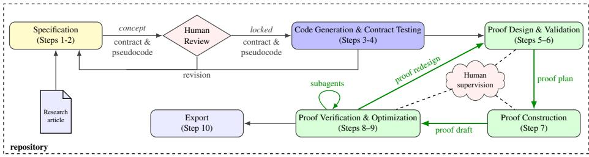

# LLM-Assisted Verification in Dafny

Wieger Wesselink , Kees Huizing , and Huub van de Wetering

Eindhoven University of Technology, The Netherlands {j.w.wesselink,h.v.d.wetering,c.huizing}@tue.nl

Abstract. Formal verification of complex algorithms requires expertise in program specification, invariant construction, mathematical proof, and the management of automated theorem provers. Although large language models (LLMs) can generate program code and proof fragments, reliably developing complete machine-checked verifications remains challenging: it requires an iterative process of constructing and validating specifications and invariants, building proofs, diagnosing solver failures, and optimizing verification performance. This paper presents a systematic ten-step workflow for LLM-assisted verification of scientific algorithms using the Dafny verification system. The workflow integrates algorithm formalization, contract development, empirical invariant validation, proof construction, bottleneck profiling, and resource-driven proof optimization. We applied the workflow using Antrhopic’s Claude Opus 5 and Opus 5.5 models, combining LLM-driven development with automated testing and verification feedback, while retaining human oversight for correctness-critical decisions and strategic interventions. We evaluate the approach on 37 complex algorithms from graph theory and labelled transition systems. Notably, we verified the Hopfcroft– Tarjan triconnectivity test, demonstrating that even highly challenging algorithmic verification tasks can be carried out through a structured LLM-assisted workflow. Many of our machine-checked verifications were obtained within hours to a few days of interactive development. Our results suggest that LLM-assisted workflows can shift the role of the human verifier from detailed proof construction toward supervision, specification review, and strategic guidance.

Keywords: Formal verification · Dafny · Large language models · Program verification · Proof engineering

## 1 Introduction

Formal verification establishes that a program satisfies a mathematical specification. Unlike testing, it provides a proof of correctness rather than checking a finite set of executions. This is particularly valuable for complex algorithms, whose correctness often depends on subtle properties of their data structures and control flow. However, developing machine-checked proofs for such algorithms remains dificult. Even when the underlying mathematical argument is known, expressing it in a form that an automated verifier can establish may require substantial proof engineering.

Dafny is a programming language and verification system that combines program development with formal specifications and proofs [41]. It supports preconditions, postconditions, loop invariants, and termination measures, and translates the resulting verification conditions into queries for the Z3 SMT solver. Although many proof steps are automated, the developer must still provide suitable invariants, lemmas, and intermediate assertions, and organise the proof so that the solver can handle it. Large verification contexts, quantified properties, and interactions between assertions can make verification dificult even when the required mathematical facts are available.

Large language models (LLMs) ofer a way to reduce manual efort involved in this process. They can develop program code, propose invariants and lemmas, construct proofs, and interpret verification errors. However, generating proof steps is only part of the task. A complete verification efort also involves formalising the algorithm, developing and testing an implementation, validating invariants, diagnosing solver problems, and ensuring that the complete program verifies. These activities require an iterative process in which the LLM uses feedback from testing and verification to guide further development.

Recent work on human-directed agentic engineering has shown the value of combining LLMs with tools, structured workflows, checkpoints, and human oversight [38]. We propose a similar approach to formal verification. Rather than focusing on a particular invariant-generation or proof-synthesis technique, we treat LLM-assisted verification as a workflow design problem. The aim is to combine LLMs, Dafny, empirical testing, solver measurements, and human review into a systematic process for constructing machine-checked proofs.

We use Claude Code, Anthropic’s agentic coding assistant, to construct and verify Dafny implementations of published algorithms. In our workflow, Claude Code is used to develop specifications, generate implementations, design loop invariants, construct proofs, and interact with the Dafny verifier. We refer to Claude Code in this role as the Verification Construction Agent (VCA). The VCA operates within a workflow that provides it with tools, instructions, and access to a persistent repository. Its work is supervised by a human, who reviews the verification target and provides strategic direction during proof development.

This paper presents a ten-step workflow for LLM-assisted verification of algorithms in Dafny. Starting from algorithm descriptions in the literature, the workflow covers formalisation, contract development, implementation and testing, invariant construction and empirical validation, proof construction, and verification optimisation. It combines feedback from empirical invariant checks with measurements of solver resource consumption to guide proof development. The process is iterative: verification failures may require changes to invariants, proof structure, or even the chosen strategy. Human supervision remains important, particularly when the workflow needs to change direction.

We evaluate the workflow on more than thirty algorithms, primarily from graph theory and labelled transition systems (LTSs). The collection includes challenging targets such as Edmonds’ blossom algorithm, Lengauer–Tarjan dominators, and the Hopcroft– Tarjan triconnectivity test. The results show that the workflow can produce substantial machine-checked verifications across diferent algorithm families. They also show that successful verification requires more than discharging individual proof obligations: the complete program must also verify under Dafny’s native configuration. This distinction is important because proof structure and solver behaviour can cause a program to fail even when its obligations verify successfully in isolation.

The main contributions of this paper are the following.

– We present a ten-step workflow for developing machine-checked Dafny verifications from algorithm descriptions in the scientific literature.

– We integrate empirical invariant validation, including truth checks, counterexamples to induction, and drop tests, into proof development.

– We present a resource-guided approach to proof engineering, using verifier measurements to identify expensive obligations and guide proof restructuring and optimisation.

– We evaluate the workflow on more than thirty algorithms, including challenging graph and LTS algorithms, and, in particular, report a machine-checked verification of the Hopcroft–Tarjan triconnectivity test.

The remainder of the paper is organised as follows. Section 2 defines the verification challenge and scope. Section 3 lists the related work. Section 4 presents the ten-step workflow. Section 5 describes the tools and Section 6 the proof-engineering techniques. Section 7 shows cross-verification knowledge reuse. Section 8 presents the evaluation, Section 9 discusses the results, and Section 10 concludes the paper and outlines future work.

## 2 Verification Challenge and Scope

We focus on the functional verification of algorithms described in the scientific literature, rather than arbitrary existing programs. Starting from published algorithm descriptions, typically given as pseudocode, we develop Dafny implementations and establish their correctness with respect to contracts based on standard definitions. This distinguishes our approach from methods that start with existing implementations and mainly generate missing annotations or proofs. Low-level implementation details, memory management, and language-specific optimisations are outside our scope. We also do not assess the pseudocode notation itself or claim that formal verification removes all ambiguity in the interpretation of an algorithm.

We use the term complex algorithm for an algorithm whose structure and correctness properties make formal verification substantially more dificult than for simple textbook examples. The algorithms considered include graph and labelled-transition- system algorithms with nested loops, large loop bodies, mutable data structures, and iterative or recursive control flow. Their correctness often depends on invariants and global properties involving vertices, edges, paths, or other structures. Examples include connectivity, reachability, minimality, and structural characterisations. Establishing termination may also require non-trivial progress measures.

A major challenge in verifying these algorithms is proof engineering. The reasoning must be expressed through invariants, lemmas, and assertions in a form that a proof checker can handle. This requires careful control of proof contexts, decomposition of verification conditions, and structuring of assertions. Solver performance can be sensitive to seemingly small changes in proof structure and assertion batching. As a result, even a mathematically straightforward proof can be dificult to verify automatically, and proofengineering efort does not necessarily grow predictably with algorithmic complexity.

Our work focuses on Dafny and its underlying verification toolchain. The workflow is therefore shaped by Dafny’s verification model, Z3’s capabilities, and the practical challenges of verifying large programs reliably.

## 3 Related Work

Dafny has been used to verify nontrivial algorithms and programs, including solutions to verification competitions, case studies, and modular proof development [18,16,29]. Related work has also studied techniques for diagnosing dificult proof obligations [23]. Large collections of verified algorithms have been developed in interactive theorem provers such as Isabelle/HOL [47], Coq [7], and Lean [45]. While these systems generally require more explicit proof construction than Dafny, they also provide automation. Studies of verification-aware programming have highlighted the efort and expertise needed to develop specifications and proofs [46,48].

Recent work has explored the use of large language models (LLMs) to assist Dafny verification. Approaches include lemma generation, annotation synthesis, and loop invariant generation [54,50,49]. Further work addresses the generation of formal specifications and verification annotations [17] and the repair of arithmetic errors in existing Dafny programs [59]. DafnyPro [4] improves generated annotations using techniques such as invariant pruning and retrieval of successful proof strategies. ATLAS [2] explores the large-scale synthesis of complete verified programs, while miniF2F-Dafny [3] applies LLMs to mathematical theorem proving with Dafny. These approaches address important parts of the verification process, but focus on specific tasks or diferent synthesis goals.

LLMs have also been studied for formal specification generation and verified program synthesis beyond Dafny. SpecGen [43] and Le-Cong et al. [40] investigate the generation and inference of formal specifications. The Vericoding benchmark [11] evaluates the generation of formally verified programs. These works provide relevant approaches and evaluation settings, but do not focus on the complete development of algorithms from descriptions in the scientific literature.

Our work addresses this broader development process. Starting from an algorithm description, we use LLMs to develop its specification and implementation, discover and validate invariants, construct proofs, and refine the program through verifier feedback and performance measurements. Unlike approaches that focus on individual verification tasks or assume an existing implementation, our workflow covers the development process from algorithm description to verified implementation. It combines LLM assistance with empirical validation, resource-guided proof development, and human supervision.

## 4 The Workflow

We have defined an interactive, ten-step workflow executed by Claude Code, which serves as the Verification Construction Agent (VCA) under human supervision. The VCA uses a repository to maintain persistent information about the verification process and its results. It also has access to supporting tools, for example, to identify verification bottlenecks. Throughout the workflow, guardrails constrain the VCA’s actions, for example, by preventing unauthorized changes to the algorithm and limiting resource usage.

  
Fig. 1. Conceptual ten-step workflow for LLM-assisted verification. Starting from an article Steps 1–2 establish a contract plus pseudocode that after human approval becomes locked. In Steps 3-4 Dafny and Python implementations are generated and the contract is tested with randomized inputs. Steps 5–6 create a proof plan consisting of empirically tested loop invariants and termination measures. Step 7 converts this plan into a draft Dafny proof. Steps 8–9 then iteratively verify and optimize the proof using subagents for solving individual issues. All steps in this loop are under human supervision. Finally, step 10 collects the experiences gained during the process. They are stored in the repository (dashed box) for usage in the current or future verification eforts.

The workflow organizes the construction of machine-checked Dafny verifications into ten steps, see Figure 1. It starts from an algorithm described in the literature and produces a formal specification, executable implementations, invariants, proofs, and verification artefacts. The steps have defined inputs, outputs, and completion criteria, summarized in Table 1. The steps can be divided into three main phases: a specification phase that establishes a contract plus pseudocode, followed by a code generation and contract testing phase, and the main proof-development phase (the green loop in Figure 1), where the human works with the VCA.

Establishing the verification target (Steps 1–2). In Step 1, the agent reconstructs the algorithm from its publication into the workflow’s pseudocode representation. It also identifies ambiguities and proposes interpretations where necessary. In Step 2, it formalizes the intended behavior as a contract consisting of preconditions and postconditions, adding any required definitions to the Python and Dafny domain libraries. The human reviews the pseudocode, the recorded interpretations, and the contract. Once approved, the contract is locked and cannot be changed without explicit human approval.

Generating and testing the implementations (Steps 3–4). In Step 3, the agent uses tooling to generate Python and Dafny implementations from the pseudocode and contract. The generated Dafny code is checked for well-formedness and type correctness. In Step 4, the Python implementation is tested using randomized inputs. The tests check the preconditions before execution and the postconditions after execution. The resulting implementations and test results provide the starting point for proof development.

Table 1. The ten workflow steps and Claude’s contribution.
<table><tr><td># Step</td><td>Produces</td><td>Claude&#x27;s action</td></tr><tr><td>1 spec</td><td>Pseudocode in LATFX</td><td>Transcribes the publication; identifies ambiguities, and proposes resolutions</td></tr><tr><td>2 contract</td><td></td><td>Formal pre- and post- Formalizes the intended functional behavior; adds conditions; contract lock missing domain definitions to the Dafny and Python libraries</td></tr><tr><td>3 generate</td><td>mentations</td><td>Python and Dafny imple- Runs the generators and checks that the generated Dafny code is well-formed and type-correct</td></tr><tr><td>4 test</td><td></td><td>Randomized Python tests Checks pre- and postconditions using randomized tests in Python</td></tr><tr><td></td><td>nation measures</td><td>5 invariants Loop invariants and termi- Writes invariants and termination measures; es- tablishes the initialization, preservation, and exit obligations for each loop</td></tr><tr><td></td><td>ants; lemma plan</td><td>6 conjectures Empirically tested invari- Writes an instrumented Python copy; empirically tests each invariant; plans the lemmas</td></tr><tr><td>7 complete</td><td>Unverified proof draft</td><td>Writes lemmas and ghost code without running Dafny; reuses proofs from similar algorithms</td></tr><tr><td>8 verify</td><td>obligations</td><td>Individually verified proof Runs a resource-restricted subagent loop to verify each obligation in isolation</td></tr><tr><td>9 optimize</td><td></td><td>Proof verified as a whole Runs a subagent loop until the entire file verifies in Dafny; does an audit for implicit assumptions</td></tr><tr><td>10 export</td><td>Session transcripts</td><td>Logs transcripts to the repository</td></tr></table>

Developing the proofplan (Steps 5–6). In Step 5, the agent constructs loop invariants and termination measures. It identifies the properties needed to establish initialization, preservation, and the loop exit conditions. In Step 6, candidate invariants are tested using an instrumented Python implementation. The workflow checks whether invariant clauses hold in reachable states, whether they are preserved by program transitions, and whether individual clauses are needed for inductiveness. Based on these results, the agent refines the invariants and develops a plan for the supporting lemmas.

Constructing and verifying the proof (Steps 7–9). In Step 7, the VCA translates the proof plan into a Dafny proof draft containing lemmas and ghost code, reusing existing proofs where applicable. Steps 8 and 9 involve substantial proof engineering. In Step 8, individual proof obligations are verified, and failures are diagnosed and addressed in resource-restricted subagent loops. This may require correcting claims, adding missing proof facts, or restructuring proofs to reduce solver context. In Step 9, the complete file is verified and its performance measured. A dedicated tool identifies bottlenecks, guiding further proof engineering through techniques such as lemma decomposition, controlling solver context, and checking assertions in isolation. Both steps involve iterative diagnosis and refinement, continuing until the complete file verifies within the intended resource limits. The final proof is also audited using Dafny for unjustified assumptions. Section 6 describes the techniques in detail. Changes made during proof development or verification may also require revisiting Steps 5–6 to revise the invariants or termination measures.

Recording the results (Step 10). In the final step, the workflow stores the artefacts and results of the verification into the repository, including specifications, contracts, implementations, proofs, and session records.

Human supervision The human supervises the proof-development process at both the strategic and technical levels. At the strategic level, the human monitors progress and verification results and may intervene to change the approach when the current strategy is inefective or ineficient. For example, the human may ask the VCA to investigate several unfinished proof obligations together, identify a common set of missing facts, and only then return to revising the invariants or contracts. The VCA translates such directions into concrete verification tasks and carries them out. The human may also contribute ideas about how to proceed with a proof or suggest a proof technique. Thus, the human provides oversight and, when useful, strategic or technical guidance, while the VCA performs the detailed analysis and proof development.

Guardrails Guardrails are static checks on a Dafny file, enforced by tools. Their purpose is to make sure that a successful verification actually establishes the algorithm’s stated correctness, and that edits have not weakened the specification or added unsound assumptions. They include checks that no changes are made in the generated code and its contract, checks that all added code is ghost code, and checks that no axioms, assume statements or unsound constructs are used. Some exceptions are allowed, e.g., adding {:isolate\_assertions} annotations.

Persistent storage The repository preserves the current verification state and provides access to previously developed proofs, domain definitions, and verification techniques, which are described in Section 6, while knowledge-reuse mechanisms are discussed in Section 7. It also maintains a status report that summarizes the current state of the verification. Importantly, the repository is not merely an archive of completed verifications. It supports learning and reuse across verification tasks. The workflow maintains a catalog of proof techniques and records lessons learned during individual verifications. These records can inform later tasks, for example by suggesting a proof strategy, identifying useful lemmas or domain definitions, or warning about approaches that previously caused dificulties.

Summary In summary, the workflow begins with human review and approval of the algorithm formalization and its contract. Once the verification target is established, the VCA carries out the implementation, proof-development, and verification tasks with a high degree of autonomy. The human supervises this work, provides strategic direction when appropriate, and may occasionally contribute proof ideas or suggest proof techniques. Support tools help the VCA test candidate invariants, verify proofs, and identify performance bottlenecks. The repository preserves the verification state and accumulates reusable proof techniques and lessons from previous tasks. The workflow thus combines human judgement, autonomous proof construction, tool-supported verification, and accumulated experience across verification eforts.

## 5 Tools

The VCA uses specialized tools for code generation, integrity checking, invariant testing, and solver diagnostics. Algorithms are specified as LaTeX pseudocode with structured comments, from which corresponding Python and Dafny implementations are generated.

Execution limits and integrity checks. Verification runs are executed under controlled resource limits (number of parallel solver processes, memory per solver process, total memory, and time per proof obligation); concurrent runs share a single memory budget. Additional tools ensure that generated programs and reviewed contracts are not modified unintentionally. A contract lock records the reviewed contract together with every definition it depends on, including library definitions, since weakening a definition would weaken the contract without changing its text; a changed contract is accepted only through an explicit step that the user confirms.

Invariant checking. A dedicated checker tests candidate invariants before formal proof construction begins. The checker executes the Python implementation on random inputs and evaluates invariant clauses and callee postconditions at the program points relevant to the proof. Three complementary analyses are performed. A truth test identifies clauses that are false in reachable states. Consider a program fragment described by the Hoare triple $\{ P \} S \{ Q \}$ , where � is typically a loop body. A counterexample-to-induction (CTI) test starts with a state � from a real execution, such that $P ( s )$ holds and executing � from � produces a state satisfying �. It then perturbs � to obtain a state $s ^ { \prime } .$ , retaining the perturbed state only if $P ( s ^ { \prime } )$ still holds. If executing � from $s ^ { \prime }$ produces a state that violates $Q ,$ a counterexample to induction has been found. This demonstrates that $P$ is too weak to establish $Q ,$ even though both properties hold along all real executions. Finally, drop tests repeat the CTI test with individual clauses removed to identify clauses that appear necessary for inductiveness. Together, these analyses provide empirical evidence about correctness, inductiveness, and necessity, helping to identify incorrect, insuficient, or redundant clauses. They complement, but do not replace, formal verification: the checker finds counterexamples but proves nothing.

Solver diagnostics and verification. The verification tools identify failing, timing-out, and expensive proof obligations, reporting their declarations, relevant clauses, and solver resource consumption. Additional diagnostics localize costly proof blocks, inspect quantifier instantiations, and identify unsatisfied or expensive callee preconditions. Verification is examined both in isolation and under Dafny’s default batched verification strategy. In isolation, assertions are checked through separate solver queries; in batched mode, multiple obligations share queries. Consequently, an obligation that verifies in isolation may still fail or time out when verified as part of a larger context. The workflow therefore performs proof development and diagnosis primarily in isolated mode, followed by measurement-driven optimization of the complete verification artefact until it verifies under Dafny’s native configuration. Verification runs are performed using fixed solver settings so that the efects of proof-structure changes can be compared reliably. The resulting measurements and diagnostics guide the proof-engineering techniques described below.

## 6 Proof-Engineering Techniques

A verification failure rarely reveals its underlying cause directly. A failed or timed-out obligation may indicate that a statement is false, that an invariant is too weak, that a proof fact is missing, or that the verifier is overwhelmed by the size of the proof context. The verification workflow comprises roughly 25 techniques for addressing such problems. This section presents the key techniques and explains how they address these diferent causes of verification failure. They act on intermediate claims, proof structure, or the context visible to the solver; the integrity checks described above ensure that none of them changes what is ultimately proven. The reported figures are based on interventions documented so far and should be regarded as indicative rather than exhaustive, since the analysis of the full corpus is still ongoing.

Check the claim before proving it. Some verification failures stem from statements that are false or fail the required induction step, which no proof restructuring can repair. The invariant checker is therefore applied twice: first to candidate invariants and intermediate claims before proving starts, and again to any failure that remains after all performance techniques have been tried. In the seven failures examined in this second way, the statements were false, and no solver tactic could have proven them.

Lemma decomposition. Large proofs are decomposed into small lemmas with simple, flat preconditions and narrowly defined responsibilities. Decomposition serves both correctness and performance: it localizes failures and allows expensive facts to be established once and reused. Its main performance benefit is that each lemma is proven in a small context of its own, making calls to it from a large method cheap. This is particularly useful for elementary facts about sets, cardinalities, arithmetic, and graph structure. Such a fact can be as expensive to prove as a hard obligation when embedded in a large method context, but nearly free when established once in a separate lemma. Lemma decomposition is used extensively throughout the verification: the results for 37 algorithms include a total of 2,351 lemmas.

Opaque specifications and proofin lemmas. In large methods, each verification condition exposes the solver to many contract facts, loop invariants, and quantified definitions at once, leading to excessive quantifier instantiation. To reduce this context, the predicates in the method’s contract, its loop invariants, and the contracts of its callees are made opaque and bundled where useful. They are never revealed in the method body. Instead, every fact the method needs is established by a lemma that reveals only the definitions it requires. The method body therefore contains only code, bounds, and lemma calls. This technique works only when applied consistently: hiding some predicates while leaving others visible often failed, whereas the complete design succeeded. In Lengauer–Tarjan, a partially opaque main method still had 36 timeouts (2,098M resource units). The complete design eliminated all of them and reduced the cost to 144M. Among the documented applications, this was the most efective technique: all 11 applications ended in a verified method, including three of the hardest targets, after recorded alternatives had failed.

Assertion isolation. Dafny normally groups multiple assertions within a declaration into verification queries, allowing the solver to reason about them together. With assertion isolation, each assertion is checked separately, using the {:isolate\_assertions} annotation on the declaration. This can replace an expensive query with several queries that are individually cheaper to verify. For example, bron\_kerbosch2 dropped from 113.2M resource units when assertions were batched to 5.2M when isolated. However, isolation can also duplicate work that the obligations would otherwise share, or fail outright: the main method of Borůvka’s algorithm ran out of memory under isolation until part of its context was hidden. The annotation must therefore be selected per declaration, based on measurement. It is the most frequently used technique among the interventions documented so far, and isolation annotations appear across many files.

## 7 Knowledge Reuse

The workflow supports two forms of reuse: verified definitions and lemmas, and knowledge about how proofs are developed. Before starting a proof, the VCA is instructed to consult verified proofs of related algorithms, domain libraries, and examples of previously resolved proof obligations.

Domain libraries. Shared libraries group definitions, predicates, and lemmas into domain-specific modules for both Dafny and Python. General modules provide the mathematical definitions used in specifications, while specialised modules contain results for particular algorithm families, such as low-link and spanning-tree modules. Results established during one verification can be added to these libraries and reused in later proofs. The Python domain library mirrors the Dafny definitions, allowing tests and conjecture checkers to use the same predicates as the formal contracts.

Reuse of proof designs and experience. Reuse also extends beyond verified code. Status records, lesson files, and a repository-wide catalogue preserve proof designs, verification strategies, and approaches that did not work. These provide useful starting points for later proofs, although new algorithms still require domain-specific reasoning. Techniques can also transfer between diferent domains. For example, a context-reduction technique developed during the Lengauer–Tarjan verification of graph algorithms was later reused in branching bisimulation proofs in the LTS domain. This shows how experience from one verification can benefit not only related algorithms but also quite diferent verification eforts.

## 8 Evaluation

The evaluation has two parts. First, we list results for a sizable corpus of algorithms in diferent domains. Second, we discuss selected algorithms that illustrate challenges encountered during verification and how the workflow addressed them.

## 8.1 Verification Corpus

The verification corpus consists of a collection of 37 verified algorithms from graph theory, labelled transition systems (LTSs), and computational geometry. Table 2 summarizes verification results for these algorithms. The table characterises the size and verification time of the resulting artefacts, rather than comparing algorithm complexity. Verification time depends on proof structure, hardware, verifier configuration, and the amount of proof engineering required. The Days column gives a rough indication of development time, measured from the first commit of the algorithm’s specification to the first version that passes verification. All verification runs were performed on a desktop PC with a 13th Gen Intel Core i7-13700 processor (16 cores) and 128 GB of RAM. We used Dafny 4.10.0 with its bundled version of Z3. Each verification run was limited to six cores and a total memory usage of 12 GB. Together, the standalone verification files contain more than 74,000 lines of Dafny code, over 2,300 lemmas, and nearly 5,000 declarations.

The corpus includes several challenging verification targets, notably Edmonds’ blossom algorithm, Lengauer–Tarjan dominators, and the Hopcroft–Tarjan triconnectivity test. The n-dimensional Quickhull algorithm is also verified with the restriction that the input points are in general position. To our knowledge, for both the Hopcroft–Tarjan triconnectivity test (based on the version corrected by Gutwenger and Mutzel [26]), and the n-dimensional Quickhull algorithm no previous machine-checked verification has been reported.

## 8.2 Case Study

We discuss four algorithms that illustrate diferent aspects of the workflow: invariant discovery in triconnectivity test, large-scale proof restructuring in Lengauer–Tarjan, largely autonomous verification of Edmonds’ blossom, and the transfer of proof-engineering techniques to LTS algorithms. The selected algorithms involve substantial mathematical reasoning and present diferent challenges for formal verification.

Triconnectivity test. The Hopcroft–Tarjan triconnectivity test is our largest and most demanding algorithm. Its correctness contract is expressed in terms of graph separation, while the algorithm reasons about depth-first search trees, low points, and separation pairs. Connecting these two views required substantial invariant development. In particular, the completeness invariant for the path-search phase went through many revisions before it became both correct and inductive. The conjecture-testing infrastructure helped identify missing conditions and improve candidate invariants.

After the invariants had been established, proof completion still required considerable proof engineering. Large verification contexts and quantifier interactions caused solver problems that were addressed through opaque predicates, explicit lemmas, and assertion isolation. This case illustrates the role of empirical invariant validation and solver-guided proof optimisation in a large verification efort.

Lengauer–Tarjan. The Lengauer–Tarjan dominator algorithm illustrates the importance of proof restructuring. The main problem was an excessively large verification context, which caused repeated solver timeouts. This is addressed by hiding large contracts and invariants behind opaque predicates and exposing only the facts needed at specific proof boundaries. Explicit lemmas were then introduced to control how these facts were made available.

Table 2. Dafny verification of the standalone files of graph, lts, and geometry. All measurements use Dafny 4.10.0 with the –cores option set to 6, and a 12 GB memory limit (see Section 8 for the hardware configuration). The Days column shows the elapsed calendar days between the commit of the algorithm pseudocode and its first successful verification. These values provide only a rough indication of development time, not actual time spent working on the algorithm. They may include extended periods during which verification was stalled pending new proof techniques, as was the case for biconnected-components.
<table><tr><td>Algorithm</td><td colspan="5">LoC Lemmas Declarations Time (s) Days</td></tr><tr><td colspan="5">Graph algorithms</td><td></td></tr><tr><td>a-star [27]</td><td>288</td><td>7</td><td>17</td><td>3.3</td><td>1</td></tr><tr><td>articulation-points [56]</td><td>3724</td><td>63</td><td>127</td><td>79.0</td><td>96</td></tr><tr><td>bellman-ford [6]</td><td>570</td><td>13</td><td>38</td><td>7.8</td><td>1</td></tr><tr><td>biconnected-components [31]</td><td>6039</td><td>134</td><td>273</td><td>74.1</td><td>123</td></tr><tr><td>boruvka [8]</td><td>3008</td><td>82</td><td>150</td><td>19.8</td><td>108</td></tr><tr><td>bridges [56]</td><td>3560</td><td>59</td><td>119</td><td>65.9</td><td>91</td></tr><tr><td>bron-kerbosch [10]</td><td>783</td><td>32</td><td>61</td><td>6.8</td><td>1</td></tr><tr><td>connected-components [12]</td><td>274</td><td>7</td><td>17</td><td>1.7</td><td>55</td></tr><tr><td>dijkstra [13]</td><td>456</td><td>11</td><td>27</td><td>8.6</td><td></td></tr><tr><td>dynamic-connectivity [30]</td><td>1826</td><td>47</td><td>87</td><td>12.0</td><td></td></tr><tr><td>edmonds-blossom [14]</td><td>3285</td><td>82</td><td>175</td><td>34.4</td><td>1</td></tr><tr><td>edmonds-karp [15]</td><td>853</td><td>25</td><td>77</td><td>4.6</td><td>30</td></tr><tr><td>fleury [19]</td><td>1422</td><td>52</td><td>110</td><td>3.8</td><td>3</td></tr><tr><td>floyd-warshall [20]</td><td>768</td><td>21</td><td>58</td><td>9.7</td><td>1</td></tr><tr><td>ford-fulkerson [21]</td><td>832</td><td>23</td><td>73</td><td>8.3</td><td>30</td></tr><tr><td>hierholzer [28]</td><td>851</td><td>32</td><td>76</td><td>22.0</td><td>1</td></tr><tr><td>hopcroft-karp [32]</td><td>1502</td><td>47</td><td>102</td><td>14.6</td><td>1</td></tr><tr><td>johnson [35]</td><td>1257</td><td>39</td><td>102</td><td>17.2</td><td>38</td></tr><tr><td>kosaraju [53]</td><td>723</td><td>26</td><td>52</td><td>2.7</td><td>38</td></tr><tr><td>kruskal [36]</td><td>2300</td><td>65</td><td>121</td><td>19.8</td><td>99</td></tr><tr><td>kuhn [37]</td><td>817</td><td>23</td><td>46</td><td>7.0</td><td>30</td></tr><tr><td>lengauer-tarjan [42]</td><td>3812</td><td>126</td><td>288</td><td>122.1</td><td>1</td></tr><tr><td>moore [44]</td><td>557</td><td>22</td><td>60</td><td>3.5</td><td>1</td></tr><tr><td>prim [51]</td><td>1361</td><td>34</td><td>63</td><td>7.0</td><td>84</td></tr><tr><td>push-relabel [22]</td><td>1336</td><td>49</td><td>131</td><td>17.3</td><td>66</td></tr><tr><td>schorr-waite [52]</td><td>380</td><td>19</td><td>42</td><td>25.6</td><td>2</td></tr><tr><td>suurballe [55]</td><td>1875</td><td>64</td><td>142</td><td>33.5</td><td>13</td></tr><tr><td>tarjan [56]</td><td>1599</td><td>41</td><td>101</td><td>17.3</td><td>1</td></tr><tr><td>triconnectivity-test [33]</td><td>9731</td><td>370</td><td>794</td><td>226.4</td><td>14</td></tr><tr><td>ullmann [57]</td><td>662</td><td>22</td><td>58</td><td>4.3</td><td>1</td></tr><tr><td>welsh-powell [58]</td><td>805</td><td>27</td><td>64</td><td>3.8</td><td></td></tr><tr><td colspan="6">LTS algorithms</td></tr><tr><td>drwb [9]</td><td>2695</td><td>109</td><td>227</td><td>25.5</td><td></td></tr><tr><td>failures-antichain-check [39]</td><td>1125</td><td>43</td><td>94</td><td>21.8</td><td>1 1</td></tr><tr><td>groote-jansen [24]</td><td>4109</td><td>177</td><td>246</td><td>47.6</td><td></td></tr><tr><td>groote-vaandrager [25]</td><td>1080</td><td>40</td><td>54</td><td>17.4</td><td></td></tr><tr><td>jgkw [34]</td><td>3137</td><td>133</td><td>173</td><td>54.8</td><td>1 1</td></tr><tr><td>Geometry algorithms</td><td></td><td></td><td></td><td></td><td></td></tr><tr><td>quickhull-nd [5]</td><td>5137</td><td>205</td><td>477</td><td>170.4</td><td>9</td></tr><tr><td>Total</td><td>74539</td><td>2371</td><td>4922</td><td>1221.7</td><td></td></tr></table>

The combined restructuring reduced the number of obligations in the main verification routine from 644 to 271, eliminated 36 timeouts, and reduced Z3 resource consumption from approximately 2.1 billion to 144 million resource units. The improvement illustrates how measurements of solver behaviour can guide changes to proof structure and turn an otherwise impractical verification into a successful one.

Edmonds’ blossom. Edmonds’ blossom algorithm provides a diferent test of the workflow: an end-to-end verification of a complex algorithm with limited human involvement. The algorithm combines alternating forests, blossom contraction, and path lifting, requiring contracts and supporting lemmas that connect these diferent parts.

The verification started from a published algorithm description and was informed by the detailed Isabelle verification by Abdulaziz et al. [1]. The human role was limited to selecting the problem and monitoring progress. The VCA developed the contracts, invariants, and proof artefacts, and addressed verification failures. After assertion isolation was applied to a small number of declarations, the complete implementation passed Dafny’s native verification. The verification covered more than 1,100 proof obligations across the domain library for graph matching and the algorithm’s verification. This case demonstrates that the workflow can handle a substantial verification task with little direct human guidance.

Groote–Jansen and JGKW. With these two algorithms we examine whether the workflow’s proof-engineering techniques also apply outside graph algorithms. Both concern LTS algorithms and required substantial proof engineering. In Groote–Jansen, context restructuring, supporting lemmas, and assertion isolation were needed to resolve repeated timeouts. JGKW presented similar problems, which were overcome through resource-guided restructuring and selective assertion isolation.

These results provide evidence that techniques developed during graph-algorithm verification can also help with algorithms from a diferent domain. Although two examples are not suficient to establish general transferability, they show that the workflow’s proof-engineering techniques are not limited to graph algorithms.

## 9 Discussion

## 9.1 Repository-Wide Results

The workflow has been applied to algorithms from several domains, including graph theory, labelled transition systems, game-tree search, sorting, and geometry. The resulting Dafny proofs range from a few hundred to almost ten thousand lines of code. Several targets, including Edmonds’ blossom algorithm, the Lengauer–Tarjan dominator algorithm, and the Hopcroft–Tarjan triconnectivity test, are particularly challenging because of their complex invariants and global correctness requirements.

All algorithms we attempted to verify, except Hopcroft–Tarjan’s triconnected-components algorithm have been fully verified. Its ongoing verification has reached 16,658 lines of Dafny code and 460 lemmas. This suggests that the practical limits of Dafny verification have not yet been reached, as new proof-engineering techniques continue to enable progress on previously stalled problems.

The verification corpus was developed over several months. Many of the proofs would represent substantial verification eforts in their own right. Although we have no controlled comparison with conventional verification, the results show that a structured LLM-assisted workflow can produce machine-checked proofs of challenging algorithms across a range of domains.

## 9.2 Cross-Case Findings

Three findings recurred across the verifications. First, the main dificulties were often related to proof engineering rather than to the underlying mathematics. Large contexts visible to the solver, interactions between quantified predicates, and groups of proof obligations that were costly to verify together often caused problems, even when the required mathematical facts were already available. In such cases, restructuring the proof context was more efective than adding further facts.

Second, measurements were important for diagnosing verification problems. Solver resource consumption, timeouts, and the structure ofproofobligations helped distinguish incorrect statements, missing proof facts, and performance problems. This made it possible to choose targeted solutions instead of relying on trial and error.

Third, proof-engineering techniques could often be reused across verifications. Opaque invariant bundles, assertion isolation, proof decomposition, and specialised library lemmas were applied to diferent algorithms. Notably, assertion isolation was especially needed in almost all complex verifications. These findings suggest that a central challenge in LLM-assisted verification is not simply generating proof steps, but organising proofs so that automated reasoning tools can handle them efectively.

## 9.3 Evolution of the Workflow and Human Oversight

The workflow developed in response to problems encountered during verification. Several algorithms, including boruvka, bridges, and biconnected-components, initially stalled for weeks despite considerable proof-development efort. Progress resumed after diagnostic and optimisation capabilities were added. Measurements of solver resource usage helped identify performance problems and guided changes to the proofs. Successful techniques were then recorded for use in later verifications.

The human role changed substantially as the workflow matured. In the early stages, the human actively contributed to proof development by proposing and discussing proof techniques, suggesting a change in the proof strategy when verification became stuck (often with help from another agent), and occasionally making major changes to the workflow. In the mature workflow, the VCA can carry out most of the reasoning autonomously. Human involvement is now mainly limited to monitoring progress, making occasional decisions about the direction of the proof efort, and intervening when the workflow fails to make progress. For example, during the ongoing verification of triconnected components, the conjecture-generation step became stuck in a loop without making significant progress. After discussion, the idea of using a proof dependency graph emerged. The agent then generated the graph and used it to guide a bottom-up proof efort, which proved considerably more successful. Occasionally, the human needs to extend the tool support, e.g. when a new pseudocode language construct is needed. Thus, the human role has shifted from actively guiding proof development to primarily supervising the process and only intervening when necessary.

## 9.4 Trustworthiness and Limitations of the Evidence

The correctness claims depend on the reconstructed pseudocode and formal contract accurately describing the intended algorithm (Steps 1–2). Ensuring their correctness is simply the responsibility ofthe human. Their review may nevertheless fail to detect errors or omissions, which may compromise the entire verification. The subsequent generation of Dafny code from the pseudocode and contract (Step 3) may also introduce errors, which must be detected through testing and verification. On the other hand, guardrails prevent changes that could weaken the locked verification target. Finally, the correctness evidence depends on the reliability ofthe testing and verification procedures, in particular the Dafny verification of the complete file in Step 9. As in any Dafny verification, the correctness claims remain conditional on the soundness of Dafny.

The evaluation has several limitations. We selected well-known, published algorithms that are represented in the training data of contemporary LLMs, although the extent to which they are represented is unknown. This is relevant when interpreting the results, since prior exposure to an algorithm may influence the efort required to reconstruct and verify it. Although the workflow successfully produced verified Dafny implementations for all algorithms in the collection, this does not establish how well it generalizes to unpublished or previously unseen algorithms, or to arbitrary source code rather than published algorithm descriptions. No controlled comparison with human-led verification was performed. Finally, the evaluation does not isolate the contribution of each individual component of the workflow.

## 10 Conclusion and Future Work

We have presented a workflow for LLM-assisted verification of algorithms in Dafny. It combines contract development, implementation and testing, empirical invariant validation, iterative proof construction, and resource-guided diagnosis and optimisation. Rather than introducing a new verifier or proof technique, the workflow brings together LLMs, verification tools, empirical checks, and human supervision in a systematic approach to formal verification.

We applied the workflow to challenging algorithms, including Edmonds’ blossom algorithm, the Lengauer–Tarjan dominator algorithm, and the Hopcroft–Tarjan triconnectivity test. The results show that substantial machine-checked proofs can be developed through a structured LLM-assisted process. A key finding is that the main dificulties often do not lie in the underlying mathematics, but in proof engineering:

controlling verification contexts, structuring proof obligations, and dealing with solver performance. Resource-guided diagnosis and proof optimisation were essential for overcoming these dificulties. As the workflow matured, the VCA became capable of carrying out most proof reasoning autonomously, while the human role shifted towards monitoring progress, making occasional decisions, and intervening when necessary. The resulting correctness claims remain conditional on the quality of the specifications and the soundness of Dafny and its underlying SMT solver, Z3.

Several directions for future work remain. First, the workflow should be evaluated on algorithms and domains less likely to be represented in LLM training data, and on existing software implementations rather than reconstructed pseudocode. It would also be interesting to apply the same approach in other verification environments, such as Lean, Isabelle, and Coq.

Second, the repository provides an opportunity to study verification processes in greater detail. Its records of proof attempts, solver resource usage, and proof-engineering decisions could help identify common causes of verification failures and evaluate the efectiveness of individual techniques and workflow components, particularly empirical invariant validation and resource-guided optimisation. Further applications to challenging algorithms will also help identify remaining bottlenecks and improve the workflow.

Finally, successful verification does not necessarily produce readable proofs. An important direction is therefore to improve proof readability and maintainability alongside successful verification. The available proof histories and transcripts provide a basis for studying how LLM-generated proofs develop and how their resulting artifacts can be made easier for humans to understand and maintain.

Data-Availability Statement The source code, Dafny verification models, and instructions for running the experiments supporting the results in this paper are available at https://10x10.org/dafny.

Disclosure of Interests. The authors declare no competing interests relevant to the content of this article.

Declaration of AI-Assisted Writing During the preparation of this manuscript, the authors used ChatGPT (OpenAI) to improve wording and language clarity. The authors reviewed and revised the suggested formulations and take full responsibility for the final content of the manuscript.

## References

1. Abdulaziz, M., Mehlhorn, K.: A formal correctness proof of edmonds’ blossom shrinking algorithm. J. Autom. Reason. 70(1), 2 (2026). https://doi.org/10.1007/ S10817-026-09747-Y, https://doi.org/10.1007/s10817-026-09747-y

2. Baksys, M., Zetzsche, S., Bouissou, O., Delmas, R., Kong, S.: ATLAS: automated toolkit for large-scale verified code synthesis. CoRR abs/2512.10173 (2025). https://doi.org/10. 48550/ARXIV.2512.10173

3. Baksys, M., Zetzsche, S., Bouissou, O., Holden, S.B.: miniF2F-dafny: LLM-guided mathematical theorem proving via auto-active verification. In: Zhang, T., Dudik, M., Jaggi, M., Agarwal, A., Li, S., Schuurmans, D., Zhu, J., Berkenkamp, F., Dong, H., Bietti, A. (eds.) Proceedings of the 43rd International Conference on Machine Learning. Proceedings of Machine Learning Research, vol. 306, pp. 5699–5716. PMLR (06–11 Jul 2026), https://proceedings.mlr.press/v306/baksys26a.html

4. Banerjee, D., Bouissou, O., Zetzsche, S.: Dafnypro: Llm-assisted automated verification for dafny programs. arXiv preprint arXiv:2601.05385 (2026). https://doi.org/10.48550/ arXiv.2601.05385

5. Barber, C.B., Dobkin, D.P., Huhdanpaa, H.: The quickhull algorithm for convex hulls. ACM Trans. Math. Softw. 22(4), 469–483 (1996). https://doi.org/10.1145/235815. 235821, https://doi.org/10.1145/235815.235821

6. Bellman, R.: On a routing problem. Quarterly of applied mathematics 16(1), 87–90 (1958). https://doi.org/10.1090/qam/102435

7. Bertot, Y., Castéran, P.: Interactive Theorem Proving and Program Development - Coq’Art: The Calculus of Inductive Constructions. Texts in Theoretical Computer Science. An EATCS Series, Springer (2004). https://doi.org/10.1007/978-3-662-07964-5, https:// doi.org/10.1007/978-3-662-07964-5

8. Borůvka, O.: O jistém problému minimálním. Práce Moravské přírodovědecké společnosti 3, 37–58 (1926), http://dml.cz/dmlcz/500114, in Czech

9. Boulgakov, A., Gibson-Robinson, T., Roscoe, A.W.: Computing maximal weak and other bisimulations. Formal Aspects Comput. 28(3), 381–407 (2016). https://doi.org/10. 1007/S00165-016-0366-2

10. Bron, C., Kerbosch, J.: Algorithm 457: finding all cliques of an undirected graph. Communi cations of the ACM 16(9), 575–577 (1973). https://doi.org/10.1145/362342.362367

11. Chiosa, I.E., Bursuc, S., Ehrenborg, T., Lin, S., Astefanoaei, L., Kukovec, J., Singh, A., Butterley, O., Bizid, A., Dougherty, Q., Zhao, M., Tan, M., Tegmark, M.: A benchmark for vericoding: Formally verified program synthesis. Trans. Mach. Learn. Res. 2026 (2026), https://openreview.net/forum?id=Zgh5kpGAm8

12. Cormen, T.H., Leiserson, C.E., Rivest, R.L., Stein, C., et al.: Introduction to algorithms, vol. 2. MIT press, Cambridge (1990)

13. Dijkstra, E.W.: A note on two problems in connexion with graphs. Numerische Mathematik 1, 269–271 (1959). https://doi.org/10.1007/BF01386390

14. Edmonds, J.: Paths, trees, and flowers. Canadian Journal of mathematics 17, 449–467 (1965). https://doi.org/10.4153/CJM-1965-045-4

15. Edmonds, J., Karp, R.M.: Theoretical improvements in algorithmic eficiency for network flow problems. J. ACM 19(2), 248–264 (1972). https://doi.org/10.1145/321694. 321699

16. Faria, J.P., Abreu, R.: Case studies of development of verified programs with dafny for accessibility assessment. In: International Conference on Fundamentals of Software Engineering. pp. 25–39. Springer (2023). https://doi.org/10.1007/978-3-031-42441-0\_3

17. Faria, J.P., Trigo, E., Honorato, V., Abreu, R.: Automatic generation of formal specification and verification annotations using llms and test oracles. CoRR abs/2601.12845 (2026). https://doi.org/10.48550/ARXIV.2601.12845

18. Farrell, M., Reynolds, C., Monahan, R.: Using dafny to solve the verifythis 2021 challenges. In: Proceedings of the 23rd ACM International Workshop on Formal Techniques for Java-like Programs. pp. 32–38 (2021). https://doi.org/10.1145/3464971.3468422

19. Fleury, M.: Deux problemes de geometrie de situation. Journal de mathematiques elementaires 2(2), 257–261 (1883)

20. Floyd, R.W.: Algorithm 97: Shortest path. Commun. ACM 5(6), 345 (1962). https://doi. org/10.1145/367766.368168

21. Ford Jr, L.R., Fulkerson, D.R.: Maximal flow through a network. Canadian journal of Math ematics 8, 399–404 (1956). https://doi.org/10.4153/CJM-1956-045-5

22. Goldberg, A.V., Tarjan, R.E.: A new approach to the maximum-flow problem. J. ACM 35(4), 921–940 (1988). https://doi.org/10.1145/48014.61051

23. Gopinathan, K., Spiliopoulos, D., Goyal, V., Müller, P., Püschel, M., Sergey, I.: Accelerating automated program verifiers by automatic proof localization. In: International Conference on Computer Aided Verification. pp. 153–174. Springer (2025). https://doi.org/10.1007/ 978-3-031-98682-6\_9

24. Groote, J.F., Jansen, D.N.: A state-based o(m log n) partitioning algorithm for branching bisimilarity. In: Bouyer, P., van de Pol, J. (eds.) 36th International Conference on Concurrency Theory, CONCUR 2025, Aarhus, Denmark, August 26-29, 2025. LIPIcs, vol. 348, pp. 18:1– 18:16. Schloss Dagstuhl - Leibniz-Zentrum für Informatik (2025). https://doi.org/10. 4230/LIPICS.CONCUR.2025.18

25. Groote, J.F., Vaandrager, F.W.: An eficient algorithm for branching bisimulation and stuttering equivalence. In: Paterson, M. (ed.) Automata, Languages and Programming, 17th International Colloquium, ICALP90, Warwick University, England, UK, July 16-20, 1990, Proceedings. Lecture Notes in Computer Science, vol. 443, pp. 626–638. Springer (1990). https://doi.org/10.1007/BFB0032063

26. Gutwenger, C., Mutzel, P.: A linear time implementation of spqr-trees. In: Marks, J. (ed.) Graph Drawing, 8th International Symposium, GD 2000, Colonial Williamsburg, VA, USA, September 20-23, 2000, Proceedings. Lecture Notes in Computer Science, vol. 1984, pp. 77–90. Springer (2000). https://doi.org/10.1007/3-540-44541-2\_8

27. Hart, P.E., Nilsson, N.J., Raphael, B.: A formal basis for the heuristic determination of minimum cost paths. IEEE Trans. Syst. Sci. Cybern. 4(2), 100–107 (1968). https://doi. org/10.1109/TSSC.1968.300136

28. Hierholzer, C., Wiener, C.: Über die möglichkeit, einen linienzug ohne wiederholung und ohne unterbrechung zu umfahren. Mathematische Annalen 6(1), 30–32 (1873). https:// doi.org/10.1007/BF01442590

29. Ho, S., Pit-Claudel, C.: Incremental proof development in dafny with module-based induction. arXiv preprint arXiv:2401.16233 (2024). https://doi.org/10.48550/arXiv. 2401.16233

30. Holm, J., de Lichtenberg, K., Thorup, M.: Poly-logarithmic deterministic fully-dynamic algorithms for connectivity, minimum spanning tree, 2-edge, and biconnectivity. J. ACM 48(4), 723–760 (2001). https://doi.org/10.1145/502090.502095

31. Hopcroft, J., Tarjan, R.: Algorithm 447: eficient algorithms for graph manipulation. Communications of the ACM 16(6), 372–378 (1973). https://doi.org/10.1145/362248. 362272

32. Hopcroft, J.E., Karp, R.M.: An n5/2 algorithm for maximum matchings in bipartite graphs. SIAM J. Comput. 2(4), 225–231 (1973). https://doi.org/10.1137/0202019

33. Hopcroft, J.E., Tarjan, R.E.: Dividing a graph into triconnected components. SIAM J. Comput. 2(3), 135–158 (1973). https://doi.org/10.1137/0202012, https://doi.org/ 10.1137/0202012

34. Jansen, D.N., Groote, J.F., Keiren, J.J.A., Wijs, A.: An o(m log n) algorithm for branching bisimilarity on labelled transition systems. In: Biere, A., Parker, D. (eds.) Tools and Algorithms for the Construction and Analysis of Systems - 26th International Conference, TACAS 2020, Held as Part of the European Joint Conferences on Theory and Practice of Software, ETAPS 2020, Dublin, Ireland, April 25-30, 2020, Proceedings, Part II. Lecture Notes in Computer Science, vol. 12079, pp. 3–20. Springer (2020). https://doi.org/10.1007/978-3-030-45237-7\_1

35. Johnson, D.B.: Eficient algorithms for shortest paths in sparse networks. J. ACM 24(1), 1–13 (1977). https://doi.org/10.1145/321992.321993

36. Kruskal, J.B.: On the shortest spanning subtree of a graph and the traveling salesman problem. Proceedings of the American Mathematical society 7(1), 48–50 (1956). https://doi.org/ 10.7551/mitpress/12274.003.0019

37. Kuhn, H.W.: The hungarian method for the assignment problem. Naval research logistics quarterly 2(1-2), 83–97 (1955). https://doi.org/10.1002/nav.3800020109

38. Kurtzer, G.: Ginux: Building an independent kernel that runs linux userspace through humandirected agentic engineering. Technical report, Zenodo (2026). https://doi.org/10. 5281/zenodo.23682548

39. Laveaux, M., Groote, J.F., Willemse, T.A.C.: Correct and eficient antichain algorithms for refinement checking. Log. Methods Comput. Sci. 17(1) (2021). https://doi.org/10. 23638/LMCS-17(1:8)2021

40. Le-Cong, T., Le, B., Murray, T.: Can llms reason about program semantics? A comprehensive evaluation of llms on formal specification inference. In: Che, W., Nabende, J., Shutova, E., Pilehvar, M.T. (eds.) Proceedings of the 63rd Annual Meeting of the Association for Computational Linguistics (Volume 1: Long Papers), ACL 2025, Vienna, Austria, July 27 - August 1, 2025. pp. 21991–22014. Association for Computational Linguistics (2025). https://doi.org/10.18653/V1/2025.ACL-LONG.1068

41. Leino, R.: Dafny: An automatic program verifier for functional correctness. In: 16th International Conference, LPAR-16, Dakar, Senegal. pp. 348–370. Springer Berlin Heidelberg (April 2010). https://doi.org/10.1007/978-3-642-17511-4\_20

42. Lengauer, T., Tarjan, R.E.: A fast algorithm for finding dominators in a flowgraph. ACM Transactions on Programming Languages and Systems (TOPLAS) 1(1), 121–141 (1979). https://doi.org/10.1145/357062.357071

43. Ma, L., Liu, S., Li, Y., Xie, X., Bu, L.: Specgen: Automated generation of formal program specifications via large language models. In: 47th IEEE/ACM International Conference on Software Engineering, ICSE 2025, Ottawa, ON, Canada, April 26 - May 6, 2025. pp. 16–28. IEEE (2025). https://doi.org/10.1109/ICSE55347.2025.00129

44. Moore, E.F.: The shortest path through a maze. In: Proc. of the International Symposium on the Theory of Switching. pp. 285–292. Harvard University Press (1959)

45. de Moura, L., Ullrich, S.: The lean 4 theorem prover and programming language. In: Platzer, A., Sutclife, G. (eds.) Automated Deduction - CADE 28 - 28th International Conference on Automated Deduction, Virtual Event, July 12-15, 2021, Proceedings. Lecture Notes in Computer Science, vol. 12699, pp. 625–635. Springer (2021). https://doi.org/10.1007/ 978-3-030-79876-5\_37, https://doi.org/10.1007/978-3-030-79876-5\_37

46. Mugnier, E., Zhou, Y., Jhala, R., Coblenz, M.: On the impact of formal verification on software development. Proceedings of the ACM on Programming Languages 9(OOPSLA2), 3642–3668 (2025). https://doi.org/10.1145/3763181

47. Nipkow, T., Paulson, L.C., Wenzel, M.: Isabelle/HOL - A Proof Assistant for Higher-Order Logic, Lecture Notes in Computer Science, vol. 2283. Springer (2002). https://doi.org/ 10.1007/3-540-45949-9, https://doi.org/10.1007/3-540-45949-9

48. Oliveira, F., Mendes, A., Carreira, C.: What challenges do developers face when using verification-aware programming languages? In: 2025 IEEE 36th International Symposium on Software Reliability Engineering (ISSRE). pp. 203–214. IEEE (2025). https://doi. org/10.1109/ISSRE66568.2025.00031

49. Pascoal Faria, J., Trigo, E., Abreu, R.: Automatic generation of loop invariants in dafny with large language models. In: Hojjat, H., Caltais, G. (eds.) Fundamentals of Software Engineering. pp. 138–154. Springer Nature Switzerland, Cham (2025). https://doi.org/ 10.1007/978-3-031-87054-5\_10

50. Poesia, G., Loughridge, C., Amin, N.: dafny-annotator: Ai-assisted verification of dafny programs (2024). https://doi.org/10.48550/arXiv.2411.15143

51. Prim, R.C.: Shortest connection networks and some generalizations. The Bell System Techni cal Journal 36(6), 1389–1401 (1957). https://doi.org/10.1002/j.1538-7305.1957. tb01515.x

52. Schorr, H., Waite, W.M.: An eficient machine-independent procedure for garbage collection in various list structures. Commun. ACM 10(8), 501–506 (1967). https://doi.org/10. 1145/363534.363554

53. Sharir, M.: A strong-connectivity algorithm and its applications in data flow analysis. Computers & Mathematics with Applications 7(1), 67–72 (1981). https://doi.org/10.1016/ 0898-1221(81)90008-0

54. Silva, Á., Mendes, A., Ferreira, J.F.: Leveraging large language models to boost dafny’s developers productivity. In: Proceedings of the International Conference on Formal Methods in Software Engineering (2024). https://doi.org/10.1145/3644033.3644374

55. Suurballe, J.W.: Disjoint paths in a network. Networks 4(2), 125–145 (1974). https://doi. org/10.1002/NET.3230040204

56. Tarjan, R.: Depth-first search and linear graph algorithms. SIAM journal on computing 1(2), 146–160 (1972). https://doi.org/10.1137/0201010

57. Ullmann, J.R.: An algorithm for subgraph isomorphism. J. ACM 23(1), 31–42 (1976). https: //doi.org/10.1145/321921.321925

58. Welsh, D.J.A., Powell, M.B.: An upper bound for the chromatic number of a graph and its application to timetabling problems. Comput. J. 10(1), 85–86 (1967). https://doi.org/ 10.1093/COMJNL/10.1.85

59. Wu, V., Mendes, A., Abreu, A.: Specification-guided repair of arithmetic errors in dafny programs using llms. In: Bianculli, D., Gómez-Martínez, E. (eds.) Software Engineering and Formal Methods - 23rd International Conference, SEFM 2025, Toledo, Spain, November 10-14, 2025, Proceedings. Lecture Notes in Computer Science, vol. 16192, pp. 261–278. Springer (2025). https://doi.org/10.1007/978-3-032-10444-1\_16