# Lara Mini Base

Language diversity as a resource, not a trade-of

Translated, Lara Team

## Abstract

General-purpose language models are trained mostly on English: over open models we review, at most, non-English pretraining data makes up only a 12% share. Models built for European languages give them far more, but score well below general-purpose models of the same size. A common concern is that, in small models, languages compete for capacity. We present Lara Mini base, a model trained from scratch on 6T tokens in English and 44 other languages, which together cover all 24 oficial languages of the European Union. As training progresses, the 44 other languages together come to outweigh English. To give these languages enough capacity at low cost, Lara Mini base uses a mixture of experts architecture with 7.2B total and 0.6B active parameters. Among open base models with up to 2B active parameters, it achieves the highest average score across standard English, multilingual, math, and code benchmarks, ahead of models trained on 4 to 6 times as many tokens. Its margin is largest on multilingual benchmarks in the languages it supports and on math benchmarks. It supports contexts of up to 128k tokens. We find that our MoE architectures reduces capacity competition between languages. For a single user on one GPU, without quantization, it generates text at least 1.8 times faster than any model with a higher average score. We release the weights of Lara Mini base under the CC BY-NC-SA 4.0 license. In addition, we will release T-HellaSwag, a higher-quality machine translation of the commonsense reasoning benchmark HellaSwag into 110 language variants.

Lara Mini base (A0.6B) Best other models with up to 2B active parameters, one per organization  
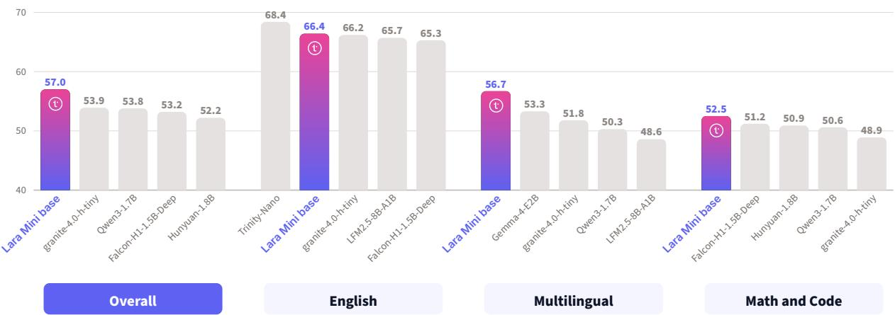  
Figure 1. Overall and domain averages of Lara Mini base and of the four best other models with up to 2B active parameters on each average.

## Contents

Introduction .   
2 Pretraining Data .   
2.1 Data Sources   
2.2 Deduplication and Filtering   
2.3 Data Mixture and Curriculum   
3 Architecture   
3.1 Hybrid Token Mixing .   
3.2 Mixture of Experts Layers   
Training 10   
4.1 Pretraining Recipe 10   
4.2 Training Dynamics   
5 Evaluation . 11   
5.1 Evaluation Setup 11   
5.2 T-HellaSwag 12   
5.3 Main Results 13   
5.4 English . 13   
5.5 Multilingual . 14   
5.6 Math and Code 15   
5.7 Long-Context Results 16   
6 Multilingual Data and Model Capacity 16   
6.1 Multilingual Share 17   
6.2 Expert Routing across Languages 17   
7 Conclusion . 18   
Acknowledgments . 20   
References . 20   
Appendix 27   
A Data Mixture in Detail . 27   
A.1 Personal and Harmful Content 27   
B Training 30   
B.1 Training Details 30   
B.2 Software . 31   
Design Ablations . 32   
C.1 Model Class, Shape and Optimizer 32   
C.2 Hybrid Attention 33   
D Evaluation Details 34   
D.1 Full Results 36   
D.2 Per-Language Results . 41   
D.3 Long-Context Evaluation 42   
D.4 Benchmark Contamination 43   
Inference Benchmark 44   
T-HellaSwag: Construction and Release 46   
G Model Card . 49   
Contributors . 50

## 1 Introduction

Small base language models have improved mostly by reading ever more tokens, and recent models with only a few billion parameters are trained on more than ten trillion of them (Yang et al., 2025a; Hugging Face, 2025c). Because high-quality English text is limited, a growing budget also ends up repeating the same data, with diminishing returns (Muennighof et al., 2025a). Rather than reading the same English text again and again, we suggest that a small model should spend part of its budget on the text it has seen least: text in other languages.

Text in other languages may ofer more than new tokens. Research on multi-task learning ha shown that related tasks can improve generalization by sharing learned representations (Caruana, 1997). Similarly, multilingual neural machine translation has demonstrated positive transfer between languages (Firat et al., 2016). More broadly, representation learning suggests that diferent observations can help a model discover shared explanatory factors underlying the data (Bengio et al., 2013). These findings motivate a hypothesis: diferent languages may provide complementary perspectives on the same underlying reality, helping a shared model learn more generalizable representations. Such benefits could potentially extend beyond multilingual tasks to English reasoning and other capabilities.

Even counting second-language speakers, English has only about 1.5 billion speakers: most of the world’s population does not speak it (Eberhard et al., 2025). Text in these languages is also widely available in open corpora (Nguyen et al., 2024; Penedo et al., 2025; Oepen et al., 2026). Yet the general-purpose open base models that disclose their mixture contribute at most 12% of their tokens to this text (Table 1). Models built for European languages give it 21% to 51%, but in our evaluation they score far below general-purpose models of the same size. For example, EuroLLM-1.7B and Apertus-v1.1-1.5B reach an average benchmark score of 27.6 and 31.2, against 53.8 for Qwen3-1.7B (Table 18). At first glance, these scores suggest that multilingual data cost a small model its general ability.

This leaves an open question: can a model with a small active-parameter budget be strong across many languages without sacrificing its English? Earlier work found that languages compete for the capacity of a small model, so adding languages can hurt each language (Conneau et al., 2020; Chang et al., 2024). Recent scaling laws show that this trade-of depends on the size of the model and on how data are allocated across languages (Longpre et al., 2026). The answer, therefore, depends not only on how much multilingual data a model is trained on but also on how it is chosen and used.

We address this question with Lara Mini base, a multilingual mixture of experts base model with 7.2B total and 0.6B active parameters, pretrained from scratch on 6T tokens. We built Lara Mini base around its data. From openly released datasets, we assembled a deduplicated and filtered pool in English and 44 other languages, which together cover all 24 oficial languages of the European Union. The first three training stages (main, transition and anneal) read 6T tokens from this pool and move toward high-quality, question-answer, code and math data. English makes up only 41% of the 6T tokens. English falls from 44% of the main stage to 27% of the anneal, so that the other languages grow from 46% to 55% of the text and outweigh English in the anneal (Section 2). Of the 6T training tokens, 97% are the first read of a document (Section 2.3). A fourth and last stage of 100B tokens then extends the context of Lara Mini base to 128k tokens (Section 4.1). To support many languages while keeping inference cost low, every layer of Lara Mini base has a fine-grained mixture of experts that activates 4 of 128 experts per token. To keep the inference state small, the layers interleave Gated DeltaNet (Yang et al., 2025c), sliding-window and global attention, the latter in only 7 of the 34 layers (Section 3).

We compare Lara Mini base with 56 open base models on standard English, multilingual, math and code benchmarks, all evaluated by us with the same harness and settings. As in Muennighof et al. (2025b), we group the models by active parameters, as a rough approximation of inference cost (Section 5.1). Among the 36 models with up to 2B active parameters, Lara Mini base ranks first on the average of the four domains, with 57.0, 3.1 points above the next model (Figure 1). It also ranks first on the multilingual average in the languages it supports, 3.4 points ahead. It leads even though this group includes models with more than 3 times its active parameters. The next two models, granite-4.0-h-tiny and Qwen3-1.7B, were trained on 22.5T and 36T tokens, about 4 and 6 times as many (Table 6). Lara Mini base also outscores several models with 6 to 13 times its active parameters, such as Ministral-3-3B (53.8), Gemma-4-E4B (55.4) and Llama-3.1-8B (51.2). Among the models we evaluated from European developers, it is the strongest, ahead of Apertus-v1.5-8B (55.8) and Domyn-Edge (55.4). Although English accounts for less than half of its training data, Lara Mini base ranks second in its group for English. When the multilingual third of the anneal is replaced with English, the English average rises by only 0.3 points and the multilingual average falls by 2.7 (Section 6.1). An expert routing analysis reveals that experts are shared across languages, which is consistent with this ablation hardly deteriorating performance on English tasks (Section 6.2).

These results come at a small inference cost. Lara Mini base needs the compute per token of a small dense model, although all its parameters must be held in memory. For a single user on one A100 GPU, without quantization, it generates about 1,100 characters per second (Figure 5). This speed matches that of dense models with about 1B parameters and is at least 1.8 times that of every model that scores higher on average.

We release the weights of Lara Mini base under the CC BY-NC-SA 4.0 license1, which allows research and other non-commercial use. We will also release T-HellaSwag, a machine translation of the commonsense reasoning benchmark HellaSwag (Zellers et al., 2019) into 110 language variants, of higher quality than the commonly used Multilingual HellaSwag (Lai et al., 2023) (Section F).

Section 2 describes the pretraining data, Section 3 the architecture and Section 4 training operations. Section 5 reports evaluation methods and results. Section 6 analyses the benefits of our data choices on multilingual and English tasks. The Appendix contains additional technical detail aimed at sharing our insights with the open LLM community.

## 2 Pretraining Data

Unlike general-purpose models, Lara Mini base is not trained mostly on English: English accounts for only 41% of its 6T training tokens.2 The 44 other languages account for at least three times the share of general-purpose open base models that disclose them (Table 1). In absolute terms, Lara Mini base processes more multilingual tokens than Llama 3, SmolLM3, or Nemotron Nano 2, even though they train on 11.2T to 20T tokens. Its share is within the range of the models for European languages in Table 1, all of which have at least 1.7B active parameters, against 0.6B for Lara Mini base. Smaller multilingual models exist, such as EuroMoE-2.6B-A0.6B and Apertus-v1.1-0.5B, but score far below Lara Mini base (Table 18).

All data come from openly released datasets (Table 2 and Section 2.1), which Translated’s internal pipeline deduplicates and filters into a training pool of 13.8T tokens (Section 2.2). We sample 6T tokens from this pool in three stages (main, transition and anneal), moving toward high-quality data (Figure 2). Explicit rules set the mixture of each stage (Table 3 and Section 2.3). A fourth stage of 100B tokens then extends the context from 4,096 to 128k tokens (Section 2.3).

## 2.1 Data Sources

Besides web, PDF and Wikipedia text (Table 2), 26% of the training tokens (1.58T) are synthetic, most of them from NVIDIA’s Nemotron collections. The largest part is English web text rewritten by language models; the rest is code, math, SFT-like data (examples in the format of supervised fine-tuning data) and multilingual question-answer data. The multilingual question-answer data make up 13% of the multilingual tokens and are mostly machine-translated from English into 16 of our languages. Section A lists every data group with its sources and licenses (Table 9) and shows how deduplication and selection reduce the collected data to the pool (Figure 8).

Table 1. Share of multilingual text (natural language other than English, without parallel data) in the pretraining data of open base models, based on technical reports. Active (total) parameters: total parameters in parentheses for mixtures of experts. Qwen3 (Yang et al., 2025a), Gemma 3 (Gemma Team, 2025) and DeepSeek-V3 (DeepSeek-AI, 2024) do not disclose the share. The multilingual share of Lara Mini base is three times the largest share among the general-purpose models, with fewer active parameters than any model for European languages.
<table><tr><td>Model</td><td>Active (total) parameters</td><td>Training tokens</td><td>Multilingual share</td><td>Multilingual tokens</td></tr><tr><td>General-purpose models</td><td></td><td></td><td></td><td></td></tr><tr><td>SmolLM2 (Ben Allal et al., 2025)</td><td>1.7B</td><td>11T</td><td>0%</td><td>一</td></tr><tr><td>Olmo 3 (Team Olmo, 2025)</td><td>7B, 32B</td><td>5.9T</td><td>0%</td><td></td></tr><tr><td>Nemotron Nano 2 (NVIDIA, 2025)</td><td>12B</td><td>20T</td><td>5%</td><td>1.0T</td></tr><tr><td>Llama 3 (Grattafiori et al., 2024)</td><td>8B-405B</td><td>15.6T</td><td>8%</td><td>1.2T</td></tr><tr><td>SmolLM3 (Hugging Face, 2025c)</td><td>3B</td><td>11.2T</td><td>12%</td><td>1.3T</td></tr><tr><td>Models for European languages</td><td></td><td></td><td></td><td></td></tr><tr><td>Kolibri (Aleph Alpha, 2026)</td><td>3.5B (78B)</td><td>20T</td><td>21%</td><td>4.3T</td></tr><tr><td>EuroLLM (Martins et al., 2025b,a)</td><td>1.7B, 9B</td><td>4T</td><td>37%</td><td>1.5T</td></tr><tr><td>Apertus (Hernández-Cano et al., 2026)</td><td>8B, 70B</td><td>15T</td><td>40%</td><td>6.0T</td></tr><tr><td>Teuken-7B (Ali et al., 2025)</td><td>7B</td><td>6T</td><td>51%</td><td>3.0T</td></tr><tr><td>Lara Mini base</td><td>0.6B (7.2B)</td><td>6T</td><td>36%</td><td>2.18T</td></tr></table>

## 2.2 Deduplication and Filtering

We remove exact copies over the whole pool at once, so that a text kept from one source is removed from every other. We then remove near-duplicates with the MinHash (Broder, 1997; Lee et al., 2022) implementation of Marin (Marin Community, 2025), within each language across all its sources, and within code. Synthetic and rewritten data are not compared for near-duplicates with the pages they rephrase. Deduplication keeps about 30T of the 50T collected tokens. Most duplicates occur across sources, so per-source deduplication would miss them: FineWeb-Edu, for instance, keeps only 15% of its tokens after deduplication against the other sources.

For quality, we use the model-based quality signals released with the main corpora. In English web data, high quality means the two highest classes of Nemotron-CC and FineWeb-Edu. The medium class of Nemotron-CC is used only before the anneal. In multilingual web data, high quality means FineWeb2-HQ, the pages that a model-based filter ranks highest in each language. Math is split in the same way by the quality tiers of its sources. On top of these signals, Translated’s internal pipeline applies further filters of its own, built on the company’s experience with multilingual data.

The selected data, tokenized with the Qwen3 tokenizer, form the training pool (Table 10). Besides all the high-quality data, the pool holds more plain web text (web data below the highquality level) than training needs. Training reads only about a fifth of this plain web text.

Decontamination. We scanned the whole training pool for the items of our evaluation benchmarks. The scan follows Brown et al. (2020): it matches long word n-grams (character n-grams in scripts written without spaces) and flags the documents that share a large part of a benchmark item. Flagged documents make up about 0.03% of the pool’s tokens. Benchmarks whose items circulate widely on the web, mostly in English, math and code, are the most exposed, while the benchmarks of our multilingual domain are much less so. Of the first three stages, only the anneal is decontaminated, as in Kolibri (Aleph Alpha, 2026): it skips training sequences that contain a flagged document without changing the mixture. The tests in Section D.4 show no evidence that Lara Mini base memorized the contaminated items: its scores are consistent with generalization and not inflated by contamination.

Table 2. Data domains: main sources, tokens in the training pool and tokens read in training with their share of the 6T. SFT-like: question-answer, math and code examples in the format of supervised fine-tuning data. All sources, with their licenses, are listed in Table ${ \mathfrak { g } } ;$ tokens per data group and stage are in Table 10. Math is the only domain read more than once.
<table><tr><td>Domain</td><td>Main sources</td><td>Pool</td><td>Training</td></tr><tr><td>English</td><td>Nemotron-CC and its synthetic data (Su et al., 2025), FineWeb-Edu (Penedo et al., 2024), FinePDFs (Hugging Face,</td><td>5.65T</td><td>2.49T (41.4%)</td></tr><tr><td>Multilingual</td><td>2025a), FineWiki (Hugging Face, 2025b) FineWeb-2 (Penedo et al., 2025), FineWeb2-HQ (Messmer et al., 2025), HPLT 3.0 (Oepen et al., 2026), CulturaX (Nguyen et al., 2024), FinePDFs, FineWiki, synthetic question-answer data</td><td>6.31T</td><td>2.18T (36.4%)</td></tr><tr><td>Code</td><td>Nemotron-CC code pages, The Stack v3 (Hugging Face, 2026) (permissive files), Nemotron synthetic code</td><td>0.90T</td><td>0.77T (12.8%)</td></tr><tr><td>Math</td><td>FineMath (Ben Allal et al., 2025), MegaMath (Zhou et al., 2025), Nemotron-CC-Math (Karimi Mahabadi et al., 2026)</td><td>0.33T</td><td>0.35T (5.9%)</td></tr><tr><td>SFT-like</td><td>Nemotron pretraining collections (NVIDIA, 2025, 2026a,b)</td><td>0.61T</td><td>0.21T (3.5%)</td></tr><tr><td>Total</td><td></td><td>13.8T</td><td>6T</td></tr></table>

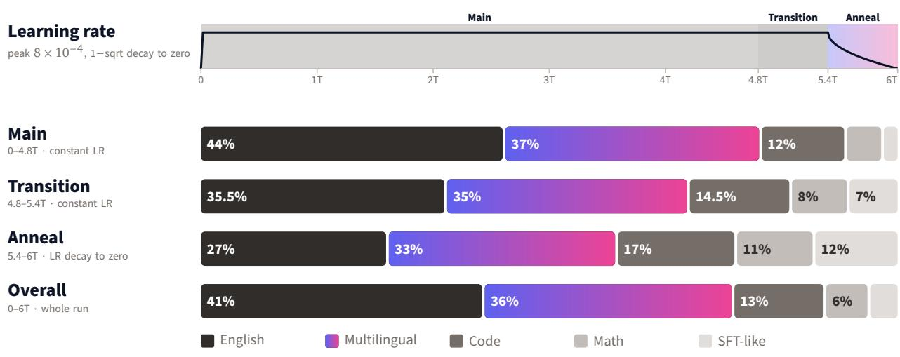

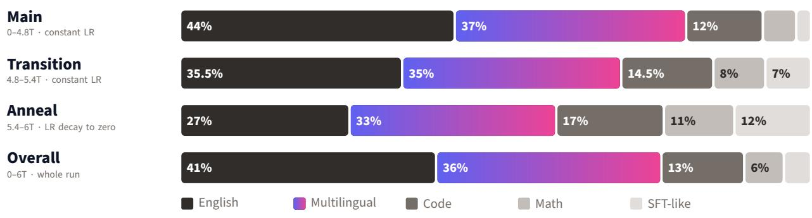  
Figure 2. Learning-rate schedule over the 6T training tokens, with the three stages shaded (top), and the domain shares of each stage (bottom); all values are in Table 10. Code, math and SFT-like data grow from 19% to 40% of the tokens, while multilingual text stays at about a third and outweighs English in the anneal.

## 2.3 Data Mixture and Curriculum

We designed the mixture to achieve competence in 44 languages besides English, with priority given to the oficial EU languages. It also had to keep English knowledge and reasoning on par with English-centric models of the same size, while adding basic code and math abilities. We set it with explicit rules rather than by optimizing mixture weights on proxy models. Each rule rests on published evidence, data availability, or our priorities among languages (Table 3). Figure 2 shows the resulting mixture of each stage.

Of the four stages of pretraining, the first three read 6T tokens in 4,096-token sequences. The main stage, 4.8T tokens at constant learning rate, uses the broadest mixture. The transition stage, with 0.6T tokens still at a constant learning rate, moves the mixture halfway toward the anneal mixture. The anneal of the last 0.6T tokens decays the learning rate to zero. As in earlier work, the learning rate decays only at the end (Hu et al., 2024; Hägele et al., 2024) and training ends on high-quality data (Feng et al., 2024). A sudden change in data can cause a model to forget what it learned earlier, and keeping part of the earlier mixture reduces this forgetting (Ibrahim et al., 2024). The transition stage therefore splits the change into two smaller steps, as the two-blend schedule of Parmar et al. (2024) does in continued pretraining. Over the three stages, code, math and SFT-like data grow from 19% to 40% of the tokens, and the anneal keeps only high-quality English web data. The multilingual share stays at about a third while English falls from 44% to 27%, so that in the anneal multilingual text is the largest domain, ahead of English (Figure 2). Of the text in English and the other languages, without code, math and SFT-like data, the other languages make up 46% in the main stage, 50% in the transition and 55% in the anneal. Its content also shifts toward high-quality sources: plain web text falls from 41% of the multilingual tokens to 6.5%, while high-quality web and question-answer data rise from 39% to 69%.

Table 3. Design of the data mixture: each choice and its basis. Shares are given per stage, in the order main, transition, anneal (Figure 2).
<table><tr><td>Decision</td><td>Choice</td><td>Basis</td></tr><tr><td>English : multilingual</td><td>54:46 between English and multilingual text, excluding code, math and SFT-like</td><td>Most high-quality and synthetic data are English; in small proxy runs, shifting tokens between English and multilingual text hurt the side that lost them more than it helped the other</td></tr><tr><td>Code</td><td>data (main stage) 12%, 14.5%, 17%</td><td>Code improves natural-language reasoning (Aryabumi et al., 2025); SmolLM3 uses 12–24% (Hugging Face, 2025c), Llama 3 17% (Grattafiori et al., 2024)</td></tr><tr><td>Math</td><td>5%, 8%, 11%</td><td>Limited by supply: about 330B unique tokens</td></tr><tr><td>SFT-like data</td><td>2%, 7%, 12%</td><td>High-quality and question-answer data help most at the end of training (Blakeney et al., 2024; Grattafiori et al., 2024; Team OLMo, 2025; NVIDIA, 2025)</td></tr><tr><td>Multilingual anneal</td><td>33%, mostly high-quality web and question-answer data</td><td>In a 100B-token continuation of a 1B model, translated question-answer data scored 10 points higher on Global MMLU than heuristically filtered Common Crawl text (NVIDIA, 2025)</td></tr></table>

We include every language with at least 20B tokens after deduplication. Irish and Maltese have far fewer speakers, but we include them so that all 24 oficial languages of the European Union are covered. This gives 44 languages besides English (Table 11). Sampling languages by size would give Russian and Chinese a third of the multilingual tokens. Flatter sampling trades quality in high-resource languages for quality in low-resource ones (Conneau et al., 2020). We therefore sample languages more evenly than by size, with extra weight given to the oficial EU languages and to a selection of widely spoken languages outside the EU. Compared with size-based sampling, these weights raise the share of oficial EU languages from 46% to 61% of multilingual tokens, mostly at the expense of Russian, Chinese and Japanese (Figure 9).

Because mixtures of experts are sensitive to repeated data (Jha et al., 2026), we cap the epochs of each source within the 6T budget, as in UniMax (Chung et al., 2023). No source is read more than twice except Wikipedia, and plain web text is repeated only in Irish and Maltese. In all, 97% of the training tokens are the first read of a document (Table 10).

Long-context stage. The fourth stage reads 100B tokens in two steps: 40B in 32k-token sequences, then 60B in 128k-token sequences (Section 4.1). As in Kolibri (Aleph Alpha, 2026), both steps mix the anneal mixture as is, the same mixture reweighted toward long documents, and natural long documents from FinePDFs (Hugging Face, 2025a) and, in the 32k step only, FineWeb2- HQ (Messmer et al., 2025) (Table 12). Both steps also give about 11% of their tokens to math and code: Nemotron-CC-Math documents of up to 16k tokens (Karimi Mahabadi et al., 2026), real (not synthetic) code and, in the 32k step only, SFT-like math documents of 16k to 32k tokens (Table 9). Keeping the anneal mixture limits the loss of short-context quality (Gao et al., 2025; Team Olmo, 2025). It therefore makes up half of the 128k step, which ends training. Across the whole stage, 58% of tokens come from documents longer than 4k tokens, and 12.3B tokens come from documents of at least 128k tokens.

## 3 Architecture

The architecture of Lara Mini base follows two goals: capacity for many languages at a small active budget, and a small inference state. The mixture of experts (MoE) layers serve the first: in our small-scale comparisons, a fine-grained MoE outperformed dense models with more than twice its active parameters (Section C.1). The hybrid token mixing serves the second. Only 7 of the 34 layers use global attention, so the memory held per sequence grows with context length about five times more slowly than in a full-attention model of the same shape.

Lara Mini base is a decoder-only Transformer with an MoE feed-forward block in every layer and three kinds of token mixer: Gated DeltaNet (Yang et al., 2025c), sliding-window attention and global attention. It has 7.2B parameters in total, of which 0.6B are active for each token (Table 4). The routed experts hold 94% of all parameters (6.8B). Of the active parameters, 24% are the tied input and output embedding, 41% the four routed experts and the shared expert that each token passes through, and 35% the token mixers, routers and normalization weights. The remaining building blocks are standard: pre-normalization with RMSNorm (Zhang and Sennrich, 2019), SwiGLU feed-forward networks (Shazeer, 2020) and no bias terms. The model uses the Qwen3 tokenizer (Yang et al., 2025a), with a vocabulary of 151,669 tokens (151,936 rows in the embedding table, padded). Figure 3 shows one layer and the order of the token mixers.

## 3.1 Hybrid Token Mixing

A Transformer with global attention in every layer caches the keys and values of all previous tokens. Its memory per sequence therefore grows linearly with context length and dominates the cost of serving long contexts. Lara Mini base instead interleaves three token mixers with complementary strengths, in short blocks, each ending with a global layer (Figure 3). A sliding-window layer is exact but sees only the last 512 tokens. A Gated DeltaNet layer captures the full context via a compressed state but struggles with precise local comparisons (Arora et al., 2024; Yang et al., 2024). Earlier hybrids therefore pair recurrent layers with local attention (De et al., 2024; Ren et al., 2025). The global layers enable exact retrieval at any distance, whereas the other two’s memory does not grow with context. Gated DeltaNet can also make training more eficient: hybrids that use it in most layers match the quality of Transformers with substantially fewer training tokens (Merrill et al., 2026).

Gated DeltaNet. Gated DeltaNet (Yang et al., 2025c) is a linear-attention layer whose state is a fixed-size matrix per head, updated with the gated delta rule:

$$
\begin{array} { r } { \pmb { S } _ { t } = \alpha _ { t } \pmb { S } _ { t - 1 } \left( \mathbf { I } - \beta _ { t } \mathbf { k } _ { t } \mathbf { k } _ { t } ^ { \top } \right) + \beta _ { t } \mathbf { v } _ { t } \mathbf { k } _ { t } ^ { \top } , \qquad \mathbf { o } _ { t } = \pmb { S } _ { t } \mathbf { q } _ { t } . } \end{array}\tag{1}
$$

The decay $\alpha _ { t } \in ( 0 , 1 )$ and the write strength $\beta _ { t } \in ( 0 , 1 )$ depend on the input token and are computed per head. The decay lets a head forget, and the delta rule (Schlag et al., 2021; Yang et al., 2024) overwrites the value stored under a key instead of adding to it. Queries, keys and values pass through a causal depthwise convolution of width 4 followed by SiLU, and queries and keys are then L2-normalized. The output of each head is normalized with RMSNorm and gated with SiLU. The layer has no positional encoding: the recurrence itself carries the order of the tokens.

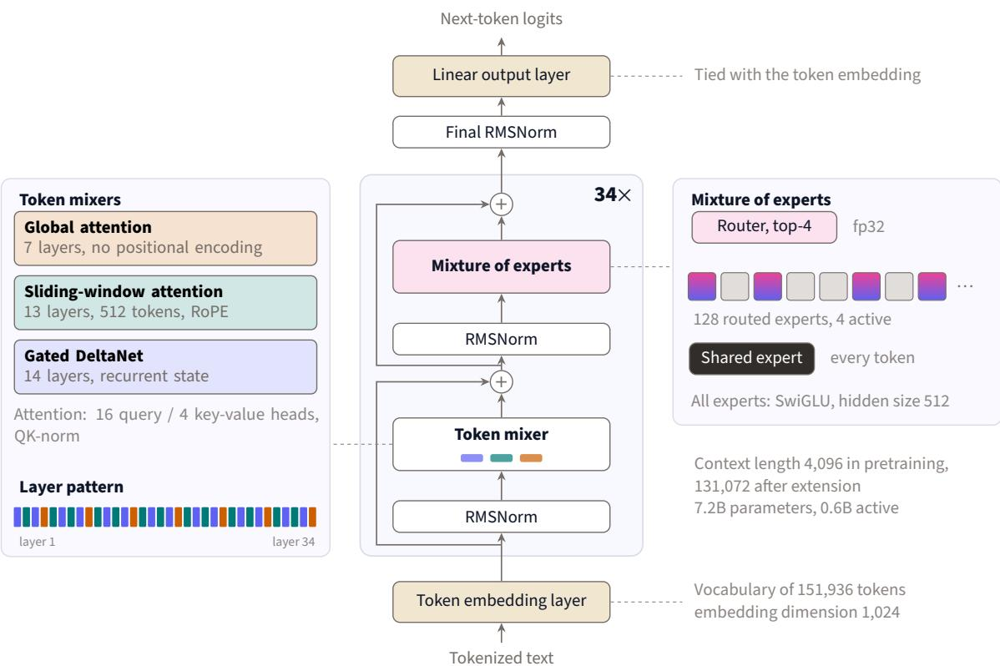  
Figure 3. Architecture of Lara Mini base. Center: each of the 34 layers applies a token mixer and a mixture of experts block, each preceded by RMSNorm and wrapped in a residual connection. Left: the three token mixers and their order: four layers [Gated DeltaNet, sliding window, Gated DeltaNet, global] followed by six blocks of five [sliding window, Gated DeltaNet, sliding window, Gated DeltaNet, global], so that the last layer is global. Right: the mixture of experts block, with 4 of the 128 routed experts active per token and one shared expert.

Sliding-window attention. Sliding-window attention (Beltagy et al., 2020; Jiang et al., 2023) restricts the attention of each token to the 512 most recent tokens, including itself. These layers use rotary position embeddings with base 10,000 over the full head dimension.

Global attention. The global layers attend over the whole context and use no positional encoding (Kazemnejad et al., 2023), since the Gated DeltaNet and sliding-window layers below them already encode position. All attention layers, windowed and global, use grouped-query attention (Ainslie et al., 2023) with 16 query and 4 key-value heads of dimension 128, and QK-norm.

Quality and memory. We compared the token mixers in ablations at 100B tokens against a baseline with global attention in every layer (Section C.2). The hybrid achieved a lower held-out loss than the baseline, very close to that of a variant with Gated DeltaNet in all 26 non-global layers, whereas sliding windows alone did not lower it. The hybrid also had the largest mean benchmark gain over the baseline, matching an oracle that, for each benchmark, selects the better of the Gated DeltaNet and sliding-window variants. After a context extension to 32k tokens, the hybrid was also the best variant on RULER and ONERULER at that length, 4 to 8 points above both single-mixer variants (Table 16). As computed from the architecture, the memory used per sequence during generation is 468 MiB at 32k tokens and 1.77 GiB at 128k tokens. A model of the same shape with global attention in every layer would hold 2.13 GiB and 8.50 GiB.

## 3.2 Mixture of Experts Layers

Every layer of Lara Mini base has an MoE block with 128 routed experts and 1 shared expert (Dai et al., 2024), all of which are SwiGLU networks with a hidden size of 512. A linear router computes one logit per routed expert, in fp32. Each token is routed to its top-4 experts by router logit, and their outputs are weighted by a softmax over these 4 logits. The shared expert processes every token and its output is added without a gate. Routing is dropless (Gale et al., 2023): no expert has a capacity limit, and no token is dropped. A load-balancing loss (Fedus et al., 2022) with coeficient 10−3 pushes the router toward an even distribution of expert use. The experts are fine-grained: their hidden size is half the model width, and a token activates 1/32 of the routed parameters. We chose the number of experts and this sparsity through ablations (Section C.1). Section 6.2 analyzes how the trained model shares its experts across languages.

## 4 Training

All four stages of pretraining use a hybrid optimizer: Muon for the weight matrices of the layers and AdamW for the other parameters (Section 4.1). In the first three stages (Section 2.3), the learning rate remains constant until the anneal, then decays to zero (Table 5). The fourth stage extends the context to 128k tokens with its own learning-rate schedule (Section 4.1).

## 4.1 Pretraining Recipe

Optimizer. Muon (Jordan et al., 2024) updates the layer weight matrices, experts included, and AdamW the other parameters; all of them share one learning rate and one weight decay (Table 5, details in Section B). In our ablations, AdamW needed 1.5 to 1.9 times as many tokens as Muon to reach the same training loss (Section C.1).

Stability measures. Large logits are a common source of instability in bf16 training. Lara Mini base bounds logits after each softmax. Besides the query and key normalization (Henry et al., 2020) and the fp32 router of Section 3, it adds an output z-loss with coeficient 10−4 (Chowdhery et al., 2023) and a router z-loss of 10−3 (Zoph et al., 2022).

Long-context stage. The long-context stage uses 100B tokens (Section 2.3), with the settings of Table 12 (Section B) taking over the last anneal optimizer state. These 100B tokens are 1.7% of the tokens of the first three stages, in line with the 0.8% to 1.8% of Olmo 3, Kolibri, SmolLM3 and Apertus (Team Olmo, 2025; Aleph Alpha, 2026; Hugging Face, 2025c; Hernández-Cano et al., 2026). The learning rate warms up to $8 \times 1 0 ^ { - 5 }$ , a tenth of the peak of the first three stages, and decays to zero over the last 15B tokens. The position encoding is unchanged: the global attention layers use none (Yang et al., 2025b), and the sliding-window layers never attend beyond 512 tokens (Section 3.1). Unlike in the first three stages, documents packed into one sequence do not interact: attention is masked across documents and the Gated DeltaNet state restarts at each document. Llama 3 found this masking important in continued pretraining on very long sequences (Grattafiori et al., 2024). Section 5.7 evaluates the result.

Table 4. Architecture of Lara Mini base. Parameter counts include the embedding, counted once.
<table><tr><td>Hyperparameter</td><td>Value</td></tr><tr><td>Layers</td><td>34</td></tr><tr><td>Gated DeltaNet</td><td>14</td></tr><tr><td>Sliding-window attention</td><td>13 (window of 512 tokens)</td></tr><tr><td>Global attention</td><td>7 (no positional encoding)</td></tr><tr><td>Hidden size</td><td>1,024</td></tr><tr><td>Attention heads (query / key-value)</td><td>16 / 4, dimension 128</td></tr><tr><td>Gated DeltaNet heads (query-key / value)</td><td>8 / 16, dimension 128</td></tr><tr><td>Routed experts / active per token</td><td>128 /4</td></tr><tr><td>Shared experts</td><td>1</td></tr><tr><td>Expert hidden size</td><td>512</td></tr><tr><td>Active / total parameters</td><td>0.6B/7.2B</td></tr><tr><td>Vocabulary size</td><td>151,669 (Qwen3 tokenizer; 151,936 embedding rows)</td></tr><tr><td>Tied input / output embeddings</td><td>Yes</td></tr><tr><td>Context length (stages 1-3 / stage 4)</td><td>4,096 /131,072</td></tr></table>

Table 5. Hyperparameters of the first three stages of pretraining (6T tokens).
<table><tr><td>Hyperparameter</td><td>Value</td></tr><tr><td>Optimizer</td><td> $\mathrm { M u o n } + \mathrm { A d a m W }$ </td></tr><tr><td>Peak learning rate</td><td> $8 \times 1 0 ^ { - 4 }$ </td></tr><tr><td>Warmup</td><td>2,000 steps (17B tokens)</td></tr><tr><td>Schedule</td><td>constant to 90% of training, then 1-sqrt decay to 0</td></tr><tr><td>Global batch size</td><td>2,048 sequences (≈8.4M tokens)</td></tr><tr><td>Sequence length</td><td>4,096</td></tr><tr><td>Training steps / tokens</td><td>715,256 /6T</td></tr><tr><td>Output z-loss</td><td> $1 0 ^ { - 4 }$ </td></tr><tr><td>AdamW  $\beta _ { 1 } , \beta _ { 2 } , \epsilon$ </td><td>0.9, 0.95, 10−8</td></tr><tr><td>Muon momentum</td><td>0.95 (Nesterov), 5 Newton-Schulz steps</td></tr><tr><td>Initialization std</td><td>0.02</td></tr><tr><td>Weight decay, gradient clipping</td><td>0.1, 1.0</td></tr><tr><td>Precision</td><td>bf16</td></tr></table>

## 4.2 Training Dynamics

Training was stable throughout: the loss never exceeded its median over the preceding 1,000 steps by more than 3%, and expert utilization remained nearly uniform (Section B). Because the training loss shifts with the data mixture at each stage boundary, we followed progress on a fixed held-out set and on the evaluation suite of Section 5 (Figure 4). During the main stage, the Overall average (the mean of the four domain averages) rose gradually from 41.1 at 1.5T tokens to 44.1 at 4.6 T tokens. The transition stage, which increases the share of code and math, mainly improved these two domains. The anneal, which decays the learning rate on the highest-quality mixture, improved every domain. From the last checkpoint before the anneal (5.2T tokens) to its end, the Overall average rose by 10.5 points and math by 22.6. English and multilingual scores improved together at every evaluated checkpoint, both in the main stage and in the anneal.

## 5 Evaluation

We compare Lara Mini base against 56 open base models across 26 benchmarks in four domains: English knowledge and reasoning, multilingual understanding, math and code. The comparison tests whether a model trained on only 41% English data remains competitive in English and leads in the other languages. We evaluate the released Lara Mini base, the checkpoint after the long-context stage (Section 4.1); Section 5.7 reports its long-context results.

## 5.1 Evaluation Setup

Lara Mini base is a base model, so we evaluate it as one, with few-shot or zero-shot prompts (Brown et al., 2020; Gu et al., 2025) and no chat template. We compare it only with other pretrained base models, never with instruction-tuned ones. We score every model ourselves, with the same prompts, settings and answer extraction, using lm-evaluation-harness (Biderman et al., 2024). Log-likelihood tasks run on the Hugging Face backend with log-softmax in fp32, and generative tasks on vLLM (Kwon et al., 2023). The two backends agree within 0.6 points on the tasks we checked.

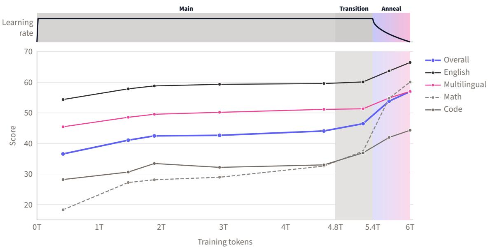  
Figure 4. Scores of Lara Mini base on the evaluation suite of Section 5 at eight checkpoints of the first three stages: Overall and domain averages, with the learning-rate schedule and the training stages on top. Shading marks the transition (4.8–5.4T) and anneal (5.4–6T) stages; lines only join the evaluated checkpoints. Every domain improves fastest during the anneal.

Table 17 in Section D lists the benchmarks and their settings. We call the languages of the training data of Lara Mini base its supported languages. As is common for models trained on a defined set of languages (Martins et al., 2025b; Ali et al., 2025; Gonzalez-Agirre et al., 2025), we evaluate on the supported ones. Section D.2 reports the results per language. One multilingual benchmark, T-HellaSwag, is our own translation of HellaSwag (Zellers et al., 2019) (Section 5.2). Each domain average is the mean of its benchmarks, and the Overall average gives the four domains equal weight. Code is scored by executing the generated programs. HumanEval is not in the suite, because all of its items occur in the public datasets of our training pool (Section 2.2).

Baselines. Following Muennighof et al. (2025b), we group the 56 baselines by active parameters, which approximate the cost of inference. The three groups have up to 2B, from 2B to 4B and more than 4B active parameters. The boundary between the last two groups is at 5B, so that the 4B models, with up to 4.7B active parameters, fall in the second. Gemma-4-E2B and Gemma-4- E4B, whose 5.1B and 7.9B parameters include per-layer embeddings, are placed at their 2B and 4B efective sizes. We checked that this grouping compares models of similar inference cost by measuring the generation speed of 45 of them on one GPU (Section E). For a single user, every measured model in the two larger groups generates text 1.4 to 4.2 times more slowly than Lara Mini base. In its own group, 21 of the 28 other measured models are slower as well. Table 6 shows 27 of the 56 baselines, and Section D.1 reports all 56 models on every benchmark, including those named in the text but not in the table.

## 5.2 T-HellaSwag

T-HellaSwag is our higher-quality machine translation of the English commonsense reasoning benchmark HellaSwag (Zellers et al., 2019) into 110 language variants of 105 languages; we include it in our evaluation suite and will release it. The variants are written in 25 scripts, and 46 of them use a script other than Latin. Each variant holds 200 documents, 22,000 in all, selected for translation quality while keeping the dificulty of the English originals. T-HellaSwag-full holds all 10,042 translated documents of each variant. A multilingual version of HellaSwag already exists, Multilingual HellaSwag (Lai et al., 2023), which covers 33 languages. We compared the two translations across 50 documents per language using two LLM judges: Gemini 4 Argon (Google DeepMind, 2026) and Claude Opus 5.5 (Anthropic, 2026). In the 32 languages they share, both judges preferred our translation in more than 98% of the documents. Section F describes how we translated and selected the documents, how we assessed the translation quality, and the limitations of the dataset.

## 5.3 Main Results

Among the 36 models with up to 2B active parameters (Table 6), Lara Mini base ranks first overall (57.0, 3.1 points above granite-4.0-h-tiny) and on the multilingual average (56.7, 3.4 points above Gemma-4-E2B). It is also first on math, second on English and fifth on code. Six of the 56 models score higher overall and six on the multilingual average, all in the two larger groups, with 4 to 14 times as many active parameters as Lara Mini base (Table 18). Of these models, the four that report their pretraining tokens were trained on 18T to 36T, 3 to 6 times as many as Lara Mini base. Lara Mini base also scores higher overall than several models with 6 to 13 times its active parameters, such as Ministral-3-3B, Gemma-4-E4B, Apertus-v1.5-8B and Llama-3.1-8B. Figure 1 summarizes the same results.

Eficiency. Figure 5 plots the Overall average of each model against the speed at which it generates text for a single user. Speed is measured in characters per second, so that models with tokenizers of diferent densities can be compared on equal footing. Lara Mini base lies on the Pareto frontier: the seven faster models score at most 42.6, and every model that scores higher generates text at least 1.8 times more slowly. The closest of them in Overall average, MiniCPM5-2B, is 0.5 points higher but 8.7 points lower on the multilingual average. The speed advantage of Lara Mini base is largest for a single user and on long prompts, and narrows when many users share the GPU (Section E).

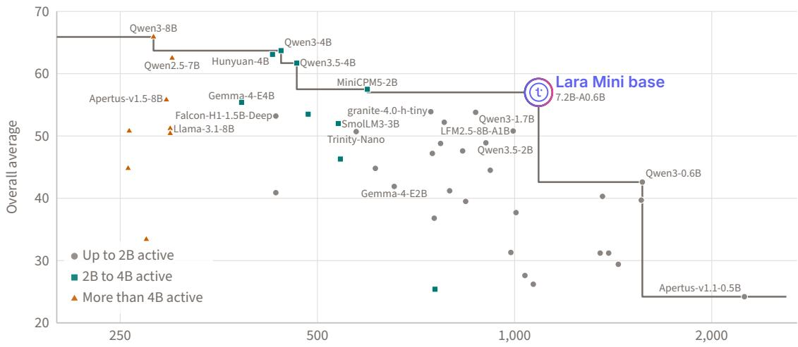  
Characters generated per second for one user (log scale)  
Figure 5. Overall average against generation speed for a single user, in characters per second, for Lara Mini base and the 45 open base models we could measure (Section E). Marks indicate the groups in Table 6; the line is the Pareto frontier for the drawn models. Every model with a higher Overall average than Lara Mini base generates text at least 1.8 times more slowly.

## 5.4 English

Table 7 reports every benchmark for Lara Mini base, the best models of its group and the best model of each larger group, and Table 19 lists the English benchmarks for all models. Its English average (66.4) is the second best of its group, 2.0 points below Trinity-Nano (68.4). Its English average lies between those of the 3B dense models SmolLM3-3B (64.7) and Ministral-3-3B (67.7).

Table 6. Domain averages of Lara Mini base and open base models, grouped by active parameters as in Muennighof et al. (2025b): up to 2B, from 2B to 4B and more than 4B. Active, Total: active and total parameters. Tokens: pretraining tokens reported by each developer, over all pretraining stages (–: not reported; †: distilled from a larger model during pretraining, wholly or in part); for Lara Mini base, the 6T of the first three stages (Section 2), as in Table 1; the long-context stage adds 100B. Multilingual is averaged over the languages supported by Lara Mini base; Overall is the mean of the four domain averages. Best result in each group in bold, second best underlined. Gemma-4-E2B and Gemma-4-E4B are listed at their 2B and 4B efective sizes, and their totals include per-layer embeddings. All 56 models we evaluated are in Table 18. Lara Mini base has the highest Overall, multilingual and math averages of the models with up to 2B active parameters.
<table><tr><td rowspan="2">Model</td><td colspan="2">Parameters</td><td rowspan="2"></td><td colspan="4">Domain average</td><td rowspan="2">Overall</td></tr><tr><td>Active</td><td>Total</td><td>Tokens English</td><td>Multilingual</td><td>Math</td><td>Code</td></tr><tr><td colspan="8">Models with more than 4B active parameters</td></tr><tr><td>Llama-3.1-8B</td><td>8.0B</td><td>8.0B</td><td>15T</td><td>69.6</td><td>55.2</td><td>36.6</td><td>43.6</td><td>51.2</td></tr><tr><td>Apertus-v1.5-8B</td><td>8.0B</td><td>8.0B</td><td>19T</td><td>69.0</td><td>59.2</td><td>50.6</td><td>44.3</td><td>55.8</td></tr><tr><td>Qwen2.5-7B</td><td>7.6B</td><td>7.6B</td><td>18T</td><td>72.3</td><td>57.3</td><td>64.9</td><td>55.5</td><td>62.5</td></tr><tr><td>Qwen3-8B</td><td>8.2B</td><td>8.2B</td><td>36T</td><td>71.9</td><td>59.2</td><td>71.3</td><td>61.0</td><td>65.9</td></tr><tr><td colspan="9">Models with 2B to 4B active parameters</td></tr><tr><td>SmolLM3-3B</td><td>3.1B</td><td>3.1B</td><td>11.2T</td><td>64.7</td><td>48.7</td><td>51.0</td><td>43.6</td><td>52.0</td></tr><tr><td>Nemotron-Flash-3B</td><td>2.7B</td><td>2.7B</td><td>4.5T</td><td>65.6</td><td>42.0</td><td>59.7</td><td>44.5</td><td>52.9</td></tr><tr><td>Ministral-3-3B</td><td>3.4B</td><td>3.4B</td><td>1-3T†</td><td>67.7</td><td>55.4</td><td>49.9</td><td>42.3</td><td>53.8</td></tr><tr><td>Domyn-Edge</td><td>3.9B</td><td>3.9B</td><td>13T</td><td>68.2</td><td>52.0</td><td>54.1</td><td>47.3</td><td>55.4</td></tr><tr><td>Gemma-4-E4B</td><td>4.0B</td><td>7.9B</td><td>一</td><td>70.1</td><td>61.1</td><td>44.4</td><td>46.0</td><td>55.4</td></tr><tr><td>MiniCPM5-2B</td><td>2.5B</td><td>2.5B</td><td>一</td><td>65.3</td><td>48.0</td><td>66.0</td><td>50.8</td><td>57.5</td></tr><tr><td>Qwen3.5-4B</td><td>4.7B</td><td>4.7B</td><td>一</td><td>70.5</td><td>58.0</td><td>66.1</td><td>52.3</td><td>61.7</td></tr><tr><td>Hunyuan-4B</td><td>4.2B</td><td>4.2B</td><td>一</td><td>70.4</td><td>51.6</td><td>72.0</td><td>58.6</td><td>63.1</td></tr><tr><td>Qwen3-4B</td><td>4.0B</td><td>4.0B</td><td>36T</td><td>71.2</td><td>57.5</td><td>69.2</td><td>57.0</td><td>63.7</td></tr><tr><td colspan="9">Models with up to 2B active parameters</td></tr><tr><td>Llama-3.2-1B</td><td>1.2B</td><td>1.2B</td><td>9T†</td><td>51.9</td><td>39.7</td><td>5.0</td><td>28.0</td><td>31.2</td></tr><tr><td>Apertus-v1.1-1.5B</td><td>1.5B</td><td>1.5B</td><td>1.7T†</td><td>53.6</td><td>44.8</td><td>5.9</td><td>20.6</td><td>31.2</td></tr><tr><td>OLMoE-1B-7B</td><td>1.3B</td><td>6.9B</td><td>5.1T</td><td>61.9</td><td>40.4</td><td>27.2</td><td>21.1</td><td>37.7</td></tr><tr><td>Gemma-4-E2B</td><td>2.0B</td><td>5.1B</td><td>一</td><td>63.3</td><td>53.3</td><td>18.0</td><td>32.8</td><td>41.9</td></tr><tr><td>Qwen3-0.6B</td><td>0.6B</td><td>0.6B</td><td>36T</td><td>55.3</td><td>43.1</td><td>37.2</td><td>34.8</td><td>42.6</td></tr><tr><td>Qwen2.5-1.5B</td><td>1.5B</td><td>1.5B</td><td>18T</td><td>62.6</td><td>46.8</td><td>43.0</td><td>38.1</td><td>47.6</td></tr><tr><td>Qwen3.5-2B</td><td>1.9B</td><td>1.9B</td><td>一</td><td>63.3</td><td>50.0</td><td>45.6</td><td>36.7</td><td>48.9</td></tr><tr><td>LFM3-1.7B</td><td>1.7B</td><td>1.7B</td><td>22T</td><td>60.0</td><td>46.7</td><td>52.2</td><td>38.0</td><td>49.2</td></tr><tr><td>Trinity-Nano</td><td>1.0B</td><td>6.1B</td><td>10T</td><td>68.4</td><td>47.4</td><td>45.0</td><td>42.0</td><td>50.7</td></tr><tr><td>LFM2.5-8B-A1B</td><td>1.7B</td><td>8.5B</td><td>38T</td><td>65.7</td><td>48.6</td><td>52.3</td><td>36.6</td><td>50.8</td></tr><tr><td>Hunyuan-1.8B</td><td>1.8B</td><td>1.8B</td><td>一</td><td>62.7</td><td>44.3</td><td>52.0</td><td>49.7</td><td>52.2</td></tr><tr><td>Falcon-H1-1.5B-Deep</td><td>1.6B</td><td>1.6B</td><td>3T</td><td>65.3</td><td>45.2</td><td>55.2</td><td>47.2</td><td>53.2</td></tr><tr><td>Qwen3-1.7B</td><td>1.7B</td><td>1.7B</td><td>36T</td><td>63.8</td><td>50.3</td><td>54.6</td><td>46.6</td><td>53.8</td></tr><tr><td>granite-4.0-h-tiny</td><td>1.0B</td><td>6.9B</td><td>22.5T</td><td>66.2</td><td>51.8</td><td>49.4</td><td>48.4</td><td>53.9</td></tr><tr><td>Lara Mini base</td><td>0.6B</td><td>7.2B</td><td>6T</td><td>66.4</td><td>56.7</td><td>59.9</td><td>45.1</td><td>57.0</td></tr></table>

## 5.5 Multilingual

Table 7 reports the multilingual benchmarks on the languages supported by Lara Mini base, and Table 20 lists them for all models. Lara Mini base ranks first in its group on seven of the nine benchmarks, and on XCOPA is tied with Gemma-4-E2B. Its lead is largest on INCLUDE (58.7, 5.3 points above granite-4.0-h-tiny). It ranks lower on the other two benchmarks, Belebele and PAWS-X. On Belebele, Qwen3.5-2B and Qwen3-1.7B score up to 2.6 points higher. On PAWS-X, a paraphrase task in six high-resource languages, Lara Mini base is 1.6 points behind the best models of its group, Hunyuan-1.8B and Trinity-Nano. On T-HellaSwag, Lara Mini base is first in its group on its supported languages (58.4), and only three of the 56 models, all with more active parameters, score higher. Averaged over all the languages of the benchmarks, including those it does not support, Lara Mini base still ranks first in its group, at 49.4 (Table 21). The second, Gemma-4-E2B (49.0), supports more than 140 languages (Gemma Team, 2026), against the 45 of Lara Mini base.

Table 7. Per-benchmark results for Lara Mini base, the five other models with up to 2B active parameters that score highest on the Overall average, and the best model of each larger group (Table 6). Multilingual benchmarks are averaged over the languages supported by Lara Mini base. Best result among the six models with up to 2B active parameters in bold, second best underlined. NP, P: non-parallel and parallel. Settings in Table 17; all models in Tables 19, 20 and 22.
<table><tr><td></td><td colspan="6">Up to 2B active parameters</td><td colspan="2">Larger models</td></tr><tr><td>Benchmark</td><td>LFM2.5 8B-A1B</td><td>Hunyuan 1.8B</td><td>Falcon-H1 1.5B-Deep</td><td>Qwen3 1.7B</td><td>granite-4.0 h-tiny</td><td>Lara Mini base</td><td>Qwen3 4B 2-4B</td><td>Qwen3 8B &gt;4B</td></tr><tr><td>English</td><td></td><td></td><td></td><td></td><td></td><td></td><td></td><td></td></tr><tr><td>NLI</td><td>52.3</td><td>50.7</td><td>55.9</td><td>54.2</td><td>54.2</td><td>52.7</td><td>54.4</td><td>46.8</td></tr><tr><td>PAWS</td><td>62.9</td><td>71.0</td><td>68.0</td><td>61.2</td><td>63.3</td><td>65.3</td><td>68.6</td><td>55.5</td></tr><tr><td>Belebele</td><td>69.1</td><td>75.4</td><td>70.9</td><td>75.9</td><td>69.9</td><td>76.0</td><td>89.3</td><td>91.3</td></tr><tr><td>COPA</td><td>85.4</td><td>78.6</td><td>82.2</td><td>82.4</td><td>85.4</td><td>84.8</td><td>85.8</td><td>89.0</td></tr><tr><td>PIQA</td><td>77.7</td><td>72.9</td><td>76.4</td><td>75.5</td><td>79.5</td><td>80.0</td><td>78.0</td><td>79.5</td></tr><tr><td>HellaSwag</td><td>74.0</td><td>62.2</td><td>69.8</td><td>67.2</td><td>77.7</td><td>74.8</td><td>75.7</td><td>79.6</td></tr><tr><td>WinoGrande</td><td>67.6</td><td>66.1</td><td>67.3</td><td>65.4</td><td>73.5</td><td>69.6</td><td>72.0</td><td>76.6</td></tr><tr><td>ARC-C</td><td>64.9</td><td>50.1</td><td>55.7</td><td>55.7</td><td>61.7</td><td>58.6</td><td>64.4</td><td>67.6</td></tr><tr><td>MMLU</td><td>63.2</td><td>62.9</td><td>66.6</td><td>62.6</td><td>65.5</td><td>63.3</td><td>73.0</td><td>76.8</td></tr><tr><td>MMLU-Pro</td><td>39.8</td><td>37.5</td><td>40.1</td><td>37.4</td><td>31.6</td><td>39.0</td><td>51.2</td><td>56.1</td></tr><tr><td>English average</td><td>65.7</td><td>62.7</td><td>65.3</td><td>63.8</td><td>66.2</td><td>66.4</td><td>71.2</td><td>71.9</td></tr><tr><td>Multilingual</td><td></td><td></td><td></td><td></td><td></td><td></td><td></td><td></td></tr><tr><td>XNLI</td><td>41.1</td><td>38.3</td><td>40.4</td><td>42.0</td><td>42.8</td><td>44.9</td><td>43.3</td><td>39.1</td></tr><tr><td>PAWS-X</td><td>54.4</td><td>58.5</td><td>56.8</td><td>55.7</td><td>57.0</td><td>56.9</td><td>57.7</td><td>51.3</td></tr><tr><td>Belebele</td><td>40.5</td><td>45.1</td><td>40.3</td><td>61.8</td><td>51.1</td><td>59.3</td><td>78.5</td><td>82.3</td></tr><tr><td>XCOPA</td><td>62.4</td><td>55.3</td><td>54.8</td><td>62.2</td><td>61.5</td><td>68.1</td><td>66.6</td><td>69.4</td></tr><tr><td>Global PIQA (NP)</td><td>61.8</td><td>54.5</td><td>56.8</td><td>58.1</td><td>63.1</td><td>72.6</td><td>63.0</td><td>67.1</td></tr><tr><td>Global PIQA (P)</td><td>29.0</td><td>23.5</td><td>26.5</td><td>28.4</td><td>30.3</td><td>34.4</td><td>31.1</td><td>33.2</td></tr><tr><td>T-HellaSwag</td><td>46.6</td><td>35.1</td><td>39.3</td><td>42.0</td><td>51.3</td><td>58.4</td><td>51.2</td><td>56.8</td></tr><tr><td>INCLUDE</td><td>48.2</td><td>43.4</td><td>42.5</td><td>51.4</td><td>53.4</td><td>58.7</td><td>62.6</td><td>66.8</td></tr><tr><td>Global MMLU</td><td>53.7</td><td>44.6</td><td>49.1</td><td>50.8</td><td>55.4</td><td>56.5</td><td>63.2</td><td>67.2</td></tr><tr><td>Multilingual average</td><td>48.6</td><td>44.3</td><td>45.2</td><td>50.3</td><td>51.8</td><td>56.7</td><td>57.5</td><td>59.2</td></tr><tr><td>Math</td><td></td><td></td><td></td><td></td><td></td><td></td><td></td><td></td></tr><tr><td>GSM8K</td><td>67.6</td><td>71.6</td><td>72.3</td><td>71.8</td><td>59.1</td><td>67.2</td><td>87.8</td><td>86.7</td></tr><tr><td>MATH</td><td>45.8</td><td>42.3</td><td>49.2</td><td>41.0</td><td>45.4</td><td>60.9</td><td>52.8</td><td>55.3</td></tr><tr><td>MGSM</td><td>43.3</td><td>42.1</td><td>44.3</td><td>50.9</td><td>43.6</td><td>51.7</td><td>66.9</td><td>71.9</td></tr><tr><td>Math average</td><td>52.3</td><td>52.0</td><td>55.2</td><td>54.6</td><td>49.4</td><td>59.9</td><td>69.2</td><td>71.3</td></tr><tr><td>Code</td><td></td><td></td><td></td><td></td><td></td><td></td><td></td><td></td></tr><tr><td>MBPP</td><td>40.4</td><td>58.8</td><td>56.8</td><td>55.4</td><td>58.4</td><td>53.8</td><td>67.0</td><td>69.6</td></tr><tr><td>MBPP+</td><td>48.4</td><td>62.2</td><td>58.5</td><td>59.8</td><td>58.5</td><td>58.2</td><td>68.0</td><td>70.4</td></tr><tr><td>CRUXEval-I</td><td>28.4</td><td>39.6</td><td>35.8</td><td>35.9</td><td>36.6</td><td>34.4</td><td>45.1</td><td>52.4</td></tr><tr><td>CRUXEval-O</td><td>29.1</td><td>38.4</td><td>37.8</td><td>35.1</td><td>40.0</td><td>33.9</td><td>48.0</td><td>51.6</td></tr><tr><td>Code average</td><td>36.6</td><td>49.7</td><td>47.2</td><td>46.6</td><td>48.4</td><td>45.1</td><td>57.0</td><td>61.0</td></tr></table>

## 5.6 Math and Code

Table 7 also reports math and code. Lara Mini base has the best math average in its group, 4.7 points above Falcon-H1-1.5B-Deep. Its math average is also higher than that of every model with

more active parameters except MiniCPM5-2B and five Qwen and Hunyuan models with 4B to 8B active parameters. Its code average ranks fifth in its group.

## 5.7 Long-Context Results

We evaluate Lara Mini base after the long-context stage (Section 4.1) at 32k and 128k tokens on RULER (Hsieh et al., 2024) (13 synthetic English tasks), ONERULER (Kim et al., 2025) (retrieval tasks in 26 languages) and HELMET (Yen et al., 2025) (mostly application-centric English tasks). Since Lara Mini base is a base model, it continues generating text after its answer. We therefore keep only the tasks whose scores do not depend on that text: four retrieval tasks for ONERULER and four categories for HELMET (Section D.3).

Before the long-context stage, Lara Mini base scores at most 15.0 on the three benchmarks at 32k and 128k tokens (Table 8). After it, Lara Mini base leads the five open models of Table 8 on ONERULER, the only multilingual benchmark of the three, at 32k tokens (90.1), and is second at 128k, 3.8 points behind Gemma-4-E2B. On RULER and HELMET, it trails only Qwen3.5-2B and Gemma-4-E2B, which have about three times its active parameters. The long-context stage barely changes short-context scores: on the benchmarks in Table 6, the Overall average changes by less than 0.1 points, and no domain average by more than 0.8 points.

Table 8. Long-context scores of Lara Mini base at the end of the anneal and after the long-context stage (the released model), and of open base models, all scored with the same protocol (Section D.3): mean of the 13 RULER tasks, of four ONERULER retrieval tasks in 26 languages and of four HELMET categories. Open models: five models with up to 2B active parameters that support 128k tokens, including the strongest of the group overall (granite-4.0-h-tiny) and on the multilingual average (Gemma-4-E2B). Active, Total: active and total parameters. Gemma-4-E2B at its 2B efective size; best in bold, second underlined. After the long-context stage, Lara Mini base ranks first on ONERULER at 32k tokens and second at 128k tokens.
<table><tr><td rowspan="2">Model</td><td colspan="2">Parameters</td><td colspan="2">RULER</td><td colspan="2">ONERULER</td><td colspan="2">HELMET</td></tr><tr><td>Active</td><td>Total</td><td>32k</td><td>128k</td><td>32k</td><td>128k</td><td>32k</td><td>128k</td></tr><tr><td>End of the anneal</td><td>0.6B</td><td>7.2B</td><td>15.0</td><td>10.9</td><td>0.4</td><td>0.0</td><td>9.3</td><td>8.9</td></tr><tr><td>Lara Mini base</td><td>0.6B</td><td>7.2B</td><td>76.6</td><td></td><td>63.7 90.1</td><td>80.9</td><td>63.0</td><td>54.7</td></tr><tr><td>Trinity-Nano</td><td>1.0B</td><td>6.1B</td><td>71.0</td><td>61.8</td><td>73.9</td><td>62.1</td><td>54.9</td><td>51.8</td></tr><tr><td>granite-4.0-h-tiny</td><td>1.0B</td><td>6.9B</td><td>29.5</td><td>26.4</td><td>19.5</td><td>14.1</td><td>41.0</td><td>36.3</td></tr><tr><td>Falcon-H1-1.5B-Deep</td><td>1.6B</td><td>1.6B</td><td>59.7</td><td>38.7</td><td>60.5</td><td>38.8</td><td>45.5</td><td>34.4</td></tr><tr><td>Qwen3.5-2B</td><td>1.9B</td><td>1.9B</td><td>83.7</td><td>73.8</td><td>87.7</td><td>77.4</td><td>64.0</td><td>56.8</td></tr><tr><td>Gemma-4-E2B</td><td>2.0B</td><td>5.1B</td><td>79.2</td><td>71.0</td><td>89.3</td><td>84.7</td><td>66.0</td><td>58.6</td></tr></table>

## 6 Multilingual Data and Model Capacity

The introduction raised a common concern about multilingual pretraining: at small scales, languages compete for the model’s capacity (Conneau et al., 2020; Chang et al., 2024). If they did in Lara Mini base, two signs should be visible. First, its multilingual data would cost English: replacing them with English would clearly raise English scores. Second, its mixture of experts would serve the languages by dividing its experts among them, so that each language uses only part of the model.

Development suite. We scored the anneals of Section 6.1 and the short runs of Sections C.1 and C.2 on a development suite. Its 17 benchmarks are the English and multilingual benchmarks in Table 17, excluding ARC-Challenge and MMLU-Pro. MMLU-Pro remained at chance level (10%) in the short runs trained from scratch, and we exclude it from all development scores so that they all average to the same benchmarks. The development suite uses its own prompts and, unless otherwise stated, averages across all languages within each benchmark, so its scores are not comparable to those in Section 5.

## 6.1 Multilingual Share

To test the first sign, we branched two anneals of 100B tokens from the training run of Lara Mini base at the end of its transition stage (5.4T tokens). Both decayed the learning rate to zero and difered only in their mixture. The first used the anneal mixture of Lara Mini base, with 27% English, 33% multilingual and 40% code, math and SFT-like data. The second replaced all multilingual data with English, at 60% English and the same 40% of code, math and SFT-like data. We scored both on the development suite, averaging the multilingual benchmarks over the supported languages as in Section 5 (Figure 6).

With more than twice as much English data in the anneal, the English average rose by only 0.3 points, about a tenth of the 2.7 points that the multilingual average lost on the supported languages (Figure 6). Without multilingual data, the score was lower on eight of the nine multilingual benchmarks, by up to 4.6 points on commonsense and knowledge benchmarks such as Global PIQA, XCOPA, T-HellaSwag and INCLUDE. The multilingual data cost math and code less than half a point. On the math and code benchmarks of Section 5, the anneal with multilingual data scored 53.8 and 43.6, and the one without it 54.2 and 43.7. A likely reason for the small English gain is that, by the end of the transition stage, the model had already read more than 2T English tokens, so that additional English in the anneal added little. The test covers only the anneal: it does not measure the efect of the multilingual share during the main stage.

Takeaway. In the anneal, replacing the multilingual third of the mixture with English raises the English average by 0.3 points and lowers the multilingual average by 2.7 points.

Change with the English-only anneal (points)

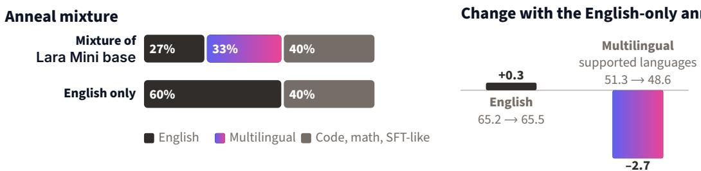  
Figure 6. Multilingual share of the anneal. Left: mixtures of the two anneals. Right: change in the mean score on the development suite when the multilingual data are replaced with English, with the scores of both anneals under each bar. English averages eight benchmarks; multilingual averages nine across the languages supported by Lara Mini base. Replacing the multilingual data with English barely raises the English average and clearly lowers the multilingual one.

## 6.2 Expert Routing across Languages

To test the second sign, we ran the released Lara Mini base on the Belebele passages (Bandarkar et al., 2024), the same text in each supported language, and recorded the experts to which each token was routed. In each layer, we measured the Jensen–Shannon divergence between each language’s distribution over the routed experts and the mean distribution across all 43 languages (Figure 7).

Routing difers between languages in the first and last layers and is almost identical in the middle of the network, with an average divergence of at most 0.015 bits in layers 10 to 17. In layers 2 to 7, 31 of the 37 languages with a relative among the 43 route most like that relative, for example, Catalan like Spanish, Czech like Slovak, and Estonian like Finnish. The grouping follows the language rather than the script: Serbian, written in Cyrillic, routes most like Croatian, and Maltese, written in Latin script, most like Arabic. Languages, therefore, share experts rather than divide them, which is consistent with the small cost of multilingual data for English (Section 6.1). Together, the two analyses find little of the competition that the concern predicts, but they do not show whether the mixture of experts or the data selection is responsible.

These findings are consistent with the hypothesis that multilingual learning benefits from shared representations rather than requiring separate capacity for each language. This resembles the positive transfer observed in multi-task learning (Caruana, 1997) and multilingual neural machine translation (Firat et al., 2016). One possible explanation is that diferent languages provide complementary constraints on representations of underlying concepts, allowing the model to generalize across linguistic boundaries. However, shared expert routing does not directly establish shared semantic representations, and our experiments do not demonstrate that multilingual training improves general reasoning or English performance.

Takeaway. Lara Mini base does not divide its experts among languages: related languages share experts in the first layers, and the middle layers route all languages alike.

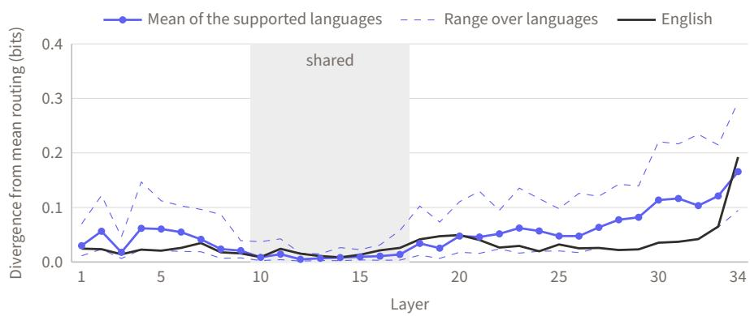  
Figure 7. Expert routing by language in the released model: for each layer, the Jensen–Shannon divergence between a language’s distribution over the 128 routed experts and the mean over the 43 supported languages covered by Belebele, on the same text in every language. Languages route diferently in the first and last layers and almost identically in the middle layers.

## 7 Conclusion

We presented Lara Mini base, a mixture of experts base model with 7.2B total and 0.6B active parameters. It was pretrained on 6T tokens, only 41% of which were in English, and in the anneal, text from the 44 other languages is the largest domain in the mixture. Its context was then extended to 128k tokens. Among the 36 open base models with up to 2B active parameters, Lara Mini base ranks first on the Overall average, on math and on the multilingual average in the languages it supports, and second on English. It achieves this at a small inference cost: for a single user, it generates text at least 1.8 times faster than every model with a higher Overall average. It is also the first among the models we compared on the multilingual long-context benchmark, ONERULER, at 32k tokens (Section 5.7). The concern that languages compete for the capacity of a small model found little support in Lara Mini base. Replacing its multilingual data with English in the anneal raised the English average by only 0.3 points and lowered the multilingual average by 2.7 (Section 6.1). Its languages also share the same experts rather than dividing them (Section 6.2).

Beyond the absence of a substantial capacity penalty, our results motivate a broader hypothesis: linguistic diversity may contribute to general-purpose intelligence by exposing a model to complementary descriptions of the world. This interpretation connects multilingual pretraining to established ideas in multi-task learning and representation learning. Testing whether language diversity directly improves general reasoning remains an important direction for future research.

Release. We release the weights of Lara Mini base under the CC BY-NC-SA 4.0 license, and will release T-HellaSwag (Section F). The data pipeline and the training pool remain internal, but Sections A and 2 describe the mixture in full.

Limitations. Lara Mini base is a base model: it is not tuned to follow instructions or for safety, and should not be deployed as an assistant without further training. Its quality varies across languages. Among the languages it supports, it scores lowest in some with limited training data, such as Azerbaijani and Bengali (Section D.2). Our analyses show that the multilingual data cost English little in the anneal. They do not measure the efect of these data during the main stage, nor show which of our choices keeps the cost small.

Future work. We plan to post-train Lara Mini base into an instruction-following model, extend the training to larger budgets and more languages, and further study how the multilingual share of the mixture afects each language and English. We also plan controlled experiments that vary linguistic diversity during the main pretraining stage, while keeping compute, total tokens, and data quality comparable, and measure the efects on English, math, code, and multilingual performance.

## Acknowledgments

Our research is supported by the DVPS project, funded by the European Union’s Horizon Europe programme under grant agreement No. 101213369, and by CINECA.

## References

Joshua Ainslie, James Lee-Thorp, Michiel de Jong, Yury Zemlyanskiy, Federico Lebrón, and Sumit Sanghai. GQA: Training generalized multi-query transformer models from multi-head checkpoints. In Proceedings of the 2023 Conference on Empirical Methods in Natural Language Processing (EMNLP), 2023.

Aleph Alpha. Kolibri: A sovereign European model on the Pareto frontier. arXiv preprint arXiv:2610.31945, 2026.

Mehdi Ali et al. Teuken-7B-Base & Teuken-7B-Instruct: Towards European LLMs. In European Conference on Artificial Intelligence (ECAI 2025), volume 413 of Frontiers in Artificial Intelligence and Applications, pages 4321–4329. IOS Press, 2025. doi: 10.3233/FAIA251328.

Duarte M. Alves, Miguel Moura Ramos, Hippolyte Gisserot-Boukhlef, João Alves, Pedro Henrique Martins, Patrick Fernandes, José Pombal, Nuno M. Guerreiro, Ricardo Rei, Amin Farajian, José G. C. de Souza, Pierre Colombo, and André F. T. Martins. EuroMoE-2.6B-A0.6B: Technical report. https://github.com/ deep-spin/EuroMoE, 2026.

Alexander Amini et al. LFM2 technical report. arXiv preprint arXiv:2511.23404, 2025.

Anthropic. Claude Opus 5.5 system card. https://www.anthropic.com/claude-opus-5-5-system-card, 2026.

Simran Arora, Sabri Eyuboglu, Michael Zhang, Aman Timalsina, Silas Alberti, James Zou, Atri Rudra, and Christopher Ré. Simple linear attention language models balance the recall-throughput tradeof. In Proceedings of the 41st International Conference on Machine Learning (ICML), volume 235 of Proceedings of Machine Learning Research, pages 1763–1840, 2024.

Viraat Aryabumi et al. To code, or not to code? exploring impact of code in pre-training. In International Conference on Learning Representations (ICLR), 2025.

Jacob Austin et al. Program synthesis with large language models. arXiv preprint arXiv:2108.07732, 2021.

Lucas Bandarkar et al. The Belebele benchmark: a parallel reading comprehension dataset in 122 language variants. In Proceedings of the 62nd Annual Meeting of the Association for Computational Linguistics (ACL), 2024.

Iz Beltagy, Matthew E. Peters, and Arman Cohan. Longformer: The long-document transformer. arXiv preprint arXiv:2004.05150, 2020.

Loubna Ben Allal et al. SmolLM2: When smol goes big — data-centric training of a fully open small language model. In Conference on Language Modeling (COLM), 2025.

Yoshua Bengio, Aaron Courville, and Pascal Vincent. Representation learning: A review and new perspectives. IEEE Transactions on Pattern Analysis and Machine Intelligence, 35(8):1798–1828, 2013. doi: 10.1109/ TPAMI.2013.50.

Stella Biderman et al. Lessons from the trenches on reproducible evaluation of language models. arXiv preprint arXiv:2405.14782, 2024.

Yonatan Bisk, Rowan Zellers, Ronan Le Bras, Jianfeng Gao, and Yejin Choi. PIQA: Reasoning about physical commonsense in natural language. In Proceedings of the AAAI Conference on Artificial Intelligence, 2020.

Cody Blakeney, Mansheej Paul, Brett W. Larsen, Sean Owen, and Jonathan Frankle. Does your data spark joy? performance gains from domain upsampling at the end of training. arXiv preprint arXiv:2406.03476, 2024.

Andrei Z. Broder. On the resemblance and containment of documents. In Proceedings of Compression and Complexity of Sequences, pages 21–29, 1997.

Tom B. Brown et al. Language models are few-shot learners. In Advances in Neural Information Processing Systems (NeurIPS), 2020.

Rich Caruana. Multitask learning. Machine Learning, 28(1):41–75, 1997. doi: 10.1023/A:1007379606734.

Tyler A. Chang, Catherine Arnett, Zhuowen Tu, and Benjamin K. Bergen. When is multilinguality a curse? language modeling for 250 high- and low-resource languages. In Proceedings of the 2024 Conference on Empirical Methods in Natural Language Processing, pages 4074–4096. Association for Computational

Linguistics, 2024. doi: 10.18653/v1/2024.emnlp-main.236. URL https://aclanthology.org/2024. emnlp-main.236/.

Tyler A. Chang et al. Global PIQA: Evaluating commonsense reasoning across 100+ languages and cultures. arXiv preprint arXiv:2510.24081, 2025.

Aakanksha Chowdhery et al. PaLM: Scaling language modeling with pathways. Journal of Machine Learning Research, 24(240):1–113, 2023.

Hyung Won Chung, Noah Constant, Xavier Garcia, Adam Roberts, Yi Tay, Sharan Narang, and Orhan Firat. UniMax: Fairer and more efective language sampling for large-scale multilingual pretraining. In International Conference on Learning Representations (ICLR), 2023.

Peter Clark et al. Think you have solved question answering? try ARC, the AI2 reasoning challenge. arXiv preprint arXiv:1803.05457, 2018.

Karl Cobbe et al. Training verifiers to solve math word problems. arXiv preprint arXiv:2110.14168, 2021.

Alexis Conneau et al. XNLI: Evaluating cross-lingual sentence representations. In Proceedings of the 2018 Conference on Empirical Methods in Natural Language Processing (EMNLP), 2018.

Alexis Conneau et al. Unsupervised cross-lingual representation learning at scale. In Proceedings of the 58th Annual Meeting of the Association for Computational Linguistics (ACL), 2020.

Damai Dai et al. DeepSeekMoE: Towards ultimate expert specialization in mixture-of-experts language models. In Proceedings of the 62nd Annual Meeting of the Association for Computational Linguistics (ACL), 2024.

David Dale and Marta R. Costa-jussà. BLASER 2.0: a metric for evaluation and quality estimation of massively multilingual speech and text translation. In Findings of the Association for Computational Linguistics: EMNLP 2024, pages 16075–16085. Association for Computational Linguistics, 2024. doi: 10.18653/v1/ 2024.findings-emnlp.943. URL https://aclanthology.org/2024.findings-emnlp.943/.

Soham De, Samuel L. Smith, Anushan Fernando, Aleksandar Botev, George Cristian-Muraru, Albert Gu, Ruba Haroun, Leonard Berrada, Yutian Chen, Srivatsan Srinivasan, Guillaume Desjardins, Arnaud Doucet, David Budden, Yee Whye Teh, Razvan Pascanu, Nando De Freitas, and Caglar Gulcehre. Grifin: Mixing gated linear recurrences with local attention for eficient language models. arXiv preprint arXiv:2402.19427, 2024.

DeepSeek-AI. DeepSeek-V3 technical report. arXiv preprint arXiv:2412.19437, 2024.

Domyn. Domyn Edge. https://huggingface.co/domyn/Domyn-Edge-Base, 2026.

David M. Eberhard, Gary F. Simons, and Charles D. Fennig. Ethnologue: Languages of the World. SIL International, Dallas, 28 edition, 2025. URL https://www.ethnologue.com.

Falcon-LLM Team. Falcon-H1: A family of hybrid-head language models redefining eficiency and performance. arXiv preprint arXiv:2507.22448, 2025.

William Fedus, Barret Zoph, and Noam Shazeer. Switch transformers: Scaling to trillion parameter models with simple and eficient sparsity. Journal of Machine Learning Research, 23(120):1–39, 2022.

Steven Feng, Shrimai Prabhumoye, Kezhi Kong, Dan Su, Mostofa Patwary, Mohammad Shoeybi, and Bryan Catanzaro. Maximize your data’s potential: Enhancing LLM accuracy with two-phase pretraining. arXiv preprint arXiv:2412.15285, 2024.

Orhan Firat, Kyunghyun Cho, and Yoshua Bengio. Multi-way, multilingual neural machine translation with a shared attention mechanism. In Proceedings of the 2016 Conference of the North American Chapter of the Associationfor Computational Linguistics: Human Language Technologies (NAACL-HLT), pages 866–875, 2016. doi: 10.18653/v1/N16-1101.

Yonggan Fu et al. Nemotron-Flash: Towards latency-optimal hybrid small language models. In Advances in Neural Information Processing Systems (NeurIPS), volume 38, pages 179183–179207, 2025.

Trevor Gale, Deepak Narayanan, Clif Young, and Matei Zaharia. MegaBlocks: Eficient sparse training with mixture-of-experts. In Proceedings of Machine Learning and Systems (MLSys), 2023.

Tianyu Gao, Alexander Wettig, Howard Yen, and Danqi Chen. How to train long-context language models (efectively). In Proceedings of the 63rd Annual Meeting of the Association for Computational Linguistics (ACL), 2025.

Gemma Team. Gemma: Open models based on Gemini research and technology. arXiv preprint arXiv:2403.08295, 2024.

Gemma Team. Gemma 3 technical report. arXiv preprint arXiv:2503.19786, 2025.

Gemma Team. Gemma 4 technical report. arXiv preprint arXiv:2607.02770, 2026.

Aitor Gonzalez-Agirre et al. Salamandra technical report. arXiv preprint arXiv:2502.08489, 2025.

Google DeepMind. Gemini 4 Argon model card. https://deepmind.google/models/model-cards/ gemini-4-argon/, 2026.

Aaron Grattafiori et al. The Llama 3 herd of models. arXiv preprint arXiv:2407.21783, 2024.

Alex Gu, Baptiste Rozière, Hugh Leather, Armando Solar-Lezama, Gabriel Synnaeve, and Sida I. Wang. CRUXEval: A benchmark for code reasoning, understanding and execution. In Proceedings of the 41st International Conference on Machine Learning (ICML), volume 235 of Proceedings of Machine Learning Research, pages 16568–16621, 2024.

Yuling Gu, Oyvind Tafjord, Bailey Kuehl, Dany Haddad, Jesse Dodge, and Hannaneh Hajishirzi. OLMES: A standard for language model evaluations. In Findings of the Associationfor Computational Linguistics: NAACL 2025, pages 5005–5033, 2025. doi: 10.18653/v1/2025.findings-naacl.282.

Nuno M. Guerreiro, Ricardo Rei, Daan van Stigt, Luisa Coheur, Pierre Colombo, and André F. T. Martins. xCOMET: Transparent machine translation evaluation through fine-grained error detection. Transactions of the Association for Computational Linguistics, 12:979–995, 2024. doi: 10.1162/tacl\_a\_00683. URL https://aclanthology.org/2024.tacl-1.54/.

Alexander Hägele, Elie Bakouch, Atli Kosson, Loubna Ben Allal, Leandro Von Werra, and Martin Jaggi. Scaling laws and compute-optimal training beyond fixed training durations. In Advances in Neural Information Processing Systems (NeurIPS), 2024.

Harald Hammarström, Robert Forkel, Martin Haspelmath, and Sebastian Bank. Glottolog 5.4. Max Planck Institute for Evolutionary Anthropology, Leipzig, 2026. URL https://glottolog.org.

Dan Hendrycks, Collin Burns, Steven Basart, Andy Zou, Mantas Mazeika, Dawn Song, and Jacob Steinhardt. Measuring massive multitask language understanding. In International Conference on Learning Representations (ICLR), 2021a.

Dan Hendrycks, Collin Burns, Saurav Kadavath, Akul Arora, Steven Basart, Eric Tang, Dawn Song, and Jacob Steinhardt. Measuring mathematical problem solving with the MATH dataset. In Advances in Neural Information Processing Systems (NeurIPS), Datasets and Benchmarks Track, 2021b.

Alex Henry, Prudhvi Raj Dachapally, Shubham Pawar, and Yuxuan Chen. Query-key normalization for transformers. In Findings of the Association for Computational Linguistics: EMNLP 2020, 2020.

Alejandro Hernández-Cano et al. Apertus: Democratizing open and compliant LLMs for global language environments. In Proceedings of the 64th Annual Meeting of the Association for Computational Linguistics (ACL), pages 46877–46955, 2026. doi: 10.18653/v1/2026.acl-long.2172.

Cheng-Ping Hsieh et al. RULER: What’s the real context size of your long-context language models? In Conference on Language Modeling (COLM), 2024.

Shengding Hu et al. MiniCPM: Unveiling the potential of small language models with scalable training strategies. In Conference on Language Modeling (COLM), 2024.

Hugging Face. FinePDFs. https://huggingface.co/datasets/HuggingFaceFW/finepdfs, 2025a.

Hugging Face. FineWiki. https://huggingface.co/datasets/HuggingFaceFW/finewiki, 2025b.

Hugging Face. SmolLM3: smol, multilingual, long-context reasoner. https://huggingface.co/blog/ smollm3, 2025c.

Hugging Face. The stack v3. https://huggingface.co/datasets/HuggingFaceCode/stack-v3-train, 2026.

IBM. IBM Granite 4.0: Hyper-eficient, high performance hybrid models for enterprise. https://www.ibm. com/new/announcements/ibm-granite-4-0-hyper-efficient-high-performance-hybrid-models, 2025a.

IBM. Granite 4.0 Nano language models. https://huggingface.co/collections/ibm-granite/ granite-40-nano-language-models-68e5775c80b60e43b72cfa16, 2025b.

IBM Granite Team. Granite 3.0 language models. https://github.com/ibm-granite/granite-3. 0-language-models, 2024.

IBM Granite Team. Granite 4.1 LLMs: How they’re built. https://huggingface.co/blog/ibm-granite/ granite-4-1, 2026a.

IBM Granite Team. Granite-SWASH-3B-a600M. https://huggingface.co/ibm-granite/ granite-swash-3b-a600m, 2026b.

IBM Research. moe-7b-1b-active-shared-experts. https://huggingface.co/ibm-research/ moe-7b-1b-active-shared-experts, 2025. Model card.

Adam Ibrahim, Benjamin Thérien, Kshitij Gupta, Mats L. Richter, Quentin Anthony, Timothée Lesort, Eugene Belilovsky, and Irina Rish. Simple and scalable strategies to continually pre-train large language models. Transactions on Machine Learning Research, 2024.

Atindra Jha, Margaret Li, Jure Leskovec, Percy Liang, and Luke Zettlemoyer. Data scarcity and model sparsity: Mixtures-of-experts overfit more to repeated data. arXiv preprint arXiv:2609.11917, 2026.

Albert Q. Jiang et al. Mistral 7B. arXiv preprint arXiv:2310.06825, 2023.

Keller Jordan, Yuchen Jin, Vlado Boza, Jiacheng You, Franz Cesista, Laker Newhouse, and Jeremy Bernstein. Muon: An optimizer for hidden layers in neural networks. https://kellerjordan.github.io/posts/ muon/, 2024.

Juraj Juraska, Daniel Deutsch, Mara Finkelstein, and Markus Freitag. MetricX-24: The Google submission to the WMT 2024 metrics shared task. In Proceedings of the Ninth Conference on Machine Translation, pages 492–504. Association for Computational Linguistics, 2024. doi: 10.18653/v1/2024.wmt-1.35. URL https://aclanthology.org/2024.wmt-1.35/.

Kanana LLM Team. Kanana-2 SLM. https://huggingface.co/collections/kakaocorp/kanana-2-slm, 2026.

Amir Hossein Kargaran, Ayyoob Imani, François Yvon, and Hinrich Schuetze. GlotLID: Language identification for low-resource languages. In Findings of the Association for Computational Linguistics: EMNLP 2023, pages 6155–6218. Association for Computational Linguistics, 2023. doi: 10.18653/v1/2023.findings-emnlp.410. URL https://aclanthology.org/2023.findings-emnlp.410/.

Rabeeh Karimi Mahabadi, Sanjeev Satheesh, Shrimai Prabhumoye, Mostofa Patwary, Mohammad Shoeybi, and Bryan Catanzaro. Nemotron-CC-Math: A 133 billion-token-scale high quality math pretraining dataset. In International Conference on Learning Representations (ICLR), 2026.

Amirhossein Kazemnejad, Inkit Padhi, Karthikeyan Natesan Ramamurthy, Payel Das, and Siva Reddy. The impact of positional encoding on length generalization in transformers. In Advances in Neural Information Processing Systems (NeurIPS), 2023.

Yekyung Kim, Jenna Russell, Marzena Karpinska, and Mohit Iyyer. One ruler to measure them all: Benchmarking multilingual long-context language models. In Conference on Language Modeling (COLM), 2025.

Ranjay Krishna, Kenji Hata, Frederic Ren, Li Fei-Fei, and Juan Carlos Niebles. Dense-captioning events in videos. In 2017 IEEE International Conference on Computer Vision (ICCV), pages 706–715. IEEE, 2017. doi: 10.1109/ICCV.2017.83.

Woosuk Kwon et al. Eficient memory management for large language model serving with PagedAttention. In Proceedings of the 29th Symposium on Operating Systems Principles (SOSP), 2023.

Kyutai. Helium 1: a modular and multilingual LLM. https://kyutai.org/blog/2025-04-30-helium/, 2025.

Viet Lai, Chien Nguyen, Nghia Ngo, Thuat Nguyen, Franck Dernoncourt, Ryan Rossi, and Thien Nguyen. Okapi: Instruction-tuned large language models in multiple languages with reinforcement learning from human feedback. In Proceedings of the 2023 Conference on Empirical Methods in Natural Language Processing: System Demonstrations, pages 318–327. Association for Computational Linguistics, 2023. doi: 10.18653/v1/2023.emnlp-demo.28. URL https://aclanthology.org/2023.emnlp-demo.28/.

Katherine Lee, Daphne Ippolito, Andrew Nystrom, Chiyuan Zhang, Douglas Eck, Chris Callison-Burch, and Nicholas Carlini. Deduplicating training data makes language models better. In Proceedings of the 60th Annual Meeting of the Association for Computational Linguistics (ACL), 2022.

Yunshui Li et al. Model merging in pre-training of large language models. In Advances in Neural Information Processing Systems (NeurIPS), volume 38, pages 148152–148175, 2025.

Liquid AI. Introducing LFM2.5: The next generation of on-device AI. https://www.liquid.ai/blog/ introducing-lfm2-5-the-next-generation-of-on-device-ai, 2026a.

Liquid AI. LFM2.5-8B-A1B: An even better on-device mixture of experts. https://www.liquid.ai/blog/ lfm2-5-8b-a1b, 2026b.

Liquid AI. Introducing LFM3: Every modality for specialized intelligence. https://www.liquid.ai/blog/ lfm3, 2026c.

Alexander H. Liu et al. Ministral 3. arXiv preprint arXiv:2601.08584, 2026.

Jiawei Liu, Chunqiu Steven Xia, Yuyao Wang, and Lingming Zhang. Is your code generated by ChatGPT really correct? rigorous evaluation of large language models for code generation. In Advances in Neural Information Processing Systems (NeurIPS), 2023.

Jingyuan Liu et al. Muon is scalable for LLM training. arXiv preprint arXiv:2502.16982, 2025.

Shayne Longpre, Sneha Kudugunta, Niklas Muennighof, I-Hung Hsu, Isaac Caswell, Alex Pentland, Sercan Arik, Chen-Yu Lee, and Sayna Ebrahimi. ATLAS: Adaptive transfer scaling laws for multilingual pretraining, finetuning, and decoding the curse of multilinguality. In International Conference on Learning Representations, 2026. URL https://arxiv.org/abs/2510.22037.

Marin Community. Marin. https://github.com/marin-community/marin, 2025.

Pedro Henrique Martins, João Alves, Patrick Fernandes, Nuno M. Guerreiro, Ricardo Rei, Amin Farajian, Mateusz Klimaszewski, Duarte M. Alves, José Pombal, Nicolas Boizard, Manuel Faysse, Pierre Colombo, François Yvon, Barry Haddow, José G. C. de Souza, Alexandra Birch, and André F. T. Martins. EuroLLM-9B: Technical report. arXiv:2506.04079, 2025a.

Pedro Henrique Martins et al. EuroLLM: Multilingual language models for Europe. Procedia Computer Science, 255:53–62, 2025b. doi: 10.1016/j.procs.2025.02.260.

William Merrill, Yanhong Li, Tyler Romero, Anej Svete, et al. Olmo hybrid: From theory to practice and back. In Conference on Language Modeling (COLM), 2026.

Bettina Messmer, Vinko Sabolčec, and Martin Jaggi. Enhancing multilingual LLM pretraining with modelbased data selection. In Advances in Neural Information Processing Systems (NeurIPS), volume 38, pages 70037–70073, 2025.

Niklas Muennighof, Alexander M. Rush, Boaz Barak, Teven Le Scao, Aleksandra Piktus, Nouamane Tazi, Sampo Pyysalo, Thomas Wolf, and Colin Rafel. Scaling data-constrained language models. Journal of Machine Learning Research, 26(53):1–66, 2025a.

Niklas Muennighof, Luca Soldaini, Dirk Groeneveld, Kyle Lo, Jacob Morrison, Sewon Min, Weijia Shi, Pete Walsh, Oyvind Tafjord, Nathan Lambert, Yuling Gu, Shane Arora, Akshita Bhagia, Dustin Schwenk, David Wadden, Alexander Wettig, Binyuan Hui, Tim Dettmers, Douwe Kiela, Ali Farhadi, Noah A. Smith, Pang Wei Koh, Amanpreet Singh, and Hannaneh Hajishirzi. OLMoE: Open mixture-of-experts language models. In International Conference on Learning Representations (ICLR), 2025b. arXiv:2409.02060.

Thuat Nguyen et al. CulturaX: A cleaned, enormous, and multilingual dataset for large language models in 167 languages. In Proceedings of the 2024 Joint International Conference on Computational Linguistics, Language Resources and Evaluation (LREC-COLING), 2024.

NVIDIA. NVIDIA Nemotron Nano 2: An accurate and eficient hybrid Mamba-Transformer reasoning model. arXiv preprint arXiv:2508.14444, 2025.

NVIDIA. Nemotron-Pretraining-Specialized-v1.1. https://huggingface.co/datasets/nvidia/ Nemotron-Pretraining-Specialized-v1.1, 2026a.

NVIDIA. Nemotron-Pretraining-Specialized-v1.2. https://huggingface.co/datasets/nvidia/ Nemotron-Pretraining-Specialized-v1.2, 2026b.

Krzysztof Ociepa, Łukasz Flis, Remigiusz Kinas, Krzysztof Wróbel, and Adrian Gwoździej. Bielik v3 small: Technical report. arXiv preprint arXiv:2505.02550, 2025.

Stephan Oepen et al. HPLT 3.0: Very large-scale multilingual resources for LLMs and MT. mono- and bi-lingual data, multilingual evaluation, and pre-trained models. In Proceedings of the Fifteenth Language Resources and Evaluation Conference (LREC), pages 1409–1434, 2026. doi: 10.63317/25xbdofco9od.

OpenBMB. MiniCPM5-2B. https://huggingface.co/openbmb/MiniCPM5-2B, 2026.

OpenLLM-France. Luciole-1B-Base. https://huggingface.co/OpenLLM-France/Luciole-1B-Base, 2026.

Jupinder Parmar, Sanjev Satheesh, Mostofa Patwary, Mohammad Shoeybi, and Bryan Catanzaro. Reuse, don’t retrain: A recipe for continued pretraining of language models. arXiv preprint arXiv:2407.07263, 2024.

Guilherme Penedo et al. The FineWeb datasets: Decanting the web for the finest text data at scale. In Advances in Neural Information Processing Systems (NeurIPS), Datasets and Benchmarks Track, 2024.

Guilherme Penedo et al. FineWeb2: One pipeline to scale them all — adapting pre-training data processing to every language. In Conference on Language Modeling (COLM), 2025.

Edoardo Maria Ponti, Goran Glavaš, Olga Majewska, Qianchu Liu, Ivan Vulić, and Anna Korhonen. XCOPA: A multilingual dataset for causal commonsense reasoning. In Proceedings of the 2020 Conference on Empirical Methods in Natural Language Processing (EMNLP), 2020.

Mario Prignano, Gabriele Cirillo, Alessio Morosini, Luca Cerovaz, Alessandro Bartolocci, Emanuele Rodolà, Giulio Starace, and Francesco Pappone. Limite 1B - Violetto. https://paradigma.inc/blog/ limite-1b-violetto/, 2026.

Qwen Team. Qwen2.5 technical report. arXiv preprint arXiv:2412.15115, 2024.

Qwen Team. Qwen3.5: Towards native multimodal agents. https://qwen.ai/blog?id=qwen3.5, 2026.

Ricardo Rei, Marcos Treviso, Nuno M. Guerreiro, Chrysoula Zerva, Ana C Farinha, Christine Maroti, José G. C. de Souza, Taisiya Glushkova, Duarte Alves, Luisa Coheur, Alon Lavie, and André F. T. Martins. CometKiwi: IST-unbabel 2022 submission for the quality estimation shared task. In Proceedings of the Seventh Conference on Machine Translation (WMT), pages 634–645. Association for Computational Linguistics, 2022. doi: 10.18653/v1/2022.wmt-1.60. URL https://aclanthology.org/2022.wmt-1.60/.

Ricardo Rei, Nuno M. Guerreiro, José Pombal, Daan van Stigt, Marcos Treviso, Luisa Coheur, José G. C. de Souza, and André F. T. Martins. Scaling up CometKiwi: Unbabel-IST 2023 submission for the quality estimation shared task. In Proceedings of the Eighth Conference on Machine Translation, pages 841–848. Association for Computational Linguistics, 2023. doi: 10.18653/v1/2023.wmt-1.73. URL https://aclanthology.org/2023.wmt-1.73/.

Liliang Ren, Yang Liu, Yadong Lu, Yelong Shen, Chen Liang, and Weizhu Chen. Samba: Simple hybrid state space models for eficient unlimited context language modeling. In International Conference on Learning Representations (ICLR), 2025.

Melissa Roemmele, Cosmin Adrian Bejan, and Andrew S. Gordon. Choice of plausible alternatives: An evaluation of commonsense causal reasoning. In AAAI Spring Symposium: Logical Formalizations of Commonsense Reasoning, 2011.

Angelika Romanou et al. INCLUDE: Evaluating multilingual language understanding with regional knowledge. In International Conference on Learning Representations (ICLR), 2025.

Keisuke Sakaguchi, Ronan Le Bras, Chandra Bhagavatula, and Yejin Choi. WinoGrande: An adversarial Winograd schema challenge at scale. In Proceedings of the AAAI Conference on Artificial Intelligence, 2020.

Alejandro R. Salamanca et al. Tiny Aya: Bridging scale and multilingual depth. In Conference on Language Modeling (COLM), 2026.

Imanol Schlag, Kazuki Irie, and Jürgen Schmidhuber. Linear transformers are secretly fast weight programmers. In International Conference on Machine Learning (ICML), pages 9355–9366, 2021.

Noam Shazeer. GLU variants improve transformer. arXiv preprint arXiv:2002.05202, 2020.

Freda Shi et al. Language models are multilingual chain-of-thought reasoners. In International Conference on Learning Representations (ICLR), 2023.

Mohammad Shoeybi, Mostofa Patwary, Raul Puri, Patrick LeGresley, Jared Casper, and Bryan Catanzaro. Megatron-LM: Training multi-billion parameter language models using model parallelism. arXiv preprint arXiv:1909.08053, 2019.

Shivalika Singh et al. Global MMLU: Understanding and addressing cultural and linguistic biases in multilingual evaluation. In Proceedings of the 63rd Annual Meeting of the Associationfor Computational Linguistics (ACL), 2025.

Varun Singh et al. Arcee Trinity large technical report. arXiv preprint arXiv:2602.17004, 2026.

Dan Su et al. Nemotron-CC: Transforming Common Crawl into a refined long-horizon pretraining dataset. In Proceedings of the 63rd Annual Meeting of the Association for Computational Linguistics (ACL), pages 2459–2475, 2025. doi: 10.18653/v1/2025.acl-long.123.

Team OLMo. 2 OLMo 2 furious. arXiv preprint arXiv:2501.00656, 2025.

Team Olmo. Olmo 3. arXiv preprint arXiv:2512.13961, 2025.

Tencent Hunyuan. Hunyuan-4B-Pretrain. https://huggingface.co/tencent/Hunyuan-4B-Pretrain, 2025.

Villanova.ai. Villanova2-2b-base. https://huggingface.co/VillanovaAI/Villanova2-2B-Base, 2026. Model card.

Yubo Wang et al. MMLU-Pro: A more robust and challenging multi-task language understanding benchmark. In Advances in Neural Information Processing Systems (NeurIPS), Datasets and Benchmarks Track, 2024.

Thomas Wolf, Lysandre Debut, Victor Sanh, Julien Chaumond, Clement Delangue, Anthony Moi, Pierric Cistac, Tim Rault, Remi Louf, Morgan Funtowicz, Joe Davison, Sam Shleifer, Patrick von Platen, Clara Ma, Yacine Jernite, Julien Plu, Canwen Xu, Teven Le Scao, Sylvain Gugger, Mariama Drame, Quentin Lhoest, and Alexander Rush. Transformers: State-of-the-art natural language processing. In Proceedings of the 2020 Conference on Empirical Methods in Natural Language Processing: System Demonstrations, pages 38–45. Association for Computational Linguistics, 2020. doi: 10.18653/v1/2020.emnlp-demos.6.

An Yang et al. Qwen3 technical report. arXiv preprint arXiv:2505.09388, 2025a.

Bowen Yang et al. Rope to nope and back again: A new hybrid attention strategy. In Advances in Neural Information Processing Systems (NeurIPS), volume 38, pages 71494–71518, 2025b.

Greg Yang, Edward J. Hu, Igor Babuschkin, Szymon Sidor, Xiaodong Liu, David Farhi, Nick Ryder, Jakub Pachocki, Weizhu Chen, and Jianfeng Gao. Tuning large neural networks via zero-shot hyperparameter transfer. In Advances in Neural Information Processing Systems (NeurIPS), volume 34, pages 17084–17097, 2021.

Songlin Yang and Yu Zhang. FLA: A Triton-based library for hardware-eficient implementations of linear attention mechanism. https://github.com/fla-org/flash-linear-attention, 2024.

Songlin Yang, Bailin Wang, Yu Zhang, Yikang Shen, and Yoon Kim. Parallelizing linear transformers with the delta rule over sequence length. In Advances in Neural Information Processing Systems (NeurIPS), 2024.

Songlin Yang, Jan Kautz, and Ali Hatamizadeh. Gated delta networks: Improving Mamba2 with delta rule. In International Conference on Learning Representations (ICLR), 2025c.

Yinfei Yang, Yuan Zhang, Chris Tar, and Jason Baldridge. PAWS-X: A cross-lingual adversarial dataset for paraphrase identification. In Proceedings of the 2019 Conference on Empirical Methods in Natural Language Processing (EMNLP-IJCNLP), 2019.

Howard Yen et al. HELMET: How to evaluate long-context language models efectively and thoroughly. In International Conference on Learning Representations (ICLR), 2025.

Rowan Zellers, Ari Holtzman, Yonatan Bisk, Ali Farhadi, and Yejin Choi. HellaSwag: Can a machine really finish your sentence? In Proceedings of the 57th Annual Meeting of the Association for Computational Linguistics (ACL), 2019.

Biao Zhang and Rico Sennrich. Root mean square layer normalization. In Advances in Neural Information Processing Systems (NeurIPS), 2019.

Yuan Zhang, Jason Baldridge, and Luheng He. PAWS: Paraphrase adversaries from word scrambling. In Proceedings of the 2019 Conference of the North American Chapter of the Association for Computational Linguistics (NAACL), 2019.

Fan Zhou et al. MegaMath: Pushing the limits of open math corpora. In Conference on Language Modeling (COLM), 2025.

Barret Zoph et al. ST-MoE: Designing stable and transferable sparse expert models. arXiv preprint arXiv:2202.08906, 2022.

Maike Züfle, Vilém Zouhar, Tu Anh Dinh, Felipe Maia Polo, Jan Niehues, and Mrinmaya Sachan. COMETpoly: Machine translation metric grounded in other candidates. In Proceedings of the Tenth Conference on Machine Translation, pages 887–904. Association for Computational Linguistics, 2025. doi: 10.18653/v1/ 2025.wmt-1.63. URL https://aclanthology.org/2025.wmt-1.63/.

## Appendix

Section A details the data mixture: the sources and licenses for each data group, the tokens in each group in the pool and at each stage, and the share of each language. Section B completes the training recipe with the optimizer, the choice of learning rate, the stability of the run, its parallelism, and the settings for the long-context stage. Section C reports the small-scale ablations behind the architecture and the optimizer. Section D gives the evaluation protocol, the results of all 56 models on every benchmark, the results of Lara Mini base in each language and the protocol of the long-context evaluation. Section E describes how we measured inference speed and reports it for Lara Mini base and 45 of the compared models. Section F describes T-HellaSwag, the translated benchmark we will release, and Section G gives the model card.

## A Data Mixture in Detail

Within each domain, the training pool is divided into data groups by kind of data and by quality.

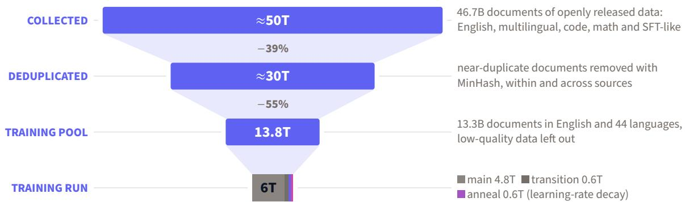  
Figure 8. From collected data to the 6T training run, with bar widths proportional to tokens; deduplication and selection are described in Section 2.2. Deduplication removes about 40% of the collected tokens.

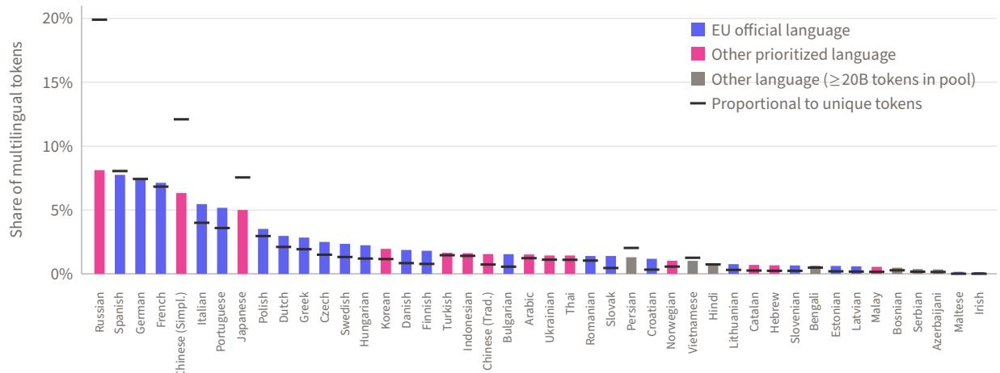  
Figure 9. Share of each language in the 2.18T multilingual tokens of the 6T run (bars), against its share under sampling proportional to its unique tokens after deduplication (dashes). Tokens and epochs per language are in Table 11. The language weights increase the share of oficial EU languages from 46% to 61% of multilingual tokens.

## A.1 Personal and Harmful Content

We do not add our own filters for personal information or harmful content and rely on each source’s processing. Common Crawl, the origin of most of our web data, respects robots.txt at crawl time.

Table 9. Data groups of the training pool, by domain, with the licenses of their sources. NVIDIA DA: NVIDIA Data Agreement for Model Training; permissive: only files under permissive licenses. Tokens and epochs per group and stage are in Table 10.
<table><tr><td>Domain</td><td>Group</td><td>Sources</td><td>Licenses</td></tr><tr><td rowspan="2">English</td><td>Web, high quality</td><td>Nemotron-CC high and medium-high (v1 and v2), FineWeb-Edu</td><td>NVIDIA DA, ODC-BY</td></tr><tr><td>Web, medium quality Synthetic</td><td>Nemotron-CC medium (v1 and v2) Nemotron-CC high-quality synthetic, v2</td><td>NVIDIA DA NVIDIA DA</td></tr><tr><td rowspan="2"></td><td>PDFs Wikipedia</td><td>synthetic and diverse QA FinePDFs (English) FineWiki (English)</td><td>ODC-BY CC BY-SA 4.0,</td></tr><tr><td>Web Web, high quality</td><td>HPLT 3.0, FineWeb-2, CulturaX</td><td>GFDL CC0, ODC-BY</td></tr><tr><td rowspan="2">Multilingual</td><td>Synthetic</td><td>FineWeb2-HQ Nemotron-CC v2 translated diverse QA, FineWeb2-HQ QA</td><td>ODC-BY NVIDIA DA, ODC-BY</td></tr><tr><td>PDFs Wikipedia</td><td>FinePDFs (non-English) FineWiki</td><td>ODC-BY CC BY-SA 4.0, GFDL</td></tr><tr><td rowspan="2">Code</td><td>Real</td><td>Nemotron-CC code, The Stack v3 (permissive</td><td>NVIDIA DA,</td></tr><tr><td>Synthetic</td><td>licenses only) Nemotron GitHub code (QA, review, rewriting, transpilation)</td><td>permissive NVIDIA DA</td></tr><tr><td rowspan="2">Math</td><td>High quality</td><td>FineMath 4+, MegaMath-Web-Pro, Nemotron-CC-Math 4+ and its MIND synthetic</td><td>ODC-BY, NVIDIA DA</td></tr><tr><td>Web</td><td>math dialogues FineMath 3+, MegaMath, Nemotron-CC-Math 3</td><td>ODC-BY, NVIDIA DA</td></tr><tr><td rowspan="3">SFT-like</td><td>Question answering</td><td>Nemotron SFT-General, STEM-SFT, Fact-Seeking, Multiple-Choice and other</td><td>NVIDIA DA, CC BY 4.0, CC BY-SA</td></tr><tr><td>Math</td><td>question-answer sets Nemotron SFT-Math, Math-Textbooks</td><td>4.0, GFDL NVIDIA DA, CC BY 4.0</td></tr><tr><td>Code</td><td>Nemotron SFT-Code, Code-Concepts, Scientific-Coding</td><td>NVIDIA DA, CC BY 4.0, CC BY-SA 4.0, GFDL</td></tr></table>

Table 10. Tokens per data group in the training pool and in each stage (billions of Qwen3 tokens), and epochs over training (tokens read divided by tokens in the pool). Four groups are read more than once: Wikipedia in both domains, high-quality multilingual web and high-quality math.
<table><tr><td>Group</td><td>Pool</td><td>Main</td><td>Transition</td><td>Anneal</td><td>Epochs</td></tr><tr><td>English web, high quality</td><td>1391.4</td><td>1152.9</td><td>108.2</td><td>76.1</td><td>0.96</td></tr><tr><td>English web, medium quality</td><td>1100.0</td><td>143.5</td><td>7.2</td><td>0.0</td><td>0.14</td></tr><tr><td>English synthetic, high quality</td><td>1916.3</td><td>538.9</td><td>64.5</td><td>56.7</td><td>0.34</td></tr><tr><td>English PDFs</td><td>1236.6</td><td>266.1</td><td>29.4</td><td>24.3</td><td>0.26</td></tr><tr><td>English Wikipedia</td><td>8.2</td><td>10.6</td><td>3.7</td><td>4.9</td><td>2.34</td></tr><tr><td>Multilingual web</td><td>3326.5</td><td>724.7</td><td>50.8</td><td>12.8</td><td>0.24</td></tr><tr><td>Multilingual web, high quality</td><td>638.2</td><td>510.2</td><td>73.3</td><td>80.0</td><td>1.04</td></tr><tr><td>Multilingual synthetic</td><td>658.6</td><td>188.2</td><td>38.0</td><td>56.3</td><td>0.43</td></tr><tr><td>Multilingual PDFs</td><td>1663.0</td><td>318.7</td><td>40.6</td><td>39.2</td><td>0.24</td></tr><tr><td>Multilingual Wikipedia</td><td>27.5</td><td>34.3</td><td>7.3</td><td>9.8</td><td>1.87</td></tr><tr><td>Code, real</td><td>466.6</td><td>345.6</td><td>50.0</td><td>56.1</td><td>0.97</td></tr><tr><td>Code, synthetic</td><td>434.9</td><td>230.4</td><td>37.0</td><td>45.9</td><td>0.72</td></tr><tr><td>Math, high quality</td><td>137.2</td><td>130.4</td><td>29.8</td><td>46.0</td><td>1.50</td></tr><tr><td>Math web</td><td>189.0</td><td>109.6</td><td>18.2</td><td>20.0</td><td>0.78</td></tr><tr><td>SFT-like, question answering</td><td>363.6</td><td>52.8</td><td>23.1</td><td>39.6</td><td>0.32</td></tr><tr><td>SFT-like, math</td><td>199.7</td><td>33.6</td><td>14.7</td><td>25.2</td><td>0.37</td></tr><tr><td>SFT-like, code</td><td>51.5</td><td>9.6</td><td>4.2</td><td>7.2</td><td>0.41</td></tr><tr><td>Total</td><td>13808.8</td><td>4800.0</td><td>600.0</td><td>600.0</td><td>0.43</td></tr></table>

Table 11. Training tokens (billions of Qwen3 tokens) and epochs per language, over the first three stages (6T tokens). Class: oficial EU language (EU), other prioritized language (P), or neither (–). Each language is weighted by the square root of its unique tokens, with extra weight for oficial EU languages and prioritized languages (Section 2.3). Only Irish and Maltese are read more than once.
<table><tr><td>Language</td><td>Class</td><td>Tokens</td><td>Epochs</td><td>Language</td><td>Class</td><td>Tokens</td><td>Epochs</td></tr><tr><td>Russian</td><td>P</td><td>177.2</td><td>0.29</td><td>Ukrainian</td><td>P</td><td>31.4</td><td>0.16</td></tr><tr><td>Spanish</td><td>EU, P</td><td>169.2</td><td>0.33</td><td>Thai</td><td>P</td><td>31.4</td><td>0.16</td></tr><tr><td>German</td><td>EU,P</td><td>162.4</td><td>0.35</td><td>Romanian</td><td>EU</td><td>30.5</td><td>0.44</td></tr><tr><td>French</td><td>EU, P</td><td>155.7</td><td>0.37</td><td>Slovak</td><td>EU, P</td><td>30.5</td><td>0.37</td></tr><tr><td>Chinese (Simpl.)</td><td>P</td><td>138.3</td><td>0.48</td><td>Persian</td><td></td><td>28.3</td><td>0.30</td></tr><tr><td>Italian</td><td>EU, P</td><td>119.3</td><td>0.44</td><td>Croatian</td><td>EU, P</td><td>25.7</td><td>0.44</td></tr><tr><td>Portuguese</td><td>EU, P</td><td>113.0</td><td>0.43</td><td>Norwegian</td><td>P</td><td>22.4</td><td>0.22</td></tr><tr><td>Japanese</td><td>P</td><td>109.3</td><td>0.28</td><td>Vietnamese</td><td>一</td><td>22.2</td><td>0.44</td></tr><tr><td>Polish</td><td>EU, P</td><td>76.9</td><td>0.42</td><td>Hindi</td><td>一</td><td>17.2</td><td>0.13</td></tr><tr><td>Dutch</td><td>EU,P</td><td>64.9</td><td>0.44</td><td>Lithuanian</td><td>EU</td><td>16.6</td><td>0.30</td></tr><tr><td>Greek</td><td>EU,P</td><td>62.1</td><td>0.37</td><td>Catalan</td><td>P</td><td>15.2</td><td>0.34</td></tr><tr><td>Czech</td><td>EU, P</td><td>54.7</td><td>0.44</td><td>Hebrew</td><td>P</td><td>14.6</td><td>0.35</td></tr><tr><td>Swedish</td><td>EU, P</td><td>51.4</td><td>0.46</td><td>Slovenian</td><td>EU</td><td>14.4</td><td>0.35</td></tr><tr><td>Hungarian</td><td>EU, P</td><td>49.0</td><td>0.44</td><td>Bengali</td><td>一</td><td>13.9</td><td>0.16</td></tr><tr><td>Korean</td><td>P</td><td>42.9</td><td>0.46</td><td>Estonian</td><td>EU</td><td>13.5</td><td>0.38</td></tr><tr><td>Danish</td><td>EU, P</td><td>40.9</td><td>0.28</td><td>Latvian</td><td>EU</td><td>12.9</td><td>0.40</td></tr><tr><td>Finnish</td><td>EU, P</td><td>39.6</td><td>0.29</td><td>Malay</td><td>P</td><td>12.0</td><td>0.41</td></tr><tr><td>Turkish</td><td>P</td><td>35.9</td><td>0.48</td><td>Bosnian</td><td>一</td><td>10.5</td><td>0.21</td></tr><tr><td>Indonesian</td><td>P</td><td>35.5</td><td>0.46</td><td>Serbian</td><td>一</td><td>8.3</td><td>0.27</td></tr><tr><td>Chinese (Trad.)</td><td>P</td><td>34.0</td><td>0.54</td><td>Azerbaijani</td><td>一</td><td>7.6</td><td>0.29</td></tr><tr><td>Bulgarian</td><td>EU, P</td><td>33.5</td><td>0.34</td><td>Maltese</td><td>EU</td><td>3.5</td><td>1.46</td></tr><tr><td>Arabic</td><td>P</td><td>33.1</td><td>0.32</td><td>Irish</td><td>EU</td><td>3.2</td><td>1.60</td></tr></table>

FineWeb-2, FineWeb2-HQ, and FinePDFs anonymize email and IP addresses; HPLT 3.0 filters adult content and credentials; and FineWeb-Edu filters adult content. Some personal information and harmful content remain in the training data, as in any web-scale corpus.

## B Training

## B.1 Training Details

Optimizer. Muon (Jordan et al., 2024) replaces the update of a weight matrix with an orthogonalized version of its momentum, computed with five Newton–Schulz iterations. We use Nesterov momentum with coeficient 0.95. Muon updates every two-dimensional weight inside the layers: the attention projections, the input and output projections of the Gated DeltaNet layers, and the routed and shared experts. Queries, keys and values are orthogonalized separately, and so is each expert. AdamW handles the tied embedding, the normalization weights, the routers, and the one-dimensional and convolutional parameters of the Gated DeltaNet layers. Following Liu et al. (2025), we scale each orthogonalized update by $0 . 2 \sqrt { \operatorname* { m a x } ( n _ { \mathrm { i n } } , n _ { \mathrm { o u t } } ) }$ , which matches its root-meansquare size to that of an AdamW update. All parameters therefore share a single learning rate and a decoupled weight decay of 0.1.

Learning rate. The ablations in Section C used a learning rate of 1 $. . 2 \times 1 0 ^ { - 3 }$ , but the 6T run has twice their batch size and 60 times their number of tokens, so we tuned it again. Since a sweep over 6T tokens was out of reach, we measured how the optimal learning rate varies with training length and extrapolated the trend to 6T. The sweep ran on a quarter-width proxy with $\mu \mathrm { P }$ (Yang et al., 2021), so that its best learning rate carries over to the full width, at the batch size of the final run and up to 74B tokens. At constant learning rate, the best value at a given length is hard to read, because the loss does not include the gain of the final decay. Reading it from averages of recent checkpoints, the best learning rate decreased with training length and extrapolated to about $3 \times 1 0 ^ { - 4 } ;$ this estimate is biased low, since the average recovers less of the decay gain of high learning rates as training gets longer. Reading it after real decays at 22, 50 and 74B tokens, the best learning rate did not fall, which gives about $2 . 4 \times 1 0 ^ { - 3 }$ ; this estimate is biased high, since the optimum may still fall beyond 74B. We chose $8 \times 1 0 ^ { - 4 }$ , close to the geometric mean of the two estimates.

Stability. Figure 10 shows the training curves. The rare spikes of the gradient norm lasted a single step and did not move the loss. The fixed held-out set in Section 4.2 has 134M tokens, drawn as with the main-stage data. Its loss fell from 1.85 at 0.2T tokens to 1.75 at the end of the main stage, stayed there through the transition and fell to 1.63 after the anneal. The gradient norm grew slowly at constant learning rate and fell with it during the anneal. The load-balancing loss, which is 1 when all experts receive the same number of tokens, settled near 1.03 within the first trillion tokens and fell to 1.02 during the anneal.

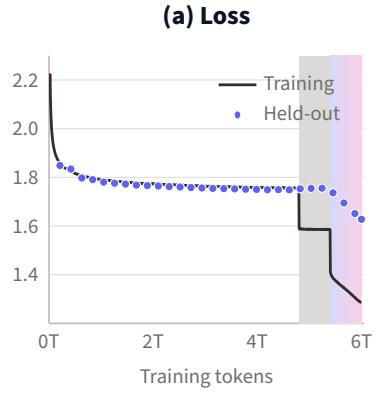

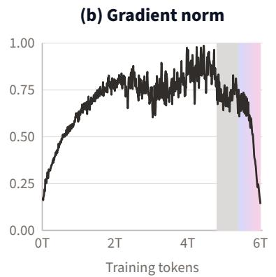

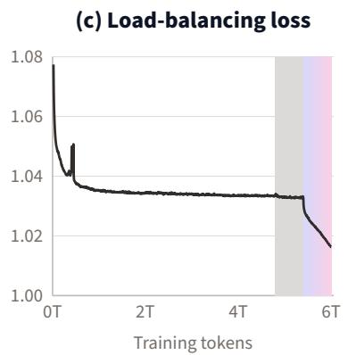  
Figure 10. Training curves: (a) training loss, smoothed, and loss on the fixed held-out set at every evaluated checkpoint; (b) gradient norm before clipping; (c) load-balancing loss of the MoE layers, divided by its coeficient (1 for uniform routing). Shading marks the transition (4.8–5.4T) and anneal (5.4–6T) stages; the first 17B tokens of warmup are not shown. Gradient-norm spikes occur only at a single step, and the load-balancing loss remains close to 1 throughout training.

Parallelism. We used data parallelism and expert parallelism of degree 4, and no tensor, pipeline, or context parallelism.

Long-context stage. Table 12 gives the settings and the data mixture of the two steps of the longcontext stage (Sections 2.3 and 4.1). The part of the mixture reweighted toward long documents applies the length weights of Kolibri (Aleph Alpha, 2026) to the anneal mixture.

Table 12. The two steps of the long-context stage: training settings and data mixture, as shares of the tokens of each step. Settings not listed are as in the first three stages (Table 5).
<table><tr><td></td><td>32k step</td><td>128k step</td><td>Overall</td></tr><tr><td>Sequence length (tokens)</td><td>32,768</td><td>131,072</td><td></td></tr><tr><td>Global batch size (sequences)</td><td>256</td><td>64</td><td></td></tr><tr><td>Steps</td><td>4,768</td><td>7,153</td><td>11,921</td></tr><tr><td>Tokens</td><td>40B</td><td>60B</td><td>100B</td></tr><tr><td>Anneal mixture, as is</td><td>33.3%</td><td>50.0%</td><td>43.3%</td></tr><tr><td>Anneal mixture, reweighted toward long documents</td><td>25.5%</td><td>9.0%</td><td>15.6%</td></tr><tr><td>Long documents</td><td>30.3%</td><td>30.0%</td><td>30.1%</td></tr><tr><td>FinePDFs</td><td>25.3%</td><td>30.0%</td><td>28.1%</td></tr><tr><td>FineWeb2-HQ</td><td>5.0%</td><td></td><td>2.0%</td></tr><tr><td>Math and code</td><td>10.9%</td><td>11.0%</td><td>11.0%</td></tr><tr><td>Nemotron-CC-Math, up to 16k tokens</td><td>5.4%</td><td>6.0%</td><td>5.8%</td></tr><tr><td>SFT-like math, 16k to 32k tokens</td><td>2.0%</td><td></td><td>0.8%</td></tr><tr><td>Real code</td><td>3.5%</td><td>5.0%</td><td>4.4%</td></tr></table>

## B.2 Software

We trained Lara Mini base with our internal training code, built on Megatron-Bridge 0.5.0 and Megatron-Core 0.18.0 (Shoeybi et al., 2019). The evaluation runs on lm-evaluation-harness and vLLM (Section D), and the inference benchmark on vLLM 0.28.0 (Section E). The released model runs in Hugging Face Transformers (Wolf et al., 2020), with the Gated DeltaNet kernels of flash-linear-attention (Yang and Zhang, 2024) when they are installed.

## C Design Ablations

The main text states the result of each ablation where it describes the corresponding choice (Sections 3 and 4.1). The ablation runs were scored on the development suite defined in Section 6.

## C.1 Model Class, Shape and Optimizer

We compared candidate architectures at about 0.5B active parameters (Table 13) under a protocol fixed before the first run. Each candidate was trained once on 100B tokens using the same data in the same order, with 4,096-token sequences and 1,024-sequence batches. The learning rate peaked at $1 . 2 \times 1 0 ^ { - 3 }$ , stayed constant up to 80B tokens and decayed to zero over the last 20B (Hägele et al., 2024). We report the mean scores on the development suite and the final model’s loss on a fixed held-out set of 128M tokens, evaluated using the same batches for every model. This loss is not comparable with the held-out loss of Section B. Losses at intermediate token counts are those of the average of eight constant-learning-rate checkpoints, which approximates a model annealed at that point (Li et al., 2025). These runs used global attention in every layer, and AdamW except in the last comparison. The hybrid layers (Section C.2) were adopted afterward.

Table 13. Model class, shape and optimizer at 100B tokens: loss on the fixed held-out set (lower is better) and mean benchmark scores, English (8 benchmarks) and multilingual (9). Experts are given as number × hidden size, with the number active per token. All rows use AdamW except the last. Highlighted is the configuration of Lara Mini base, before the hybrid attention. Every MoE ends with a lower loss than both dense models.
<table><tr><td>Layers</td><td>Routed experts</td><td>Shared</td><td>Active</td><td>Total</td><td>Loss</td><td>English</td><td>Multilingual</td></tr><tr><td>28</td><td>dense</td><td></td><td>0.60B</td><td>0.60B</td><td>2.431</td><td>50.4</td><td>36.9</td></tr><tr><td>28</td><td>dense</td><td></td><td>1.24B</td><td>1.24B</td><td>2.285</td><td>53.7</td><td>38.3</td></tr><tr><td>24</td><td>64 × 768, top-4</td><td></td><td>0.51B</td><td>3.91B</td><td>2.201</td><td>55.8</td><td>38.8</td></tr><tr><td>24</td><td>128 × 768, top-4</td><td></td><td>0.51B</td><td>7.53B</td><td>2.160</td><td>56.3</td><td>39.5</td></tr><tr><td>34</td><td>128 × 512, top-4</td><td></td><td>0.55B</td><td>7.18B</td><td>2.159</td><td>56.7</td><td>39.7</td></tr><tr><td>34</td><td>128 × 512, top-4</td><td>1× 512</td><td>0.60B</td><td>7.24B</td><td>2.140</td><td>57.3</td><td>40.0</td></tr><tr><td>Same, with Muon</td><td></td><td></td><td></td><td></td><td>2.098</td><td>58.1</td><td>40.7</td></tr></table>

Mixture of experts and shape. The MoE was ahead of both dense models from the start. With 64 experts, the MoE ended with a lower loss than the 1.24B dense model, which has 2.4 times as many active parameters. The gap between the MoE and the 0.6B dense model was already 0.219 nats at 5B tokens and did not shrink. Doubling the experts at the same active compute reduced the loss further as training progressed, from 0.011 at 5B tokens to 0.041 at 100 B tokens. The deeper, narrower shape with 34 layers started behind (0.036 higher loss at 5B tokens) and tied the 24-layer shape at 100B. We chose it because it scored at or above the 24-layer shape on 13 of the 17 benchmarks and has 0.35B fewer total parameters. A shared expert (Dai et al., 2024), which every token passes through, adds 0.05B active parameters. The loss reduction it brought was stable from about 25B tokens on, and the model with it scored higher than the one without on 12 of the 17 benchmarks.

Muon over AdamW. Muon (Section 4.1) used the same peak learning rate as AdamW, selected by a sweep on a half-width proxy with $\mu \mathrm { P }$ (Yang et al., 2021) and confirmed at full size. With Muon, the held-out loss was lower at every intermediate point, by 0.19 at 5B tokens and by 0.04 to 0.05 from 40B tokens on. AdamW needed 1.5 times as many tokens to reach Muon’s training loss between 10B and 30B tokens, and about 1.9 times as many at 80B. Muon was also ahead on 15 of the 17 benchmarks.

Takeaway. At about 0.5B active parameters, a fine-grained MoE beats dense models with up to 2.4 times as many active parameters; a shared expert and Muon further lower the loss.

## C.2 Hybrid Attention

We tested how much of the global attention can be replaced by Gated DeltaNet and sliding-window attention without losing quality. Starting from the 34-layer shape with one shared expert, trained with Muon (Section C.1), we compared three variants under the protocol of Section C.1 (Table 14). The first uses Gated DeltaNet (Yang et al., 2025c) in 26 of the 34 layers, and the second uses sliding windows of 512 tokens in the same 26 layers. The third is the hybrid of Lara Mini base, with 14 Gated DeltaNet and 13 sliding-window layers arranged exactly as in Section 3.1. The remaining layers keep global attention.

Table 14. Hybrid attention ablations at 100B tokens, against global attention in all 34 layers: change in held-out loss, mean change in score over the 17 benchmarks (points), and memory held per sequence during generation at 32k tokens, relative to global attention (computed as in Section 3.1). The oracle takes, on each benchmark, the better score of the two single-mixer variants. The single-mixer variants keep global attention across 8 layers, while the hybrid uses 7. The hybrid has the largest benchmark gain and the smallest memory.
<table><tr><td>Token mixers</td><td>∆ loss</td><td>∆ benchmarks</td><td>Memory at 32k</td></tr><tr><td>Global attention (34 layers)</td><td></td><td></td><td>100%</td></tr><tr><td>Gated DeltaNet (26 layers)</td><td>-0.017</td><td>+0.37</td><td>24.2%</td></tr><tr><td>Sliding window (26 layers)</td><td>+0.002</td><td>+0.17</td><td>24.7%</td></tr><tr><td>Gated DeltaNet (14) + sliding window (13)</td><td>-0.015</td><td>+0.67</td><td>21.5%</td></tr><tr><td>Oracle: better of Gated DeltaNet and sliding window</td><td>一</td><td>+0.65</td><td>1</td></tr></table>

Gated DeltaNet improves quality; sliding windows alone do not. Gated DeltaNet lowered the held-out loss by a margin that appeared early in training and held to the end (Table 14). This is consistent with the lower loss of Gated DeltaNet hybrids at matched budgets reported by Merrill et al. (2026). Sliding windows alone ended up on a level playing field with full attention.

The two mixers are complementary. On benchmarks, the two single-mixer variants were strong on diferent tasks (Table 15). Gated DeltaNet was better on text completion and commonsense reasoning; sliding windows were better on tasks that compare two sentences, such as entailment. The diference did not come from the length of the context, since most benchmark prompts fit within the window.

Table 15. Benchmark families: accuracy of the sliding-window and hybrid variants minus that of the Gated DeltaNet variant, in points. Sliding windows help on entailment and paraphrase; Gated DeltaNet on the other families.
<table><tr><td>Family</td><td>Benchmarks</td><td>Sliding window</td><td>Hybrid</td></tr><tr><td>Inference</td><td>NLI, XNLI</td><td>+0.59</td><td>+0.53</td></tr><tr><td>Paraphrase</td><td>PAWS, PAWS-X</td><td>+0.26</td><td>+0.05</td></tr><tr><td>Causality</td><td>COPA, XCOPA</td><td>-0.58</td><td>+0.17</td></tr><tr><td>Physical</td><td>PIQA, Global PIQA</td><td>-0.39</td><td>+0.35</td></tr><tr><td>Completion</td><td>HellaSwag, T-HellaSwag</td><td>-0.96</td><td>-0.07</td></tr><tr><td>Coreference</td><td>WinoGrande</td><td>-2.84</td><td>-0.16</td></tr><tr><td>Comprehension</td><td>Belebele</td><td>-0.17</td><td>+0.15</td></tr><tr><td>Knowledge</td><td>MMLU, Global MMLU, INCLUDE</td><td>-0.27</td><td>-0.10</td></tr></table>

The hybrid matches the best of both. The hybrid kept most of the loss gain of Gated DeltaNet with about half as many Gated DeltaNet layers. On benchmarks, it kept the advantage of Gated DeltaNet on completion and commonsense reasoning and recovered most of the advantage of sliding windows on entailment (Table 15). It scored above full attention on 16 of the 17 benchmarks. Its mean gain over full attention matched that of the oracle in Table 14, which neither single-mixer variant reached.

Long context. To test whether the ranking holds beyond the training length, we extended the three variants from their 100B checkpoints with the same long-context stage. This stage trained each variant on the same 10B tokens, in 32k-token sequences, with attention masked across documents. We then evaluated them on RULER (Hsieh et al., 2024), its multilingual counterpart ONERULER (Kim et al., 2025) and HELMET (Yen et al., 2025) at 16k and 32k tokens, and on the 17 short benchmarks (Table 16). The hybrid was the best on RULER and ONERULER at both lengths. On HELMET, which also covers retrieval-augmented generation, re-ranking and in-context learning, the hybrid and Gated DeltaNet were level at 32k tokens and ahead of sliding windows. The hybrid led on the two categories that require reading many passages, retrieval-augmented generation and re-ranking. The extension did not hurt short-context quality: every variant gained slightly on the short benchmarks, and the hybrid remained the best.

Table 16. Hybrid attention ablations after a long-context stage of 10B tokens at 32k: mean score over the 17 short benchmarks, and RULER (mean of 13 tasks), ONERULER (4 retrieval tasks in 26 languages) and HELMET (mean of its recall, RAG, re-ranking and in-context learning categories) at 16k and 32k tokens. The hybrid is best on RULER and ONERULER at both lengths.
<table><tr><td rowspan="2">Token mixers</td><td rowspan="2">Short</td><td colspan="2">RULER</td><td colspan="2">ONERULER</td><td colspan="2">HELMET</td></tr><tr><td>16k</td><td>32k</td><td>16k</td><td>32k</td><td>16k</td><td>32k</td></tr><tr><td>Gated DeltaNet (26 layers)</td><td>49.66</td><td>57.3</td><td>46.1</td><td>63.5</td><td>55.9</td><td>44.9</td><td>39.0</td></tr><tr><td>Sliding window (26 layers)</td><td>49.51</td><td>55.9</td><td>48.3</td><td>65.1</td><td>60.1</td><td>40.0</td><td>35.1</td></tr><tr><td>Hybrid (14 + 13 layers)</td><td>50.13</td><td>57.5</td><td>52.8</td><td>71.7</td><td>64.0</td><td>43.4</td><td>39.6</td></tr></table>

Takeaway. Interleaving Gated DeltaNet with sliding-window layers retains nearly all the loss gain of Gated DeltaNet and yields the best short- and long-context scores among the three variants, using global attention in only 7 of 34 layers.

## D Evaluation Details

We run every benchmark with lm-evaluation-harness (Biderman et al., 2024) (development version 0.4.14.dev0), using its task configurations unchanged except for the number of shots, which we fix as in Table 17. Generative tasks run on vLLM (Kwon et al., 2023) in bfloat16 with greedy decoding and a context of 4,096 tokens.

Baselines. The 56 base models we compare with come from these releases: Llama 3, 3.1 and 3.2 (Grattafiori et al., 2024), Qwen2.5 (Qwen Team, 2024), Qwen3 (Yang et al., 2025a) and Qwen3.5 (Qwen Team, 2026), Gemma (Gemma Team, 2024), Gemma 3 (Gemma Team, 2025) and Gemma 4 (Gemma Team, 2026), Mistral-7B (Jiang et al., 2023) and Ministral 3 (Liu et al., 2026), SmolLM2 (Ben Allal et al., 2025) and SmolLM3 (Hugging Face, 2025c), OLMoE (Muennighof et al., 2025b), Falcon-H1 (Falcon-LLM Team, 2025), Nemotron-Flash (Fu et al., 2025), Granite 3 (IBM Granite Team, 2024), Granite 4.0 (IBM, 2025a) and Granite 4.0 Nano (IBM, 2025b), Granite 4.1 (IBM Granite Team, 2026a) and granite-swash (IBM Granite Team, 2026b), LFM2 and LFM2.5 (Amini et al., 2025; Liquid AI, 2026a,b) and LFM3 (Liquid AI, 2026c), Trinity (Singh et al., 2026), Hunyuan (Tencent Hunyuan, 2025), MiniCPM5 (OpenBMB, 2026), Kanana-2 (Kanana LLM Team, 2026), Tiny Aya (Salamanca et al., 2026), Apertus (Hernández-Cano et al., 2026), EuroLLM (Martins et al., 2025b), EuroMoE (Alves et al., 2026), Teuken (Ali et al., 2025), Salamandra (Gonzalez-Agirre et al., 2025), Helium (Kyutai, 2025), Luciole (OpenLLM-France, 2026),

Table 17. Benchmark suite. Each domain average is the mean of its benchmarks, and the Overall average is the mean of the four domain averages. Lang.: number of languages or language variants averaged. Multilingual benchmarks are averaged over the languages supported by Lara Mini base, counting the country variants of Global PIQA (three of Spanish, two of French and of Portuguese) and the variants of T-HellaSwag separately. MGSM, a math benchmark, is averaged across all 11 of its languages. Acc. (norm.): accuracy normalized by answer length. Math-Verify: the final answer is checked for mathematical equivalence with the reference.
<table><tr><td>Domain</td><td>Benchmark</td><td>Shots</td><td>Metric</td><td>Lang.</td></tr><tr><td rowspan="10">English</td><td>XNLI (English) (Conneau et al., 2018)</td><td>0</td><td>Acc.</td><td></td></tr><tr><td>PAWS (English) (Zhang et al., 2019)</td><td>0</td><td>Acc.</td><td></td></tr><tr><td>Belebele (English) (Bandarkar et al., 2024)</td><td>0</td><td>Acc.</td><td></td></tr><tr><td>COPA (Roemmele et al., 2011)</td><td>0</td><td>Acc.</td><td></td></tr><tr><td>PIQA (Bisk et al., 2020)</td><td>0</td><td>Acc. (norm.)</td><td></td></tr><tr><td>HellaSwag (Zellers et al., 2019)</td><td>10</td><td>Acc. (norm.)</td><td></td></tr><tr><td>WinoGrande (Sakaguchi et al., 2020)</td><td>5</td><td>Acc.</td><td></td></tr><tr><td>ARC-Challenge (Clark et al., 2018)</td><td>25</td><td>Acc. (norm.)</td><td></td></tr><tr><td>MMLU (Hendrycks et al., 2021a)</td><td>5</td><td>Acc.</td><td></td></tr><tr><td>MMLU-Pro (Wang et al., 2024)</td><td>5, CoT</td><td>Exact match</td><td></td></tr><tr><td rowspan="8">Multilingual</td><td>XNLI (Conneau et al., 2018)</td><td>0</td><td>Acc.</td><td>12</td></tr><tr><td>PAWS-X (Yang et al., 2019)</td><td>0</td><td>Acc.</td><td>6</td></tr><tr><td>Belebele (Bandarkar et al., 2024)</td><td>0</td><td>Acc.</td><td>42</td></tr><tr><td>XCOPA (Ponti et al., 2020)</td><td>0</td><td>Acc.</td><td>7</td></tr><tr><td>Global PIQA, non-parallel (Chang et al., 2025)</td><td>0</td><td>Acc.</td><td>45</td></tr><tr><td>Global PIQA, parallel</td><td>0</td><td>Acc.</td><td>44</td></tr><tr><td>T-HellaSwag (Section F)</td><td>0</td><td>Acc. (norm.)</td><td>48</td></tr><tr><td>INCLUDE (Romanou et al., 2025)</td><td>5</td><td>Acc.</td><td>30</td></tr><tr><td rowspan="3">Math</td><td>Global MMLU (Singh et al., 2025)</td><td>5</td><td>Acc.</td><td>12</td></tr><tr><td>GSM8K (Cobbe et al., 2021)</td><td>5</td><td>Exact match</td><td></td></tr><tr><td>MATH (Hendrycks et al., 2021b)</td><td>4</td><td>Math-Verify</td><td></td></tr><tr><td></td><td>MGSM (Shi et al., 2023)</td><td>8, CoT</td><td>Exact match</td><td>11</td></tr><tr><td rowspan="4">Code</td><td>MBPP (Austin et al., 2021)</td><td>3</td><td>pass@1</td><td></td></tr><tr><td>MBPP+ (Liu et al., 2023)</td><td>3</td><td>pass@1</td><td></td></tr><tr><td>CRUXEval-I (Gu et al., 2024)</td><td>2</td><td>pass@1</td><td></td></tr><tr><td>CRUXEval-O</td><td>2</td><td>pass@1</td><td></td></tr></table>

Bielik v3 (Ociepa et al., 2025), Domyn-Edge (Domyn, 2026), Limite (Prignano et al., 2026), Villanova2 (Villanova.ai, 2026) and moe-7b-1b (IBM Research, 2025).

Answer extraction. The harness’s default extraction sometimes scores the answer format rather than the answer, so for three benchmarks we use a stricter or more complete parser, the same for every model:

• GSM8K: the first answer marked as #### N; if there is none, the first \boxed{N}; if there is none, the first “the answer is N”. We never fall back to the last number in the output.

• MGSM: the answer phrase of each language’s native chain-of-thought prompt, allowing an optional currency sign and spaces as thousands separators. The harness’s Bengali pattern is the English one, so it scores every model at zero.

• MBPP+: the MBPP generations, which must pass both MBPP’s own tests and the additional EvalPlus tests (Liu et al., 2023).

MATH uses the Minerva prompts and is scored with Math-Verify over its seven subjects (5,000 problems). CRUXEval-I and CRUXEval-O use direct prediction and the oficial answer parser.

## D.1 Full Results

Table 18 gives the domain averages of every model we evaluated, and Tables 19 to 22 give every benchmark. Models are grouped by active parameters as in Table 6, larger models first, and sorted by Overall average within each group.

Table 18. Domain averages of all 56 open base models we evaluated and Lara Mini base, grouped by active parameters as in Table 6. Active, Total: active and total parameters. Multilingual: averaged over the languages supported by Lara Mini base. Best result in each group in bold, second best underlined.
<table><tr><td></td><td colspan="2">Parameters</td><td colspan="3">Domain average</td><td></td><td></td></tr><tr><td>Model</td><td>Active Total</td><td></td><td>English</td><td>Multilingual</td><td>Math</td><td>Code</td><td>Overall</td></tr><tr><td colspan="8">Models with more than 4B active parameters</td></tr><tr><td>Teuken-7B</td><td>7.5B</td><td>7.5B</td><td>59.8</td><td>47.1</td><td>7.4</td><td>19.1</td><td>33.4</td></tr><tr><td>Mistral-7B-v0.3</td><td>7.3B</td><td>7.3B</td><td>68.1</td><td>49.0</td><td>24.6</td><td>37.4</td><td>44.8</td></tr><tr><td>Llama-3-8B</td><td>8.0B</td><td>8.0B</td><td>68.8</td><td>53.5</td><td>35.8</td><td>43.3</td><td>50.4</td></tr><tr><td>Gemma-7B</td><td>8.5B</td><td>8.5B</td><td>68.5</td><td>55.2</td><td>39.0</td><td>40.5</td><td>50.8</td></tr><tr><td>Llama-3.1-8B</td><td>8.0B</td><td>8.0B</td><td>69.6</td><td>55.2</td><td>36.6</td><td>43.6</td><td>51.2</td></tr><tr><td>Apertus-v1.5-8B</td><td>8.0B</td><td>8.0B</td><td>69.0</td><td>59.2</td><td>50.6</td><td>44.3</td><td>55.8</td></tr><tr><td>Qwen2.5-7B</td><td>7.6B</td><td>7.6B</td><td>72.3</td><td>57.3</td><td>64.9</td><td>55.5</td><td>62.5</td></tr><tr><td>Qwen3-8B</td><td>8.2B</td><td>8.2B</td><td>71.9</td><td>59.2</td><td>71.3</td><td>61.0</td><td>65.9</td></tr><tr><td colspan="8"></td></tr><tr><td>Models with 2B to 4B active parameters salamandra-2b</td><td>2.3B</td><td>2.3B</td><td>48.9</td><td>39.4</td><td>2.9</td><td>10.4</td><td>25.4</td></tr><tr><td>Villanova2-2B</td><td>2.4B</td><td>2.4B</td><td>59.8</td><td>45.3</td><td>28.8</td><td>33.9</td><td>41.9</td></tr><tr><td>tiny-aya</td><td>3.4B</td><td>3.4B</td><td>62.5</td><td>54.5</td><td>38.8</td><td>29.4</td><td>46.3</td></tr><tr><td>SmolLM3-3B</td><td>3.1B</td><td>3.1B</td><td>64.7</td><td>48.7</td><td>51.0</td><td>43.6</td><td>52.0</td></tr><tr><td>Nemotron-Flash-3B</td><td>2.7B</td><td>2.7B</td><td>65.6</td><td>42.0</td><td>59.7</td><td>44.5</td><td>52.9</td></tr><tr><td>granite-4.1-3b</td><td>3.4B</td><td>3.4B</td><td>64.3</td><td>48.1</td><td>53.8</td><td>47.6</td><td>53.5</td></tr><tr><td>Ministral-3-3B</td><td>3.4B</td><td>3.4B</td><td>67.7</td><td>55.4</td><td>49.9</td><td>42.3</td><td>53.8</td></tr><tr><td>Domyn-Edge</td><td>3.9B</td><td>3.9B</td><td>68.2</td><td>52.0</td><td>54.1</td><td>47.3</td><td>55.4</td></tr><tr><td>Gemma-4-E4B</td><td>4.0B</td><td>7.9B</td><td>70.1</td><td>61.1</td><td>44.4</td><td>46.0</td><td>55.4</td></tr><tr><td>MiniCPM5-2B</td><td>2.5B</td><td>2.5B</td><td>65.3</td><td>48.0</td><td>66.0</td><td>50.8</td><td>57.5</td></tr><tr><td>Qwen3.5-4B</td><td>4.7B</td><td>4.7B</td><td>70.5</td><td>58.0</td><td>66.1</td><td>52.3</td><td>61.7</td></tr><tr><td>Hunyuan-4B</td><td>4.2B</td><td>4.2B</td><td>70.4</td><td>51.6</td><td>72.0</td><td>58.6</td><td>63.1</td></tr><tr><td>Qwen3-4B</td><td>4.0B</td><td>4.0B</td><td>71.2</td><td>57.5</td><td>69.2</td><td>57.0</td><td>63.7</td></tr><tr><td colspan="8">Models with up to 2B active parameters</td></tr><tr><td>Apertus-v1.1-0.5B</td><td>0.4B</td><td>0.4B</td><td>45.8</td><td>37.8</td><td>2.0</td><td>11.1</td><td>24.2</td></tr><tr><td>Gemma-3-1B</td><td>1.0B</td><td>1.0B</td><td>49.3</td><td>40.6</td><td>2.2</td><td>12.6</td><td>26.2</td></tr><tr><td>EuroLLM-1.7B</td><td>1.7B</td><td>1.7B</td><td>48.5</td><td>40.1</td><td>3.9</td><td>18.0</td><td>27.6</td></tr><tr><td>EuroMoE-2.6B-A0.6B</td><td>0.5B</td><td>2.6B</td><td>49.6</td><td>40.7</td><td>6.2</td><td>21.1</td><td>29.4</td></tr><tr><td>helium-1-2b</td><td>2.0B</td><td>2.0B</td><td>59.8</td><td>43.3</td><td>6.1</td><td>13.5</td><td>30.7</td></tr><tr><td>Llama-3.2-1B</td><td>1.2B</td><td>1.2B</td><td>51.9</td><td>39.7</td><td>5.0</td><td>28.0</td><td>31.2</td></tr><tr><td>Apertus-v1.1-1.5B</td><td>1.5B</td><td>1.5B</td><td>53.6</td><td>44.8</td><td>5.9</td><td>20.6</td><td>31.2</td></tr><tr><td>Luciole-1B</td><td>1.3B</td><td>1.3B</td><td>51.5</td><td>38.9</td><td>11.0</td><td>24.0</td><td>31.3</td></tr><tr><td>limite-1b-soup</td><td>1.0B</td><td>1.0B</td><td>44.9</td><td>35.5</td><td>47.2</td><td>18.9</td><td>36.6</td></tr><tr><td>SmolLM2-1.7B</td><td>1.7B</td><td>1.7B</td><td>58.5 61.9</td><td>39.1</td><td>17.6 27.2</td><td>31.8</td><td>36.8</td></tr><tr><td>OLMoE-1B-7B</td><td>1.3B</td><td>6.9B</td><td>57.5</td><td>40.4</td><td>26.9</td><td>21.1 26.1</td><td>37.7</td></tr><tr><td>granite-swash-3b-a600m Nemotron-Flash-1B</td><td>0.6B</td><td>3.0B</td><td>54.7</td><td>41.5</td><td>33.1</td><td>32.2</td><td>38.0 39.3</td></tr><tr><td></td><td>1.0B</td><td>1.0B 3.3B</td><td>59.1</td><td>37.3</td><td>25.6</td><td>32.6</td><td></td></tr><tr><td>granite-3.1-3b-a800m</td><td>0.9B</td><td></td><td>56.1</td><td>40.9</td><td>30.3</td><td>28.2</td><td>39.5 39.7</td></tr><tr><td>Qwen3.5-0.8B</td><td>0.8B</td><td>0.8B</td><td>57.2</td><td>44.3</td><td>37.8</td><td>23.9</td><td></td></tr><tr><td>LFM2.5-1.2B</td><td>1.2B</td><td>1.2B</td><td>46.8</td><td>42.2</td><td>51.0</td><td>27.5</td><td>40.3</td></tr><tr><td>limite-1b</td><td>1.0B</td><td>1.0B</td><td></td><td>36.3</td><td></td><td>37.9</td><td>40.4</td></tr><tr><td>Bielik-1.5B</td><td>1.6B</td><td>1.6B</td><td>58.6</td><td>40.4</td><td>26.8</td><td></td><td>40.9</td></tr><tr><td>Falcon-H1-0.5B</td><td>0.5B</td><td>0.5B</td><td>56.1</td><td>36.8</td><td>39.2</td><td>32.9</td><td>41.2</td></tr><tr><td>Gemma-4-E2B</td><td>2.0B</td><td>5.1B</td><td>63.3</td><td>53.3</td><td>18.0</td><td>32.8 34.8</td><td>41.9</td></tr><tr><td>Qwen3-0.6B</td><td>0.6B</td><td>0.6B</td><td>55.3 59.5</td><td>43.1</td><td>37.2</td><td>39.9</td><td>42.6</td></tr><tr><td>kanana-2-1.3b</td><td>1.3B</td><td>1.3B</td><td></td><td>40.7</td><td>35.5</td><td>39.5</td><td>43.9</td></tr><tr><td>granite-4.0-h-1b</td><td>1.5B</td><td>1.5B</td><td>57.6</td><td>43.0</td><td>37.8</td><td></td><td>44.5</td></tr><tr><td>moe-7b-1b</td><td>1.1B</td><td>6.4B</td><td>62.8</td><td>42.8</td><td>34.1</td><td>39.5 43.0</td><td>44.8 47.2</td></tr><tr><td>granite-4.0-1b Qwen2.5-1.5B</td><td>1.6B 1.5B</td><td>1.6B 1.5B</td><td>60.0 62.6</td><td>42.5 46.8</td><td>43.3 43.0</td></table>

Table 19. English benchmarks for all 56 models we evaluated and Lara Mini base. Bele.: Belebele; HS: HellaSwag; WG: WinoGrande; MMLU-P: MMLU-Pro. Settings in Table 17; best result in each group in bold, second best underlined.
<table><tr><td rowspan=1 colspan=11>Model                  NLIPAWSBele.COPAPIQA HSWGARC-CMMLUMMLU-PAvg.</td></tr><tr><td rowspan=1 colspan=11>Models with more than 4B active parametersTeuken-7B             56.9 59.445.9 86.078.777.471.7  54.0 49.8    17.959.8</td></tr><tr><td rowspan=1 colspan=5>Mistral-7B-v0.3         55.3 68.472.1 88.2</td><td rowspan=1 colspan=5>82.183.278.8  60.2  62.5    30.5</td><td rowspan=1 colspan=1>68.1</td></tr><tr><td rowspan=1 colspan=5>Llama-3-8B            54.8 70.175.287.8</td><td rowspan=1 colspan=1>80.7</td><td rowspan=1 colspan=4>82.378.5  58.4  65.5    34.7</td><td rowspan=1 colspan=1>68.8</td></tr><tr><td rowspan=1 colspan=5>Gemma-7B             52.9 69.276.089.4</td><td rowspan=1 colspan=1>81.0</td><td rowspan=1 colspan=4>82.477.4  60.0  63.1    33.5</td><td rowspan=1 colspan=1>68.5</td></tr><tr><td rowspan=1 colspan=5>Llama-3.1-8B           55.3 70.481.0 88.2</td><td rowspan=1 colspan=5>80.982.378.3  58.0  65.3    35.8</td><td rowspan=1 colspan=1>69.6</td></tr><tr><td rowspan=1 colspan=3>Apertus-v1.5-8B        55.0 65.5</td><td rowspan=1 colspan=2>77.9 87.8</td><td rowspan=1 colspan=1>80.1</td><td rowspan=1 colspan=4>80.374.4  64.5  66.3    38.2</td><td rowspan=1 colspan=1>69.0</td></tr><tr><td rowspan=1 colspan=3>Qwen2.5-7B            53.9 68.8</td><td rowspan=1 colspan=2>88.8 89.2</td><td rowspan=1 colspan=1>79.9</td><td rowspan=1 colspan=4>80.375.9  63.8  74.2    48.5</td><td rowspan=1 colspan=1>72.3</td></tr><tr><td rowspan=1 colspan=10>Qwen3-8B             46.8 55.591.3 89.079.579.676.6 67.6 76.8    56.1</td><td rowspan=1 colspan=1>71.9</td></tr><tr><td rowspan=1 colspan=3>Models with 2B to 4B active parameters</td><td rowspan=1 colspan=2></td><td rowspan=1 colspan=4></td><td rowspan=1 colspan=1></td><td rowspan=1 colspan=1></td></tr><tr><td rowspan=1 colspan=1>salamandra-2b</td><td rowspan=1 colspan=1>51.9</td><td rowspan=1 colspan=1>57.8</td><td rowspan=1 colspan=1>23.7</td><td rowspan=1 colspan=1>79.2</td><td rowspan=1 colspan=1>73.3</td><td rowspan=1 colspan=1>63.7</td><td rowspan=1 colspan=2>62.2  41.5</td><td rowspan=1 colspan=1>25.5     9.8</td><td rowspan=1 colspan=1>48.9</td></tr><tr><td rowspan=1 colspan=1>Villanova2-2B</td><td rowspan=1 colspan=1>52.9</td><td rowspan=1 colspan=1>59.2</td><td rowspan=1 colspan=1>63.9</td><td rowspan=1 colspan=1>78.6</td><td rowspan=1 colspan=1>75.4</td><td rowspan=1 colspan=1>70.4</td><td rowspan=1 colspan=1>65.1</td><td rowspan=1 colspan=1>55.0</td><td rowspan=1 colspan=1>53.5    24.1</td><td rowspan=1 colspan=1>59.8</td></tr><tr><td rowspan=1 colspan=1>tiny-aya</td><td rowspan=1 colspan=1>54.3</td><td rowspan=1 colspan=1>66.7</td><td rowspan=1 colspan=1>66.2</td><td rowspan=1 colspan=1>84.2</td><td rowspan=1 colspan=1>77.3</td><td rowspan=1 colspan=1>72.4</td><td rowspan=1 colspan=1>68.4</td><td rowspan=1 colspan=1>52.7</td><td rowspan=1 colspan=1>58.4    24.8</td><td rowspan=1 colspan=1>62.5</td></tr><tr><td rowspan=1 colspan=1>SmolLM3-3B</td><td rowspan=1 colspan=1>49.5</td><td rowspan=1 colspan=1>61.0</td><td rowspan=1 colspan=1>65.8</td><td rowspan=1 colspan=1>85.6</td><td rowspan=1 colspan=1>78.5</td><td rowspan=1 colspan=1>77.1</td><td rowspan=1 colspan=1>73.4</td><td rowspan=1 colspan=1>60.1</td><td rowspan=1 colspan=1>61.3    35.2</td><td rowspan=1 colspan=1>64.7</td></tr><tr><td rowspan=1 colspan=1>Nemotron-Flash-3B</td><td rowspan=1 colspan=2>55.2 65.6</td><td rowspan=1 colspan=1>70.8</td><td rowspan=1 colspan=1>83.8</td><td rowspan=1 colspan=1>80.0</td><td rowspan=1 colspan=1>73.4</td><td rowspan=1 colspan=1>69.1</td><td rowspan=1 colspan=1>57.3</td><td rowspan=1 colspan=1>61.1    39.3</td><td rowspan=1 colspan=1>65.6</td></tr><tr><td rowspan=1 colspan=1>granite-4.1-3b</td><td rowspan=1 colspan=1>48.1</td><td rowspan=1 colspan=1>58.9</td><td rowspan=1 colspan=1>62.7</td><td rowspan=1 colspan=1>83.8</td><td rowspan=1 colspan=1>79.5</td><td rowspan=1 colspan=1>75.7</td><td rowspan=1 colspan=1>72.9</td><td rowspan=1 colspan=1>59.9</td><td rowspan=1 colspan=1>64.3    37.4</td><td rowspan=1 colspan=1>64.3</td></tr><tr><td rowspan=1 colspan=1>Ministral-3-3B</td><td rowspan=1 colspan=1>53.1</td><td rowspan=1 colspan=1>64.9</td><td rowspan=1 colspan=1>82.0</td><td rowspan=1 colspan=1>85.2</td><td rowspan=1 colspan=1>78.2</td><td rowspan=1 colspan=1>74.4</td><td rowspan=1 colspan=1>69.9</td><td rowspan=1 colspan=1>63.1</td><td rowspan=1 colspan=1>68.0    38.6</td><td rowspan=1 colspan=1>67.7</td></tr><tr><td rowspan=1 colspan=1>Domyn-Edge</td><td rowspan=1 colspan=1>53.7</td><td rowspan=1 colspan=1>69.4</td><td rowspan=1 colspan=1>85.8</td><td rowspan=1 colspan=1>86.2</td><td rowspan=1 colspan=1>79.3</td><td rowspan=1 colspan=1>75.8</td><td rowspan=1 colspan=1>73.7</td><td rowspan=1 colspan=1>57.8</td><td rowspan=1 colspan=1>63.6    36.5</td><td rowspan=1 colspan=1>68.2</td></tr><tr><td rowspan=1 colspan=1>Gemma-4-E4B</td><td rowspan=1 colspan=1>54.1</td><td rowspan=1 colspan=1>65.8</td><td rowspan=1 colspan=1>81.0</td><td rowspan=1 colspan=1>87.6</td><td rowspan=1 colspan=1>81.2</td><td rowspan=1 colspan=1>81.5</td><td rowspan=1 colspan=1>75.6</td><td rowspan=1 colspan=1>66.0</td><td rowspan=1 colspan=1>70.6    37.9</td><td rowspan=1 colspan=1>70.1</td></tr><tr><td rowspan=1 colspan=1>MiniCPM5-2B</td><td rowspan=1 colspan=1>53.6</td><td rowspan=1 colspan=1>67.0</td><td rowspan=1 colspan=1>74.0</td><td rowspan=1 colspan=1>82.6</td><td rowspan=1 colspan=1>77.0</td><td rowspan=1 colspan=1>69.1</td><td rowspan=1 colspan=1>66.2</td><td rowspan=1 colspan=1>55.0</td><td rowspan=1 colspan=1>65.3    43.2</td><td rowspan=1 colspan=1>65.3</td></tr><tr><td rowspan=1 colspan=1>Qwen3.5-4B</td><td rowspan=1 colspan=1>44.0</td><td rowspan=1 colspan=1>66.3</td><td rowspan=1 colspan=1>87.4</td><td rowspan=1 colspan=1>85.2</td><td rowspan=1 colspan=1>79.3</td><td rowspan=1 colspan=1>77.2</td><td rowspan=1 colspan=1>73.1</td><td rowspan=1 colspan=1>66.5</td><td rowspan=1 colspan=1>73.1    52.5</td><td rowspan=1 colspan=1>70.5</td></tr><tr><td rowspan=1 colspan=1>Hunyuan-4B</td><td rowspan=1 colspan=2>54.8 67.9</td><td rowspan=1 colspan=1>87.3</td><td rowspan=1 colspan=1>84.2</td><td rowspan=1 colspan=1>77.5</td><td rowspan=1 colspan=1>72.1</td><td rowspan=1 colspan=1>73.6</td><td rowspan=1 colspan=1>59.0</td><td rowspan=1 colspan=1>72.5    55.1</td><td rowspan=1 colspan=1>70.4</td></tr><tr><td rowspan=1 colspan=1>Qwen3-4B</td><td rowspan=1 colspan=2>54.4 68.6</td><td rowspan=1 colspan=1>89.3</td><td rowspan=1 colspan=1>85.8</td><td rowspan=1 colspan=1>78.0</td><td rowspan=1 colspan=1>75.7</td><td rowspan=1 colspan=1>72.0</td><td rowspan=1 colspan=1>64.4</td><td rowspan=1 colspan=1>73.0    51.2</td><td rowspan=1 colspan=1>71.2</td></tr><tr><td rowspan=1 colspan=1>Models with up to 2B active</td><td rowspan=1 colspan=2>parameters</td><td rowspan=1 colspan=1></td><td rowspan=1 colspan=1></td><td rowspan=1 colspan=1></td><td rowspan=1 colspan=1></td><td rowspan=1 colspan=1></td><td rowspan=1 colspan=1></td><td rowspan=1 colspan=1></td><td rowspan=1 colspan=1></td></tr><tr><td rowspan=1 colspan=1>Apertus-v1.1-0.5B</td><td rowspan=1 colspan=1>54.1</td><td rowspan=1 colspan=1>53.5</td><td rowspan=1 colspan=1>25.6</td><td rowspan=1 colspan=1>74.8</td><td rowspan=1 colspan=1>70.4</td><td rowspan=1 colspan=1>52.3</td><td rowspan=1 colspan=1>57.2</td><td rowspan=1 colspan=1>36.4</td><td rowspan=1 colspan=1>24.7     9.3</td><td rowspan=1 colspan=1>45.8</td></tr><tr><td rowspan=1 colspan=1>Gemma-3-1B</td><td rowspan=1 colspan=1>52.8</td><td rowspan=1 colspan=1>60.7</td><td rowspan=1 colspan=1>25.3</td><td rowspan=1 colspan=1>79.6</td><td rowspan=1 colspan=1>75.1</td><td rowspan=1 colspan=1>62.9</td><td rowspan=1 colspan=1>61.4</td><td rowspan=1 colspan=1>39.3</td><td rowspan=1 colspan=1>26.2     9.3</td><td rowspan=1 colspan=1>49.3</td></tr><tr><td rowspan=1 colspan=1>EuroLLM-1.7B</td><td rowspan=1 colspan=1>49.4</td><td rowspan=1 colspan=1>59.9</td><td rowspan=1 colspan=1>27.9</td><td rowspan=1 colspan=1>76.6</td><td rowspan=1 colspan=1>73.9</td><td rowspan=1 colspan=1>60.8</td><td rowspan=1 colspan=1>59.6</td><td rowspan=1 colspan=1>40.9</td><td rowspan=1 colspan=1>26.9     9.6</td><td rowspan=1 colspan=1>48.5</td></tr><tr><td rowspan=1 colspan=1>EuroMoE-2.6B-A0.6B</td><td rowspan=1 colspan=1>52.3</td><td rowspan=1 colspan=1>58.1</td><td rowspan=1 colspan=1>24.4</td><td rowspan=1 colspan=1>79.0</td><td rowspan=1 colspan=1>76.8</td><td rowspan=1 colspan=1>65.0</td><td rowspan=1 colspan=1>61.3</td><td rowspan=1 colspan=1>44.8</td><td rowspan=1 colspan=1>24.9     9.3</td><td rowspan=1 colspan=1>49.6</td></tr><tr><td rowspan=1 colspan=1>helium-1-2b</td><td rowspan=1 colspan=1>53.1</td><td rowspan=1 colspan=1>65.7</td><td rowspan=1 colspan=1>54.6</td><td rowspan=1 colspan=1>82.8</td><td rowspan=1 colspan=1>78.1</td><td rowspan=1 colspan=1>73.1</td><td rowspan=1 colspan=1>68.9</td><td rowspan=1 colspan=1>52.1</td><td rowspan=1 colspan=1>52.0    17.7</td><td rowspan=1 colspan=1>59.8</td></tr><tr><td rowspan=1 colspan=1>Llama-3.2-1B</td><td rowspan=1 colspan=1>54.5</td><td rowspan=1 colspan=1>60.0</td><td rowspan=1 colspan=1>36.2</td><td rowspan=1 colspan=1>81.8</td><td rowspan=1 colspan=1>75.0</td><td rowspan=1 colspan=1>65.8</td><td rowspan=1 colspan=1>62.8</td><td rowspan=1 colspan=1>40.4</td><td rowspan=1 colspan=1>31.1    11.2</td><td rowspan=1 colspan=1>51.9</td></tr><tr><td rowspan=1 colspan=1>Apertus-v1.1-1.5B</td><td rowspan=1 colspan=1>53.5</td><td rowspan=1 colspan=1>62.2</td><td rowspan=1 colspan=1>32.1</td><td rowspan=1 colspan=1>81.0</td><td rowspan=1 colspan=1>75.4</td><td rowspan=1 colspan=1>65.3</td><td rowspan=1 colspan=1>63.3</td><td rowspan=1 colspan=1>47.3</td><td rowspan=1 colspan=1>42.7    13.6</td><td rowspan=1 colspan=1>53.6</td></tr><tr><td rowspan=1 colspan=1>Luciole-1B</td><td rowspan=1 colspan=1>53.8</td><td rowspan=1 colspan=1>56.9</td><td rowspan=1 colspan=1>34.9</td><td rowspan=1 colspan=1>78.4</td><td rowspan=1 colspan=1>73.6</td><td rowspan=1 colspan=1>62.5</td><td rowspan=1 colspan=1>61.7</td><td rowspan=1 colspan=1>45.0</td><td rowspan=1 colspan=1>35.2    12.5</td><td rowspan=1 colspan=1>51.5</td></tr><tr><td rowspan=1 colspan=1>limite-1b-soup</td><td rowspan=1 colspan=1>54.6</td><td rowspan=1 colspan=1>65.6</td><td rowspan=1 colspan=1>26.3</td><td rowspan=1 colspan=1>57.4</td><td rowspan=1 colspan=1>60.6</td><td rowspan=1 colspan=1>35.6</td><td rowspan=1 colspan=1>55.3</td><td rowspan=1 colspan=1>34.3</td><td rowspan=1 colspan=1>35.6    23.7</td><td rowspan=1 colspan=1>44.9</td></tr><tr><td rowspan=1 colspan=1>SmolLM2-1.7B</td><td rowspan=1 colspan=1>51.0</td><td rowspan=1 colspan=1>66.1</td><td rowspan=1 colspan=1>43.7</td><td rowspan=1 colspan=1>82.8</td><td rowspan=1 colspan=1>77.6</td><td rowspan=1 colspan=1>73.1</td><td rowspan=1 colspan=1>67.9</td><td rowspan=1 colspan=1>53.8</td><td rowspan=1 colspan=1>50.1    19.2</td><td rowspan=1 colspan=1>58.5</td></tr><tr><td rowspan=1 colspan=1>OLMoE-1B-7B</td><td rowspan=1 colspan=1>52.6</td><td rowspan=1 colspan=1>64.5</td><td rowspan=1 colspan=1>51.7</td><td rowspan=1 colspan=1>87.4</td><td rowspan=1 colspan=1>79.7</td><td rowspan=1 colspan=1>79.7</td><td rowspan=1 colspan=1>72.1</td><td rowspan=1 colspan=1>58.4</td><td rowspan=1 colspan=1>55.0    18.1</td><td rowspan=1 colspan=1>61.9</td></tr><tr><td rowspan=1 colspan=1>granite-swash-3b-a600m</td><td rowspan=1 colspan=1>53.2</td><td rowspan=1 colspan=1>58.0</td><td rowspan=1 colspan=1>48.0</td><td rowspan=1 colspan=1>80.2</td><td rowspan=1 colspan=1>77.4</td><td rowspan=1 colspan=1>69.2</td><td rowspan=1 colspan=1>66.1</td><td rowspan=1 colspan=1>49.6</td><td rowspan=1 colspan=1>54.4    18.9</td><td rowspan=1 colspan=1>57.5</td></tr><tr><td rowspan=1 colspan=1>Nemotron-Flash-1B</td><td rowspan=1 colspan=1>51.2</td><td rowspan=1 colspan=1>60.2</td><td rowspan=1 colspan=1>42.6</td><td rowspan=1 colspan=1>79.8</td><td rowspan=1 colspan=1>75.4</td><td rowspan=1 colspan=1>61.3</td><td rowspan=1 colspan=1>61.1</td><td rowspan=1 colspan=1>46.0</td><td rowspan=1 colspan=1>44.6    25.0</td><td rowspan=1 colspan=1>54.7</td></tr><tr><td rowspan=1 colspan=1>granite-3.1-3b-a800m</td><td rowspan=1 colspan=1>56.9</td><td rowspan=1 colspan=1>67.3</td><td rowspan=1 colspan=1>40.9</td><td rowspan=1 colspan=1>84.4</td><td rowspan=1 colspan=1>78.9</td><td rowspan=1 colspan=1>74.2</td><td rowspan=1 colspan=1>69.3</td><td rowspan=1 colspan=1>51.1</td><td rowspan=1 colspan=1>19.4</td><td rowspan=1 colspan=1>59.1</td></tr><tr><td rowspan=1 colspan=1>Qwen3.5-0.8B</td><td rowspan=1 colspan=1>50.1</td><td rowspan=1 colspan=1>62.0</td><td rowspan=1 colspan=1>68.6</td><td rowspan=1 colspan=1>74.8</td><td rowspan=1 colspan=1>71.6</td><td rowspan=1 colspan=1>55.5</td><td rowspan=1 colspan=1>60.1</td><td rowspan=1 colspan=1>43.7</td><td rowspan=1 colspan=1>26.5</td><td rowspan=1 colspan=1>56.1</td></tr><tr><td rowspan=1 colspan=1>LFM2.5-1.2B</td><td rowspan=1 colspan=1>52.1</td><td rowspan=1 colspan=1>58.7</td><td rowspan=1 colspan=1>63.1</td><td rowspan=1 colspan=1>76.4</td><td rowspan=1 colspan=1>73.0</td><td rowspan=1 colspan=1>61.0</td><td rowspan=1 colspan=1>61.0</td><td rowspan=1 colspan=1>56.0</td><td rowspan=1 colspan=1>55.1    15.3</td><td rowspan=1 colspan=1>57.2</td></tr><tr><td rowspan=1 colspan=1>limite-1b</td><td rowspan=1 colspan=1>49.2</td><td rowspan=1 colspan=1>56.6</td><td rowspan=1 colspan=1>36.8</td><td rowspan=1 colspan=1>65.2</td><td rowspan=1 colspan=1>62.9</td><td rowspan=1 colspan=1>39.8</td><td rowspan=1 colspan=1>54.9</td><td rowspan=1 colspan=1>39.0</td><td rowspan=1 colspan=1>39.3    24.9</td><td rowspan=1 colspan=1>46.8</td></tr><tr><td rowspan=1 colspan=1>Bielik-1.5B</td><td rowspan=1 colspan=1>49.8</td><td rowspan=1 colspan=1>66.0</td><td rowspan=1 colspan=1>66.2</td><td rowspan=1 colspan=1>77.4</td><td rowspan=1 colspan=1>72.3</td><td rowspan=1 colspan=1>64.7</td><td rowspan=1 colspan=1>64.2</td><td rowspan=1 colspan=1>46.5</td><td rowspan=1 colspan=1>55.2    23.8</td><td rowspan=1 colspan=1>58.6</td></tr><tr><td rowspan=1 colspan=1>Falcon-H1-0.5B</td><td rowspan=1 colspan=1>52.3</td><td rowspan=1 colspan=1>65.2</td><td rowspan=1 colspan=1>50.1</td><td rowspan=1 colspan=1>72.0</td><td rowspan=1 colspan=1>71.1</td><td rowspan=1 colspan=1>56.3</td><td rowspan=1 colspan=1>58.4</td><td rowspan=1 colspan=1>47.1</td><td rowspan=1 colspan=1>55.1    33.0</td><td rowspan=1 colspan=1>56.1</td></tr><tr><td rowspan=1 colspan=1>Gemma-4-E2B</td><td rowspan=1 colspan=1>53.6</td><td rowspan=1 colspan=1>67.8</td><td rowspan=1 colspan=1>64.8</td><td rowspan=1 colspan=1>84.8</td><td rowspan=1 colspan=1>78.9</td><td rowspan=1 colspan=1>75.3</td><td rowspan=1 colspan=1>68.4</td><td rowspan=1 colspan=1>57.6</td><td rowspan=1 colspan=1>57.8    23.6</td><td rowspan=1 colspan=1>63.3</td></tr><tr><td rowspan=1 colspan=1>Qwen3-0.6B</td><td rowspan=1 colspan=1>52.9</td><td rowspan=1 colspan=1>60.5</td><td rowspan=1 colspan=1>56.8</td><td rowspan=1 colspan=1>76.0</td><td rowspan=1 colspan=1>70.0</td><td rowspan=1 colspan=1>53.5</td><td rowspan=1 colspan=1>60.4</td><td rowspan=1 colspan=1>45.1</td><td rowspan=1 colspan=1>52.5    25.7</td><td rowspan=1 colspan=1>55.3</td></tr><tr><td rowspan=1 colspan=1>kanana-2-1.3b</td><td rowspan=1 colspan=1>51.2</td><td rowspan=1 colspan=1>65.5</td><td rowspan=1 colspan=1>60.4</td><td rowspan=1 colspan=1>79.2</td><td rowspan=1 colspan=1>76.0</td><td rowspan=1 colspan=1>64.1</td><td rowspan=1 colspan=1>62.2</td><td rowspan=1 colspan=1>49.9</td><td rowspan=1 colspan=1>56.4    29.9</td><td rowspan=1 colspan=1>59.5</td></tr><tr><td rowspan=1 colspan=1>granite-4.0-h-1b</td><td rowspan=1 colspan=1>45.8</td><td rowspan=1 colspan=1>64.7</td><td rowspan=1 colspan=1>43.2</td><td rowspan=1 colspan=1>81.0</td><td rowspan=1 colspan=1>76.3</td><td rowspan=1 colspan=1>69.7</td><td rowspan=1 colspan=1>65.1</td><td rowspan=1 colspan=1>50.9</td><td rowspan=1 colspan=1>56.6    22.4</td><td rowspan=1 colspan=1>57.6</td></tr><tr><td rowspan=1 colspan=1>moe-7b-1b</td><td rowspan=1 colspan=1>55.8</td><td rowspan=1 colspan=1>65.0</td><td rowspan=1 colspan=1>53.1</td><td rowspan=1 colspan=1>87.6</td><td rowspan=1 colspan=1>78.7</td><td rowspan=1 colspan=1>78.5</td><td rowspan=1 colspan=1>72.4</td><td rowspan=1 colspan=1>56.5</td><td rowspan=1 colspan=1>55.8    24.7</td><td rowspan=1 colspan=1>62.8</td></tr><tr><td rowspan=1 colspan=1>granite-4.0-1b</td><td rowspan=1 colspan=1>49.3</td><td rowspan=1 colspan=1>55.1</td><td rowspan=1 colspan=1>59.8</td><td rowspan=1 colspan=1>82.6</td><td rowspan=1 colspan=1>75.6</td><td rowspan=1 colspan=1>70.2</td><td rowspan=1 colspan=1>67.6</td><td rowspan=1 colspan=1>53.8</td><td rowspan=1 colspan=1>57.2    29.3</td><td rowspan=1 colspan=1>60.0</td></tr><tr><td rowspan=1 colspan=1>Qwen2.5-1.5B</td><td rowspan=1 colspan=1>51.9</td><td rowspan=1 colspan=1>64.1</td><td rowspan=1 colspan=1>71.7</td><td rowspan=1 colspan=1>84.6</td><td rowspan=1 colspan=1>76.0</td><td rowspan=1 colspan=1>67.9</td><td rowspan=1 colspan=1>64.6</td><td rowspan=1 colspan=1>54.7</td><td rowspan=1 colspan=1>60.8    29.5</td><td rowspan=1 colspan=1>62.6</td></tr><tr><td rowspan=1 colspan=1>Falcon-H1-1.5B</td><td rowspan=1 colspan=1>56.8</td><td rowspan=1 colspan=1>67.1</td><td rowspan=1 colspan=1>65.9</td><td rowspan=1 colspan=1>79.8</td><td rowspan=1 colspan=1>74.9</td><td rowspan=1 colspan=1>66.8</td><td rowspan=1 colspan=1>65.5</td><td rowspan=1 colspan=1>52.9</td><td rowspan=1 colspan=1>61.7    40.4</td><td rowspan=1 colspan=1>63.2</td></tr><tr><td rowspan=1 colspan=1>Qwen3.5-2B</td><td rowspan=1 colspan=1>53.6</td><td rowspan=1 colspan=1>61.7</td><td rowspan=1 colspan=1>82.8</td><td rowspan=1 colspan=1>82.0</td><td rowspan=1 colspan=1>74.8</td><td rowspan=1 colspan=1>67.6</td><td rowspan=1 colspan=1>66.3</td><td rowspan=1 colspan=1>54.1</td><td rowspan=1 colspan=1>54.2    36.4</td><td rowspan=1 colspan=1>63.3</td></tr><tr><td rowspan=1 colspan=1>LFM3-1.7B</td><td rowspan=1 colspan=1>52.5</td><td rowspan=1 colspan=1>65.3</td><td rowspan=1 colspan=1>69.3</td><td rowspan=1 colspan=1>76.8</td><td rowspan=1 colspan=1>68.4</td><td rowspan=1 colspan=1>59.5</td><td rowspan=1 colspan=1>62.4</td><td rowspan=1 colspan=1>51.0</td><td rowspan=1 colspan=1>58.8    35.7</td><td rowspan=1 colspan=1>60.0</td></tr><tr><td rowspan=1 colspan=1>Trinity-Nano</td><td rowspan=1 colspan=1>54.7</td><td rowspan=1 colspan=1>67.1</td><td rowspan=1 colspan=1>79.0</td><td rowspan=1 colspan=1>87.2</td><td rowspan=1 colspan=1>81.1</td><td rowspan=1 colspan=1>78.3</td><td rowspan=1 colspan=1>74.2</td><td rowspan=1 colspan=1>62.6</td><td rowspan=1 colspan=1>66.1    33.6</td><td rowspan=1 colspan=1>68.4</td></tr><tr><td rowspan=1 colspan=1>LFM2.5-8B-A1B</td><td rowspan=1 colspan=1>52.3</td><td rowspan=1 colspan=1>62.9</td><td rowspan=1 colspan=1>69.1</td><td rowspan=1 colspan=1>85.4</td><td rowspan=1 colspan=1>77.7</td><td rowspan=1 colspan=1>74.0</td><td rowspan=1 colspan=1>67.6</td><td rowspan=1 colspan=1>64.9</td><td rowspan=1 colspan=1>63.2    39.8</td><td rowspan=1 colspan=1>65.7</td></tr><tr><td rowspan=1 colspan=1>Hunyuan-1.8B</td><td rowspan=1 colspan=1>50.7</td><td rowspan=1 colspan=1>71.0</td><td rowspan=1 colspan=1>75.4</td><td rowspan=1 colspan=1>78.6</td><td rowspan=1 colspan=1>72.9</td><td rowspan=1 colspan=1>62.2</td><td rowspan=1 colspan=1>66.1</td><td rowspan=1 colspan=1>50.1</td><td rowspan=1 colspan=1>62.9    37.5</td><td rowspan=1 colspan=1>62.7</td></tr><tr><td rowspan=1 colspan=1>Falcon-H1-1.5B-Deep</td><td rowspan=1 colspan=1>55.9</td><td rowspan=1 colspan=1>68.0</td><td rowspan=1 colspan=1>70.9</td><td rowspan=1 colspan=1>82.2</td><td rowspan=1 colspan=1>76.4</td><td rowspan=1 colspan=1>69.8</td><td rowspan=1 colspan=1>67.3</td><td rowspan=1 colspan=1>55.7</td><td rowspan=1 colspan=1>66.6    40.1</td><td rowspan=1 colspan=1>65.3</td></tr><tr><td rowspan=1 colspan=1>Qwen3-1.7B</td><td rowspan=1 colspan=1>54.2</td><td rowspan=1 colspan=1>61.2</td><td rowspan=1 colspan=1>75.9</td><td rowspan=1 colspan=1>82.4</td><td rowspan=1 colspan=1>75.5</td><td rowspan=1 colspan=1>67.2</td><td rowspan=1 colspan=1>65.4</td><td rowspan=1 colspan=1>55.7</td><td rowspan=1 colspan=1>62.6    37.4</td><td rowspan=1 colspan=1>63.8</td></tr><tr><td rowspan=1 colspan=1>granite-4.0-h-tiny</td><td rowspan=1 colspan=2>54.2 63.3</td><td rowspan=1 colspan=1>69.9</td><td rowspan=1 colspan=1>85.4</td><td rowspan=1 colspan=1>79.5</td><td rowspan=1 colspan=1>77.7</td><td rowspan=1 colspan=1>73.5</td><td rowspan=1 colspan=1>61.7</td><td rowspan=1 colspan=1>65.5    31.6</td><td rowspan=1 colspan=1>66.2</td></tr><tr><td rowspan=1 colspan=3>Lara Mini base        52.7 65.3</td><td rowspan=1 colspan=2>76.0 84.8</td><td rowspan=1 colspan=1>80.0</td><td rowspan=1 colspan=1>74.8</td><td rowspan=1 colspan=3>69.6  58.6  63.3    39.0</td><td rowspan=1 colspan=1>66.4</td></tr></table>

Table 20. Multilingual benchmarks for all 56 models we evaluated and Lara Mini base, each averaged over the languages supported by Lara Mini base (Table 17). Bele.: Belebele; GP-NP, GP-P: Global PIQA non-parallel and parallel; T-HS: T-HellaSwag (Section F); INCL.: INCLUDE; G-MMLU: Global MMLU. Best result in each group in bold, second best underlined.
<table><tr><td>Model</td><td>XNLI</td><td>PAWS-X</td><td>Bele.</td><td>XCOPA</td><td>GP-NP</td><td>GP-P</td><td>T-HS INCL.</td><td>G-MMLU</td><td>Avg.</td><td></td></tr><tr><td colspan="9">Models with more than 4B active parameters</td><td></td></tr><tr><td>Teuken-7B</td><td>44.2</td><td>54.6</td><td>34.8</td><td>61.1</td><td>66.1</td><td>29.9</td><td>51.9</td><td>43.2</td><td>37.9</td><td>47.1</td></tr><tr><td>Mistral-7B-v0.3</td><td>42.6</td><td>59.3</td><td>47.3</td><td>58.8</td><td>62.7</td><td>28.4</td><td>48.5</td><td>47.0</td><td>46.3</td><td>49.0</td></tr><tr><td>Llama-3-8B</td><td>45.7</td><td>59.8</td><td>50.4</td><td>65.7</td><td>66.2</td><td>32.5</td><td>54.9</td><td>54.2</td><td>52.1</td><td>53.5</td></tr><tr><td>Gemma-7B</td><td>43.5</td><td>59.7</td><td>57.4</td><td>68.2</td><td>69.0</td><td>33.0</td><td>58.5</td><td>54.8</td><td>52.8</td><td>55.2</td></tr><tr><td>Llama-3.1-8B</td><td>46.2</td><td>60.8</td><td>60.3</td><td>67.1</td><td>66.5</td><td>32.6</td><td>55.2</td><td>54.7</td><td>52.9</td><td>55.2</td></tr><tr><td>Apertus-v1.5-8B</td><td>45.1</td><td>59.1</td><td>64.2</td><td>70.5</td><td>73.6</td><td>36.7</td><td>62.6</td><td>61.8</td><td>59.0</td><td>59.2</td></tr><tr><td>Qwen2.5-7B</td><td>44.0</td><td>58.8</td><td>74.9</td><td>67.5</td><td>63.2</td><td>32.9</td><td>50.8</td><td>60.9</td><td>62.9</td><td>57.3</td></tr><tr><td>Qwen3-8B</td><td>39.1</td><td>51.3</td><td>82.3</td><td>69.4</td><td>67.1</td><td>33.2</td><td>56.8</td><td>66.8</td><td>67.2</td><td>59.2</td></tr><tr><td colspan="9">Models with 2B to 4B active parameters</td><td></td></tr><tr><td>salamandra-2b</td><td>40.9</td><td>51.5</td><td>24.3</td><td>56.3</td><td>60.0</td><td>28.1</td><td>42.2</td><td>25.7</td><td>25.3</td><td>39.4</td></tr><tr><td>Villanova2-2B</td><td>42.2</td><td>53.6</td><td>43.0</td><td>58.0</td><td>59.7</td><td>26.6</td><td>41.6</td><td>40.7</td><td>42.0</td><td>45.3</td></tr><tr><td>tiny-aya</td><td>46.2</td><td>57.9</td><td>54.0</td><td>67.8</td><td>69.3</td><td>30.7</td><td>56.3</td><td>56.7</td><td>51.7</td><td>54.5</td></tr><tr><td>SmolLM3-3B</td><td>41.0</td><td>55.5</td><td>47.2</td><td>62.5</td><td>59.8</td><td>29.2</td><td>45.5</td><td>47.0</td><td>50.5</td><td>48.7</td></tr><tr><td>Nemotron-Flash-3B</td><td>38.2</td><td>56.0</td><td>38.8</td><td>55.0</td><td>52.3</td><td>26.0</td><td>35.3</td><td>36.0</td><td>40.2</td><td>42.0</td></tr><tr><td>granite-4.1-3b</td><td>37.8</td><td>50.7</td><td>49.3</td><td>60.1</td><td>58.8</td><td>27.8</td><td>45.9</td><td>50.4</td><td>52.5</td><td>48.1</td></tr><tr><td>Ministral-3-3B</td><td>44.0</td><td>56.5</td><td>69.5</td><td>62.4</td><td>64.0</td><td>32.6</td><td>53.5</td><td>58.3</td><td>58.1</td><td>55.4</td></tr><tr><td>Domyn-Edge</td><td>42.0</td><td>63.3</td><td>64.9</td><td>61.8</td><td>60.3</td><td>28.5</td><td>46.6</td><td>51.4</td><td>49.5</td><td>52.0</td></tr><tr><td>Gemma-4-E4B</td><td>45.3</td><td>59.5</td><td>70.5</td><td>71.7</td><td>75.2</td><td>35.6</td><td>63.8</td><td>65.7</td><td>62.7</td><td>61.1</td></tr><tr><td>MiniCPM5-2B</td><td>43.2</td><td>56.2</td><td>46.3</td><td>58.1</td><td>59.2</td><td>28.3</td><td>43.5</td><td>48.0</td><td>49.3</td><td>48.0</td></tr><tr><td>Qwen3.5-4B</td><td>38.4</td><td>56.7</td><td>76.2</td><td>66.1</td><td>68.3</td><td>33.4</td><td>55.3</td><td>64.0</td><td>63.7</td><td>58.0</td></tr><tr><td>Hunyuan-4B</td><td>40.7 43.3</td><td>59.7 57.7</td><td>66.5 78.5</td><td>60.5 66.6</td><td>58.6 63.0</td><td>27.6 31.1</td><td>43.2 51.2</td><td>52.0 62.6</td><td>55.2</td><td>51.6</td></tr><tr><td colspan="9">Qwen3-4B</td><td>63.2</td></tr><tr><td>Models with up to 2B active parameters Apertus-v1.1-0.5B</td><td></td><td>48.7</td><td>23.7</td><td>57.6</td><td>58.7</td><td>23.9</td><td>36.4</td><td>25.5</td><td></td><td></td></tr><tr><td>Gemma-3-1B</td><td>41.6</td><td>51.9</td><td>26.5</td><td>62.8</td><td>61.8</td><td>26.4</td><td>42.1</td><td>25.9</td><td>24.5 26.3</td><td>37.8</td></tr><tr><td>EuroLLM-1.7B</td><td>41.9</td><td>50.3</td><td>25.2</td><td>57.8</td><td>62.0</td><td>28.2</td><td>44.2</td><td>25.8</td><td>26.3</td><td>40.6</td></tr><tr><td>EuroMoE-2.6B-A0.6B</td><td>41.0</td><td>50.6</td><td>25.3</td><td>58.1</td><td>65.2</td><td>28.8</td><td>47.1</td><td>25.4</td><td>25.3</td><td>40.1</td></tr><tr><td>helium-1-2b</td><td>40.3</td><td>53.4</td><td>35.7</td><td>55.7</td><td>59.3</td><td>26.7</td><td>43.2</td><td>38.4</td><td>36.6</td><td>40.7</td></tr><tr><td>Llama-3.2-1B</td><td>40.3</td><td>52.6</td><td>29.7</td><td>59.0</td><td>56.2</td><td>24.9</td><td>37.4</td><td>28.7</td><td>27.7</td><td>43.3</td></tr><tr><td>Apertus-v1.1-1.5B</td><td>41.3</td><td>54.2</td><td>27.6</td><td>63.5</td><td>63.9</td><td>28.7</td><td>47.3</td><td>37.6</td><td>36.1</td><td>39.7</td></tr><tr><td>Luciole-1B</td><td>44.6</td><td>51.9</td><td>28.9</td><td>54.4</td><td>55.8</td><td>25.0</td><td>35.8</td><td>29.8</td><td>30.1</td><td>44.8</td></tr><tr><td>limite-1b-soup</td><td>38.2</td><td>48.0</td><td>26.3</td><td>51.6</td><td>50.4</td><td>22.2</td><td>30.6</td><td>27.1</td><td>29.3</td><td>38.9</td></tr><tr><td>SmolLM2-1.7B</td><td>33.9 37.6</td><td>54.9</td><td>30.4</td><td>53.6</td><td>51.4</td><td>24.3</td><td>33.3</td><td>32.4</td><td>33.5</td><td>35.5</td></tr><tr><td>OLMoE-1B-7B</td><td>40.0</td><td>53.4</td><td>30.7</td><td>56.1</td><td>54.0</td><td>24.9</td><td>34.9</td><td>34.5</td><td>35.3</td><td>39.1</td></tr><tr><td>granite-swash-3b-a600m</td><td>39.7</td><td>50.9</td><td>35.3</td><td>54.2</td><td>54.5</td><td>26.0</td><td>37.1</td><td>37.2</td><td>38.9</td><td>40.4</td></tr><tr><td>Nemotron-Flash-1B</td><td>36.5</td><td>52.2</td><td>27.8</td><td>52.9</td><td>50.5</td><td>23.8</td><td>31.0</td><td>29.4</td><td>31.2</td><td>41.5</td></tr><tr><td>granite-3.1-3b-a800m</td><td>39.1</td><td>53.7</td><td>30.4</td><td>57.6</td><td>55.7</td><td>25.4</td><td>37.3</td><td>33.7</td><td>35.3</td><td>37.3 40.9</td></tr><tr><td></td><td>38.3</td><td>53.9</td><td>49.1</td><td>57.1</td><td>56.2</td><td>25.0</td><td>37.1</td><td>40.0</td><td>42.0</td><td>44.3</td></tr><tr><td>Qwen3.5-0.8B LFM2.5-1.2B</td><td>37.1</td><td>54.8</td><td>34.7</td><td>54.7</td><td>54.7</td><td>25.8</td><td>36.9</td></table>

Table 21. Multilingual benchmarks for all 56 models we evaluated and Lara Mini base, each averaged over all its languages, including those Lara Mini base does not support. Abbreviations as in Table 20. Best result in each group in bold, second best underlined.
<table><tr><td>Model</td><td>XNLI PAWS-X</td><td></td><td>Bele. XCOPA</td><td>GP-NP</td><td>GP-P</td><td>T-HS</td><td>INCL.</td><td>G-MMLU</td><td>Avg.</td><td></td></tr><tr><td colspan="9">Models with more than 4B active parameters</td><td></td><td></td></tr><tr><td>Teuken-7B</td><td>42.8</td><td>54.6</td><td>30.2</td><td>57.8</td><td>57.4</td><td>24.9</td><td>41.9</td><td>40.4</td><td>36.6</td><td>43.0</td></tr><tr><td>Mistral-7B-v0.3</td><td>41.5</td><td>59.3</td><td>36.1</td><td>56.7</td><td>56.5</td><td>24.9</td><td>40.5</td><td>44.0</td><td>44.2</td><td>44.9</td></tr><tr><td>Llama-3-8B</td><td>44.4</td><td>59.8</td><td>40.3</td><td>62.0</td><td>59.7</td><td>27.1</td><td>46.8</td><td>51.7</td><td>50.0</td><td>49.1</td></tr><tr><td>Gemma-7B</td><td>42.9</td><td>59.7</td><td>43.1</td><td>64.1</td><td>61.3</td><td>27.5</td><td>48.7</td><td>53.1</td><td>50.6</td><td>50.1</td></tr><tr><td>Llama-3.1-8B</td><td>44.9</td><td>60.8</td><td>45.7</td><td>62.7</td><td>60.0</td><td>27.6</td><td>46.9</td><td>52.1</td><td>50.6</td><td>50.1</td></tr><tr><td>Apertus-v1.5-8B</td><td>44.6</td><td>59.1</td><td>48.2</td><td>65.2</td><td>64.3</td><td>30.1</td><td>52.7</td><td>59.3</td><td>56.3</td><td>53.3</td></tr><tr><td>Qwen2.5-7B</td><td>42.6</td><td>58.8</td><td>53.9</td><td>62.0</td><td>56.9</td><td>27.7</td><td>41.9</td><td>56.0</td><td>58.9</td><td>51.0</td></tr><tr><td>Qwen3-8B</td><td>38.6</td><td>51.3</td><td>62.8</td><td>63.9</td><td>60.1</td><td>28.1</td><td>47.4</td><td>63.3</td><td>63.2</td><td>53.2</td></tr><tr><td colspan="9">Models with 2B to 4B active parameters</td><td></td></tr><tr><td>salamandra-2b</td><td>40.0</td><td>51.5</td><td>23.8</td><td>55.0</td><td>55.2</td><td>24.3</td><td>36.9</td><td>26.1</td><td>25.2</td><td>37.6</td></tr><tr><td>Villanova2-2B</td><td>41.0</td><td>53.6</td><td>33.0</td><td>55.7</td><td>54.9</td><td>23.6</td><td>36.1</td><td>38.0</td><td>40.2</td><td>41.8</td></tr><tr><td>tiny-aya</td><td>45.6</td><td>57.9</td><td>41.2</td><td>63.4</td><td>61.1</td><td>26.2</td><td>46.4</td><td>52.5</td><td>50.0</td><td>49.4</td></tr><tr><td>SmolLM3-3B</td><td>40.0</td><td>55.5</td><td>36.4</td><td>58.4</td><td>56.2</td><td>25.2</td><td>38.8</td><td>43.8</td><td>47.8</td><td>44.7</td></tr><tr><td>Nemotron-Flash-3B</td><td>37.7</td><td>56.0</td><td>32.0</td><td>54.1</td><td>52.8</td><td>24.0</td><td>33.6</td><td>34.8</td><td>38.6</td><td>40.4</td></tr><tr><td>granite-4.1-3b</td><td>37.3</td><td>50.7</td><td>38.7</td><td>57.2</td><td>55.1</td><td>24.9</td><td>40.0</td><td>48.0</td><td>49.9</td><td>44.6</td></tr><tr><td>Ministral-3-3B</td><td>42.7</td><td>56.5</td><td>49.4</td><td>59.6</td><td>58.2</td><td>27.0</td><td>44.8</td><td>55.8</td><td>54.8</td><td>49.9</td></tr><tr><td>Domyn-Edge</td><td>41.0</td><td>63.3</td><td>47.3</td><td>58.4</td><td>55.9</td><td>25.2</td><td>40.0</td><td>48.2</td><td>47.0</td><td>47.4</td></tr><tr><td>Gemma-4-E4B</td><td>45.1</td><td>59.5</td><td>56.7</td><td>67.0</td><td>66.3</td><td>29.8</td><td>56.3</td><td>63.5</td><td>60.7</td><td>56.1</td></tr><tr><td>MiniCPM5-2B</td><td>42.4</td><td>56.2</td><td>36.3</td><td>56.6</td><td>55.2</td><td>24.7</td><td>37.9</td><td>44.8</td><td>47.1</td><td>44.6</td></tr><tr><td>Qwen3.5-4B</td><td>38.1</td><td>56.7</td><td>56.3</td><td>61.3</td><td>60.7</td><td>27.8</td><td>46.4</td><td>60.2</td><td>60.8</td><td>52.0</td></tr><tr><td>Hunyuan-4B Qwen3-4B</td><td>39.9 42.4</td><td>59.7 57.7</td><td>49.0 58.5</td><td>57.7 62.1</td><td>55.5 57.5</td><td>25.0 26.8</td><td>37.8 43.5</td><td>48.9 59.4</td><td>52.3 59.3</td><td>47.3 51.9</td></tr><tr><td colspan="9"></td><td></td></tr><tr><td>Models with up to 2B active parameters Apertus-v1.1-0.5B</td><td>40.5</td><td>48.7</td><td>24.2</td><td>55.6</td><td>54.5</td><td>22.6</td><td>34.1</td><td>25.5</td><td>24.5</td><td></td></tr><tr><td>Gemma-3-1B</td><td>41.0</td><td>51.9</td><td>26.5</td><td>59.5</td><td>56.9</td><td>24.1</td><td>37.7</td><td>25.8</td><td>26.2</td><td>36.7 38.9</td></tr><tr><td>EuroLLM-1.7B</td><td>39.9</td><td>50.3</td><td>24.5</td><td>56.0</td><td>56.5</td><td>24.6</td><td>38.0</td><td>26.0</td><td>26.0</td><td>38.0</td></tr><tr><td>EuroMoE-2.6B-A0.6B</td><td>39.4</td><td>50.6</td><td>24.9</td><td>55.9</td><td>58.2</td><td>25.0</td><td>39.0</td><td>25.9</td><td>25.2</td><td>38.3</td></tr><tr><td>helium-1-2b</td><td>39.3</td><td>53.4</td><td>30.1</td><td>54.5</td><td>55.1</td><td>23.7</td><td>37.6</td><td>36.3</td><td>35.5</td><td>40.6</td></tr><tr><td>Llama-3.2-1B</td><td>40.2</td><td>52.6</td><td>27.9</td><td>56.6</td><td>53.8</td><td>23.4</td><td>34.8</td><td>28.7</td><td>27.4</td><td>38.4</td></tr><tr><td>Apertus-v1.1-1.5B</td><td>43.5</td><td>54.2</td><td>25.7</td><td>59.8</td><td>57.7</td><td>25.3</td><td>40.6</td><td>37.2</td><td>35.1</td><td>42.1</td></tr><tr><td>Luciole-1B</td><td>37.6</td><td>51.9</td><td>27.9</td><td>53.6</td><td>54.0</td><td>22.9</td><td>34.2</td><td>29.2</td><td>29.5</td><td>37.9</td></tr><tr><td>limite-1b-soup</td><td>33.9</td><td>48.0</td><td>26.2</td><td>51.7</td><td>51.3</td><td>22.4</td><td>30.5</td><td>26.9</td><td>29.2</td><td>35.6</td></tr><tr><td>SmolLM2-1.7B</td><td>37.2</td><td>54.9</td><td>28.7</td><td>53.3</td><td>52.2</td><td>22.7</td><td>32.8</td><td>32.1</td><td>32.9</td><td>38.5</td></tr><tr><td>OLMoE-1B-7B</td><td>39.3</td><td>53.4</td><td>28.5</td><td>54.8</td><td>53.3</td><td>23.0</td><td>33.1</td><td>33.5</td><td>34.4</td><td>39.3</td></tr><tr><td>granite-swash-3b-a600m</td><td>38.9</td><td>50.9</td><td>30.0</td><td>53.4</td><td>53.4</td><td>23.9</td><td>34.3</td><td>35.6</td><td>37.4</td><td>39.7</td></tr><tr><td>Nemotron-Flash-1B</td><td>36.0</td><td>52.2</td><td>26.8</td><td>53.0</td><td>51.8</td><td>22.7</td><td>31.2</td><td>29.3</td><td>30.6</td><td>37.1</td></tr><tr><td>granite-3.1-3b-a800m</td><td>38.4</td><td>53.7</td><td>28.4</td><td>55.7</td><td>53.5</td><td>23.2</td><td>34.6</td><td>32.7</td><td>34.1</td><td>39.4</td></tr><tr><td>Qwen3.5-0.8B</td><td>37.6</td><td>53.9</td><td>37.1</td><td>55.6</td><td>54.2</td><td>23.4</td><td>34.5 34.5</td><td>37.8</td><td>40.5</td><td>41.6</td></tr><tr><td>LFM2.5-1.2B</td><td>36.6</td><td>54.8 48.8</td><td>29.1 27.3</td><td>54.2</td><td>53.2</td><td>23.6</td></table>

Table 22. Math and code benchmarks for all 56 models we evaluated and Lara Mini base. Avg.: mean of the math and code averages. CRUX-I, CRUX-O: CRUXEval input and output prediction, answered directly. Best result in each group in bold, second best underlined.
<table><tr><td></td><td colspan="2">Math</td><td colspan="2"></td><td colspan="3">Code</td><td rowspan="2"></td></tr><tr><td>Model</td><td>GSM8K</td><td>MATH</td><td>MGSM</td><td>MBPP</td><td>MBPP+</td><td>CRUX-I</td><td>CRUX-O Avg.</td></tr><tr><td colspan="8">Models with more than 4B active parameters</td></tr><tr><td>Teuken-7B</td><td>10.9</td><td>4.4</td><td>7.0</td><td>13.4</td><td>14.0</td><td>22.4</td><td>26.6 13.3</td><td></td></tr><tr><td>Mistral-7B-v0.3</td><td>36.4</td><td>14.0</td><td>23.5</td><td>38.0</td><td>41.5</td><td>36.0</td><td>34.1</td><td>31.0</td></tr><tr><td>Llama-3-8B</td><td>51.0</td><td>19.0</td><td>37.2</td><td>49.8</td><td>53.4</td><td>32.9</td><td>37.3</td><td>39.6</td></tr><tr><td>Gemma-7B</td><td>51.9</td><td>24.8</td><td>40.2</td><td>45.2</td><td>47.1</td><td>33.3</td><td>36.5</td><td>39.7</td></tr><tr><td>Llama-3.1-8B</td><td>50.6</td><td>21.2</td><td>37.8</td><td>49.2</td><td>52.7</td><td>35.1</td><td>37.4</td><td>40.1</td></tr><tr><td>Apertus-v1.5-8B</td><td>67.1</td><td>30.2</td><td>54.6</td><td>50.0</td><td>55.8</td><td>33.6</td><td>37.8</td><td>47.5</td></tr><tr><td>Qwen2.5-7B</td><td>83.9</td><td>49.9</td><td>60.8</td><td>63.6</td><td>68.3</td><td>44.3</td><td>45.8</td><td>60.2</td></tr><tr><td>Qwen3-8B</td><td>86.7</td><td>55.3</td><td>71.9</td><td>69.6</td><td>70.4</td><td>52.4</td><td>51.6</td><td>66.1</td></tr><tr><td colspan="8">Models with 2B to 4B active parameters</td><td></td></tr><tr><td>salamandra-2b</td><td>2.4</td><td>2.6</td><td>3.6</td><td>5.8</td><td>7.4</td><td>13.6</td><td>14.9</td><td>6.7</td></tr><tr><td>Villanova2-2B</td><td>38.7</td><td>26.3</td><td>21.5</td><td>35.0</td><td>41.0</td><td>32.3</td><td>27.4</td><td>31.4</td></tr><tr><td>tiny-aya</td><td>57.4</td><td>23.6</td><td>35.2</td><td>27.8</td><td>32.5</td><td>27.6</td><td>29.5</td><td>34.1</td></tr><tr><td>SmolLM3-3B</td><td>68.7</td><td>42.5</td><td>41.9</td><td>50.0</td><td>54.5</td><td>34.9</td><td>35.1</td><td>47.3</td></tr><tr><td>Nemotron-Flash-3B</td><td>65.4</td><td>67.7</td><td>46.1</td><td>52.2</td><td>58.7</td><td>32.4</td><td>34.6</td><td>52.1</td></tr><tr><td>granite-4.1-3b</td><td>72.2</td><td>41.9</td><td>47.3</td><td>51.4</td><td>51.6</td><td>44.9</td><td>42.5</td><td>50.7</td></tr><tr><td>Ministral-3-3B</td><td>64.7</td><td>35.8</td><td>49.2</td><td>44.0</td><td>50.0</td><td>38.3</td><td>36.9</td><td>46.1</td></tr><tr><td>Domyn-Edge</td><td>74.6</td><td>40.6</td><td>47.0</td><td>53.8</td><td>55.8</td><td>42.5</td><td>37.3</td><td>50.7</td></tr><tr><td>Gemma-4-E4B</td><td>56.8</td><td>24.0</td><td>52.5</td><td>51.2</td><td>54.2</td><td>38.1</td><td>40.4</td><td>45.2</td></tr><tr><td>MiniCPM5-2B</td><td>73.5</td><td>66.2</td><td>58.3</td><td>58.6</td><td>67.2</td><td>38.8</td><td>38.8</td><td>58.4</td></tr><tr><td>Qwen3.5-4B</td><td>82.4</td><td>54.2</td><td>61.6</td><td>52.6</td><td>58.7</td><td>50.0</td><td>48.0</td><td>59.2</td></tr><tr><td>Hunyuan-4B</td><td>78.0 87.8</td><td>74.8 52.8</td><td>63.1 66.9</td><td>58.8 67.0</td><td>62.4 68.0</td><td>56.3 45.1</td><td>57.0 48.0</td><td>65.3 63.1</td></tr><tr><td colspan="8">Qwen3-4B</td><td></td></tr><tr><td>Models with up to 2B active parameters</td><td></td><td></td><td>2.0</td><td>5.0</td><td>6.1</td><td>18.0</td><td>15.5</td><td></td></tr><tr><td>Apertus-v1.1-0.5B</td><td>1.1</td><td>3.0 2.7</td><td>2.1</td><td>8.6</td><td>10.9</td><td>12.4</td><td>18.5</td><td>6.6</td></tr><tr><td>Gemma-3-1B EuroLLM-1.7B</td><td>1.9</td><td>3.5</td><td>2.8</td><td>12.2</td><td>15.9</td><td>23.5</td><td>20.3</td><td>7.4 10.9</td></tr><tr><td></td><td>5.3</td><td>5.9</td><td>3.7</td><td>19.6</td><td>21.7</td><td>24.8</td><td>18.3</td><td>13.6</td></tr><tr><td>EuroMoE-2.6B-A0.6B</td><td>9.0</td><td>4.1</td><td>5.1</td><td>4.2</td><td>6.4</td><td>26.1</td><td>17.5</td><td>9.8</td></tr><tr><td>helium-1-2b Llama-3.2-1B</td><td>9.0 6.5</td><td>4.3</td><td>4.2</td><td>26.4</td><td>32.8</td><td>28.5</td><td>24.4</td><td>16.5</td></tr><tr><td>Apertus-v1.1-1.5B</td><td>7.7</td><td>4.4</td><td>5.6</td><td>15.4</td><td>21.7</td><td>25.0</td><td>20.1</td><td>13.2</td></tr><tr><td>Luciole-1B</td><td>15.7</td><td>9.6</td><td>7.6</td><td>22.6</td><td>26.7</td><td>25.9</td><td>20.9</td><td>17.5</td></tr><tr><td>limite-1b-soup</td><td>76.6</td><td>53.8</td><td>11.2</td><td>14.8</td><td>14.8</td><td>22.0</td><td>24.1</td><td>33.1</td></tr><tr><td>SmolLM2-1.7B</td><td>29.6</td><td>12.5</td><td>10.7</td><td>33.6</td><td>39.2</td><td>27.1</td><td>27.4</td><td>24.7</td></tr><tr><td>OLMoE-1B-7B</td><td>51.0</td><td>17.4</td><td>13.4</td><td>21.6</td><td>23.0</td><td>19.6</td><td>20.0</td><td>24.2</td></tr><tr><td>granite-swash-3b-a600m</td><td>36.7</td><td>25.8</td><td>18.2</td><td>26.6</td><td>32.3</td><td>18.6</td><td>26.8</td><td>26.5</td></tr><tr><td>Nemotron-Flash-1B</td><td>32.2</td><td>44.9</td><td>22.0</td><td>34.8</td><td>45.2</td><td>25.8</td><td>23.0</td><td>32.6</td></tr><tr><td>granite-3.1-3b-a800m</td><td>41.8</td><td>19.3</td><td>15.8</td><td>35.0</td><td>43.9</td><td>24.3</td><td>27.1</td><td>29.1</td></tr><tr><td>Qwen3.5-0.8B</td><td>40.3</td><td>25.2</td><td>25.6</td><td>26.0</td><td>29.9</td><td>31.6</td><td>25.3</td><td>29.3</td></tr><tr><td>LFM2.5-1.2B</td><td>55.1</td><td>32.1</td><td>26.2</td><td>22.4</td><td>32.3</td><td>17.4</td><td>23.5</td><td>30.9</td></tr><tr><td></td><td>78.6</td><td>53.4</td><td>21.1</td><td>27.4</td><td>29.4</td><td>26.4</td><td>27.0</td><td>39.3</td></tr><tr><td>limite-1b Bielik-1.5B</td><td>36.7</td><td>28.7</td><td>15.2</td><td>41.8</td><td>47.6</td><td>32.4</td><td>29.8</td><td>32.4</td></tr><tr><td>Falcon-H1-0.5B</td><td>63.4</td><td>39.2</td><td>15.0</td><td>36.0</td><td>40.7</td><td>29.4</td><td>25.5</td><td>36.1</td></tr><tr><td>Gemma-4-E2B</td><td>22.8</td><td>10.7</td><td>20.6</td><td>36.6</td><td>40.0</td><td>27.5</td><td>27.1</td><td>25.4</td></tr><tr><td>Qwen3-0.6B</td><td>49.7</td><td>30.4 31.4</td><td>31.4 25.7</td><td>39.2 47.6</td><td>45.5</td><td>27.4 27.9</td><td>27.3</td></table>

## D.2 Per-Language Results

Figure 11 plots the score of Lara Mini base in each supported language against its training tokens in that language. Each point is the score in the language minus the benchmark mean across the non-English-supported languages, averaged over multilingual benchmarks that cover the language. Subtracting the benchmark mean removes the diferences in chance level and dificulty between benchmarks. The median score of the languages Lara Mini base does not support is 20 points below that of its supported languages. Among the supported languages, the score grows only moderately with the number of training tokens (Spearman correlation 0.4). Of the three classes of language in the figure, the oficial EU languages, which the language weights favor (Section 2.3), have the highest median. Serbian, with 8B training tokens, scores close to Russian, which has 21 times as many. The weakest supported languages are Azerbaijani and Bengali, followed by Irish and Maltese, the two languages with the fewest training tokens.

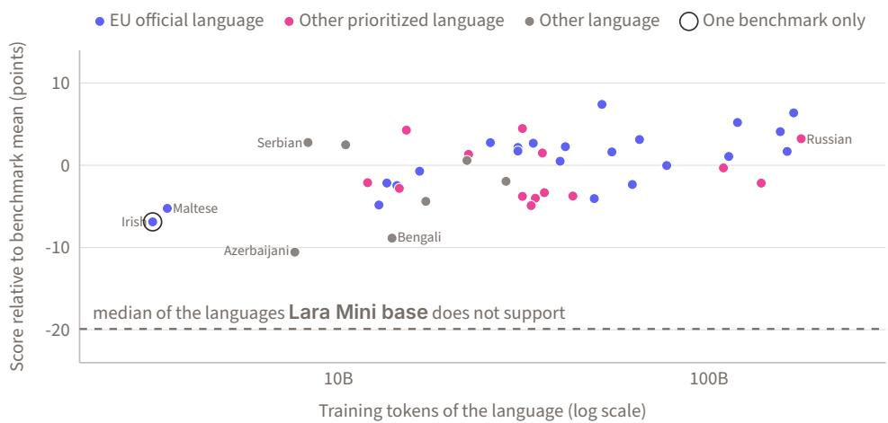  
Figure 11. Score of Lara Mini base in each supported language against its training tokens in that language (log scale). Scores are relative to the mean of each benchmark across the non-English-supported languages and are averaged across the multilingual benchmarks that cover the language. The dashed line is the median of the languages and varieties Lara Mini base does not support. The ring marks Irish, which only T-HellaSwag covers. Every supported language scores above the median of the languages Lara Mini base does not support.

Table 23 gives the score of Lara Mini base on every multilingual benchmark in each supported language. For each language, it compares the mean of Lara Mini base with the best mean over the same benchmarks among the 35 other models with up to 2B active parameters. Lara Mini base is ahead in 41 of the 44 languages. It trails in Simplified Chinese (Qwen3-1.7B, 2.7 points) and Bosnian (Gemma-4-E2B, 1.3 points), and is level with kanana-2-1.3b in Korean.

Table 23. Scores of Lara Mini base per supported language on each multilingual benchmark that covers it (–: not covered; country variants averaged into their language), its mean over these benchmarks (Avg.), and the best mean over the same benchmarks among the 35 other models with up to 2B active parameters (Peer, with the model that holds it: �EuroMoE-2.6B-A0.6B, �Gemma-4-E2B, �LFM2.5-8B-A1B, �Qwen3-1.7B, �Qwen3.5-2B, � granite-4.0-h-tiny, �kanana-2-1.3b). Languages in order of training tokens; bold: Lara Mini base ahead. Abbreviations as in Table 20. Lara Mini base is ahead in 41 of the 44 languages.
<table><tr><td>Language</td><td>Bele.</td><td>G-MMLU</td><td>INCL. XNLI</td><td></td><td>PAWS-X XCOPA</td><td></td><td>GP-NP</td><td>GP-P</td><td>T-HS</td><td>Avg. Peer</td></tr><tr><td>Russian</td><td>67.1</td><td></td><td>54.4</td><td>48.6</td><td></td><td></td><td>76.0 31.1</td><td></td><td>63.5 56.8</td><td>56.2b</td></tr><tr><td>Spanish</td><td>64.3</td><td>59.6</td><td>64.0 45.9</td><td>63.8</td><td></td><td>87.3</td><td>41.4</td><td>62.0</td><td>61.0</td><td>58.8f</td></tr><tr><td>German</td><td>62.9</td><td>58.9</td><td>51.8 47.9</td><td>59.2</td><td></td><td>77.0</td><td>36.9</td><td>56.0</td><td>56.3</td><td>54.7f</td></tr><tr><td>French</td><td>63.2</td><td>58.8</td><td>60.9 49.8</td><td>59.3</td><td></td><td>75.0</td><td>43.7</td><td>60.8</td><td>58.9</td><td>55.7b</td></tr><tr><td>Chinese (Simpl.)</td><td>65.7</td><td>57.3</td><td>51.2 36.7</td><td>53.6</td><td>70.6</td><td>58.0</td><td>35.0</td><td>57.5</td><td>53.9</td><td>56.6d</td></tr><tr><td>Italian</td><td>67.2</td><td>59.4</td><td>71.2</td><td></td><td>71.8</td><td>77.0</td><td>39.8</td><td>58.0</td><td>63.5</td><td>60.0f</td></tr><tr><td>Portuguese</td><td>68.6</td><td>60.0</td><td>53.9</td><td>1</td><td></td><td>70.5</td><td>34.5</td><td>59.0</td><td>57.7</td><td>56.7f</td></tr><tr><td>Japanese</td><td>54.3</td><td>55.7</td><td>63.3</td><td>51.6 1</td><td></td><td>79.0</td><td>40.8</td><td>60.5</td><td>57.9</td><td>56.1f</td></tr><tr><td>Polish</td><td>60.6</td><td></td><td>54.4</td><td></td><td></td><td>75.0</td><td>36.9</td><td></td><td>56.5 56.7</td><td>52.7b</td></tr><tr><td>Dutch</td><td>65.1</td><td></td><td>62.1</td><td></td><td></td><td></td><td>74.0 35.0</td><td></td><td>63.0 59.8</td><td>57.3b</td></tr><tr><td>Greek</td><td>58.1</td><td></td><td>54.5 45.2</td><td></td><td></td><td></td><td>60.0 35.0</td><td>61.5</td><td>52.4</td><td>49.1b</td></tr><tr><td>Czech</td><td>62.2</td><td></td><td></td><td></td><td></td><td></td><td>79.0 32.0</td><td>58.0</td><td>57.8</td><td>52.5f</td></tr><tr><td>Swedish</td><td>68.0</td><td></td><td></td><td></td><td></td><td></td><td>82.0 36.9</td><td>67.5</td><td>63.6</td><td>60.1b</td></tr><tr><td>Hungarian</td><td>60.1</td><td></td><td>51.6</td><td></td><td></td><td></td><td>63.0 34.0</td><td>54.5</td><td>52.7</td><td>48.5b</td></tr><tr><td>Korean</td><td>58.7</td><td>54.2</td><td>57.6</td><td>54.2</td><td></td><td></td><td>58.0 30.1</td><td>58.0</td><td>53.0</td><td>53.08</td></tr><tr><td>Danish</td><td>64.0</td><td></td><td></td><td></td><td></td><td></td><td>66.0 38.8</td><td>65.0</td><td>58.5</td><td>53.5b</td></tr><tr><td>Finnish</td><td>61.2</td><td></td><td>45.9</td><td></td><td></td><td></td><td>80.0 39.8</td><td>59.0</td><td>57.2</td><td>49.7b</td></tr><tr><td>Turkish</td><td>58.1</td><td></td><td>55.3 48.0</td><td></td><td>63.0</td><td></td><td>74.0 25.2</td><td>49.5</td><td>53.3</td><td>51.6b</td></tr><tr><td>Indonesian</td><td>56.3</td><td>57.8</td><td>62.0</td><td></td><td>71.8</td><td></td><td>76.0 33.0</td><td>61.5</td><td>59.8</td><td>57.4e</td></tr><tr><td>Chinese (Trad.)</td><td>60.8</td><td></td><td></td><td></td><td></td><td></td><td>56.0 34.0</td><td></td><td>58.0 52.2</td><td>52.1d</td></tr><tr><td>Bulgarian</td><td>62.2</td><td></td><td>66.9 47.2</td><td></td><td></td><td></td><td>78.0 31.1</td><td>59.0</td><td>57.4</td><td>52.8b</td></tr><tr><td>Arabic</td><td>60.2</td><td>54.5</td><td>57.1 33.5</td><td></td><td></td><td></td><td>61.0 27.2</td><td>57.0</td><td>50.1</td><td>48.0c</td></tr><tr><td>Ukrainian</td><td>57.6</td><td></td><td>65.8</td><td></td><td></td><td></td><td>86.0 34.0</td><td>62.5</td><td>61.2</td><td>57.7b</td></tr><tr><td>Thai</td><td>56.8</td><td></td><td>45.1</td><td></td><td>61.6</td><td></td><td>70.0 33.0</td><td>52.5</td><td>53.2</td><td>52.5b</td></tr><tr><td>Romanian</td><td>63.1</td><td></td><td>一</td><td></td><td></td><td></td><td>80.0 29.1</td><td>59.5</td><td>57.9</td><td>54.3b</td></tr><tr><td>Slovak</td><td>60.3</td><td></td><td>一</td><td></td><td></td><td></td><td>85.0 28.2</td><td>60.0</td><td>58.4</td><td>54.0b</td></tr><tr><td>Persian</td><td>58.8</td><td></td><td>45.6</td><td></td><td></td><td></td><td>76.0</td><td>37.9 55.5</td><td>54.8</td><td>51.3b</td></tr><tr><td>Croatian</td><td>60.1</td><td></td><td>71.6</td><td></td><td></td><td></td><td>76.0 33.0</td><td>56.5</td><td>59.5</td><td>56.0b</td></tr><tr><td>Norwegian</td><td>62.7</td><td></td><td></td><td></td><td></td><td></td><td>69.0 35.0</td><td></td><td>63.5 57.5</td><td>51.2b</td></tr><tr><td>Vietnamese</td><td>61.6</td><td></td><td>58.6</td><td>44.3</td><td></td><td>72.6</td><td>71.0</td><td>35.0</td><td>57.5 57.2</td><td>53.6e</td></tr><tr><td>Hindi</td><td>48.7</td><td>51.3</td><td>56.1</td><td>45.9</td><td></td><td></td><td>65.0</td><td>32.0 55.0</td><td>50.6</td><td>48.1b</td></tr><tr><td>Lithuanian</td><td>53.0</td><td></td><td>62.9</td><td></td><td></td><td></td><td>69.0</td><td>35.0</td><td>60.0 56.0</td><td>49.5b</td></tr><tr><td>Catalan</td><td>63.0</td><td></td><td></td><td></td><td></td><td></td><td>80.0</td><td>36.9</td><td>62.0 60.5</td><td>55.1b</td></tr><tr><td>Hebrew</td><td>53.0</td><td></td><td>66.0</td><td></td><td></td><td></td><td>55.0</td><td>35.9</td><td>59.5 53.9</td><td>53.8b</td></tr><tr><td>Slovenian</td><td>56.9</td><td></td><td></td><td></td><td></td><td></td><td>66.0</td><td>31.1</td><td>61.0 53.7</td><td>48.7b</td></tr><tr><td>Bengali</td><td>46.4</td><td>50.0</td><td>50.4</td><td></td><td></td><td></td><td>69.0</td><td>29.1</td><td>51.5 49.4</td><td>46.0b</td></tr><tr><td>Estonian</td><td>53.4</td><td></td><td>67.4</td><td></td><td></td><td>65.2</td><td>58.0</td><td>32.0 62.5 53.5</td><td>56.4 54.0</td><td>52.5b 49.3b</td></tr><tr><td>Latvian Malay</td><td>54.6 58.1</td><td></td><td>60.3</td><td></td></table>

## D.3 Long-Context Evaluation

Some tasks of RULER, ONERULER and HELMET assume a model that answers and then stops, while a base model keeps writing after its answer. Table 24 lists what we changed and why. Every model in Table 8 is scored with the same prompts, samples and code. Among them, granite-4.0-h-tiny scores low on RULER and ONERULER because it copies only two to five digits of each 7-digit number it has to retrieve.

Table 24. Changes to the long-context benchmarks for base models.
<table><tr><td>Benchmark</td><td>What we changed</td><td>Why</td></tr><tr><td>RULER</td><td>Fixed samples: 100 per task and length, generated once, with lengths counted in each model&#x27;s tokens</td><td>The harness draws new random samples at every run; fixed samples give every model the same inputs</td></tr><tr><td rowspan="5">ONERULER</td><td>No answer template at the end of the prompt; instead, the prompt ends with the start of the answer, the needle sentence up to the number (“The special magic number for ... is:&quot;)</td><td>Base models copy the answer template instead of answering</td></tr><tr><td>In the task with four numbers for one key, the start of the answer states how many there are (“The 4 special magic numbers for ... are:&quot;)</td><td>Without the count, models often stop after one to three numbers, so the score measures when they stop rather than what they find</td></tr><tr><td>An answer is correct if it contains the right numbers, whatever text follows them</td><td>The original scoring gives zero to any answer that contains the word for &quot;none&quot;, which a base model often copies from the question after a correct answer</td></tr><tr><td>The task whose correct answer is “none&quot; (no needle has the key asked for) is left out</td><td>Without examples in the prompt, the base models we tested did not answer “none&quot;; with examples, the score depends on how closely a model follows them rather than on what it</td></tr><tr><td>The two common-word tasks are left out</td><td>retrieves, and a model can then answer “none&quot; even when the needle is there They score close to zero for every model from</td></tr><tr><td>HELMET</td><td>Answers of up to 64 tokens; 20 samples per language and task up to 32k tokens, 10 at 64k and 128k</td><td>16k tokens Room for four 7-digit numbers with tokenizers that split numbers into single digits; fewer samples at the longest lengths to limit the cost</td></tr><tr><td rowspan="4"></td><td>Summarization, citation and long-document question answering left out</td><td>Base models score on summarization by copying the example summary given in the prompt; citation needs an entailment model that we do not run; long-document question answering has weak automatic metrics and 100 questions per</td></tr><tr><td>At 128k, retrieval-augmented generation prompts that are too long are shortened by dropping their lowest-ranked distractor passages, never a passage with</td><td>dataset HELMET instead cuts the end of the prompt by an amount that depends on the tokenizer, which can remove the passage with the answer</td></tr><tr><td>the answer; every model gets the same prompts</td><td></td></tr><tr><td>In-context learning on four of its five datasets</td><td>The fifth, NLU, is no longer publicly available</td></tr></table>

## D.4 Benchmark Contamination

Here we test whether contamination inflates the scores of Lara Mini base. HumanEval is excluded from the suite because nearly all of its items, including solutions, appear in public datasets in our pool (Section 2.2). Every other benchmark is used as released, with all its items. On MMLU and MBPP, two tests verify that items from the training pool do not inflate model’s score, against three references from its group: Llama-3.2-1B, granite-4.0-h-tiny, and Qwen3-1.7B. We divide benchmark items into clean and potentially contaminated subsets based on whether our scan identifies overlap with the training pool. This partition is applied consistently to all four models, although the training data of the reference models may difer from ours. Neither test shows signs of memorization: model’s scores are consistent with generalization.

Accuracy. A model that had memorized the contaminated items would score higher on them than on the clean ones, relative to the references (Table 25). Lara Mini base does not: its diference is −0.2 points on MMLU (references: −0.7 to +2.0) and −9.2 on MBPP (−15.6 to −8.4). Both diferences fall within the reference-model ranges, providing no clear evidence of an unusual accuracy advantage on potentially contaminated items.

Table 25. Accuracy (%; pass@1 for MBPP) on the clean and contaminated items of MMLU and MBPP. Δ: contaminated minus clean.
<table><tr><td></td><td colspan="3">MMLU</td><td colspan="3">MBPP</td></tr><tr><td>Model</td><td>Clean</td><td>Contam.</td><td>Δ</td><td>Clean</td><td>Contam.</td><td>Δ</td></tr><tr><td>Llama-3.2-1B</td><td>31.5</td><td>30.8</td><td>-0.7</td><td>39.5</td><td>23.9</td><td>-15.6</td></tr><tr><td>granite-4.0-h-tiny</td><td>64.4</td><td>66.4</td><td>+2.0</td><td>65.4</td><td>57.0</td><td>-8.4</td></tr><tr><td>Qwen3-1.7B</td><td>61.5</td><td>63.4</td><td>+1.9</td><td>66.7</td><td>53.2</td><td>-13.5</td></tr><tr><td>Lara Mini base</td><td>63.6</td><td>63.4</td><td>-0.2</td><td>61.7</td><td>52.5</td><td>-9.2</td></tr></table>

Likelihood. Memorization can also make the reference text more predictable without changing the answer. This shows in the bits per byte (BPB) of the reference text given the prompt: the reference code for MBPP, the question and its correct answer for MMLU. BPB varies across models, so only the ratio of contaminated to clean items is comparable; it is below 1 even for a model that has never seen the items, because the two groups difer in length and style. The ratio of Lara Mini base lies within the reference ranges on both benchmarks (Table 26): 0.982 on MMLU (0.940 to 0.990) and 0.763 on MBPP (0.749 to 0.806). Thus, Lara Mini base does not exhibit an unusually large likelihood advantage on potentially contaminated items relative to the reference models.

Table 26. Bits per byte of the reference text on the clean and contaminated items of MMLU and MBPP, and their ratio (contaminated / clean). BPB values depend on the model, so only the ratios are comparable; a ratio clearly below those of the other models would indicate memorization.
<table><tr><td></td><td colspan="3">MMLU</td><td colspan="3">MBPP</td></tr><tr><td>Model</td><td>Clean</td><td>Contam.</td><td>Ratio</td><td>Clean</td><td>Contam.</td><td>Ratio</td></tr><tr><td>Llama-3.2-1B</td><td>0.847</td><td>0.816</td><td>0.964</td><td>0.562</td><td>0.429</td><td>0.763</td></tr><tr><td>granite-4.0-h-tiny</td><td>0.855</td><td>0.847</td><td>0.990</td><td>1.207</td><td>0.972</td><td>0.806</td></tr><tr><td>Qwen3-1.7B</td><td>0.826</td><td>0.776</td><td>0.940</td><td>0.408</td><td>0.306</td><td>0.749</td></tr><tr><td>Lara Mini base</td><td>0.790</td><td>0.776</td><td>0.982</td><td>0.507</td><td>0.387</td><td>0.763</td></tr></table>

## E Inference Benchmark

We measured the inference speed of Lara Mini base and of 45 of the 56 baselines of Section 5. The other 11 were not measured: 10 are not natively supported by vLLM 0.28.0 or fail to load in vLLM 0.28.0, and Villanova2-2B was added to the comparison after the benchmark. Table 27 reports the results, and Figure 5 plots the Overall average against the speed for one user.

Setup. Each model runs on a single NVIDIA A100 GPU with vLLM 0.28.0 (Kwon et al., 2023) in bf16. All models use the same engine settings, with CUDA graphs captured for batches of up to 2,048 tokens. Prompts are real text from our held-out set, cut to the exact lengths specified by each model’s tokenizer. Every number is the median of up to three repeats. Since tokenizers difer in density, from 245 to 495 tokens per 1,000 characters (273 for Lara Mini base), we report characters per second.

Table 27. Inference speed on one A100 GPU with vLLM, for 1,024-token prompts and 256 generated tokens: characters/s for one user, thousands of characters/s for 64 and 256 users, and median time to first token (TTFT, ms; under load it includes queueing). 128k: thousands of characters/s on 126,976-token prompts with 1,024 generated tokens (–: longer than the context of the model). Active: active parameters (B). Groups as in Table 6, sorted from slowest to fastest for one user, Lara Mini base last. †Some measurements from one or two repeats. Lara Mini base is the eighth-fastest of the 46 models for one user and ties for fifth of the 29 that support 128k-token prompts.
<table><tr><td></td><td></td><td colspan="2">1 user</td><td colspan="2">64 users</td><td colspan="2">256 users</td><td>128k</td></tr><tr><td>Model</td><td>Active</td><td>Chars/s</td><td></td><td>TTFT k chars/s</td><td>TTFT</td><td>k chars/s</td><td>TTFT</td><td>k chars/s</td></tr><tr><td colspan="7">Models with more than 4B active parameters</td><td></td></tr><tr><td>Mistral-7B-v0.3†</td><td>7.25</td><td>257</td><td>77.6</td><td>5.4</td><td>487</td><td>5.5</td><td>939</td><td>一</td></tr><tr><td>Gemma-7B†</td><td>8.54</td><td>258</td><td>81.9</td><td>4.5</td><td>509</td><td>4.4</td><td>36,924</td><td></td></tr><tr><td>Teuken-7B†</td><td>7.45</td><td>274</td><td>66.4</td><td>7.1</td><td>437</td><td>6.9</td><td>1,054</td><td></td></tr><tr><td>Qwen3-8B†</td><td>8.19</td><td>281</td><td>74.2</td><td>5.9</td><td>499</td><td>5.7</td><td>3,799</td><td>9.2</td></tr><tr><td>Apertus-v1.5-8B†</td><td>8.00</td><td>294</td><td>75.3</td><td>6.4</td><td>476</td><td>6.6</td><td>930</td><td>10.2</td></tr><tr><td>Llama-3-8B</td><td>8.03</td><td>298</td><td>77.0</td><td>6.4</td><td>483</td><td>6.7</td><td>938</td><td></td></tr><tr><td>Llama-3.1-8B†</td><td>8.03</td><td>298</td><td>77.1</td><td>6.4</td><td>478</td><td>6.7</td><td>934</td><td>10.4</td></tr><tr><td>Qwen2.5-7B†</td><td>7.62</td><td>300</td><td>64.1</td><td>7.2</td><td>428</td><td>8.0</td><td>779</td><td>15.0</td></tr><tr><td colspan="7">Models with 2B to 4B active parameters</td><td></td><td></td></tr><tr><td>Gemma-4-E4B†</td><td>4.00</td><td>383</td><td>57.2</td><td>9.9</td><td>281</td><td>14.0</td><td>446</td><td>16.0</td></tr><tr><td>Hunyuan-4B</td><td>4.22</td><td>427</td><td>46.6</td><td>8.1</td><td>335</td><td>7.5</td><td>805</td><td>10.1</td></tr><tr><td>Qwen3-4B</td><td>4.02</td><td>440</td><td>43.2</td><td>8.4</td><td>327</td><td>7.7</td><td>785</td><td>10.3</td></tr><tr><td>Qwen3.5-4B†</td><td>4.66</td><td>465</td><td>52.6</td><td>9.4</td><td>312</td><td>10.7</td><td>537</td><td>32.2</td></tr><tr><td>granite-4.1-3b†</td><td>3.40</td><td>484</td><td>40.3</td><td>10.5</td><td>281</td><td>8.7</td><td>713</td><td>13.9</td></tr><tr><td>SmolLM3-3B</td><td>3.08</td><td>538</td><td>36.3</td><td>12.5</td><td>228</td><td>12.9</td><td>481</td><td></td></tr><tr><td>tiny-aya</td><td>3.35</td><td>542</td><td>40.2</td><td>11.7</td><td>233</td><td>11.2</td><td>489</td><td></td></tr><tr><td>MiniCPM5-2B†</td><td>2.50</td><td>596</td><td>33.0</td><td>15.1</td><td>200</td><td>13.2</td><td>486</td><td>19.5</td></tr><tr><td>salamandra-2b</td><td>2.30</td><td>756</td><td>23.8</td><td>11.4</td><td>136</td><td>13.0</td><td>1,404</td><td></td></tr><tr><td colspan="7">Models with up to 2B active parameters</td><td></td><td></td></tr><tr><td>Bielik-1.5B</td><td>1.60</td><td>432</td><td>26.0</td><td>11.3</td><td>149</td><td>11.0</td><td>606</td><td></td></tr><tr><td>Falcon-H1-1.5B-Deep†</td><td>1.55</td><td>432</td><td>76.9</td><td>7.3</td><td>367</td><td>9.5</td><td>501</td><td>21.3</td></tr><tr><td>Trinity-Nano</td><td>1.00</td><td>573</td><td>34.9</td><td>10.7</td><td>167</td><td>13.0</td><td>370</td><td>71.4</td></tr><tr><td>moe-7b-1b</td><td>1.10</td><td>613</td><td>33.0</td><td>8.9</td><td>176</td><td>12.0</td><td>383</td><td></td></tr><tr><td>Gemma-4-E2B†</td><td>2.00</td><td>655</td><td>36.2</td><td>17.1</td><td>166</td><td>25.0</td><td>283</td><td>18.2</td></tr><tr><td>granite-4.0-h-tiny</td><td>1.00</td><td>745</td><td>40.1</td><td>10.4</td><td>190</td><td>16.8</td><td>343</td><td>95.3</td></tr><tr><td>granite-4.0-1b†</td><td>1.60</td><td>749</td><td>27.4</td><td>14.4</td><td>190</td><td>13.7</td><td>431</td><td>18.3</td></tr><tr><td>SmolLM2-1.7B</td><td>1.70</td><td>754</td><td>26.1</td><td>10.1</td><td>166</td><td>10.6</td><td>1,181</td><td></td></tr><tr><td>Falcon-H1-1.5B Hunyuan-1.8B</td><td>1.55</td><td>771</td><td>34.1</td><td>13.9</td><td>147 184</td><td>15.3 16.2</td><td>364 375</td><td>45.1</td></tr><tr><td>Falcon-H1-0.5B</td><td>1.80</td><td>781</td><td>27.3 42.6</td><td>16.6 14.4</td><td>200</td><td>18.8</td><td>284</td><td>22.9</td></tr><tr><td>Qwen2.5-1.5B</td><td>0.50</td><td>796</td><td>23.4</td><td>23.6</td><td>139</td><td>23.0</td><td>399</td><td>35.7</td></tr><tr><td>granite-3.1-3b-a800m†</td><td>1.50</td><td>833</td><td>25.8</td><td>12.7</td><td>141</td><td>14.2</td><td>351</td><td>22.1</td></tr><tr><td></td><td>0.90</td><td>842</td><td></td><td></td><td>148</td><td>16.1</td><td>342</td><td>19.7</td></tr><tr><td>Qwen3-1.7B† Qwen3.5-2B</td><td>1.70</td><td>872 904</td><td>26.3 33.3</td><td>15.2 20.3</td><td>166</td><td>24.4</td><td>295</td><td>77.5</td></tr><tr><td>granite-4.0-h-1b</td><td>1.90 1.50</td><td>918</td><td>41.3</td><td>16.2</td><td>204</td><td>20.7</td><td>285</td><td>112</td></tr><tr><td>Luciole-1B†</td><td>1.32</td><td>987</td><td>22.5</td><td>19.9</td><td>142</td><td>16.8</td><td>398</td><td>26.6</td></tr><tr><td>LFM2.5-8B-A1B</td><td>1.70</td><td>995</td><td>34.2</td><td>13.5</td><td>160</td><td>23.3</td><td>297</td><td>76.7</td></tr><tr><td>OLMoE-1B-7B</td><td>1.30</td><td>1,005</td><td>27.6</td><td>10.2</td><td>141</td><td>15.9</td><td>292</td><td></td></tr><tr><td>EuroLLM-1.7B</td><td>1.70</td><td>1,037</td><td>23.5</td><td>17.2</td><td>126</td><td>18.2</td><td>311</td><td></td></tr><tr><td>Gemma-3-1B</td><td>1.00</td><td>1,068</td><td>19.6</td><td>31.0</td><td>83</td><td>38.3</td><td>199</td><td></td></tr><tr><td>Llama-3.2-1B</td><td>1.20</td><td>1,351</td><td>19.8</td><td>29.9</td><td>114</td><td>26.7</td><td>355</td><td>43.6</td></tr><tr><td>LFM2.5-1.2B</td><td>1.20</td><td>1,362</td><td>19.9</td><td>35.1</td><td>125</td><td>40.5</td><td>1,441</td><td>85.7</td></tr><tr><td>Apertus-v1.1-1.5B</td><td>1.50</td><td>1,392</td><td>19.2</td><td>29.8</td><td>112</td><td>27.0</td><td>355</td><td></td></tr><tr><td>EuroMoE-2.6B-A0.6B</td><td>0.50</td><td>1,440</td><td>18.1</td><td>23.9</td><td>73</td><td>33.0</td><td>230 212</td></table>

## F T-HellaSwag: Construction and Release

T-HellaSwag is a higher-quality machine translation of HellaSwag (Zellers et al., 2019) into 110 language variants, which we will release. The HellaSwag test-split labels are not public, so we translated the 10,042 documents in its validation split into each variant using Lara3, Translated’s machine translation service. T-HellaSwag contains 200 of these documents per language variant, selected for translation quality and stratified by source and dificulty. T-HellaSwag-full contains all 10,042 translated validation documents per variant, without selection.

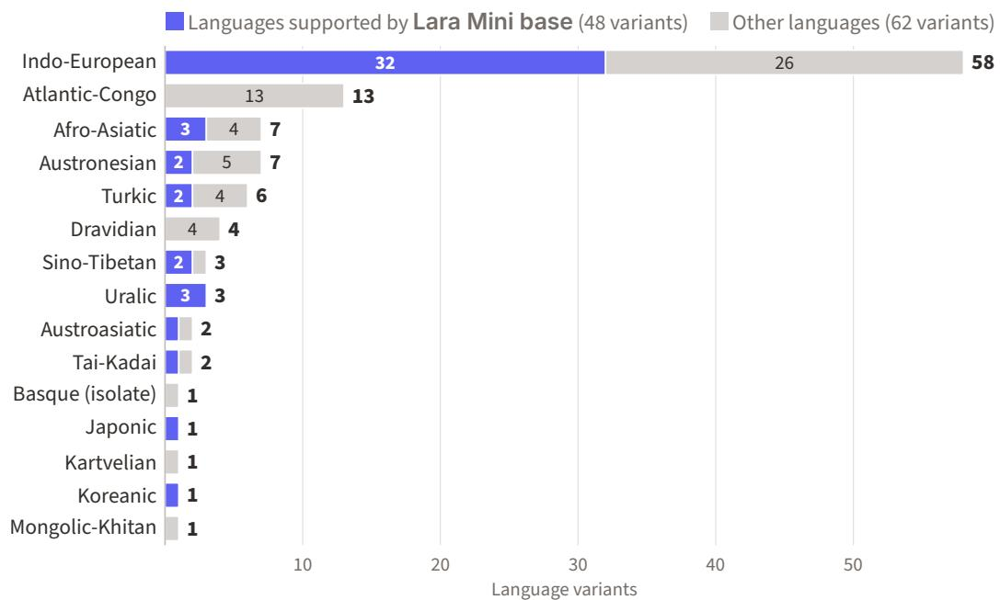  
Figure 12. The 110 language variants of T-HellaSwag by language family in Glottolog (Hammarström et al., 2026). Indo-European accounts for 58 of the variants, and five families, including Atlantic-Congo with 13 variants, occur only among languages that Lara Mini base does not support.

Languages. Table 28 lists the 110 language variants: 48 for the 44 non-English languages supported by Lara Mini base and 62 for other languages. French, Portuguese and Spanish each have two regional variants, while Serbian has two script variants. The 105 languages belong to 15 families (Figure 12).

Table 28. The 110 language variants of T-HellaSwag and T-HellaSwag-full.
<table><tr><td>44 non-English languages supported by Lara Mini base (48 variants)</td><td>Arabic, Azerbaijani, Bengali, Bosnian, Bulgarian, Catalan, Chinese (Simplified), Chinese (Traditional), Croatian, Czech, Danish, Dutch, Estonian, Finnish, French (Canada), French (France), German, Greek, Hebrew, Hindi, Hungarian, Indonesian, Irish, Italian, Japanese, Korean, Latvian, Lithuanian, Malay, Maltese, Norwegian (Bokmål), Persian, Polish, Portuguese (Brazil), Portuguese (Portugal), Romanian, Russian, Serbian (Cyrillic), Serbian (Latin), Slovak, Slovenian, Spanish (Mexico), Spanish (Spain), Swedish, Thai, Turkish, Ukrainian, Vietnamese</td></tr><tr><td>Other languages (62 variants)</td><td>Afrikaans, Albanian, Amharic, Armenian, Assamese, Basque, Belarusian, Bhojpuri, Burmese, Cebuano, Chichewa, Galician, Georgian, Gujarati, Haitian Creole, Hausa, Icelandic, Igbo, Javanese, Kannada, Kazakh, Khmer, Kinyarwanda, Kurdish (Kurmanji), Kurdish (Sorani), Kyrgyz, Lao, Lingala, Luganda, Luxembourgish, Macedonian, Maithili, Malagasy, Malayalam, Marathi, Mongolian, Nepali, Northern Sotho, Odia, Oromo (West Central), Pashto, Punjabi, Shona, Sindhi, Sinhala, Somali, Southern Sotho, Sundanese, Swahili, Tagalog, Tajik, Tamil, Telugu, Tswana, Urdu, Uyghur, Uzbek, Welsh, Xhosa, Yiddish, Yoruba, Zulu</td></tr></table>

Translation. HellaSwag draws its documents from ActivityNet Captions (Krishna et al., 2017) and wikiHow4. Each document contains an activity label, a context and four candidate endings. The task is to choose the ending that best continues the context (Figure 13(a)). The translated document must retain one context shared by all four endings, and each translated ending must remain consistent with that context. We translated each document in four requests, one per ending. Each request sent the activity label, context and ending as separate segments (Figure 13(b)). The first request translated all three segments; requests 2 to 4 resent the translated activity label and context as non-translatable segments. For ActivityNet documents, HellaSwag splits a sentence into context and endings: the context ends with the subject, most often a short phrase such as “he” or “the man”. A subject cut of from its verb often cannot be translated correctly because, in many languages, the verb determines its case or position, or allows it to be dropped. We therefore moved this subject fragment to the start of each ending before translation. To keep activity labels consistent across documents, we also maintained a lexicon of them for each language. Each label was translated once, and subsequent requests sent its translation as a non-translatable segment. After translation, we restored wikiHow markup, such as [title], using a rule-based script in the fields where Lara had translated. We used Claude Opus 5.5 (Anthropic, 2026) to correct four types of translation error: fields in the wrong language or script; characters or words of another script within a field; English text left untranslated within a field; and two endings in the same document with identical translations.

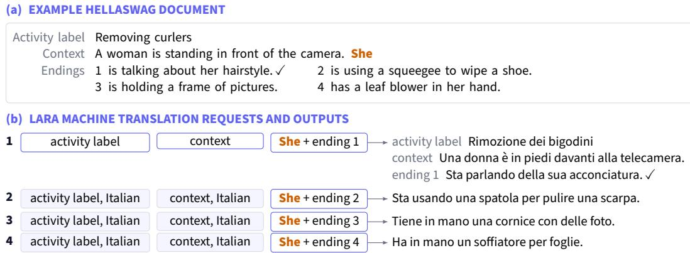  
Figure 13. A HellaSwag document and its translation into Italian. (a) The source document, with the subject fragment at the end of the context shown in orange and the correct ending marked (✓). (b) The four requests to Lara. The subject fragment is moved to the start of each ending; the translated activity label and context from request 1 are sent as non-translatable segments in requests 2–4 (shaded).

Selection. For each language variant, we selected the 200 documents with the highest translationquality scores, stratifying the selection by source and by the dificulty of the English originals (Figure 14). We evaluated eight reference-free quality estimation (QE) models in each language variant to assess how reliably they ranked translations: CometKiwi-22 (Rei et al., 2022), CometKiwi-XL and CometKiwi-XXL (Rei et al., 2023), xCOMET-XL and xCOMET-XXL (Guerreiro et al., 2024), MetricX-24-Hybrid-XXL (Juraska et al., 2024), BLASER 2.0-QE (Dale and Costa-jussà, 2024), and COMET-poly (Züfle et al., 2025). We tested each model on 1,000 sampled documents per language variant with four corruptions of an ending: word deletion, word shufling, replacement with another ending of the same document and replacement with an ending of another document. A model passed for a language if, for each corruption, it scored the original ending above the corrupted one in at least 95% of the comparisons. Six of the eight models passed in at least one language. In the three languages where no model passed, we used MetricX-24 alone with lower thresholds: 90% for Luxembourgish and Luganda, and 85% for West Central Oromo. The models that passed for a language scored all four endings of every document. Because a single faulty ending invalidates a document, each model rated a document by the percentile rank of its worst ending, and a document’s score was the mean of these ranks over the models that passed.

Before selection, automatic checks excluded documents containing untranslated English, fields in the wrong script or language (Kargaran et al., 2023), or retranslated fields. Selecting by translation quality alone under-represented ActivityNet: its share of the selected documents fell from 32.4% to 15.0% on average. Such a selection would therefore distort both the source and the dificulty distributions of the dataset. We divided the remaining documents into 13 strata by source (ActivityNet or wikiHow) and by the dificulty of the English original, estimated with 50 public base models. We selected the same proportion of the highest-scoring documents from each stratum, yielding 200 documents per language variant. To verify that the dificulty was preserved, we evaluated 35 additional public base models, not used to build the strata, on the selected documents. The mean absolute diference in English accuracy between the selected documents and the original split was 1.6 points, against 3.2 points when selecting by quality alone and 1.5 points for random documents from the same strata. Each language variant has its own selection of documents, so part of a score diference between two variants comes from the documents. T-HellaSwag is built to compare models within each variant.

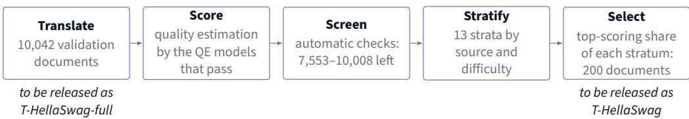  
Figure 14. Construction of each T-HellaSwag language variant, with the number of documents remaining per variant after each step. The translated validation split will be released in full as T-HellaSwag-full. Selecting the same proportion from every stratum preserves the source and dificulty distributions of the English originals.

Quality. Automatic checks verified that every translated document was complete and that the four endings of each document shared the same translated activity label and context. On the final data, every check passed in both sets and in all 110 language variants. We compared T-HellaSwag with Multilingual HellaSwag (Lai et al., 2023). The latter’s construction difers from ours in two ways. It keeps the activity labels in English, so that each of its prompts begins with English text. It also translates the subject that ends each ActivityNet context separately from the endings, so that the two parts of the split sentence may not agree. For each of the 32 languages in both datasets, we drew 50 random T-HellaSwag documents that Multilingual HellaSwag also translates, and compared the two translations of each document. Two LLM judges, Gemini 4 Argon (Google DeepMind, 2026) and Claude Opus 5.5, preferred our translation for 98.6% and 98.7% of the documents, respectively. A human linguist reviewed 50 documents in each of Italian, French and Russian. Of the 150 documents, 145 were rated OK, 5 as having a minor error and none as having a major error.

Limitations. Apart from the linguist review in three languages, the evidence of translation quality comes from QE models and LLM judges. No human translator revised either set, so both can contain machine-translation errors, such as stray characters and line breaks. T-HellaSwag-full is not filtered: it also keeps the documents that the automatic checks excluded from T-HellaSwag. Both sets retain the situations described in the English source, so they measure commonsense reasoning in each language variant, not knowledge specific to its culture. Because HellaSwag is public, a model that encountered an English document during training may recognize its translation.

Release. Both sets will be released with one configuration per set and language variant, e.g., it-IT and it-IT-full for Italian. They share 50 few-shot documents per language variant from the HellaSwag training split, so that no validation document serves as a few-shot example. We translated the few-shot documents in the same way as the validation documents and selected them based on the scores from the same QE models. We score each language variant in the same way as the standard HellaSwag task scores English. The release will credit HellaSwag, wikiHow and ActivityNet Captions (Krishna et al., 2017) as sources.

## G Model Card

Table 29. Model card of Lara Mini base.
<table><tr><td>Developer</td><td>Translated</td></tr><tr><td>Model type</td><td>Decoder-only mixture of experts base model; hybrid of Gated DeltaNet, sliding-window and global attention (Section 3)</td></tr><tr><td>Parameters</td><td>7.2B total, 0.6B active per token (embeddings included)</td></tr><tr><td>Layers</td><td>34: 14 Gated DeltaNet (GDN), 13 sliding-window attention (window 512, RoPE), 7 global attention (no positional encoding)</td></tr><tr><td>Layer pattern</td><td>GDN, sliding, GDN, global, then (sliding, GDN, sliding, GDN, global) × 6 1,024</td></tr><tr><td>Hidden size Attention</td><td>16 query heads, 4 key-value heads, head dimension 128, QK-norm</td></tr><tr><td>Gated DeltaNet</td><td>8 key heads, 16 value heads, head dimension 128, short convolution of width 4</td></tr><tr><td>Mixture of experts</td><td>In every layer: 128 routed experts (top-4, fp32 router) and 1 shared expert, all</td></tr><tr><td>Vocabulary</td><td>SwiGLU with hidden size 512 151,936 tokens; input and output embeddings tied</td></tr><tr><td>Context length</td><td>4,096 tokens in the first three stages; 131,072 after the long-context stage (Section 4.1)</td></tr><tr><td>Precision</td><td>bf16</td></tr><tr><td>Training data</td><td>6T tokens of public data: English and multilingual text, code, math and SFT-like data (Section 2), then 100B tokens in the long-context stage</td></tr><tr><td>Languages</td><td>English and 44 others, which together cover all 24 official EU languages (Table 11)</td></tr><tr><td>License</td><td>CC BY-NC-SA 4.0 (https://creativecommons.org/1icenses/by-nc-sa/4.0/)</td></tr><tr><td>Intended use</td><td>Research, and a starting point for fine-tuning and post-training; a base model, not</td></tr><tr><td>Limitations</td><td>tuned to follow instructions or for safety See Section 7</td></tr></table>

## Contributors

Lara Mini base is the work of the Lara Team at Translated. All contributors are with Translated and are listed in alphabetical order by last name.

Maria Pia Adinolfi, Isabelle Andrieu, Grazia Fiorella Anfuso, Melania Annunziata, Daniele Antonini, Marta Arena, Luca Barone, Dana Barras Franco, Francesca Basiricò, Francesca Bee, Sofia Bertini, Nicola Bertoldi, Giorgio Biancini, Alessandra Bigi, Giulia Boccalini, Tommaso Bonomo, Enrico Boscardi, Sebastien Bratieres, Francesco Brigante, Giulia Brignola, Romolo Buondestino, Brenda Patricia Byrne, Giorgia Campora, Edoardo Cappelli, Veronica Carascosi, Francesca Carducci, Cody Carlson, Davide Caroselli, Ambra Cascio, Dario Cascio, Mauro Cassani, Andrea Castro, Alessandro Cattelan, Giulia Ceccacci, Paola Cellini, Giulia Chiriatti, Federico Cialini, Valentina Ciarlariello, Daniele Cocozza, Emanuela Coghe, Kathleen Compares, Marco Comunità, Davide Conti, Helen Rebecca Corfield, Michele Cortellessa, Anna Cracco, Aurora Cuppone, Arianna D’Andrea, Maurizio Davoli, Andrea De Angelis, Andrea De Blasi, Rebecca De Giorgi, Annalisa De Petra, Arianna De Pilla, Joris Demiraj, Elena Deufemia, Federica Di Antonio, Pierluigi Di Cianni, Vincenzo Di Cicco, Michela Di Clemente, Alan Di Francesco, Ylenia Di Gese, Federica Di Iulio, Claudia Di Lorenzo, Andrea Di Paola, Giulia Di Pilla, Jessica Dickson, Francesco Elefante, Ilaria Fabrizio, Alessandro Falappa, Viviana Fantozzi, Antonio Farina, Andrea Fernandez Tostado Ro.Diego Andrea, Andrea Ferrari, Sara Ferri, Simona Ferri, Fabio Fioramonti, Stefano Florio, Mariachiara Fornaro, Anna Maria Foti, Niccolò Fransoni, Alessandro Fusacchia, Emma Gamba, Francesco Gasperoni, Davide Gattini, Marta Giani, Claudia Giannetti, Valerio Giannini, Antonella Giudici, Mara Gramendola, Michele Grandinetti, Eleonora Graziani, L’Meese Hope Greaney, Dario Gubernari, Filomena Guglielmi, Jonathan Hammond, Stephen William Harris, Rowena Elizabeth Hogg, Marta Hontanon Del Olmo, Marco Ilari, Kenneth Larry Jackson Jr, Sagar Joshi, Bartosz Alberto Karman, Iuliia Khimenko, Valerio Lanni, Giulio Leonardi, Veronica Levco, Matteo Licci, Alessio Ligios, Noemi Lomartire, Domenico Lupinetti, Jennifer Mirjam Maechtlen, Chiara Maggiori, Maria Luisa Malerba, Francesco Marconi, Domenico Marini, Francesca Marsili Andrea Martinelli, James Mc Groary, Matteo Menicacci, Andrew Steven Miller, Marco Moauro, Giuliana Molon, Ilaria Mongelluzzi, Emiliano Morghen, Giovanni Moscati, Filippo Musmeci, Flavia Napoleoni, Nicola Giuseppe Ninni, Beatrice Ottoni, Federica Pagliani, Nicolò Palmiero, Daniele Palumbo, Chiara Pantani, Stefano Paolucci, Deborah Paritario, Michela Pascale, Thomas Passera, Daniele Patrioli, Chiara Patrizi, Silvia Patrizi, Giulia Pelos, Simone Giovanni Perone, Cristiano Perrone, Joshua Peterson, Katia Piredda, Francesca Piscitelli Alessandra Posca, Lorenzo Pratesi, Francesca Prencipe, Daniela Proietto Cuco, Mattia Pupino Marangio, Disheng Qiu, Mirco Ramo, Federica Rapagnà, Waldo Luis Ribeiro, Federico Ricciuti, Alessia Ridoni, Eleonora Risi Valdettaro, Jon Matthew Ritzdorf, Serena Rivera, Federico Roma, Arianna Ruggiero, Eleonora Ruggiu, Mariafrancesca Sagliocco, Vanessa Salvi, Alessio Sampieri, Elena Santanelli, Roberto Sastre, Luca Scofano, Alessandro Sdei, Giuseppe Sebastiani, Claudia Nicole Siegenthaler, Monica Signoretti, Nicola Sobieski, Biancamaria Soellner, Valentina Stati, Michael Stevens, Arianna Stissi, Fabiana Stomaci, Leonardo Taddei, Christopher Thomas, Maurizio Tiberi, John Tinsley, Riccardo Tittarelli, Carla Tocco, Martina Totaro, Barbara Veronika Totzauer, Alessio Tranzocchi, Letizia Treossi, Mara Trombetti, Marco Trombetti, Andrea Valenzi, Kirti Vashee, Giulia Vestita, Teodosio Vezza, Giulia Vignola, Sara Virtuoso, Valentina Volpini, Francesca Vurro, Jolita Zaksauskaite, Giulia Zanarella, Paolo Zanotti, Francesca Zavettieri, Irene Zorzi.