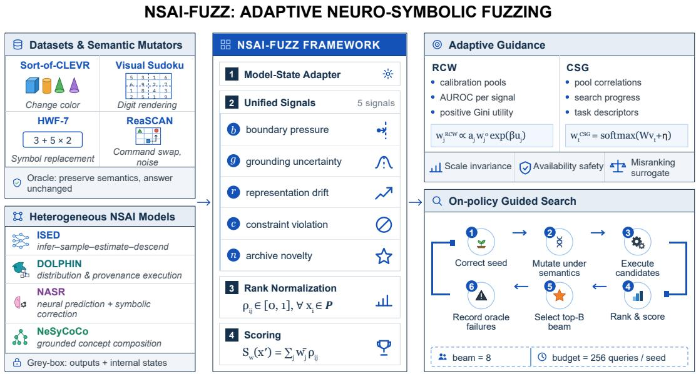
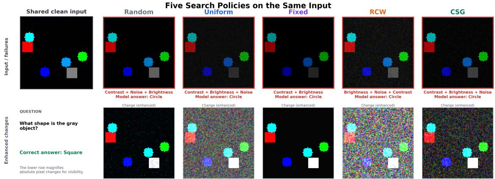

# One Fuzzer, Many Reasoners: Adaptive Neuro-Symbolic Fuzzing with Reliability-Calibrated and Context-Gated Guidance

Jinghao Wen1, Xianglong Yu2, Shaohuang Wang1, and Xun Jiao1

1Department of Electrical and Computer Engineering, Villanova University, Villanova, PA, USA 1School of Arts and Sciences, University of Pennsylvania, Philadelphia, PA, USA

## Abstract

Neural-symbolic AI (NSAI) combines learned perception with programs, constraints, and compositional reasoning, but remains difficult to test because small semantics-preserving changes can alter grounded symbols and trigger discontinuous reasoning failures. Existing neural fuzzers mainly rely on neural coverage or representation-space feedback and do not provide a common testing interface for heterogeneous NSAI systems. We introduce NSAI-FUZZ, the first unified semantics-aware fuzzing framework that separates task-specific valid mutation from architecture-neutral guided search and represents each candidate using five availability-aware, rank-normalized risk signals: boundary pressure, grounding uncertainty, representation drift, constraint violation, and archive novelty. We further propose Reliability-Calibrated Weighting (RCW), which learns dataset–model-level signal allocations from calibrated reliability, and Contextual Signal Gating (CSG), which adapts signal weights to the current candidate pool. We evaluate ISED, DOLPHIN, NASR, and NeSyCoCo across four reasoning tasks, nine compatible dataset–model cells, 20 policies, and 1,800 on-policy runs. Fixed five-signal guidance outperforms Random and Uniform in every cell, with gains of up to 19.115 pp and 3.280 pp, while RCW and CSG further improve over Fixed in all nine cells by up to 6.621 pp. Under matched mutation and query budgets, RCW and CSG achieve 16.17% and 16.06% aggregate failure discovery, versus 6.06% for the strongest neural-fuzzing baseline, while retaining substantially more deduplicated failure behaviors. Wall-clock evaluation further shows that TensorFuzz requires 1.11× the runtime of RCW while achieving only 0.45× its failure throughput. These results show that effective and efficient fuzzing of heterogeneous NSAI systems benefits from a common neural–symbolic risk interface with adaptive signal allocation.

## 1 Introduction

Neural-symbolic AI (NSAI) combines learned perception with explicit reasoning. A neural module may ground pixels into digits, objects, or concepts; a downstream component then executes an arithmetic program, enforces Sudoku constraints, or composes a language-conditioned concept program. Representative systems include DeepProbLog Manhaeve et al. (2018), ISED Solko-Breslin et al. (2024), DOLPHIN Naik et al. (2025), NASR Cornelio et al. (2023), and NeSyCoCo Kamali et al. (2025). This interface enables structured reasoning, but also creates a sharp reliability boundary: a small change in neural evidence can replace a grounded symbol, alter an execution path, or violate a global constraint.

Testing such systems is challenging. Clean accuracy does not characterize how failures are distributed around correctly solved inputs, while conventional adversarial attacks are an imperfect fit because symbolic execution may be non-differentiable or combinatorial. Moreover, a perturbation is meaningful only if it preserves the task semantics: changing the answer of a Sudoku instance or the referent of a grounding command does not constitute a valid robustness failure. Existing neural fuzzers Pei et al. (2017); Tian et al.

(2018); Xie et al. (2019); Odena et al. (2019) such as DeepHunter and TensorFuzz guide search using neuron coverage, activation-space novelty, or other representation-specific feedback. These mechanisms remain useful for exploring neural states, but they do not directly expose NSAI-specific risks such as grounding instability, symbolic constraint violation, or execution-boundary changes, nor do their original interfaces naturally span heterogeneous neural–symbolic systems.

To the best of our knowledge, we present the first unified fuzzing framework specifically designed to test heterogeneous NSAI systems. NSAI-FUZZ separates what mutations are valid from which valid candidates should be explored. Each task adapter generates semantics-preserving mutations and provides an oracle that verifies that the expected answer is unchanged. Search is then performed through a common architecture-neutral interface rather than through model-specific coverage metrics. The common interface represents each valid candidate using five signals: boundary pressure, grounding uncertainty, representation drift, constraint violation, and archive novelty. Pool-wise rank normalization removes scale differences, while unavailable signals are explicitly masked, enabling a common search procedure across heterogeneous neural–symbolic interfaces.

Our experiments first establish that structured multi-signal guidance is effective within this common framework. Fixed five-signal guidance outperforms Random and Uniform in all nine dataset–model cells, with gains of up to 19.115 pp and 3.280 pp, respectively. Single-signal and leave-one-out diagnostics further show that signal importance varies substantially across tasks and models. Thus, the main challenge is not whether to use the five signals, but how to allocate their weights for each model–task setting.

We address this challenge with two adaptive mechanisms. Reliability-Calibrated Weighting (RCW) learns a cell-level allocation from signal reliability, while Contextual Signal Gating (CSG) adapts the allocation to the current candidate pool during search. We evaluate ISED, DOLPHIN, NASR, and NeSyCoCo across four tasks, yielding nine compatible cells, 20 policies, ten paired attack seeds, and 1,800 on-policy runs. Both adaptive methods outperform Fixed, with gains of up to 6.621 pp. We further compare NSAI-FUZZ against five matched neural-fuzzing feedback policies, DeepHunter, TensorFuzz, DLFuzz, NSGen-transfer, and CriticalFuzz, under identical inputs, mutation operators, semantic constraints, frontier width, hardware, and query budgets. The strongest aggregate neural baseline, TensorFuzz, reaches a 6.06% failure discovery rate, whereas RCW and CSG achieve 16.17% and 16.06%, corresponding to 2.67× and 2.65× higher failure discovery, respectively. After exact-output and activation-similarity deduplication, TensorFuzz retains 6,210 failure clusters, compared with 11,508 for RCW and 12,058 for CSG, indicating that the higher yield is not explained only by repeated near-duplicate failures.

We additionally evaluate wall-clock efficiency across both the principal NSAI-FUZZ policies and matched neural-fuzzing baselines. Using RCW as the common normalization reference, Random requires only 0.71× the online runtime but achieves just 0.20× the failure throughput, while TensorFuzz requires 1.11× the runtime of RCW but delivers only 0.45× its throughput. CSG exhibits nearly identical online cost to RCW (1.01× runtime) and retains comparable failure throughput (0.98×). These results show that the higher failure yield of adaptive NSAI guidance is not obtained by spending substantially more wall-clock time. Figure 1 summarizes NSAI-FUZZ, from semantics-preserving mutation and unified signal extraction to adaptive weighting and on-policy guided search. Our contributions are:

• To the best of our knowledge, we present the first unified fuzzing framework specifically designed for heterogeneous neural-symbolic AI systems, separating task-specific semantics-preserving mutation from architecture-neutral guided search.

• We introduce five availability-aware, rank-normalized guidance signals. Fixed guidance outperforms Random and Uniform in all dataset–model cells, with gains of up to 19.115 pp and 3.280 pp, respectively, while signal importance varies substantially across cells.

• We propose RCW and CSG to automatically allocate signal weights from dataset–model reliability and candidate-pool context, respectively. Both outperform Fixed in all nine cells, yielding positive adaptive comparisons and gains of up to 6.621 pp.

  
Figure 1: Overview of NSAI-FUZZ. Task-specific semantic mutators generate valid candidates, which are mapped by a common adapter to five unified guidance signals. RCW and CSG adapt their weights to guide on-policy search across heterogeneous NSAI systems.

• Under matched mutation and query budgets, RCW and CSG achieve 16.17% and 16.06% failure discovery versus 6.06% for the strongest adapted neural-fuzzing baseline, and retain 11,508/12,058 similarity-based failure clusters versus 6,210 for TensorFuzz.

• Wall-clock analysis further shows that RCW and CSG achieve substantially higher sustained failure throughput than both Random and conventional neural-fuzzing baselines without requiring greater online runtime; especially, TensorFuzz uses 1.11× the runtime of RCW while achieving only 0.45× its failure throughput.

## 2 Related Work

Neural-symbolic learning. Neural-symbolic systems expose heterogeneous interfaces: DeepProbLog couples neural predicates with probabilistic logic (Manhaeve et al., 2018); ISED supports arbitrary black-box programs (Solko-Breslin et al., 2024); DOLPHIN composes distributions and provenance (Naik et al., 2025); NASR uses symbolic correction (Cornelio et al., 2023); and NeSyCoCo executes differentiable concept programs (Kamali et al., 2025). Their intermediate states range from probabilities and sampled worlds to correction masks and grounding tensors. We therefore standardize extracted risk semantics rather than raw internal representations.

Testing learned systems. DeepXplore, DeepTest, DeepHunter, TensorFuzz, and DLFuzz guide neural testing using neuron coverage, metamorphic transformations, activation-space novelty, or activation drift (Pei et al., 2017; Tian et al., 2018; Xie et al., 2019; Odena et al., 2019; Guo et al., 2018). More recent approaches such as NSGen and CriticalFuzz further exploit semantic or critical-neuron feedback (Huang et al., 2024; Bai et al.,

2024). These methods provide effective guidance for conventional neural networks, but their feedback is tied to neural representations and does not directly expose grounding uncertainty, symbolic constraint violations, or neural–symbolic execution boundaries. We therefore compare against matched-feedback adaptations of DeepHunter, TensorFuzz, DLFuzz, NSGen, and CriticalFuzz under identical mutations, semantic validity constraints, frontier width, hardware, and query budgets. This isolates the effect of search feedback while preserving the same NSAI testing environment.

Adaptive multi-signal guidance. Multi-objective fuzzing can combine coverage, uncertainty, and distance, but their relative importance is domain dependent. Our rank fusion removes scale mismatch; RCW learns dataset–model-level weights from calibrated reliability, while CSG adapts weights to candidate-pool context during search. All policies are evaluated on-policy because different frontier selections induce different future candidate pools.

## 3 Why a Unified Framework?

Interface mismatch. Let an NSAI system consist of a neural perceptual map $M _ { \theta }$ , a structured state constructor G, and an executor P:

$$
F ( x , q ) = P ( G ( M _ { \theta } ( x ) , q ) ) .\tag{1}
$$

The optional query q may be a relational question, arithmetic program, or language command. Equation equation 1 covers heterogeneous intermediate states that are not directly interchangeable, so a coverage metric designed for one interface cannot be applied uniformly across Sort-of-CLEVR, Visual Sudoku, HWF-7, and ReaSCAN.

We therefore standardize risk semantics rather than raw internal states. Each adapter exposes available estimates of boundary pressure, grounding uncertainty, representation drift, constraint violation, and novelty; missing signals are masked, making one search procedure across heterogeneous executors.

Semantics before search. For a solved seed $( x , q , y )$ , a task-specific mutation operator T produces $x ^ { \prime } =$ $T ( x ; \xi ) , \xi$ denotes the mutation parameters, such as perturbation magnitude, transformation type, or sampled replacement instance. A task relation $\equiv _ { y }$ certifies that the expected answer is unchanged:

$$
x ^ { \prime } \equiv _ { y } x \quad \Longrightarrow \quad y ( x ^ { \prime } , q ) = y ( x , q ) = y .\tag{2}
$$

The oracle failure is

$$
f ( x ^ { \prime } ) = { \mathbb { k } } [ F ( x ^ { \prime } , q ) \neq y ] \quad { \mathrm { s u b j e c t ~ t o ~ } } x ^ { \prime } \equiv _ { y } x .\tag{3}
$$

Photometric transformations are restricted by an ${ \mathrm { R M S } } – L _ { 2 }$ ball, while structured transformations preserve equivalence by construction. Invalid candidates are discarded, so guidance affects search efficiency rather than test validity.

Threat model and objective. We assume grey-box forward access to output scores and selected intermediate representations; gradients, parameter updates, and training data are not required. Given query budget Q, policy π maximizes failure yield

$$
J ( \pi ) = \mathbb { E } \left[ { \frac { 1 } { Q } } \sum _ { t = 1 } ^ { Q } f ( x _ { t } ^ { \pi } ) \right] .\tag{4}
$$

All policies share seeds, candidate generators, validity filters, beam size, and query caps, differing only in frontier selection. Thus, differences in $J ( \pi )$ reflect guidance.

## 4 Method

## 4.1 Architecture-Neutral Guidance Signals

For each valid candidate $x ^ { \prime } .$ , the model-state adapter returns five available signals $s ( x ^ { \prime } ) = [ b , g , r , c , n ]$ Let $z _ { k } ( x ^ { \prime } )$ be the score of answer $k$ and $h ( x ^ { \prime } )$ an adapter-selected intermediate representation. Boundary pressure measures proximity to an incorrect decision,

$$
b ( x ^ { \prime } ) = \operatorname* { m a x } _ { k \neq y } z _ { k } ( x ^ { \prime } ) - z _ { y } ( x ^ { \prime } ) ,\tag{5}
$$

with the corresponding execution margin used for structured outputs. Grounding uncertainty $g$ measures instability at the neural–symbolic interface using normalized entropy, prototype distance, or execution uncertainty, depending on the exposed state. Representation drift measures latent change,

$$
r ( \boldsymbol { x } ^ { \prime } ) = 1 - \frac { h ( \boldsymbol { x } ) ^ { \top } h ( \boldsymbol { x } ^ { \prime } ) } { \| h ( \boldsymbol { x } ) \| _ { 2 } \| h ( \boldsymbol { x } ^ { \prime } ) \| _ { 2 } + \epsilon } .\tag{6}
$$

Constraint violation c measures normalized symbolic inconsistency; it is masked when no meaningful checker is available. Finally, Archive novelty encourages unexplored states,

$$
n ( x ^ { \prime } ) = \operatorname* { m i n } _ { a \in \mathcal { A } } \left( 1 - \cos ( h ( x ^ { \prime } ) , a ) \right) .\tag{7}
$$

Although their implementations depend on the adapter, all five signals share the same risk interpretation: larger values receive higher search priority.

## 4.2 Pool-Wise Rank Fusion

Because the five raw signals have heterogeneous scales, we rank candidates within the current valid pool $C _ { t } = \{ x _ { 1 } ^ { \prime } , \ldots , x _ { m } ^ { \prime } \}$ . Let $s _ { i j }$ be signal $j \in \{ 1 , \ldots , 5 \}$ for candidate $x _ { i } ^ { \prime }$ . Its percentile rank is

$$
\rho _ { i j } = \frac { 1 } { m - 1 } \sum _ { \ell = 1 } ^ { m } \mathcal { H } [ s _ { \ell j } < s _ { i j } ] , \qquad \rho _ { i j } \in [ 0 , 1 ] ,\tag{8}
$$

where larger $\rho _ { i j }$ indicates higher rank; ties are resolved deterministically.

To handle unavailable signals, let $a = ( a _ { 1 } , \dots , a _ { 5 } ) \in \{ 0 , 1 \} ^ { 5 }$ , with $a _ { j } = 1$ if signal $j$ is available, and let $w \in \Delta ^ { 4 }$ , where $\Delta ^ { 4 } = \{ w \in \mathbb { R } _ { > 0 } ^ { 5 } : \sum _ { j } w _ { j } = 1 \}$ . The masked and normalized fusion score is

$$
S _ { w } ( x _ { i } ^ { \prime } ) = \sum _ { j = 1 } ^ { 5 } \bar { w } _ { j } \rho _ { i j } , \qquad \bar { w } _ { j } = \left\{ \begin{array} { l l } { \frac { a _ { j } w _ { j } } { \sum _ { k = 1 } ^ { 5 } a _ { k } w _ { k } } , } & { \sum _ { k = 1 } ^ { 5 } a _ { k } w _ { k } > 0 , } \\ { 0 , } & { \mathrm { o t h e r w i s e } . } \end{array} \right.\tag{9}
$$

Larger $S _ { w }$ gives higher frontier priority. If all nominal weight is assigned to unavailable signals, all candidates tie and a seeded stable tie-break is used.

Fixed uses $w ^ { 0 } = ( . 3 5 , . 2 0 , . 2 0 , . 1 5 , . 1 0 )$ for boundary, grounding, drift, constraint, and novelty. Uniform assigns equal weight to available signals; one-hot policies retain one signal; leave-one-out policies remove one signal and renormalize the remaining Fixed weights; Random ignores $S _ { w }$ and randomly orders the frontier.

Proposition 1 (Monotone-scale invariance). For any strictly increasing transformations $\phi _ { j }$ , replacing every raw signal $s _ { i j } \ b y \ \phi _ { j } ( s _ { i j } )$ leaves all percentile ranks $\rho _ { i j }$ unchanged and therefore preserves thefused scores and selectedfrontier.

Proposition 2 (Availability safety). For any two nominal weight vectors whose available coordinates are proportional, masked normalization produces the same effective weights w¯ and hence the same candidate ordering. Unavailable signals receive zero effective weight and cannot affect selection.

Strictly monotone transformations preserve within-pool ordering, while masking preserves relative weight among available signals; proofs are given in Appendix A.

## 4.3 Reliability-Calibrated Weighting

RCW learns one signal-weight vector per dataset–model cell from calibration candidates $\{ x _ { i } ^ { \prime } , f _ { i } \} _ { i = 1 } ^ { N _ { \mathrm { c a l } } }$ , where $f _ { i } \in \{ 0 , 1 \}$ denotes failure. For signal $j ,$ , we measure failure-ranking ability by

$$
A _ { j } = \mathrm { A U C } ( \{ s _ { i j } \} _ { i = 1 } ^ { N _ { \mathrm { c a l } } } , \{ f _ { i } \} _ { i = 1 } ^ { N _ { \mathrm { c a l } } } ) ,\tag{10}
$$

and define reliability utility

$$
u _ { j } = \operatorname* { m a x } ( 2 A _ { j } - 1 , 0 ) ,\tag{11}
$$

so $u _ { j } \in [ 0 , 1 ]$ and signals no better than random receive zero positive evidence.

Let

$$
\Delta _ { a } = \left\{ w \in \mathbb { R } _ { \geq 0 } ^ { 5 } : \sum _ { j = 1 } ^ { 5 } w _ { j } = 1 , \ w _ { j } = 0 \mathrm { ~ i f ~ } a _ { j } = 0 \right\} ,
$$

and let $w _ { a } ^ { 0 }$ be the availability-masked Fixed prior. RCW solves

$$
w ^ { \mathrm { R C W } } = \arg \operatorname* { m a x } _ { w \in \Delta _ { a } } \left\{ \langle w , u \rangle - \frac { 1 } { \beta } D _ { \mathrm { K L } } ( w \| w _ { a } ^ { 0 } ) \right\} ,\tag{12}
$$

where $\begin{array} { r } { \langle w , u \rangle = \sum _ { j } w _ { j } u _ { j } } \end{array}$ rewards reliable signals, $D _ { \mathrm { K L } }$ regularizes deviation from the prior, and $\beta > 0$ controls reweighting strength.

The closed-form solution is

$$
w _ { j } ^ { \mathrm { R C W } } = \frac { a _ { j } w _ { j } ^ { 0 } \exp ( \beta u _ { j } ) } { \sum _ { k = 1 } ^ { 5 } a _ { k } w _ { k } ^ { 0 } \exp ( \beta u _ { k } ) } ,\tag{13}
$$

with $\beta = 3$ . Thus, reliable signals receive more weight while the prior limits extreme allocations; $w ^ { \mathrm { R C W } }$   
remains fixed within each dataset–model cell.

Proposition 3 (Optimality and stability of RCW). $I f w _ { a , j } ^ { 0 } > 0$ for every available signal, Equation equation 12 has the unique maximizer in Equation equation 13. For utility vectors $u , u ^ { \prime } ,$ , any available signals j, k satisfy

$$
\left| \log \frac { w _ { j } ( u ) / w _ { k } ( u ) } { w _ { j } ( u ^ { \prime } ) / w _ { k } ( u ^ { \prime } ) } \right| \leq 2 \beta \| u - u ^ { \prime } \| _ { \infty } .\tag{14}
$$

Hence, RCW is uniquely defined and its relative weights are stable to calibration perturbations; derivations appear in Appendix A.

## 4.4 Contextual Signal Gating

Because cell-level weights cannot adapt to changing candidate pools, CSG builds a round-level context vector $v _ { t }$ from ranked-signal statistics, pairwise correlations, signal availability, search progress, and task/model descriptors. A linear gate predicts

$$
w _ { t } ^ { \mathrm { C S G } } = \mathrm { s o f t m a x } _ { a } ( W v _ { t } + \eta ) ,\tag{15}
$$

where $W$ is learnable, $\eta = \log { w ^ { 0 } }$ , and softmaxa masks unavailable signals. Thus, $w _ { t } ^ { \mathrm { C S G } } \in \Delta ^ { 4 }$ may vary across rounds.

For a sampled failure/non-failure pair $( p , n )$ with $f _ { p } = 1$ and $f _ { n } = 0 ,$ , let $\rho _ { p } , \rho _ { n } \in [ 0 , 1 ] ^ { 5 }$ be their ranked signal vectors and define

$$
\begin{array} { r } { m _ { p n } = ( w _ { t } ^ { \mathrm { C S G } } ) ^ { \top } ( \rho _ { p } - \rho _ { n } ) , } \end{array}\tag{16}
$$

so $m _ { p n } > 0$ ranks the failure higher.

The gate minimizes

$$
\begin{array} { r } { \mathcal { L } = \displaystyle \frac { 1 } { | \mathcal { P } | } \sum _ { ( p , n ) \in \mathcal { P } } \log ( 1 + \exp ( - m _ { p n } ) ) } \\ { + \lambda \| W \| _ { F } ^ { 2 } + \gamma D _ { \mathrm { K L } } ( w _ { a } ^ { 0 } \| w _ { t } ^ { \mathrm { C S G } } ) , } \end{array}\tag{17}
$$

where $\mathcal { P }$ is the sampled pair set, λ controls $\ell _ { 2 }$ regularization, and $\gamma$ regularizes toward the masked prior. We sample at most 64 pairs per pool and train for 150 epochs with learning rate . $. 0 3 , \lambda = 1 0 ^ { - 4 }$ , and $\gamma = . 0 5$

Proposition 4 (Misranking surrogate). For everyfailure/non-failure pair,

$$
\mathcal { k } [ m _ { p n } \leq 0 ] \leq \frac { \log ( 1 + \exp ( - m _ { p n } ) ) } { \log 2 } .\tag{18}
$$

Hence, the pairwise loss upper-bounds empirical misranking. This is a local ranking guarantee, so all policies are evaluated on-policy.

## 4.5 Guided Search

We instantiate Equation equation 4 with bounded beam search. At round t, each parent $u \in B _ { t }$ is mutated by $T ( u ; \xi )$ , and semantic filtering yields

$$
C _ { t } = \{ T ( u ; \xi ) : u \in \mathcal { B } _ { t } \} \cap \{ x ^ { \prime } : x ^ { \prime } \equiv _ { y } x \} ,\tag{19}
$$

where each retained candidate is executed once and counts toward the query budget.

With beam width B and signal weights $w _ { t } .$ , score-based policies retain

$$
\boldsymbol { B } _ { t + 1 } = \underset { x _ { i } ^ { \prime } \in C _ { t } } { \arg \mathrm { t o p B } } \ : S _ { w _ { t } } ( x _ { i } ^ { \prime } ) ,\tag{20}
$$

while Random selects B candidates by seeded permutation. All policies share seeds, mutations, validity checks, beam width, and query cap, differing only in parent selection.

Evaluation is on-policy: different parents induce different future candidate pools. Random-frontier pools are used only for RCW/CSG calibration; reported results come from fresh policy trajectories. The archive $\boldsymbol { A } _ { t }$ stores the seed and selected parents, and failures do not terminate search. For $m _ { t } = | C _ { t } |$ and representation dimension $d ,$ rank fusion costs $O ( 5 m _ { t } \log m _ { t } )$ and exact novelty $O ( m _ { t } | \ r _ { A _ { t } | d } )$ . Additional details appear in Appendix A.

## 5 Experimental Setup

Evaluation configuration. We evaluate ISED and DOLPHIN on Sort-of-CLEVR, Visual Sudoku, and HWF-7; NASR on Visual Sudoku and HWF-7; and NeSyCoCo on ReaSCAN, yielding nine compatible dataset–model cells. The tasks cover relational VQA (Santoro et al., 2017), $9 \times 9$ Sudoku (Wang et al., 2019), handwritten arithmetic, and compositional visual grounding (Wu et al., 2021). Each adapter defines its mutation space, semantic oracle, and available signals; only initially correct inputs are fuzzed. Each cell evaluates 20 policies: Random, Uniform, Fixed (.35, .20, .20, .15, .10), five one-hot, five leave-one-out, RCW, CSG, and five matched neural-fuzzing baselines—DeepHunter, TensorFuzz, DLFuzz, NSGen-transfer, and CriticalFuzz. All policies use the same 20 initially correct inputs per cell, mutation operators, semantic validity checks, model checkpoints, beam width eight, hardware, and 256 candidate evaluations per input, differing only in search feedback and frontier selection. Ten paired attack seeds therefore yield $9 \times 2 0 \times 1 0 = 1 { , } 8 0 0$ on-policy runs, corresponding to 9,216,000 candidate evaluations. Adapter and implementation details are given in Appendices B and F.

  
Figure 2: Five search policies on the Sort-of-CLEVR. All mutations preserve the oracle answer Square but induce the prediction Circle; the bottom row visualizes enhanced pixel differences.

Calibration and metrics. Random-frontier traces are grouped into candidate pools, with alternating pools used for calibration and screening and at most 2,000 retained per cell. RCW estimates single-signal AUROC, while CSG is fit on calibration pools; all policies are then rerun from scratch on-policy. The primary metric is candidate-level oracle failure discovery rate,

$$
\widehat { J } = \frac { \sum _ { i } f ( x _ { i } ^ { \prime } ) } { N _ { \mathrm { v a l i d } } } .\tag{21}
$$

We report means over the same ten paired attack seeds for all policies. We additionally report exact-output deduplication, activation-similarity failure clusters, and wall-clock runtime, TTF, $Q _ { \mathrm { f i r s t } }$ , and failure throughput. Experiments use three NVIDIA RTX A6000 48 GB GPUs, a 64-thread CPU environment, PyTorch, and CUDA.

## 6 Fuzzing Results

## 6.1 Qualitative Search Example

Figure 2 shows how different policies explore the same initially correct Sort-of-CLEVR seed. All mutations preserve the oracle answer Square but induce the incorrect prediction Circle, illustrating that frontier selection reaches different regions of the valid mutation space. The lower row shows enhanced absolute pixel differences from the clean input.

## 6.2 Structured Guidance Within NSAI-FUZZ

Table 1 first compares the internal NSAI-FUZZ policies. Fixed guidance outperforms Random in all nine dataset–model cells, often by a large margin: 12.68% versus 1.13% on Sort-of-CLEVR/ISED, 18.10% versus 2.58% on HWF-7/DOLPHIN, and 10.21% versus 1.07% on ReaSCAN/NeSyCoCo. Since the two policies share the same seeds, mutation operators, validity checks, beam width, and query budgets, while Random selects the frontier without using the five guidance signals, these gains show that boundary pressure, grounding uncertainty, representation drift, constraint violation, and novelty provide effective information for steering the search toward failure-prone regions. Thus, structured five-signal guidance is substantially more effective than unguided random frontier selection.

Table 1: Mean failure discovery rate (%) across ten paired attack seeds.
<table><tr><td>Dataset</td><td>Model</td><td>DeepHunter</td><td>TensorFuzz</td><td>DLFuzz</td><td>NSGen-T</td><td>CriticalFuzz</td><td>Random</td><td>Uniform</td><td>Fixed</td><td>RCW</td><td>CSG</td></tr><tr><td>Sort-of-CLEVR</td><td>ISED</td><td>0.18</td><td>1.91</td><td>1.31</td><td>0.39</td><td>0.14</td><td>1.127</td><td>11.693</td><td>12.675</td><td>13.832</td><td>13.526</td></tr><tr><td>Sort-of-CLEVR</td><td>DOLPHIN</td><td>1.35</td><td>1.60</td><td>1.50</td><td>0.59</td><td>1.33</td><td>2.108</td><td>13.723</td><td>14.335</td><td>14.914</td><td>15.557</td></tr><tr><td>Visual Sudoku</td><td>ISED</td><td>4.69</td><td>5.72</td><td>5.14</td><td>3.95</td><td>4.49</td><td>6.645</td><td>12.791</td><td>14.133</td><td>16.062</td><td>16.629</td></tr><tr><td>Visual Sudoku</td><td>DOLPHIN</td><td>0.00</td><td>0.00</td><td>0.00</td><td>0.00</td><td>0.00</td><td>1.395</td><td>4.002</td><td>4.908</td><td>5.764</td><td>5.740</td></tr><tr><td>Visual Sudoku</td><td>NASR</td><td>9.96</td><td>9.08</td><td>10.31</td><td>10.02</td><td>9.59</td><td>9.598</td><td>18.023</td><td>21.303</td><td>23.598</td><td>23.740</td></tr><tr><td>HWF-7</td><td>ISED</td><td>3.30</td><td>7.23</td><td>8.12</td><td>0.80</td><td>2.93</td><td>0.619</td><td>5.904</td><td>6.725</td><td>9.680</td><td>9.934</td></tr><tr><td>HWF-7</td><td>DOLPHIN</td><td>3.67</td><td>9.30</td><td>10.20</td><td>12.32</td><td>3.67</td><td>2.582</td><td>15.232</td><td>18.098</td><td>24.719</td><td>23.123</td></tr><tr><td>HWF-7</td><td>NASR</td><td>4.77</td><td>14.88</td><td>10.00</td><td>18.09</td><td>5.96</td><td>3.270</td><td>21.447</td><td>22.385</td><td>26.650</td><td>25.633</td></tr><tr><td>ReaSCAN</td><td>NeSyCoCo</td><td>0.74</td><td>4.84</td><td>3.89</td><td>2.25</td><td>5.57</td><td>1.074</td><td>9.889</td><td>10.211</td><td>10.283</td><td>10.664</td></tr></table>

Table 2: Failure diversity across all nine dataset–model cells and ten paired attack seeds.
<table><tr><td>Policy</td><td>Raw failures</td><td>Exact unique</td><td>Similarity clusters</td></tr><tr><td>DeepHunter</td><td>14,670</td><td>5,300</td><td>5,450</td></tr><tr><td>TensorFuzz</td><td>27,940</td><td>5,610</td><td>6,210</td></tr><tr><td>DLFuzz</td><td>25,840</td><td>5,390</td><td>5,850</td></tr><tr><td>NSGen-transfer</td><td>24,780</td><td>5,330</td><td>5,740</td></tr><tr><td>CriticalFuzz</td><td>17,240</td><td>5,370</td><td>5,620</td></tr><tr><td>RCW</td><td>74,506</td><td>10,719</td><td>11,508</td></tr><tr><td>CSG</td><td>74,003</td><td>11,311</td><td>12,058</td></tr></table>

Fixed also outperforms Uniform in every cell. Because all five signals are rank-normalized before fusion, this gap reflects unequal signal usefulness rather than numerical scale. Moreover, both RCW and CSG further improve over Fixed in every cell, with gains of up to 6.621 pp. These comparisons establish the effectiveness of structured and adaptive guidance within the common NSAI-FUZZ search framework. We next compare against established neural-fuzzing feedback under the same evaluation configuration.

## 6.3 Comparison with Neural-Fuzzing Baselines

Table 1 compares RCW/CSG with five established neural-fuzzing feedback policies under the same inputs, mutations, semantic constraints, beam width, checkpoints, hardware, and query budgets. Conventional neural feedback remains useful, but is consistently weaker than guidance designed around the neural–symbolic interface. Across all nine cells, TensorFuzz is the strongest neural baseline in aggregate, with a mean candidatelevel failure discovery rate of 6.06%, whereas RCW and CSGreach 16.17% and 16.06%, corresponding to 2.67× and 2.65× higher failure discovery.

The advantage is also broadly distributed across individual interfaces. On Visual Sudoku/NASR, the strongest neural baseline reaches 10.31%, compared with 23.598% and 23.740% for RCW/CSG; on HWF-7/DOLPHIN, NSGen-transfer reaches 12.32%, compared with 24.719% and 23.123%; and on ReaS-CAN/NeSyCoCo, CriticalFuzz reaches 5.57%, compared with 10.283% and 10.664% for RCW/CSG. Visual Sudoku/DOLPHIN is particularly sparse: RCW discovers failures while all five neural-fuzzing baselines find none. These results indicate that activation coverage, distance, and neuron/path novelty provide useful exploration signals, but do not fully capture risks arising at grounding, constraint, and neural–symbolic execution interfaces.

Failure diversity after deduplication. A higher candidate-level failure rate could result from repeatedly discovering the same or highly similar failures. Table 2 therefore reports two complementary diversity summaries. Exact deduplication retains one failure for each clean-seed/erroneous-output pair, while activationsimilarity clustering partitions failures with the same clean seed and erroneous output according to their activation embeddings.

The advantage of RCW/CSG remains after both forms of deduplication. Among the neural-fuzzing baselines, TensorFuzz retains the largest number of exact-unique failures (5,610) and similarity clusters (6,210). In comparison, RCW retains 10,719 exact-unique failures and 11,508 similarity clusters, while CSG retains 11,311 and 12,058, respectively. Relative to TensorFuzz, RCW/CSG therefore discover $1 . 9 1 \times / 2 . 0 2 \times$ as many exact-unique failures and $1 . 8 5 \times / 1 . 9 4 \times$ as many similarity-clustered failure behaviors. These results indicate that the higher failure-discovery rate of adaptive NSAI guidance is not explained simply by repeatedly generating near-duplicate failures.

The diversity advantage is also robust to the clustering threshold: for cosine thresholds 0.95, 0.98, and 0.99, the strongest neural baseline retains 5,910, 6,210, and 6,590 clusters, whereas RCW retains 10,982, 11,508, and 12,021 and CSG retains 11,659, 12,058, and 12,638, respectively. The complete threshold sensitivity results are provided in Appendix D. These results show that the higher failure-discovery rate of adaptive NSAI guidance is not explained simply by repeatedly generating near-duplicate failures. We interpret these clusters as distinct observed failure behaviors rather than causally verified independent root causes.

Table 3: Single-signal failure discovery rates (%).
<table><tr><td>Dataset-model</td><td>B</td><td>G</td><td>R</td><td>C</td><td>N</td></tr><tr><td>Sort-of-CLEVR-ISED</td><td>12.564</td><td>11.947</td><td>5.801</td><td>1.885</td><td>5.916</td></tr><tr><td>Sort-of-CLEVR-DOLPHIN</td><td>13.193</td><td>13.327</td><td>12.315</td><td>1.424</td><td>3.817</td></tr><tr><td>Visual Sudoku-ISED</td><td>15.815</td><td>5.387</td><td>8.053</td><td>10.100</td><td>7.680</td></tr><tr><td>Visual Sudoku-DOLPHIN</td><td>5.676</td><td>2.141</td><td>1.209</td><td>1.615</td><td>.895</td></tr><tr><td>Visual Sudoku-NASR</td><td>23.000</td><td>8.473</td><td>11.844</td><td>15.094</td><td>9.781</td></tr><tr><td>HWF-7-ISED</td><td>8.742</td><td>5.824</td><td>8.954</td><td>2.979</td><td>4.934</td></tr><tr><td>HWF-7-DOLPHIN</td><td>22.355</td><td>11.441</td><td>19.125</td><td>3.129</td><td>10.533</td></tr><tr><td>HWF-7-NASR</td><td>24.820</td><td>11.791</td><td>22.848</td><td>3.549</td><td>11.611</td></tr><tr><td>ReaSCAN-NeSyCoCo</td><td>9.992</td><td>0.787</td><td>9.689</td><td>0.693</td><td>4.170</td></tr></table>

## 6.4 Signal Importance Is Heterogeneous

Having established that NSAI-specific guidance outperforms both internal baselines and conventional neuralfuzzing feedback, we next examine why a single fixed signal allocation is insufficient. Single-signal and leave-one-out (LOO) diagnostics reveal that the five guidance signals contribute very differently across dataset–model cells. A one-hot policy measures the stand-alone search strength of one signal, while a LOO policy removes one signal from Fixed and renormalizes the remaining mass, revealing whether that signal is helpful under the fixed combination.

Table 3 shows that the stand-alone strength of the five signals varies substantially across model–task cells. Boundary is the strongest single signal in seven of nine cells, reaching 23.000% on Visual Sudoku/NASR, 22.355% on HWF-7/DOLPHIN, and 24.820% on HWF-7/NASR. However, it is not universally dominant: Grounding performs best on Sort-of-CLEVR/DOLPHIN (13.327%), while Drift is strongest on HWF-7/ISED (8.954%). Other signals can be much weaker in isolation, indicating that no single guidance signal is uniformly effective across heterogeneous NSAI systems.

Table 4 further reveals that signal usefulness also changes when signals are combined. Removing Constraint gives the best LOO result in four cells, including Sort-of-CLEVR/ISED and Visual Sudoku/NASR, whereas removing Grounding is best for HWF-7/DOLPHIN, HWF-7/NASR, and ReaSCAN/NeSyCoCo. Sortof-CLEVR/DOLPHIN instead benefits most from removing Novelty, while Visual Sudoku/DOLPHIN favors removing Drift. These results show that a signal that is strong individually is not necessarily equally useful in a multi-signal combination. More importantly, both Single and LOO analyses are post-hoc diagnostics and do not determine the appropriate signal weights in advance, motivating RCW and CSG to learn signal allocations from dataset–model reliability and candidate-pool context, respectively.

Table 4: Leave-one-out (LOO) signal ablation (%).
<table><tr><td>Dataset-model</td><td>-B</td><td>-G</td><td>-R</td><td>-C</td><td>-N</td></tr><tr><td>Sort-of-CLEVR-ISED</td><td>10.632</td><td>12.305</td><td>12.577</td><td>12.760</td><td>12.659</td></tr><tr><td>Sort-of-CLEVR-DOLPHIN</td><td>12.668</td><td>13.995</td><td>14.117</td><td>14.305</td><td>14.630</td></tr><tr><td>Visual Sudoku-ISED</td><td>9.627</td><td>14.863</td><td>14.736</td><td>15.031</td><td>14.055</td></tr><tr><td>Visual Sudoku-DOLPHIN</td><td>1.727</td><td>4.639</td><td>5.123</td><td>4.719</td><td>5.012</td></tr><tr><td>Visual Sudoku–NASR</td><td>13.500</td><td>20.764</td><td>21.059</td><td>21.881</td><td>21.059</td></tr><tr><td>HWF-7-ISED</td><td>5.514</td><td>7.416</td><td>5.934</td><td>7.711</td><td>6.484</td></tr><tr><td>HWF-7-DOLPHIN</td><td>13.986</td><td>18.998</td><td>16.873</td><td>17.977</td><td>18.496</td></tr><tr><td>HWF-7-NASR</td><td>17.266</td><td>24.994</td><td>20.809</td><td>21.240</td><td>21.783</td></tr><tr><td>ReaSCAN-NeSyCoCo</td><td>8.922</td><td>10.447</td><td>9.646</td><td>10.127</td><td>9.857</td></tr></table>

## 6.5 Adaptive Weighting Learns Effective Signal Allocations

The preceding diagnostics show that signal importance varies substantially across model–task cells, making weight allocation itself the key challenge. RCW learns a cell-level allocation from calibrated signal reliability, whereas CSG further adapts the allocation to the current candidate-pool context.

Table 1 shows that both RCW and CSG outperform Fixed in all nine dataset–model cells, yielding positive gains in all 18 adaptive comparisons. The largest improvements occur on HWF-7: for DOLPHIN, RCW raises failure discovery from 18.098% to 24.719% (+6.621 pp) and CSG to 23.123% (+5.025 pp); for NASR, the corresponding gains are +4.265 pp and +3.248 pp. On HWF-7/ISED, RCW and CSG improve Fixed by 2.955 pp and 3.209 pp, respectively. The gains also extend across other reasoning interfaces. On Visual Sudoku/NASR, RCW and CSG improve Fixed by 2.295 pp and 2.437 pp; on Sort-of-CLEVR/DOLPHIN, CSG gains 1.222 pp; and on ReaSCAN, CSG still improves Fixed from 10.211% to 10.664%. These results show that adaptive allocation remains effective across different tasks, models, and signal-availability patterns.

Neither mechanism is uniformly superior: RCW achieves the higher rate in four cells and CSG in five. This reflects their complementary adaptation granularities—RCW captures dataset–model-level reliability, whereas CSG responds to candidate-pool context during search. Complete adaptive gains, learned RCW allocations, and cross-dataset analysis are provided in Appendix C.

## 6.6 Wall-Clock Fuzzing Efficiency

Table 5 compares online search time, capped wall-clock time to first failure (TTF), capped first-failure query count $Q _ { \mathrm { f i r s t } }$ , and failure-discovery throughput. To make the internal and neural-fuzzer comparisons directly readable in one table, each metric is normalized to RCW within the same dataset–model cell and then geometrically averaged across cells. Lower values are better for Runtime, TTF, and $Q _ { \mathrm { f i r s t } }$ , while higher values are better for Fail./s. The complete timing protocol is given in Appendix E.

Random has the lowest online runtime (0.71× RCW) because it performs no guidance computation, but its failure throughput is only 0.20× that of RCW. Uniform and Fixed incur nearly the same runtime as the adaptive methods, yet achieve only 0.81× and 0.91× RCW’s failure throughput. Thus, most of the guided-search cost arises from common signal extraction and ranking rather than adaptive weighting itself.

The neural-fuzzing baselines do not provide a wall-clock advantage over the adaptive methods. Tensor-Fuzz, the strongest neural baseline in aggregate failure discovery, requires 1.11× the runtime and 1.15× the capped TTF of RCW while achieving only 0.45× its failure throughput. The remaining neural baselines exhibit similarly lower throughput (0.17–0.40×) despite comparable or higher online runtime. CSG remains close to RCW in both cost and effectiveness, requiring only 1.01× its runtime and achieving 0.98× its throughput. Overall, adaptive NSAI-specific guidance improves sustained failure discovery without relying on greater online wall-clock expenditure.

Table 5: Wall-clock efficiency of matched neural-fuzzing baselines and NSAI-FUZZ policies.
<table><tr><td>Policy</td><td>Runtime (×)↓</td><td> $\mathrm { T T F } \left( \times \right) \downarrow$ </td><td> $Q _ { \mathrm { f i r s t } } \left( \times \right) \downarrow$ </td><td> $\mathrm { F a i l . } / \mathrm { s } \left( \times \right) \uparrow$ </td></tr><tr><td>Random</td><td>0.71</td><td>0.74</td><td>1.08</td><td>0.20</td></tr><tr><td rowspan="2">Uniform Fixed</td><td>1.02</td><td>1.04</td><td>1.00</td><td>0.81</td></tr><tr><td>1.01</td><td>1.01</td><td>1.01</td><td>0.91</td></tr><tr><td rowspan="4">DeepHunter TensorFuzz DLFuzz NSGen-transfer</td><td>1.09</td><td>1.15</td><td>1.09</td><td>0.17</td></tr><tr><td>1.11</td><td>1.15</td><td>1.06</td><td>0.45</td></tr><tr><td>1.11</td><td>1.16</td><td>1.06</td><td>0.40</td></tr><tr><td>1.10</td><td>1.09</td><td>1.02</td><td>0.23</td></tr><tr><td>CriticalFuzz</td><td>1.09</td><td>1.11</td><td>1.02</td><td>0.22</td></tr><tr><td>RCW</td><td>1.00</td><td>1.00</td><td>1.00</td><td>1.00</td></tr><tr><td>CSG</td><td>1.01</td><td>1.02</td><td>1.02</td><td>0.98</td></tr></table>

## 7 Conclusion

We presented NSAI-FUZZ, a semantics-aware fuzzing framework that maps heterogeneous NSAI states into five availability-aware, rank-normalized risk signals. Across nine dataset–model cells, structured guidance consistently outperforms Random and Uniform, while matched comparisons further show that RCW and CSG substantially outperform established neural-fuzzing feedback, achieving 16.17% and 16.06% aggregate failure discovery versus 6.06% for the strongest neural baseline and retaining substantially more exact-unique and similarity-clustered failure behaviors after deduplication. Single-signal and leave-one-out analyses reveal substantial heterogeneity in signal importance across tasks and models, motivating adaptive signal allocation; accordingly, RCW and CSG adapt to dataset–model reliability and candidate-pool context, respectively, and improve over Fixed across all evaluated cells. Wall-clock results further show that these gains do not rely on greater online computation: TensorFuzz requires 1.11× the runtime of RCW while achieving only 0.45× its failure throughput. Overall, these results demonstrate that a common fuzzing interface is practical across heterogeneous NSAI systems and that effective and efficient testing benefits from neural–symbolic-specific risk guidance with adaptive signal allocation.

## Reproducibility Statement

The experimental unit, compatibility matrix, policy definitions, mutation oracles, query budget, beam width, ten paired attack seeds, and calibration protocol are specified in Sections 5–6 and Appendix F. Appendix B defines the adapter-level signals and semantic validity conditions. Tables 3 and 4 report the complete singlesignal and leave-one-out results, while Appendix C provides the complete adaptive improvements and learned RCW allocations. Appendix D reports failure-deduplication threshold sensitivity, and Appendix E specifies the wall-clock measurement protocol. Appendix A contains supplementary derivations and method details. The anonymous artifact includes the adapters, configurations, attack seeds, candidate-level summaries, timing logs, and analysis code required to reproduce the reported results and tables.

## Ethics Statement

This work studies defensive reliability testing on synthetic or public benchmarks and involves no human subjects or private data. Guided fuzzing can make failures easier to find; semantic mutation constraints are reported so that discovered cases remain valid tests rather than unrestricted adversarial examples. Rates must not be used as cross-dataset robustness rankings because candidate distributions differ by task.

## AI Use Statement

Generative AI tools were used to assist with language editing, document organization, and LaTeX drafting. The authors remain responsible for the scientific claims and verified the implementation descriptions, formulas, experimental records, and numerical results against the retained artifacts. AI tools were not treated as a source of experimental evidence.

## References

Tongtong Bai, Song Huang, Yifan Huang, Xingya Wang, Chunyan Xia, Yubin Qu, and Zhen Yang. Critical fuzz: A critical neuron coverage-guided fuzz testing framework for deep neural networks. Information and Software Technology, 172:107476, 2024.

Cristina Cornelio, Jan Stuehmer, Shell Xu Hu, and Timothy Hospedales. Learning where and when to reason in neuro-symbolic inference. In International Conference on Learning Representations, 2023. URL https://openreview.net/forum?id=en9V5F8PR-.

Jianmin Guo, Yu Jiang, Yue Zhao, Quan Chen, and Jiaguang Sun. Dlfuzz: Differential fuzzing testing of deep learning systems. In Proceedings of the 2018 26th ACM Joint Meeting on European Software Engineering Conference and Symposium on the Foundations ofSoftware Engineering, pp. 739–743, 2018.

Li Huang, Weifeng Sun, Meng Yan, Zhongxin Liu, Yan Lei, and David Lo. Neuron semantic-guided test generation for deep neural networks fuzzing. ACM Transactions on Software Engineering and Methodology, 34(1):1–38, 2024.

Danial Kamali, Elham J. Barezi, and Parisa Kordjamshidi. NeSyCoCo: A neuro-symbolic concept composer for compositional generalization. In Proceedings of the AAAI Conference on Artificial Intelligence, volume 39, pp. 4184–4193, 2025. doi: 10.1609/aaai.v39i4.32439.

Robin Manhaeve, Sebastijan Dumanciˇ c, Angelika Kimmig, Thomas Demeester, and Luc De Raedt. Deep-´ ProbLog: Neural probabilistic logic programming. In Advances in Neural Information Processing Systems, volume 31, 2018.

Aaditya Naik, Jason Liu, Claire Wang, Amish Sethi, Saikat Dutta, Mayur Naik, and Eric Wong. DOLPHIN: A programmable framework for scalable neurosymbolic learning. In Proceedings of the 42nd International Conference on Machine Learning, volume 267 of Proceedings ofMachine Learning Research, pp. 45461– 45483. PMLR, 2025.

Augustus Odena, Catherine Olsson, David Andersen, and Ian Goodfellow. TensorFuzz: Debugging neural networks with coverage-guided fuzzing. In International conference on machine learning, pp. 4901–4911. PMLR, 2019.

Kexin Pei, Yinzhi Cao, Junfeng Yang, and Suman Jana. DeepXplore: Automated whitebox testing of deep learning systems. In Proceedings of the 26th Symposium on Operating Systems Principles (SOSP), pp. 1–18, 2017. doi: 10.1145/3132747.3132785.

Adam Santoro, David Raposo, David G. T. Barrett, Mateusz Malinowski, Razvan Pascanu, Peter W. Battaglia, and Timothy P. Lillicrap. A simple neural network module for relational reasoning. In Advances in Neural Information Processing Systems, volume 30, pp. 4967–4976, 2017.

Alaia Solko-Breslin, Seewon Choi, Ziyang Li, Neelay Velingker, Rajeev Alur, Mayur Naik, and Eric Wong. Data-efficient learning with neural programs. In Advances in Neural Information Processing Systems, volume 37, 2024.

Yuchi Tian, Kexin Pei, Suman Jana, and Baishakhi Ray. DeepTest: Automated testing of deep-neural-networkdriven autonomous cars. In Proceedings of the 40th International Conference on Software Engineering (ICSE), pp. 303–314, 2018. doi: 10.1145/3180155.3180220.

Po-Wei Wang, Priya L. Donti, Bryan Wilder, and J. Zico Kolter. SATNet: Bridging deep learning and logical reasoning using a differentiable satisfiability solver. In Proceedings ofthe 36th International Conference on Machine Learning, volume 97 of Proceedings ofMachine Learning Research, pp. 6545–6554. PMLR, 2019.

Zhengxuan Wu, Elisa Kreiss, Desmond C. Ong, and Christopher Potts. ReaSCAN: Compositional reasoning in language grounding. In Proceedings ofthe Neural Information Processing Systems Track on Datasets and Benchmarks, volume 1, 2021.

Xiaofei Xie, Lei Ma, Felix Juefei-Xu, Minhui Xue, Hongxu Chen, Yang Liu, Jianjun Zhao, Bo Li, Jianxiong Yin, and Simon See. DeepHunter: A coverage-guided fuzz testing framework for deep neural networks. In Proceedings ofthe 28th ACM SIGSOFT International Symposium on Software Testing and Analysis (ISSTA), pp. 146–157, 2019. doi: 10.1145/3293882.3330579.

## A Additional Derivations and Formal Details

## A.1 Fuzzing as a constrained finite-horizon process

Let $\sigma _ { t } = ( B _ { t } , \mathcal { A } _ { t } , t , q _ { t } )$ denote the search state, where $q _ { t }$ is the remaining query budget. A policy selects a beam from the valid pool; the mutator and model jointly induce the next-state kernel $P _ { T } ( \sigma _ { t + 1 } \mid \sigma _ { t } , \boldsymbol { B _ { t + 1 } } )$ The constrained return is

$$
V ^ { \pi } ( \sigma _ { 0 } ) = \mathbb { E } _ { \pi , P _ { T } } \left[ \sum _ { { t = 0 } } ^ { H - 1 } \sum _ { x \in C _ { t } } f ( x ) ~ { \Bigg | } ~ C _ { t } \subseteq { \mathcal { V } } ( x _ { 0 } ) , ~ \sum _ { t } | C _ { t } | \leq Q \right] ,\tag{22}
$$

where $\mathcal { V } ( x _ { 0 } ) = \{ x : x \equiv _ { y } x _ { 0 } \}$ is the semantic validity set. The score is not itself a reward model: its top-B operator defines π. Offline re-ranking fixes $C _ { t }$ from a behavior policy and therefore does not integrate over the transition kernel induced by a new frontier.

## A.2 RCW from a Gibbs posterior

For available signals, introduce a Lagrange multiplier $\nu$ for $\textstyle \sum _ { j } w _ { j } = 1$ . Differentiating Equation equation 12 gives

$$
u _ { j } - \beta ^ { - 1 } \Bigg ( \log \frac { w _ { j } } { w _ { a , j } ^ { 0 } } + 1 \Bigg ) + \nu = 0 .\tag{23}
$$

Thus $w _ { j } \propto w _ { a , j } ^ { 0 } e ^ { \beta u _ { j } }$ . The normalizer is the partition function $\begin{array} { r } { Z ( u ) = \sum _ { k : a _ { k } = 1 } w _ { a , k } ^ { 0 } e ^ { \beta u _ { k } } } \end{array}$ , yielding $w _ { j } =$ ∂ log $Z / ( \beta \partial { u _ { j } } )$ . Its Jacobian is

$$
\frac { \partial w _ { j } } { \partial u _ { k } } = \beta w _ { j } ( \mathcal { k } [ j = k ] - w _ { k } ) .\tag{24}
$$

Large $\beta$ reacts sharply to AUROC estimation error, while $\beta \to 0$ recovers the masked prior.

## A.3 Contextual ranking risk

Let D be the calibration distribution over candidate pools and ${ \mathcal { P } } ( C )$ the failure/non-failure pairs in pool C. The population objective approximated by CSG is

$$
\begin{array} { r } { \mathcal { R } ( W ) = \mathbb { E } _ { C \sim \mathcal { D } } \mathbb { E } _ { ( p , n ) \sim \mathcal { P } ( C ) } \ell \Big ( w _ { W } ( v _ { C } ) ^ { \top } ( \rho _ { p } - \rho _ { n } ) \Big ) + \lambda \| W \| _ { F } ^ { 2 } + \gamma D _ { \mathrm { K L } } ( w _ { a } ^ { 0 } \| w _ { W } ( v _ { C } ) ) , } \end{array}\tag{25}
$$

where $\ell ( m ) = \log ( 1 + e ^ { - m } )$ . Since $\mathcal { H } [ m \leq 0 ] \leq \ell ( m ) / \log 2$ , logistic risk controls local pairwise misranking. It does not imply global regret under Equation equation 22; the on-policy matrix evaluates long-horizon behavior.

## B Adapter and Oracle Specifications

Table 6: Compatibility-driven evaluation matrix and semantic mutation oracle.
<table><tr><td>Dataset</td><td>Models</td><td>Mutation/oracle</td></tr><tr><td>Sort-of-CLEVR</td><td>ISED, DOLPHIN</td><td>Imaging changes; fixed generated scene, question, and answer</td></tr><tr><td>Visual Sudoku</td><td>ISED, DOLPHIN, NASR</td><td>Digit rerendering and board symmetries; fixed so- lution</td></tr><tr><td>HWF-7</td><td>ISED, DOLPHIN, NASR</td><td>Same-class real glyph replacement and bounded imaging; fixed expression</td></tr><tr><td>ReaSCAN</td><td>NeSyCoCo</td><td>Imaging changes; fixed scene graph, command, and referent</td></tr></table>

Sort-of-CLEVR. Scenes contain colored geometric objects and binary relational questions. Mutations alter brightness, contrast, color temperature, and bounded noise without changing object count, identity, spatial relation, or question. ISED and DOLPHIN expose answer distributions and relational states. Boundary is the correct-answer execution margin; grounding is object or execution uncertainty; drift uses relation states; constraint measures mass inconsistent with the generated scene program. Recorded clean QA accuracy is 100.0% for ISED and 99.63% for DOLPHIN.

Visual Sudoku. A grid is rendered from digit glyphs while the puzzle and unique solution remain fixed. Exact row/column-preserving transformations and bounded glyph changes define validity. ISED and DOL-PHIN connect digit perception to a solver; NASR exposes correction decisions around symbolic reasoning. Constraint is normalized row, column, and box inconsistency. The representation is the perception tensor, provenance execution vector, or correction-aware state. Recorded exact-grid accuracy is 78.2% for ISED and 75.6% for NASR; the seed-correctness filter, rather than aggregate clean accuracy, defines every model’s eligible fuzzing corpus.

HWF-7. Seven-symbol handwritten arithmetic expressions are mutated through same-class glyph replacement and bounded rendering changes. The expression tree and numeric target remain unchanged. Grounding measures digit/operator uncertainty, drift measures the neural or reasoning state, and constraint measures probability mass assigned to invalid executions. ISED, DOLPHIN, and NASR receive the same valid candidate stream but expose different raw states. Clean exact-expression accuracies are 97.75%, 55.21%, and 91.08% for ISED, DOLPHIN, and NASR, respectively.

ReaSCAN. Generated scenes pair layouts with compositional navigation commands. Photometric changes preserve scene graph and command. NeSyCoCo exposes object concept scores and the executed conceptcomposition program. Boundary, grounding, drift, and novelty are available. No independent constraint checker is exposed, so constraint is masked for adaptive methods; constraint-only is a degenerate all-tie diagnostic and is not interpreted as a usable guide. NeSyCoCo reaches 98.5% clean test accuracy in this adapter.

## C Complete Adaptive Results and Weight Analysis

This section provides the complete adaptive results and learned RCW allocations. All failure discovery rates are candidate-level means across the same ten attack seeds used in the main experiments.

Table 7: Adaptive improvements over Fixed. ∆ denotes the percentage-point increase in mean oracle failure discovery rate.
<table><tr><td>Cell</td><td>Policy</td><td>Fixed</td><td>Adaptive</td><td>∆</td></tr><tr><td rowspan="2">SoC/ISED</td><td>RCW</td><td>12.675</td><td>13.832</td><td>+1.157</td></tr><tr><td>CSG</td><td>12.675</td><td>13.526</td><td>+0.851</td></tr><tr><td rowspan="2">SoC/DOLPHIN</td><td>RCW</td><td>14.335</td><td>14.914</td><td>+0.579</td></tr><tr><td>CSG</td><td>14.335</td><td>15.557</td><td>+1.222</td></tr><tr><td rowspan="2">Sudoku/ISED</td><td>RCW</td><td>14.133</td><td>16.062</td><td>+1.929</td></tr><tr><td>CSG</td><td>14.133</td><td>16.629</td><td>+2.496</td></tr><tr><td rowspan="2">Sudoku/DOLPHIN</td><td>RCW</td><td>4.908</td><td>5.764</td><td>+0.856</td></tr><tr><td>CSG</td><td>4.908</td><td>5.740</td><td>+0.832</td></tr><tr><td rowspan="2">Sudoku/NASR</td><td>RCW</td><td>21.303</td><td>23.598</td><td>+2.295</td></tr><tr><td>CSG</td><td>21.303</td><td>23.740</td><td>+2.437</td></tr><tr><td rowspan="2">HWF/ISED</td><td>RCW</td><td>6.725</td><td>9.680</td><td>+2.955</td></tr><tr><td>CSG</td><td>6.725</td><td>9.934</td><td>+3.209</td></tr><tr><td rowspan="2">HWF/DOLPHIN</td><td>RCW</td><td>18.098</td><td>24.719</td><td>+6.621</td></tr><tr><td>CSG</td><td>18.098</td><td>23.123</td><td>+5.025</td></tr><tr><td rowspan="2">HWF/NASR</td><td>RCW</td><td>22.385</td><td>26.650</td><td>+4.265</td></tr><tr><td>CSG</td><td>22.385</td><td>25.633</td><td>+3.248</td></tr><tr><td rowspan="2">ReaSCAN/NeSyCoCo</td><td>RCW</td><td>10.211</td><td>10.283</td><td>+0.072</td></tr><tr><td>CSG</td><td>10.211</td><td>10.664</td><td>+0.453</td></tr></table>

Table 7 gives the complete adaptive improvements over Fixed. Both RCW and CSG improve failure discovery in every evaluated cell, yielding positive gains in all 18 adaptive comparisons. The largest gains occur on HWF-7/DOLPHIN, where RCW improves Fixed by 6.621 pp and CSG by 5.025 pp, followed by HWF-7/NASR with gains of 4.265 pp and 3.248 pp, respectively. Substantial improvements also appear on HWF-7/ISED and Visual Sudoku, while smaller but still positive gains are observed on Sort-of-CLEVR and ReaSCAN. These results show that adaptive signal allocation is effective across distinct neural–symbolic interfaces rather than being driven by a single dataset or model family.

Table 8 shows that the learned RCW allocations vary substantially across dataset–model cells. Boundary receives the largest weight in every cell, but its mass ranges from .446 on HWF-7/ISED and ReaS-CAN/NeSyCoCo to .726 on Visual Sudoku/DOLPHIN. Representation drift also varies strongly, from .021 on Visual Sudoku/DOLPHIN to .277 on HWF-7/NASR, and receives substantial weight on ReaS-CAN/NeSyCoCo (.255). Constraint is particularly prominent on Visual Sudoku/ISED (.192) and Visual Sudoku/NASR (.175), but receives little mass in several Sort-of-CLEVR and HWF-7 cells and is unavailable for ReaSCAN. These differences show that RCW does not merely recover the same global prior, but reallocates signal mass according to cell-specific reliability.

Table 8: Learned RCW signal allocations in the order $( b , g , r , c , n )$ . The variation across cells reflects dataset– model-dependent signal reliability.
<table><tr><td>Cell</td><td>b</td><td>g</td><td>r</td><td>C</td><td>n</td></tr><tr><td>SoC/ISED</td><td>.468</td><td>.238</td><td>.228</td><td>.010</td><td>.056</td></tr><tr><td>SoC/DOLPHIN</td><td>.507</td><td>.261</td><td>.184</td><td>.011</td><td>.036</td></tr><tr><td>Sudoku/ISED</td><td>.585</td><td>.099</td><td>.083</td><td>.192</td><td>.041</td></tr><tr><td>Sudoku/DOLPHIN</td><td>.726</td><td>.141</td><td>.021</td><td>.099</td><td>.014</td></tr><tr><td>Sudoku/NASR</td><td>.623</td><td>.111</td><td>.064</td><td>.175</td><td>.026</td></tr><tr><td>HWF/ISED</td><td>.446</td><td>.174</td><td>.254</td><td>.090</td><td>.036</td></tr><tr><td>HWF/DOLPHIN</td><td>.613</td><td>.141</td><td>.184</td><td>.013</td><td>.048</td></tr><tr><td>HWF/NASR</td><td>.532</td><td>.138</td><td>.277</td><td>.011</td><td>.042</td></tr><tr><td>ReaSCAN/NeSyCoCo</td><td>.446</td><td>.191</td><td>.255</td><td>.000</td><td>.108</td></tr></table>

The weight patterns also provide a task-level interpretation of the adaptive results. Visual Sudoku assigns relatively more mass to boundary and constraint signals, consistent with the interaction between local perceptual errors and global symbolic constraints. HWF-7 exhibits stronger model dependence: representation drift receives comparatively high weight for ISED and NASR, whereas boundary remains dominant for DOLPHIN. Sort-of-CLEVR shows more moderate adaptive gains despite different learned allocations, while ReaSCAN demonstrates availability-aware portability: the constraint signal is masked, yet CSG still improves over Fixed using the remaining signals. Detailed adapter and oracle definitions are provided in Appendix B.

## D Failure-Deduplication Threshold Sensitivity

Table 9 reports the sensitivity of the activation-similarity clustering results to the cosine-similarity threshold. Clustering is performed only among failures from the same clean seed and with the same erroneous structured output; failures with different outputs are never merged solely based on activation similarity.

Table 9: Number of similarity-based failure clusters under different cosine similarity thresholds.
<table><tr><td>Threshold</td><td>DeepHunter</td><td>TensorFuzz</td><td>DLFuzz</td><td>NSGen-T</td><td>CriticalFuzz</td><td>RCW</td><td>CSG</td></tr><tr><td>0.95</td><td>5,400</td><td>5,910</td><td>5,610</td><td>5,540</td><td>5,490</td><td>10,982</td><td>11,659</td></tr><tr><td>0.98</td><td>5,450</td><td>6,210</td><td>5,850</td><td>5,740</td><td>5,620</td><td>11,508</td><td>12,058</td></tr><tr><td>0.99</td><td>5,540</td><td>6,590</td><td>6,180</td><td>5,970</td><td>5,750</td><td>12,021</td><td>12,638</td></tr></table>

Across all three thresholds, RCW and CSG retain substantially more similarity-based failure clusters than the neural-fuzzing baselines. At thresholds 0.95, 0.98, and 0.99, the strongest neural baseline retains 5,910, 6,210, and 6,590 clusters, respectively, compared with 10,982, 11,508, and 12,021 for RCW and 11,659, 12,058, and 12,638 for CSG. The diversity advantage therefore remains consistent across the tested similarity thresholds.

## E Wall-Clock Evaluation Protocol

We evaluate the wall-clock efficiency of DeepHunter, TensorFuzz, DLFuzz, NSGen-transfer, CriticalFuzz, Random, Uniform, Fixed, RCW, and CSG using the same ten paired attack seeds, 20 initially correct inputs,

256 candidate evaluations per input, beam width eight, mutation families, checkpoints, and hardware as in the main evaluation. Each timed attack runs alone on one RTX A6000. Timing includes mutation generation, model execution, feedback or signal extraction, ranking, and frontier updates, while checkpoint loading and clean-input validation are excluded. CUDA is synchronized at measured inference boundaries, and every timed attack executes exactly 256 candidates.

For policy $p ,$ dataset–model cell $^ { c , }$ and attack $^ { a , }$ let $T _ { p c a } ^ { \mathrm { s e a r c h } }$ denote the total online search time. We also record the wall-clock time and query index of the first discovered failure, denoted by $T _ { p c a } ^ { \mathrm { f i r s t } }$ and $Q _ { p c a } ^ { \mathrm { f i r s t } }$ respectively. For attacks that discover no failure, these quantities are capped at the total search time and 256 queries to avoid the optimistic bias of averaging only successful attacks.

Failure throughput measures the number of discovered failures per unit online time:

$$
E _ { p c } ^ { \mathrm { t i m e } } = \frac { \sum _ { a } F _ { p c a } ( T _ { p c a } ^ { \mathrm { s e a r c h } } ) } { \sum _ { a } T _ { p c a } ^ { \mathrm { s e a r c h } } } ,\tag{26}
$$

where $F _ { p c a } ( t )$ is the cumulative number of oracle failures discovered by time $t .$

Because absolute inference latency differs substantially across models, runtime, time to first failure, query count to first failure, and failure throughput are normalized to RCW within each dataset–model cell. The resulting multiplicative ratios are aggregated across the nine cells using the geometric mean. For failure-throughput ratios, cells in which the reference policy discovers no failure are excluded from the corresponding geometric mean.

## F Reproduction Checklist

The evaluation contains nine compatible cells, twenty policies, and ten paired repetitions, for $9 \times 2 0 \times 1 0 =$ 1,800 on-policy runs. Each run samples 20 initially correct inputs and permits 256 candidate evaluations per valid input with beam width eight. Reproduction proceeds by (i) verifying checkpoint clean accuracy and the seed-correctness filter; (ii) fitting RCW/CSG on random-frontier calibration pools without final outcomes; (iii) executing all policies from scratch under matched inputs, mutations, validity checks, budgets, and seeds; and (iv) aggregating candidate-level failure discovery rates by attack seed and reporting their mean across the ten paired repetitions. A complete audit requires 200 policy–seed summaries per cell and verifies that every policy is present ten times.